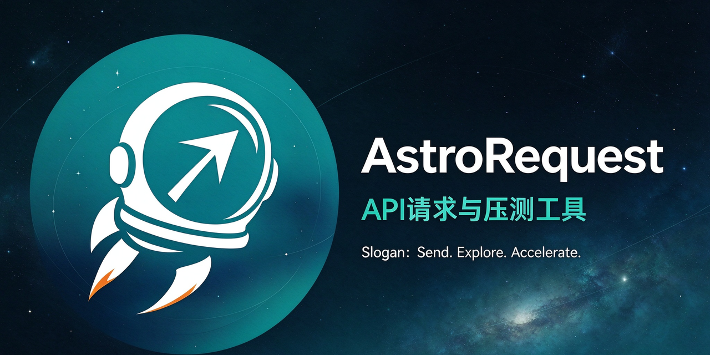
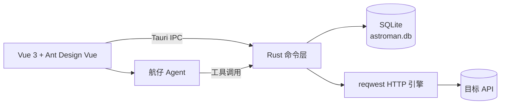

# AstroMan

<p align="center">
  
</p>

<p align="center">
  <strong>Sail across the API universe · 航行于 API 星际</strong>
</p>

<p align="center">
  
  
  
  
  
</p>

AstroMan 是一款**本地优先**的 HTTP API 研发工具箱：接口调试、环境与变量、脚本签名、批量运行、性能压测、离线工具箱与 AI Agent，收敛在同一个桌面工作台里。无需注册、无需后端服务，项目、历史、报告与密钥全部保存在本机。

以「星际宇航」为产品意象：每条请求是一次发射，每个服务是一颗星球，压测流量是推进器，而你是驾驶 AstroMan 的宇航员。

> 原项目名 **FbinHttp**，自 1.0.7 起更名为 **AstroMan**；内置 AI 助手「小HI」同步更名为「航仔」。旧数据首次启动自动迁移。

## 核心能力

- **请求调试**：GET / POST / PUT / DELETE / PATCH / HEAD / OPTIONS，Params、Headers、Cookie、Auth、Form-Data、Binary、GraphQL、JSON 注释与语法着色
- **环境与变量**：多环境切换、`{{变量}}` 替换、时间 / 随机内置变量、环境脚本生成运行时变量
- **脚本与加密**：同步 JS 沙箱，前后置脚本、断言、`vars` / `env` / `cipher` / `rsa`，覆盖 MD5 / HMAC / AES / DES / 3DES / RSA
- **批量运行**：集合级 Runner，迭代、间隔、CSV / JSON 数据驱动，脚本与断言全部生效
- **本地压测**：固定并发 / 阶梯加压、RPS 限速、自动停止、SLA 验收、实时曲线、JSON / HTML / Excel 报告与横向对比
- **导入导出**：cURL、Postman / Apifox、OpenAPI 3.0 / Swagger 2.0 导入；项目 JSON、OpenAPI 导出
- **离线工具箱**：9 大分类 75 个工具，全部本地计算
- **航仔 AI Agent**：三协议模型接入、61 个业务工具 + `tool_search`、写操作确认、上下文预算与摘要、复盘时间线
- **本地优先**：SQLite 存储、无账号、无云依赖；数据目录可自定义与迁移
- **跨平台**：Windows 10/11（x64 / x86）与 macOS 10.15+（Intel / Apple Silicon）

## 下载安装

| 平台 | 安装包 | 说明 |
|---|---|---|
| Windows 10/11（x64） | `AstroMan_*_x64-setup.exe` | 标准包（约 5MB），缺 WebView2 时安装过程联网补齐 |
| Windows 离线（x64） | `AstroMan_*_x64-offline-setup.exe` | 内置 WebView2（约 211MB），断网 / 内网 / LTSC / Server 用 |
| Windows 10（32 位） | `AstroMan_*_x86-setup.exe` / `_x86-offline-setup.exe` | 32 位系统专用 |
| Windows 便携版 | `AstroMan_*_x64-portable.zip` / `_x86-portable.zip` | 解压双击 `astroman.exe`，不写注册表 |
| macOS 10.15+ | `AstroMan_*_universal.dmg` | 通用包，Intel 与 Apple Silicon 均可 |

- 下载入口：[GitHub Releases](https://github.com/Wayward-GOU/AstroMan/releases)
- 系统下限、Gatekeeper / SmartScreen 放行、安装器报错处理：[docs/compatibility.md](docs/compatibility.md)
- macOS 一键安装：`bash install-macos.sh v1.0.7`（Release 附件自带）

## 快速开始

1. 新建项目与集合，打开「示例项目」可以直接练习
2. 在「环境」里配置 `base_url`、`token` 等变量，请求里写 `{{base_url}}`
3. 新建请求，填方法 / URL / Params / Headers / Body，点发送
4. 需要签名或密文时，在请求的「脚本」页写前置 / 后置脚本
5. 需要回归时用「批量运行」，需要容量摸底时用「压测」
6. 右侧机器人打开「航仔」，配置模型服务后可用自然语言操作软件

完整步骤：[快速开始](docs/quick-start.md) · 变量与脚本：[脚本 API](docs/script-api.md)

## 航仔 AI Agent

航仔由你自备的模型 Key 驱动，支持 OpenAI 兼容 / Anthropic / Gemini，可接 DeepSeek、Kimi、智谱、通义千问、Ollama 等。

- 聊天、答疑、出方案时不碰本机数据；明确说「帮我查 / 改 / 跑」才进入操作模式
- 建项目、改接口、发请求、写脚本、跑批量、发起压测都能代劳
- 所有写操作先给计划，确认后弹结构化卡片，取消即不执行
- Key 加密存本机，只回显掩码；对话、用量与工具流水全部本地
- 可停止生成、自动重试、查看预算条、按轮次复盘并导出脱敏诊断包

详见 [航仔：内置 AI Agent](docs/ai-agent.md)。

## 技术栈

| 层 | 技术 |
|---|---|
| 桌面壳 | Tauri 2 |
| 核心逻辑 | Rust（reqwest、rusqlite、tokio） |
| 前端 | Vue 3 + TypeScript + Vite |
| 组件库 | Ant Design Vue 4 |
| 状态管理 | Pinia |
| 本地存储 | SQLite（bundled） |



## 项目结构

```text
AstroMan/
├─ src/                 # Vue 前端（views / components / stores / api）
├─ src-tauri/           # Tauri + Rust（commands / db / prompts / icons）
├─ docs/                # 文档、社交预览图
├─ scripts/             # macOS 安装脚本
├─ package.json
└─ vite.config.ts
```

## 数据与隐私

- 所有数据保存在本机 SQLite；默认位置见 [开发与打包](docs/development.md#数据位置)
- 模型 API Key 使用 AES-256-GCM 加密后落库，列表只返回掩码
- 工具结果、日志导出、会话导出统一脱敏
- 无账号、无遥测上传；AI 请求只发送给你自己配置的模型服务

## 文档

| 文档 | 内容 |
|---|---|
| [快速开始](docs/quick-start.md) | 安装后第一个请求、环境变量、脚本、压测、AI |
| [完整功能清单](docs/features.md) | 按当前代码逐项列出的能力 |
| [系统兼容性](docs/compatibility.md) | Windows / macOS 下限、安装包差异、放行方式 |
| [脚本 API](docs/script-api.md) | 前后置脚本对象、内置变量、加密示例 |
| [压测与报告](docs/load-testing.md) | 压测配置、指标、SLA、报告导出与对比 |
| [离线工具箱](docs/toolbox.md) | 9 大类 75 个工具清单 |
| [航仔 AI Agent](docs/ai-agent.md) | 模型接入、工具、安全、预算与会话 |
| [开发与打包](docs/development.md) | 环境要求、开发启动、安装包构建、代码约定 |
| [常见问题](docs/faq.md) | 安装、构建、数据恢复、AI 与脚本 FAQ |
| [路线图](docs/roadmap.md) | 已交付能力与规划中方向 |
| [CHANGELOG](CHANGELOG.md) | 版本变更与问题修复记录 |

## 路线图

已交付 M1–M7：请求调试、环境变量、历史、压测与报告、AI Agent、导入导出、品牌升级与双安装包。

规划中：链路编排 Flow、定时巡检与告警、CLI / CI、WebSocket、分布式压测、团队同步、Linux 桌面端。完整说明见 [路线图](docs/roadmap.md)。

## 参与贡献

- 提交前请先看 [开发与打包](docs/development.md)
- 新增 IPC 命令必须注册到 `src-tauri/src/lib.rs` 的 `generate_handler!`
- UI 变更请遵循现有设计令牌与 Ant Design Vue 组件规范
- Issue / PR 请附复现步骤、系统版本与截图

## License

当前仓库尚未添加 `LICENSE` 文件，正式开源发布前将补充（倾向 MIT）。在此之前，请勿将代码用于未授权的商业分发。

---

> AstroMan — 发射每一次请求，探索服务的每一颗星球。
