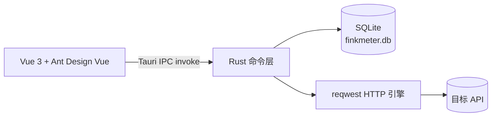

# FinkMeter

> 一个装在电脑上的 API 调试工具。打开就能发请求、看响应，数据全部留在本机。
> 无需注册、无需登录、无需后端服务。

<p>
  
  
  
  
  
</p>

---

## 下载安装

| 平台 | 安装包 | 说明 |
|---|---|---|
| Windows 10/11（x64） | `FinkMeter_*_x64-setup.exe` | 双击安装，当前用户安装无需管理员权限 |
| macOS 11+（Apple Silicon / Intel） | `FinkMeter_*_universal.dmg` | 通用包，自带 `arm64` 与 `x86_64` 两个切片，**Intel Mac 无需单独下载 Intel 版** |

macOS 首次打开若出现下面这个提示（按钮只有「完成 / 移到废纸篓」），是系统对未公证应用的 Gatekeeper 拦截，**不是芯片架构不兼容**：

> Apple 无法验证「FinkMeter.app」是否包含可能危害 Mac 安全或泄漏隐私的恶意软件。

按下方「[macOS 安装](#macos-安装)」中的方式一（一键安装脚本）或方式二（系统设置放行）处理即可。

---

## macOS 安装

最低支持 macOS 11.0。Release 中的 dmg 是通用包，同时包含 Intel（`x86_64`）与 Apple Silicon（`arm64`）切片，安装脚本会自动校验本机架构是否被支持。

安装包做的是 ad-hoc 签名、未做 Apple 公证，因此首次打开会触发 Gatekeeper 提示「Apple 无法验证 FinkMeter.app」。这是签名 / 隔离属性问题，不是芯片不兼容，按下面任一方式放行即可。

**方式一：一键安装脚本（推荐）**

仓库提供了 [scripts/install-macos.sh](scripts/install-macos.sh)，发布时由 [release.yml](.github/workflows/release.yml) 上传到 Release 附件，一条命令完成下载、架构校验、安装、清除隔离属性、ad-hoc 签名与启动：

```bash
curl -fLO https://github.com/Wayward-GOU/FinkMeter/releases/download/v1.0.3/install-macos.sh
bash install-macos.sh v1.0.3
```

不带参数执行时安装最新正式版。仓库若为私有，需要先提供 Token：

```bash
GITHUB_TOKEN=ghp_xxx bash install-macos.sh v1.0.3
```

**方式二：手动安装**

1. 打开 dmg，把 `FinkMeter.app` 拖到「应用程序」
2. 双击打开，若提示「Apple 无法验证」：打开「系统设置 → 隐私与安全性」，在「安全性」区域点击「仍要打开」，输入密码确认（macOS 15 起右键「打开」不再能绕过该提示，必须走这一步）
3. 也可以直接在终端手动放行：

```bash
sudo xattr -dr com.apple.quarantine /Applications/FinkMeter.app
sudo codesign --force --deep --sign - /Applications/FinkMeter.app
open /Applications/FinkMeter.app
```

> Gatekeeper 只认 Apple 签发的 Developer ID 证书 + 公证票据，GitHub Actions 无法替代签发，只能执行 `codesign` / `notarytool`。如需彻底消除提示，准备 Apple Developer Program 账号后在 workflow 中配置 `APPLE_CERTIFICATE`、`APPLE_ID`、`APPLE_PASSWORD`、`APPLE_TEAM_ID` 等 secrets 即可。当前仓库已配置 ad-hoc 签名（`signingIdentity: "-"`），可避免系统把应用判定为「已损坏」。

---

## 当前状态

| 检查项 | 结果 |
|---|---|
| 前端类型检查 + 构建（`vue-tsc` + `vite build`） | 通过 |
| Rust 编译检查（`cargo check`） | 通过 |
| Tauri 图标集 | 已生成（`.ico` / `.icns` / PNG） |
| 跨平台支持 | Windows 10/11（NSIS / MSI）、macOS 11+（dmg / app，Apple Silicon 与 Intel） |
| 安装包 | 按下方命令在对应系统自行生成 |

---

## 技术栈

| 层 | 技术 | 用途 |
|---|---|---|
| 桌面壳 | Tauri 2 | 窗口、IPC、安装包 |
| 核心逻辑 | Rust | HTTP 请求、SQLite、文件 |
| HTTP 客户端 | reqwest 0.12 | 连接池、自签证书开关、超时、gzip |
| 本地数据库 | SQLite（rusqlite bundled） | 项目、集合、请求、环境、历史 |
| 前端 | Vue 3 + TypeScript + Vite | 页面与交互 |
| 组件库 | Ant Design Vue 4 | 表单、树、表格、弹窗 |
| 状态管理 | Pinia | 项目与环境状态 |
| 路由 | Vue Router（Hash） | 页面切换 |

### 运行结构



---

## 目录结构

```text
FinkMeter/
├─ src/                     # 前端
│  ├─ api/                  # IPC 调用封装
│  ├─ components/           # 通用组件（Key-Value 编辑器、折线图、页头）
│  ├─ router/               # 路由
│  ├─ stores/               # Pinia 状态
│  ├─ styles/               # 全局样式与设计变量
│  ├─ types/                # 前后端数据契约
│  └─ views/                # 工作台 / 项目 / 请求编辑器 / 环境 / 压测 / 报告 / 工具箱 / 设置
├─ src-tauri/               # 桌面端
│  ├─ capabilities/         # Tauri 权限配置
│  ├─ icons/                # 应用图标
│  ├─ src/
│  │  ├── commands/          # 46 个 IPC 命令（含工作台统计、压测、报告、cURL 解析、项目导入导出、接口搜索、运行记录、存储位置、哈希）
│  │  ├─ db/                # 建表、种子数据（schema.sql）
│  │  ├─ models.rs          # 数据模型（camelCase 序列化）
│  │  ├─ state.rs           # 连接池 + HTTP Client + 压测取消信号
│  │  ├─ util.rs            # 模板变量渲染等工具
│  │  ├─ lib.rs             # 命令注册与启动
│  │  └─ main.rs            # 程序入口
│  ├─ Cargo.toml
│  └─ tauri.conf.json
├─ package.json
├─ vite.config.ts
└─ tsconfig.json
```

---

## 环境要求

Windows 与 macOS 的依赖不同，按目标系统准备。

### Windows

| 依赖 | 版本 | 说明 |
|---|---|---|
| Node.js | 22.x | 已安装 |
| npm | 10.x | 已安装 |
| Rust | stable（MSVC） | 已安装到 `D:\Software\Rust` |
| MSVC Build Tools | 2019 / 2022 | 已安装（需要「使用 C++ 的桌面开发」） |

本机 Rust 相关环境变量：

| 变量 | 值 |
|---|---|
| `RUSTUP_HOME` | `D:\Software\Rust\rustup` |
| `CARGO_HOME` | `D:\Software\Rust\cargo` |
| `PATH`（追加） | `D:\Software\Rust\cargo\bin` |

> 修改过环境变量后，需要**重开终端或重启 IDEA** 才会生效。

### macOS

| 依赖 | 版本 | 说明 |
|---|---|---|
| Node.js | 20.x / 22.x | `brew install node` 或官网安装包 |
| npm | 10.x | 随 Node.js 安装 |
| Rust | stable | 使用 rustup 安装 |
| Xcode Command Line Tools | 最新 | `xcode-select --install`，编译 rusqlite / Tauri 必需 |

```bash
# 安装 Rust，并补齐通用包所需的双架构标准库
curl --proto '=https' --tlsv1.2 -sSf https://sh.rustup.rs | sh
rustup target add aarch64-apple-darwin x86_64-apple-darwin
```

---

## 开发启动

在项目根目录执行（Windows）：

```powershell
npm.cmd run tauri dev
```

macOS：

```bash
npm run tauri dev
```

启动过程：

1. Vite 在 `http://localhost:1420` 启动前端
2. Tauri 编译 Rust 并打开桌面窗口
3. 首次编译依赖需要几分钟，之后为增量编译

停止：关闭窗口，或在终端按 `Ctrl + C`。

只启动前端（浏览器调试 UI，IPC 调用不可用）：

```powershell
npm.cmd run dev
```

---

## 打包安装包

> 安装包必须在目标系统上构建：Windows 包在 Windows 打，macOS 包在 macOS 打（Tauri 不支持交叉打包）。

### Windows

全部格式（NSIS + MSI）：

```powershell
npm.cmd run tauri build
```

只打 exe 安装包（NSIS，推荐）：

```powershell
npm.cmd run build:win
```

| 产物 | 路径 |
|---|---|
| **exe 安装包** | `src-tauri\target\release\bundle\nsis\FinkMeter_1.0.0_x64-setup.exe` |
| msi 安装包 | `src-tauri\target\release\bundle\msi\FinkMeter_1.0.0_x64_en-US.msi` |
| 免安装可执行文件 | `src-tauri\target\release\finkmeter.exe` |

安装向导内置语言与路径选择：

- 首屏可选安装语言（简体中文 / English），卸载程序同样支持
- 随后在「选择安装位置」页可修改安装目录，默认 `%LOCALAPPDATA%\FinkMeter`
- 采用当前用户安装模式，全程无需管理员权限

**分发方式**：把 `FinkMeter_1.0.0_x64-setup.exe` 发给对方，双击安装即可使用。`finkmeter.exe` 只是免安装可执行文件，没有卸载入口和开始菜单快捷方式，不建议直接分发。

安装器默认在缺少 WebView2 时联网下载安装；目标机器完全离线时，请先手动安装 Microsoft Edge WebView2 Runtime。

> 安装包未做代码签名，首次运行 Windows 会提示 SmartScreen，选择「更多信息 → 仍要运行」即可。

### 安装包体积优化

| 优化项 | 配置 | 作用 |
|---|---|---|
| Rust 发布配置 | `panic = "abort"` + `lto` + `codegen-units = 1` + `opt-level = "z"` + `strip` | 去掉符号表、开启全量 LTO、按体积优化 |
| 前端资源压缩 | `tauri = { features = ["compression"] }` | 内嵌的 JS / CSS 以 Brotli 压缩存放 |
| TLS 后端 | reqwest `native-tls` | 复用系统证书库，移除 rustls / ring 依赖 |
| 安装器压缩 | NSIS `compression = "lzma"` | 安装包使用 LZMA 最高压缩 |

实测体积：`finkmeter.exe` 约 6.07 MB，`FinkMeter_1.0.0_x64-setup.exe` 约 2.68 MB。

> 国内网络首次打包时，下载 NSIS 工具容易超时（`timeout: global`）。可先设置镜像再执行：
>
> ```powershell
> $env:TAURI_BUNDLER_TOOLS_GITHUB_MIRROR='https://gh-proxy.com/https://github.com'
> npm.cmd run build:win
> ```
>
> 工具下载后会缓存在 `%LOCALAPPDATA%\tauri`，后续打包不再联网。

### macOS

首次构建前安装双架构标准库：

```bash
rustup target add aarch64-apple-darwin x86_64-apple-darwin
```

构建通用包（Apple Silicon + Intel 一份安装包）：

```bash
npm run build:mac
```

只构建当前架构的 `app` + `dmg`：

```bash
npm run tauri build
```

| 产物 | 路径 |
|---|---|
| **dmg 安装包** | `src-tauri/target/universal-apple-darwin/release/bundle/dmg/FinkMeter_*_universal.dmg` |
| 应用程序 | `src-tauri/target/universal-apple-darwin/release/bundle/macos/FinkMeter.app` |
| 当前架构可执行文件 | `src-tauri/target/release/bundle/macos/FinkMeter.app` |

最低支持 macOS 11.0。Release 中的 dmg 是通用包，同时包含 Intel（`x86_64`）与 Apple Silicon（`arm64`）切片；安装、放行与 Gatekeeper 说明见 [macOS 安装](#macos-安装)。

---

## 数据位置

| 内容 | Windows | macOS |
|---|---|---|
| 数据库 | `%APPDATA%\FinkMeter\finkmeter.db` | `~/Library/Application Support/FinkMeter/finkmeter.db` |
| WAL 临时文件 | `finkmeter.db-wal` / `finkmeter.db-shm`（同目录） | 同目录 |
| 存储位置配置 | `%APPDATA%\com.finkmeter.app\storage.json` | `~/Library/Application Support/com.finkmeter.app/storage.json` |

首次启动会自动建库，并写入一份可直接试用的示例数据：

- 项目：`示例项目`（已存在但仍是初始示例时会自动补齐场景）
- 集合：`01 基础请求`、`02 认证与请求头`、`03 表单与内容类型`、`04 变量与脚本`、`05 状态码与延迟`、`06 压测示例`
- 请求：约 30 个场景接口，覆盖 GET/POST/PUT/PATCH/DELETE/HEAD、Bearer / API Key 认证、Form / Raw / JSON Body、内置变量、前置与后置脚本、`<500` / `401` / `400` 等状态码、延迟与重定向、压测基准接口
- 环境：`本地环境`（`base_url = https://httpbin.org`、`token`、`api_key`、`user_id`、`username`，并附带一段环境脚本示例）

> `httpbin.org` 在国内可能较慢。把 URL 换成你自己的接口，或修改环境变量 `base_url` 即可。

---

## 已实现功能

- 项目的新建、重命名、删除
- 集合树（无限嵌套、子集合、改名、删除）
- 请求编辑：方法、URL、Params、Headers、Body、前置/后置脚本字段；Postman 风格布局——面包屑导航、方法 / URL / 环境 / 发送按钮合一的请求栏、Tab 数量角标、JSON 一键格式化、响应 Pretty/Raw 切换与一键复制；左右双栏对照（左侧请求参数、右侧响应结果，Body 编辑器与响应区自适应撑满），底部运行历史固定保留
- 接口多标签页：同一项目内可像 Postman 一样同时打开最多 20 个接口，标签按项目记忆（重启后恢复），支持点击切换、中键 / 关闭按钮关闭、一键关闭全部；编辑内容自动保存（停止输入约 1 秒后写入，切换标签、关闭标签或离开页面时立即保存），无需手动点保存即可在接口间复制参数
- 代码片段（Postman 式）：请求栏「代码」按钮打开右侧抽屉，可按 cURL / HTTP 原始报文 / JavaScript fetch / Python requests 四种格式查看并一键复制；环境变量按当前环境替换，敏感变量保持占位符，请求头缺少 Content-Type 时自动补齐
- 自动更新：启动约 5 秒后静默查询 GitHub Release 最新版本，发现新版本弹窗展示发布说明与版本号，可一键下载对应平台安装包（Windows `setup.exe` / macOS `dmg`）并启动安装；设置页可手动检查、开关启动自动检查、打开发布页
- 请求历史页：侧边栏「请求历史」集中查看最近发送记录（最新 500 条），支持按接口名 / URL / 方法 / 状态码搜索，展示总数、失败数与平均耗时，点击任意记录可直接跳回原接口继续编辑
- 脚本执行：发送前运行前置脚本（可读写 `request.method / url / headers / params / body`，用 `vars.set()` 生成变量并渲染进 URL、Header、Body），收到响应后运行后置脚本（`response.status / headers / body / json()`，`test(name, fn)` + `assert()` 断言，`vars` 提取变量供后续请求复用）；响应区「测试」页展示断言通过率、失败原因、控制台输出与运行时变量
- 本地发送 HTTP 请求，展示状态码、耗时、大小、响应头、响应体
- 响应体 JSON 自动格式化，超过 5MB 自动截断
- 忽略证书校验开关、30 秒超时
- 环境变量与 `{{变量}}` 替换，优先级：运行时变量（脚本 `vars.set`）> 环境变量 > 内置变量
- 内置时间变量：`{{timestamp}}`（毫秒）、`{{timestampSec}}`、`{{isoTime}}`、`{{datetime}}`、`{{date}}`、`{{time}}`、`{{yyyyMMdd}}`、`{{yyyyMMddHHmmss}}`，同时兼容 Postman 的 `{{$timestamp}}` 写法
- 内置随机变量：`{{uuid}}`、`{{uuidNoDash}}`、`{{randomInt(1,100)}}`、`{{randomFloat(1,10,2)}}`、`{{randomString(8)}}`、`{{randomString(8, hex)}}`、`{{randomHex(16)}}`、`{{randomNumber(6)}}`、`{{randomBool}}`、`{{randomEmail}}`、`{{randomPhone}}`、`{{randomIPv4}}`
- 环境脚本：每个环境可编写一段每次请求前执行的脚本，用 `vars.set('key', value)` 生成运行时变量（如签名、traceId、nonce），请求里用 `{{key}}` 引用；脚本运行日志会并入请求编辑器的「脚本」页
- 请求历史（本地保留最近 5000 条）
- 本地压测引擎：固定并发与阶梯加压两种模式，支持并发数、压测时长、Ramp-Up 预热、思考时间、连接超时、请求超时、跟随重定向、忽略证书、目标 RPS 限速与错误率自动停止
- 压测配置入口：点击侧边栏「压测」或页面「新建压测」，弹窗内先选项目、环境，再选接口，后按 JMeter 线程组风格分组填写参数（线程组 / HTTP 请求默认值 / 流量与节奏 / 自动停止 / SLA 验收），一步完成配置并开始压测；也可从请求编辑器直接带入配置
- 流量整形：目标 RPS 令牌桶限速，可按秒精确控制发出速率
- SLA 验收阈值：P95 / P99 / 错误率 / 最小 RPS 四项可配置，报告自动逐项判定达标情况
- 压测实时指标：总请求、RPS、平均延迟、P95/P99、错误率、当前并发、当前阶段与实时状态码分布
- 压测实时曲线：吞吐量 QPS、延迟分位（每秒采样）
- 压测报告：结束自动入库，包含成功率、P50/P75/P90/P95/P99/P99.9、标准差、TTFB 平均与 P95、APDEX、总流量、最大/平均 QPS
- 报告详情：健康结论、SLA 判定、完整分位表、状态码分布、错误类型分布、延迟直方图、吞吐/并发/延迟/错误率曲线、阶梯阶段汇总、每秒明细、逐请求明细与配置快照
- 请求明细：每次请求单独记录发起时间、方法、URL、请求体（模板渲染后的实际内容）、状态码、耗时、TTFB、响应大小、成功/失败与错误信息（最多保留 50000 条），报告详情页可按全部/成功/失败筛选并分页查看
- 报告导出：支持三种格式——`*.json` 归档（完整数据，含全部请求明细）、`*.html` 可视化报告（自包含样式，含 KPI、SLA 判定、趋势图、分布表与请求明细，可直接浏览器打开或打印为 PDF）、`*.xlsx` 多工作表表格（概览 / 延迟分位 / 采样明细 / 请求明细（含请求体） / 响应时间分布 / 状态码 / 错误类型 / 错误明细 / 分阶段汇总 / 配置快照）
- 压测中可随时停止，已产生的数据仍会保存成报告
- cURL 一键导入：粘贴命令自动解析方法、URL、Header、Params 与 Body，可直接选定目标集合
- 项目内接口搜索：在项目页按接口名称或 URL 跨集合检索，结果直接打开编辑
- 单接口运行历史：每次发送自动记录请求参数（Params / Headers / Body）、响应状态、响应头、响应体与耗时，在编辑器底部展开查看，每个接口保留最近 50 条并可一键清空
- 完整删除能力：项目、集合、请求（列表与编辑器内均可删）、环境与变量、压测报告均支持删除，请求历史支持一键清空，删除前统一二次确认
- 常用请求头预设：请求编辑器内置 Postman 风格分组下拉（常用/认证/内容协商/客户端信息/条件请求），选中即追加，同名自动覆盖
- 项目 JSON 导出/导入（迁移用）：项目页顶部或工作台项目卡片菜单可一键导出为 `*.finkmeter.json`，包含项目信息、嵌套集合、全部请求（含请求头、参数、Body、脚本、断言）与环境变量；在工作台「导入项目 → 导入项目 JSON」选择文件即可复原为新项目，项目重名时自动追加「（导入）」后缀
- 工具箱（参考 tool.aiapaas.com，目录式布局，共 9 大分类 75 个工具，支持关键词全局搜索与懒加载）
  - JSON 工具（18）：JSON 格式化 / 压缩 / 校验 / 转义（树形与文本双视图、行号与字符统计、报错行列定位）、JSON → Java / C# / Go / TypeScript 实体类、SQL CREATE TABLE → Java 实体类、JSON ↔ YAML / XML / CSV / GET 查询参数、JSON → SQL（逐条 / 批量 INSERT，标识符与字符串自动转义）、JSON → Markdown 表格、JSON ↔ JSON Lines（转换出错定位行号）
  - 格式化转换（1）：HTML / XML / CSS / JavaScript / Java / C# / Go / PHP / C / SQL 代码美化与压缩（可调缩进，JS 注释与正则字面量安全）
  - 加密编码（15）：MD5 / SHA-1 / SHA-256 / SHA-512 / HMAC 哈希、AES-256-CBC 加解密、JWT 解码（过期状态与声明解析）与 JWT 签发（HS256 / HS512，自动写入 iat / exp）、Base64 / Base64URL、Base32、十六进制编解码（大小写与 0x 前缀）、字符串转义还原、URL 编解码、Unicode 转义、HTML 实体、ASCII 码转换、RC4、Gzip 压缩、CRC32 / CRC16 / Luhn 校验
  - 文本处理（13）：命名风格转换（10 种）、文本统计、行去重、批量替换、文本反转、全角半角互转、人民币金额大写、摩尔斯电码、文本对比（行级 LCS 差异高亮）、内容提取（邮箱 / URL / IPv4 / 手机号 / 数字 / UUID / 中文）、行处理（清理 / 去重 / 排序 / 反转 / 行号 / 合并）、MAC 地址格式化与随机生成、文本一键处理（清空 / 撤销 / 重做 / 复制、随机密码、去空行空格、大小写、去重取重、排序、SQL IN（按换行或逗号拆分，所有值自动加单引号，输出 `IN(...);`）、or / 逗号 / 自定义符号连接、列转行、表格转 Markdown 或 HTML、自动与指定符号转置、多表连接、格式化 JSON、MyBatis 日志提取 SQL）
  - 计算换算（10）：进制转换（2/8/10/16/32/36）、单位换算（长度/重量/面积/体积/速度/数据/时间/温度）、颜色转换（HEX/RGB/HSL/HSV/CMYK + WCAG 对比度）、时间戳互转、日期计算（相差天数 / 工作日 / 日期加减）、px 与 rem 换算、密码生成、UUID v4、随机字符串、键盘按键码
  - 开发辅助（4）：MyBatis 动态 SQL 填充（if / where / set / trim / foreach / choose / bind，支持 `#{}` 与 `${}` 渲染、占位符模式、参数清单）与 MyBatis 日志回填（解析 `Preparing` / `Parameters` / `Total`，按类型还原字面量 SQL，支持多语句切换与 Mapper 来源信息）、正则表达式测试（分组、命名分组、高亮预览）、Cron 表达式解析（字段含义 + 未来执行时间）、雪花 ID 解析（时间 / 数据中心 / 工作节点 / 序列号）
  - 网络工具（5）：IP 查询（支持本机公网 IP 与任意指定 IP 的归属地、运营商、经纬度）、IPv4 子网计算（掩码/广播/可用范围/主机数/分类）、IP 与整数互转、URL 解析（协议 / 主机 / 端口 / 路径 / 查询参数）、常用端口速查
  - 二维码（2）：二维码生成（文本/网址、WiFi、名片、电话、短信、邮件、定位七类内容，可调尺寸、留白、容错级别、前景背景色、码点与定位点样式、Logo，导出 PNG/SVG）、二维码识别（上传或拖入图片，本机解析内容并识别 WiFi、名片、邮件、链接等类型）
  - 查询手册（7）：ASCII 码表、HTTP 状态码、MIME 类型、常用请求头、Git 命令速查、Docker 命令速查、正则语法速查
- 系统监视（Windows / macOS）：CPU 每核心占用与频率、内存/交换区、磁盘容量与读写速率、网络接口上下行速率与累计流量、电池状态、运行时长与系统信息；GPU 利用率在 Windows 下通过 PDH 采集，其他平台自动隐藏
- 本机 IP 展示：Windows 走 Win32 `GetAdaptersAddresses`，macOS / Linux 走 `getifaddrs` + 系统路由表，采集全部网卡的 IPv4/IPv6 地址、MAC 与默认网关，主 IP 卡片支持一键复制，网卡列表与系统信息同步展示
- 系统监视采样：3/5/10 秒可调，切换间隔自动重置曲线，支持暂停与手动刷新，保留近 90 个采样点并以本地 SVG 曲线展示 CPU/内存/GPU、网络吞吐与磁盘 I/O 趋势
- 进程占用 Top 12：支持按 CPU 或内存排序
- 工作台：本地工作区总览（项目 / 接口 / 集合 / 环境 / 报告 / 历史请求六项统计）、当前项目快捷入口、压测与工具六宫格、产品概览带（能力简介、理念标签与累计统计）、四项能力说明卡片（接口调试 / 本地压测 / 离线工具箱 / 数据留在本机）、项目卡片、最近压测成功率与 P95、最近请求列表（可点击回到对应接口）、本机 CPU/内存/磁盘/GPU 与主 IP 状态、常用工具快捷跳转
- 四步上手引导与常见问题，覆盖环境变量、并发建议、报告导出与停止压测
- 应用信息页（版本、数据目录、数据库路径）
- 数据存储位置自定义：设置页可切换 SQLite 数据目录，支持把现有数据库迁移到新目录（WAL 先合并再复制）、恢复默认位置、打开目录，重启应用后生效；自定义目录失效时自动回退默认目录
- 桌面化图标导航栏（64px 窄侧栏）+ 仪表盘风格应用 Logo，界面元素全部走设计令牌
- 四套可切换配色主题：深海蓝（默认）、石墨灰、森林绿、暗夜（深色模式），设置页即时切换并记忆选择

## 路线图

| 阶段 | 内容 | 状态 |
|---|---|---|
| M1 | 工程骨架、请求调试、环境变量、历史 | 已完成 |
| M2 | 本地压测引擎、实时曲线、压测报告 | 已完成 |
| M3 | 用户自带 Key 的 AI 辅助（OpenAI 兼容协议） | 待开发 |
| M4 | cURL 一键导入、项目导出与导入 | 已完成 |
| M5 | Postman 集合导入、安装包验证 | 待开发 |

---

## 常见问题

**1. 提示 `cargo 不是内部或外部命令`**

新环境变量尚未生效。关闭当前终端并重启 IDEA，再执行：

```powershell
where.exe cargo
```

应输出 `D:\Software\Rust\cargo\bin\cargo.exe`。

**2. 依赖下载慢或失败**

在 `D:\Software\Rust\cargo\config.toml` 中配置镜像：

```toml
[source.crates-io]
replace-with = 'rsproxy-sparse'

[source.rsproxy-sparse]
registry = "sparse+https://rsproxy.cn/index/"

[net]
git-fetch-with-cli = true
```

**3. 打包卡在下载 NSIS / WiX**

Tauri 首次打包会下载安装器工具，需要能访问 GitHub。网络受限时建议先只打 NSIS：

```powershell
npm.cmd run tauri build -- --bundles nsis
```

**4. 端口 1420 被占用**

`vite.config.ts` 设置了 `strictPort: true`，端口被占用会直接失败。关闭占用 1420 端口的进程后重试。

**5. 想恢复初始数据**

关闭应用后删除数据库文件（连同 `-wal`、`-shm`），下次启动会重新建库并写入示例数据：

```text
Windows: %APPDATA%\FinkMeter\finkmeter.db
macOS:   ~/Library/Application Support/FinkMeter/finkmeter.db
```

**6. macOS 提示「无法打开，因为无法验证开发者」或「未打开 FinkMeter.app」**

安装包未签名、未公证，属于 Gatekeeper 的正常拦截。**不要点「移到废纸篓」**，用以下任一方式放行：

- 使用 Release 附件里的 `install-macos.sh`（自动下载、安装并移除隔离属性）：`bash install-macos.sh`
- 右键点击 `FinkMeter.app` → 打开 → 再次点击「打开」
- 打开「系统设置 → 隐私与安全性」，拉到最下方点击「仍要打开」
- 终端执行 `xattr -dr com.apple.quarantine /Applications/FinkMeter.app`

**7. macOS 构建报缺少 SDK / linker**

安装 Xcode Command Line Tools 后重试：

```bash
xcode-select --install
```

若已安装仍失败，执行 `sudo xcode-select --reset` 让工具链指向正确的 Xcode 路径。

**8. macOS 上看不到 GPU 占用**

GPU 利用率依赖 Windows 性能计数器（PDH），macOS 下该模块自动隐藏；CPU、内存、磁盘、网络、电池与本机 IP 均正常展示。

---

## 开发约定

- Rust 结构体统一使用 `#[serde(rename_all = "camelCase")]`，与前端类型对齐
- 前端类型定义集中在 `src/types/models.ts`
- 所有 IPC 调用集中在 `src/api/`
- 页面不直接访问系统能力，网络与存储全部走 Rust 命令
- 新增命令需要在 `src-tauri/src/lib.rs` 的 `generate_handler!` 中注册
