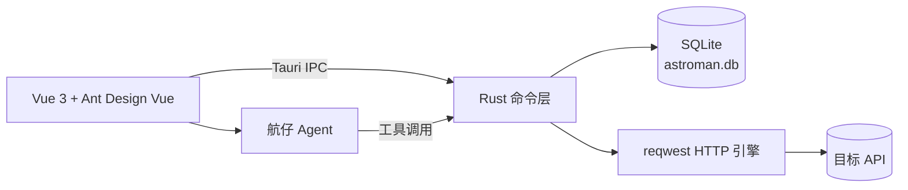

# AstroMan

<p align="center">
  
</p>


<p align="center">
  <strong>Sail across the API universe · 航行于 API 星际</strong>
</p>

<p align="center">
  
  
  
  
  
</p>

AstroMan 是一款**本地优先**的 HTTP API 研发工具箱：接口调试、环境与变量、脚本签名、批量运行、性能压测、抓包分析、记事本与待办、离线工具箱与 AI Agent，收敛在同一个桌面工作台里。无需注册、无需后端服务，项目、历史、报告、待办与密钥全部保存在本机。

以「星际宇航」为产品意象：每条请求是一次发射，每个服务是一颗星球，压测流量是推进器，而你是驾驶 AstroMan 的宇航员。

> 原项目名 **FbinHttp**，自 1.0.7 起更名为 **AstroMan**；内置 AI 助手「小HI」同步更名为「航仔」。旧数据首次启动自动迁移。

## 产品定位

市面上的工具各占一段：Postman 强在调试与协作，JMeter 强在压测，在线工具箱强在零散小工具——但三者互不相通，一个日常联调往往要在三个窗口间来回倒。AstroMan 补的就是这个交集。

### 能力对标

> 表格只写**已实现**的能力，未实现的方向统一标「规划中」，与 [路线图](docs/roadmap.md) 保持一致。

| 能力维度 | Postman | Apifox | JMeter | Charles | **AstroMan** |
| --- | --- | --- | --- | --- | --- |
| 单接口调试 | 强 | 强 | 弱 | — | 强 |
| 抓包 / 流量录制 | 中（内置代理） | 中（导入 HAR / cURL，需外部抓包） | 强（录制脚本） | 强（HTTP / HTTPS 代理） | 强（本机 MITM，断点改包 / Map Local / 弱网） |
| HTTPS 解密 / 证书 | 中（需手动信任证书） | 弱（依赖外部工具） | 中（需手动导入证书） | 强（需安装并信任根证书） | 强（一键安装根证书、接管系统代理） |
| 手机抓包 | 中（手动代理 + 证书） | 弱（依赖外部工具） | 中（手动代理 + 证书） | 强（手动代理 + 证书） | 强（同 Wi-Fi 代理，证书可导出安装） |
| 流量归档 / 重发 | 弱（无原生 HAR / ZIP 导出） | 中（HAR 导入后可调试） | 弱（需另存或转换） | 强（HAR / 会话导出、改参重发） | 强（HAR / ZIP、域名分组导出、改参重发） |
| 环境 / 变量管理 | 强 | 强 | 弱 | 弱（无环境体系） | 强 |
| 脚本扩展与签名 | 强（JS 沙箱） | 中 | 中（需 Java / Groovy） | 中（Rewrite / 断点 / 脚本） | 强（JS 沙箱 + `cipher` / `rsa` 内置加解密） |
| 用例集合 / 断言 | 强 | 强 | 中（断言强、组织弱） | — | 强 |
| 批量回归 / 数据驱动 | 强（Runner） | 强（自动化测试） | 中 | — | 强（集合 Runner + CSV / JSON 驱动） |
| 链路 / 流程编排 | 中（`setNextRequest`） | 中 | 中（控制器组合） | — | 弱（仅集合顺序批量，Flow 规划中） |
| 性能压测 | 弱（付费、云端配额） | 弱（轻量） | 强（专业） | 弱（仅重放，非压测） | 强（单机轻量：固定 / 阶梯并发、RPS 限速、SLA 判定） |
| 压测报告 | 弱 | 弱 | 中（需插件） | — | 强（JSON / HTML / Excel，支持报告横向对比） |
| 定时拨测 / 巡检 | 中（Monitor，付费云端） | 中（定时任务） | 无（需外挂 Jenkins） | — | 无（规划中） |
| 离线工具箱 | 无 | 无 | 无 | — | 强（9 分类 92 个工具，纯本地计算） |
| AI 辅助 | 中（付费，云端） | 中（以问答为主） | 无 | — | 强（自带 Key，92 个工具可直接操作软件） |
| 文档 / 团队协作 | 强 | 强（一体化） | 无 | — | 弱（仅 OpenAPI 导出，无多人协作） |
| 导入兼容 | — | 支持 Postman 迁移 | — | HAR / 会话文件 | cURL / Postman / Apifox / OpenAPI 3.0 / Swagger 2.0 |
| 数据存放 | 云端为主 | 云端为主 | 本地 | 本地 | 本地 SQLite，无账号、无遥测 |
| 部署形态 | 桌面 + SaaS | 桌面 + SaaS | 桌面 / CLI | 桌面（Windows / macOS / Linux） | 桌面（Windows / macOS） |
| 资源占用 | 高（Electron） | 高（Electron） | 偏高（JVM） | 中（Java） | 低（Tauri，标准安装包约 5MB） |
| 中文体验 | 一般 | 强 | 一般 | 一般 | 强（原生中文，含国内模型预设） |
| 开源 | 否（闭源） | 否（闭源） | 是（Apache-2.0） | 否（闭源，付费） | 是 |

> Charles 是专业抓包工具，非抓包维度仅作参考；标「—」表示该维度不适用。

**怎么读这张表：**

- **领先**：抓包归档与重发（HTTPS 解密、域名分组、HAR / ZIP、改参重发、断点改包 / Map Local / 弱网模拟；较 Charles 多 ZIP 归档，且调试 / 回归 / 压测在同一应用内）、离线工具箱、可实操的 AI Agent、本地数据、体积与资源占用、压测报告的展示与导出。
- **持平**：单接口调试、环境变量、脚本、断言、批量回归——日常主力场景不输 Postman。
- **待补齐**：链路编排 Flow、定时巡检、团队协作、WebSocket、分布式压测；抓包进阶能力（WebSocket / HTTP3）尚未提供。团队协作与云端 Mock 类场景，当前不适合选它。

### 差异化定位

- **一个应用覆盖五件事**：接口调试、批量回归、性能压测、抓包分析、离线工具，不必在 Postman + JMeter + Charles + 在线工具箱之间来回切换，也不会因为工具站要联网而卡在内网。
- **本地优先，没有账号体系**：项目、历史、报告、模型 Key 全部落在本机 SQLite。内网、隔离网、客户现场可直接用，不用申请席位，也不用担心数据被同步到别人的服务器。
- **AI 真的能干活**：航仔不止聊天，能建项目、改接口、发请求、写脚本、跑批量、发起压测，写操作一律先给计划再执行；模型用你自己的 Key，可接 DeepSeek / Kimi / 智谱 / 通义千问 / Ollama。
- **不做 JMeter 的界面复刻**：不堆线程组、配置元件这些工程化概念，保持 Postman 式低门槛交互，压测结果直接产出可交付的报告（HTML / Excel / 横向对比）。
- **兼容现有生态**：cURL 一键导入，Postman 集合、Apifox 导出、OpenAPI 3.0 / Swagger 2.0 都能进来，项目也可导出为 JSON 归档，迁移成本低。

### 能力边界

- 压测是**单机轻量引擎**，适合容量摸底与发版前验证，不追求 JMeter 级别的协议覆盖与分布式压测。
- 当前**纯本地**：无团队协作、无云端 Mock、无定时巡检（均在路线图中）。
- 传输协议只覆盖 HTTP / HTTPS，WebSocket 与 gRPC 尚未支持。
- 抓包是**本机 MITM 代理**：不做 VPN / TUN 全局劫持，证书固定（pinning）与 HTTP/3（QUIC）流量无法解密；部分 App（如微信）可能绕过 Wi-Fi 代理或不信任用户证书。

### 什么时候选它

| 你的场景 | 更合适的选择 |
| --- | --- |
| 团队协作、云端文档、Mock Server、多人共享工作区 | Apifox / Postman |
| 分布式压测、gRPC / WebSocket / MQTT 压测、依赖 JMeter 插件生态 | JMeter |
| 内网或隔离网、数据不能出本机、想在一个应用里完成调试 + 回归 + 压测 + 零散小工具 | **AstroMan** |
| 想用自然语言让 AI 代劳建接口、跑回归、发压测 | **AstroMan** |
| 只偶尔转个 JSON、算个哈希 | 在线工具箱够用；需要离线或天天用再看 AstroMan |

### 目标用户

| 用户角色                | 核心诉求                                                       |
| ----------------------- | -------------------------------------------------------------- |
| 后端开发工程师          | 日常构造请求、联调接口、脚本签名、查看响应、快速回归           |
| 测试工程师              | 用例集管理、断言、数据驱动批量回归、压测摸底与报告交付         |
| 架构师 / 技术负责人     | 容量压测摸底、SLA 判定、多份报告横向对比（链路编排在路线图中） |
| 运维 / SRE              | 本机排障、发版前接口验证、内网离线使用（定时巡检在路线图中）   |
| 开源爱好者 / 独立开发者 | 免费、无账号、无云依赖、数据本地保存                           |

### 适配架构

- **单体应用**：单机调试、本地服务联调、上线前压测摸底。
- **微服务架构**：多环境切换、按集合组织跨服务接口、单服务容量摸底（链路编排与依赖拓扑规划中）。
- **内网 / 隔离环境**：标准包、内置 WebView2 的离线包与便携版，无需联网授权即可使用。
- **DevOps 流程**：桌面端或 `astroman-cli` 执行同一套测试场景，产出 HTML / JSON / JUnit，直接接入 GitHub Actions / Jenkins 门禁。

## 核心能力

- **请求调试**：GET / POST / PUT / DELETE / PATCH / HEAD / OPTIONS，Params、Headers、Cookie、Auth、Form-Data、Binary、GraphQL、JSON 注释与语法着色
- **环境与变量**：多环境切换、`{{变量}}` 替换、时间 / 随机内置变量、环境脚本生成运行时变量
- **脚本与加密**：同步 JS 沙箱，前后置脚本、断言、`vars` / `env` / `cipher` / `rsa`，覆盖 MD5 / HMAC / AES / DES / 3DES / RSA
- **批量运行**：集合级 Runner，迭代、间隔、CSV / JSON 数据驱动，脚本与断言全部生效
- **自动化测试**：可保存的测试套件与用例（HTTP / Python / 压测），声明式断言、Python 前后置钩子、数据驱动、失败重试、运行历史与 HTML / JSON / JUnit 报告；套件包可在机器间导入导出
- **本地压测**：固定并发 / 阶梯加压、RPS 限速、自动停止、SLA 验收、实时曲线、统一口径的 QPS 指标组（平均 / 峰值 / 90% 分布 / 单并发 / 目标达成率）、JSON / HTML / Excel 报告与横向对比；套件内压测用例支持 SLA 与基线回归门禁
- **抓包分析**：本机 MITM 代理解密 HTTP / HTTPS，按域名分组查看请求与响应、关键字过滤、全部 / 单条 / 分组导出 HAR 或 ZIP（ZIP 解压后打开 `index.html` 即可阅读）、保存请求与响应体；手机同 Wi-Fi 代理，支持根证书一键安装与系统代理接管；任意流量可改方法 / URL / 头 / Body 重发，未录制时也能直接重发；支持断点改包、Map Local / Map Remote、弱网模拟
- **记事本与待办**：待办 / 笔记 / 灵感 / 资料四种类型，今天 / 本周 / 全部 / 已完成视图，按逾期与截止分组；自然语言快速记录（「明天10点 交周报 #工作 !」）、多标签、列表 / 卡片双视图；应用内提醒、提前量、重复、稍后 10 分钟、暂停与免打扰；截图生成待办、图片附件；托盘菜单与 `Ctrl+Alt+N` 全局快速记录
- **导入导出**：cURL、Postman / Apifox、OpenAPI 3.0 / Swagger 2.0、HAR 1.2 导入；项目 JSON、OpenAPI 导出
- **离线工具箱**：9 大分类 92 个工具，全部本地计算，支持收藏与最近使用
- **航仔 AI Agent**：三协议模型接入、92 个工具（79 业务 + 12 工具箱 + `tool_search`，含 7 抓包域 / 22 测试域）、写操作确认、上下文预算与摘要、复盘时间线
- **外观**：21 套配色主题（14 浅 / 7 深，含低饱和「陶土红」）、可拖到窗口任意位置的宇航员挂件、64px 窄侧栏与命令面板
- **本地优先**：SQLite 存储、无账号、无云依赖；数据目录可自定义与迁移
- **跨平台**：Windows 10/11（x64 / x86）与 macOS 10.15+（Intel / Apple Silicon）

## 下载安装

| 平台 | 安装包 | 说明 |
|---|---|---|
| Windows 10/11（x64） | `AstroMan_*_x64-setup.exe` | 标准包（约 5MB），缺 WebView2 时安装过程联网补齐 |
| Windows 离线（x64） | `AstroMan_*_x64-offline-setup.exe` | 内置 WebView2（约 211MB），断网 / 内网 / LTSC / Server 用 |
| Windows 10（32 位） | `AstroMan_*_x86-setup.exe` / `_x86-offline-setup.exe` | 32 位系统专用 |
| Windows 便携版 | `AstroMan_*_x64-portable.zip` / `_x86-portable.zip` | 解压双击 `astroman.exe`，不写注册表 |
| macOS 10.15+ | `AstroMan_*_universal.dmg` | 通用包，Intel 与 Apple Silicon 均可 |

- 下载入口：[GitHub Releases](https://github.com/Wayward-GOU/AstroMan/releases)
- 系统下限、Gatekeeper / SmartScreen 放行、安装器报错处理：[docs/compatibility.md](docs/compatibility.md)
- macOS 一键安装：`bash install-macos.sh v1.0.9`（Release 附件自带）

## 快速开始

1. 新建项目与集合，打开「示例项目」可以直接练习
2. 在「环境」里配置 `base_url`、`token` 等变量，请求里写 `{{base_url}}`
3. 新建请求，填方法 / URL / Params / Headers / Body，点发送
4. 需要签名或密文时，在请求的「脚本」页写前置 / 后置脚本
5. 需要回归时用「批量运行」，需要容量摸底时用「压测」
6. 想看 App 或网页实际发了什么，用「抓包」：开始录制 → 信任根证书 → 接管系统代理，流量按域名分组查看，可导出 HAR / ZIP、断点改包或弱网模拟
7. 要记待办或随手记，用「记事本」：输入「明天10点 交周报 #工作」回车即存，到点应用内提醒；截图也能识别成待办
8. 点击右侧的宇航员挂件「航仔」（可按住拖到任意位置，单击进入），配置模型服务后可用自然语言操作软件

完整步骤：[快速开始](docs/quick-start.md) · 抓包：[抓包](docs/capture.md) · 变量与脚本：[脚本 API](docs/script-api.md)

## 航仔 AI Agent

航仔由你自备的模型 Key 驱动，支持 OpenAI 兼容 / Anthropic / Gemini，可接 DeepSeek、Kimi、智谱、通义千问、Ollama 等。

- 聊天、答疑、出方案时不碰本机数据；明确说「帮我查 / 改 / 跑」才进入操作模式
- 建项目、改接口、发请求、写脚本、跑批量、发起压测都能代劳
- 所有写操作先给计划，确认后弹结构化卡片，取消即不执行
- Key 加密存本机，只回显掩码；对话、用量与工具流水全部本地
- 可停止生成、自动重试、查看预算条、按轮次复盘并导出脱敏诊断包

详见 [航仔：内置 AI Agent](docs/ai-agent.md)。

## 技术栈

| 层 | 技术 |
|---|---|
| 桌面壳 | Tauri 2 |
| 核心逻辑 | Rust（reqwest、rusqlite、tokio） |
| 前端 | Vue 3 + TypeScript + Vite |
| 组件库 | Ant Design Vue 4 |
| 状态管理 | Pinia |
| 本地存储 | SQLite（bundled） |



## 项目结构

```text
AstroMan/
├─ src/                 # Vue 前端（views / components / stores / api）
├─ src-tauri/           # Tauri + Rust（commands / db / prompts / icons）
├─ docs/                # 文档、社交预览图
├─ scripts/             # macOS 安装脚本
├─ package.json
└─ vite.config.ts
```

## 数据与隐私

- 所有数据保存在本机 SQLite；默认位置见 [开发与打包](docs/development.md#数据位置)
- 模型 API Key 使用 AES-256-GCM 加密后落库，列表只返回掩码
- 工具结果、日志导出、会话导出统一脱敏
- 无账号、无遥测上传；AI 请求只发送给你自己配置的模型服务

## 文档

| 文档 | 内容 |
|---|---|
| [快速开始](docs/quick-start.md) | 安装后第一个请求、环境变量、脚本、压测、AI |
| [完整功能清单](docs/features.md) | 按当前代码逐项列出的能力 |
| [系统兼容性](docs/compatibility.md) | Windows / macOS 下限、安装包差异、兼容矩阵、长稳回归 |
| [企业部署与交付](docs/enterprise.md) | 数据目录、policy.json、更新渠道与灰度、代码签名、离线安装、诊断包 |
| [脚本 API](docs/script-api.md) | 前后置脚本对象、内置变量、加密示例 |
| [压测与报告](docs/load-testing.md) | 压测配置、指标、SLA、报告导出与对比 |
| [抓包](docs/capture.md) | 本机 / 手机 HTTPS 抓包、根证书、断点改包、Map Local / Remote、弱网、HAR / ZIP 导出与改参重发 |
| [记事本与待办](docs/notes-design.md) | 技术设计与交互约定：类型、视图、快速记录、提醒规则、截图识别与附件 |
| [自动化测试](docs/automated-testing.md) | 测试场景、Python 钩子、压测门禁、套件包与 CLI / CI |
| [离线工具箱](docs/toolbox.md) | 9 大类 92 个工具清单 |
| [航仔 AI Agent](docs/ai-agent.md) | 模型接入、工具、安全、预算与会话 |
| [开发与打包](docs/development.md) | 环境要求、开发启动、安装包构建、代码约定 |
| [常见问题](docs/faq.md) | 安装、构建、数据恢复、AI 与脚本 FAQ |
| [路线图](docs/roadmap.md) | 已交付能力与规划中方向 |
| [CHANGELOG](CHANGELOG.md) | 版本变更与问题修复记录 |

## 路线图

已交付 M1–M10：请求调试、环境变量、历史、压测与报告、AI Agent、导入导出、品牌升级与双安装包、自动化测试与 CLI / CI、抓包分析（含断点 / 映射 / 弱网）、记事本与待办。

规划中：链路编排 Flow、定时巡检与告警、混合多接口压测、WebSocket、分布式压测、团队同步、Linux 桌面端。完整说明见 [路线图](docs/roadmap.md)。

## 参与贡献

- 提交前请先看 [开发与打包](docs/development.md)
- 提交前本地过一遍与 CI 同源的门禁：`npm run test`、`npm run build`、`cargo fmt --check --all`、`cargo clippy --all-targets -- -D warnings`、`cargo test --lib`；覆盖率门槛见 [测试与质量门禁](docs/development.md#测试与质量门禁)
- 新增 IPC 命令必须注册到 `src-tauri/src/lib.rs` 的 `generate_handler!`
- UI 变更请遵循现有设计令牌与 Ant Design Vue 组件规范（颜色只用 `--fm-*`，主题在 `src/stores/theme.ts`）
- Issue / PR 请附复现步骤、系统版本与截图

## License

[MIT](LICENSE) © AstroMan

---

> AstroMan — 发射每一次请求，探索服务的每一颗星球。
