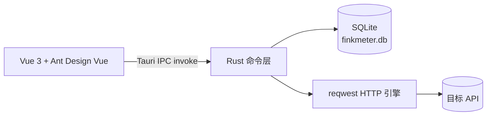

# FinkMeter

> 一个装在电脑上的 API 调试工具。打开就能发请求、看响应，数据全部留在本机。
> 无需注册、无需登录、无需后端服务。

<p>
  
  
  
  
  
</p>

---

## 当前状态

| 检查项 | 结果 |
|---|---|
| 前端类型检查 + 构建（`vue-tsc` + `vite build`） | 通过 |
| Rust 编译检查（`cargo check`） | 通过 |
| Tauri 图标集 | 已生成 |
| 安装包 | 按下方命令自行生成 |

---

## 技术栈

| 层 | 技术 | 用途 |
|---|---|---|
| 桌面壳 | Tauri 2 | 窗口、IPC、安装包 |
| 核心逻辑 | Rust | HTTP 请求、SQLite、文件 |
| HTTP 客户端 | reqwest 0.12 | 连接池、自签证书开关、超时、gzip |
| 本地数据库 | SQLite（rusqlite bundled） | 项目、集合、请求、环境、历史 |
| 前端 | Vue 3 + TypeScript + Vite | 页面与交互 |
| 组件库 | Ant Design Vue 4 | 表单、树、表格、弹窗 |
| 状态管理 | Pinia | 项目与环境状态 |
| 路由 | Vue Router（Hash） | 页面切换 |

### 运行结构



---

## 目录结构

```text
FinkMeter/
├─ src/                     # 前端
│  ├─ api/                  # IPC 调用封装
│  ├─ components/           # 通用组件（Key-Value 编辑器、折线图、页头）
│  ├─ router/               # 路由
│  ├─ stores/               # Pinia 状态
│  ├─ styles/               # 全局样式与设计变量
│  ├─ types/                # 前后端数据契约
│  └─ views/                # 工作台 / 项目 / 请求编辑器 / 环境 / 压测 / 报告 / 工具箱 / 设置
├─ src-tauri/               # 桌面端
│  ├─ capabilities/         # Tauri 权限配置
│  ├─ icons/                # 应用图标
│  ├─ src/
│  │  ├── commands/          # 33 个 IPC 命令（含压测、报告、cURL 解析、项目导入导出、接口搜索、运行记录、哈希）
│  │  ├─ db/                # 建表、种子数据（schema.sql）
│  │  ├─ models.rs          # 数据模型（camelCase 序列化）
│  │  ├─ state.rs           # 连接池 + HTTP Client + 压测取消信号
│  │  ├─ util.rs            # 模板变量渲染等工具
│  │  ├─ lib.rs             # 命令注册与启动
│  │  └─ main.rs            # 程序入口
│  ├─ Cargo.toml
│  └─ tauri.conf.json
├─ package.json
├─ vite.config.ts
└─ tsconfig.json
```

---

## 环境要求

| 依赖 | 版本 | 说明 |
|---|---|---|
| Node.js | 22.x | 已安装 |
| npm | 10.x | 已安装 |
| Rust | stable（MSVC） | 已安装到 `D:\Software\Rust` |
| MSVC Build Tools | 2019 / 2022 | 已安装（需要「使用 C++ 的桌面开发」） |

本机 Rust 相关环境变量：

| 变量 | 值 |
|---|---|
| `RUSTUP_HOME` | `D:\Software\Rust\rustup` |
| `CARGO_HOME` | `D:\Software\Rust\cargo` |
| `PATH`（追加） | `D:\Software\Rust\cargo\bin` |

> 修改过环境变量后，需要**重开终端或重启 IDEA** 才会生效。

---

## 开发启动

在项目根目录执行：

```powershell
npm.cmd run tauri dev
```

启动过程：

1. Vite 在 `http://localhost:1420` 启动前端
2. Tauri 编译 Rust 并打开桌面窗口
3. 首次编译依赖需要几分钟，之后为增量编译

停止：关闭窗口，或在终端按 `Ctrl + C`。

只启动前端（浏览器调试 UI，IPC 调用不可用）：

```powershell
npm.cmd run dev
```

---

## 打包安装包

### 全部格式

```powershell
npm.cmd run tauri build
```

### 只打 exe 安装包（NSIS，推荐）

```powershell
npm.cmd run tauri build -- --bundles nsis
```

### 产物位置

| 产物 | 路径 |
|---|---|
| **exe 安装包** | `src-tauri\target\release\bundle\nsis\FinkMeter_1.0.0_x64-setup.exe` |
| msi 安装包 | `src-tauri\target\release\bundle\msi\FinkMeter_1.0.0_x64_en-US.msi` |
| 免安装可执行文件 | `src-tauri\target\release\finkmeter.exe` |

> 安装包未做代码签名，首次运行 Windows 会提示 SmartScreen，选择「更多信息 → 仍要运行」即可。

---

## 数据位置

| 内容 | Windows |
|---|---|
| 数据库 | `%APPDATA%\FinkMeter\finkmeter.db` |
| WAL 临时文件 | `finkmeter.db-wal` / `finkmeter.db-shm`（同目录） |

首次启动会自动建库，并写入一份可直接试用的示例数据：

- 项目：`示例项目`
- 集合：`默认集合`
- 请求：`示例请求`（`GET {{base_url}}/get`）
- 环境：`本地环境`（`base_url = https://httpbin.org`）

> `httpbin.org` 在国内可能较慢。把 URL 换成你自己的接口，或修改环境变量 `base_url` 即可。

---

## 已实现功能

- 项目的新建、重命名、删除
- 集合树（无限嵌套、子集合、改名、删除）
- 请求编辑：方法、URL、Params、Headers、Body、前置/后置脚本字段
- 本地发送 HTTP 请求，展示状态码、耗时、大小、响应头、响应体
- 响应体 JSON 自动格式化，超过 5MB 自动截断
- 忽略证书校验开关、30 秒超时
- 环境变量与 `{{变量}}` 替换
- 内置变量函数：`{{timestamp}}`、`{{uuid}}`、`{{randomInt(a,b)}}`、`{{randomString(n)}}`
- 请求历史（本地保留最近 5000 条）
- 本地压测引擎：固定并发与阶梯加压两种模式，支持并发数、压测时长、预热、思考时间、超时、忽略证书
- 流量整形：目标 RPS 令牌桶限速，可按秒精确控制发出速率
- SLA 验收阈值：P95 / P99 / 错误率 / 最小 RPS 四项可配置，报告自动逐项判定达标情况
- 压测实时指标：总请求、RPS、平均延迟、P95/P99、错误率、当前并发、当前阶段与实时状态码分布
- 压测实时曲线：吞吐量 QPS、延迟分位（每秒采样）
- 压测报告：结束自动入库，包含成功率、P50/P75/P90/P95/P99/P99.9、标准差、TTFB 平均与 P95、APDEX、总流量、最大/平均 QPS
- 报告详情：健康结论、SLA 判定、完整分位表、状态码分布、错误类型分布、延迟直方图、吞吐/并发/延迟/错误率曲线、阶梯阶段汇总、每秒明细与配置快照
- 报告导出：一键导出为 `*.json` 归档文件，包含全部指标、采样、错误与配置
- 压测中可随时停止，已产生的数据仍会保存成报告
- cURL 一键导入：粘贴命令自动解析方法、URL、Header、Params 与 Body，可直接选定目标集合
- 项目内接口搜索：在项目页按接口名称或 URL 跨集合检索，结果直接打开编辑
- 单接口运行历史：每次发送自动记录请求参数（Params / Headers / Body）、响应状态、响应头、响应体与耗时，在编辑器底部展开查看，每个接口保留最近 50 条并可一键清空
- 完整删除能力：项目、集合、请求（列表与编辑器内均可删）、环境与变量、压测报告均支持删除，请求历史支持一键清空，删除前统一二次确认
- 常用请求头预设：请求编辑器内置 Postman 风格分组下拉（常用/认证/内容协商/客户端信息/条件请求），选中即追加，同名自动覆盖
- 项目一键导出/导入：导出为 `*.finkmeter.json`，包含嵌套集合、全部请求与环境变量，导入后自动生成新项目
- 工具箱：JSON 格式化 / 压缩 / 校验 / 转义（带行号、行数与字符统计、报错行列定位），Base64 / URL / Unicode 编解码，MD5 / SHA / HMAC 与 AES 加解密，时间戳互转，UUID 与随机数据生成
- 开发工具：MyBatis 动态 SQL 填充（if / where / set / trim / foreach / choose / bind，支持 `#{}` 与 `${}` 渲染、占位符模式、参数清单）、JWT 解码、正则表达式测试、命名风格转换
- 工作台「快速开始」四步引导与常见问题，环境页变量使用说明
- 应用信息页（版本、数据目录、数据库路径）
- 桌面化图标导航栏（64px 窄侧栏）+ 仪表盘风格应用 Logo，界面元素全部走设计令牌
- 四套可切换配色主题：深海蓝（默认）、石墨灰、森林绿、暗夜（深色模式），设置页即时切换并记忆选择

## 路线图

| 阶段 | 内容 | 状态 |
|---|---|---|
| M1 | 工程骨架、请求调试、环境变量、历史 | 已完成 |
| M2 | 本地压测引擎、实时曲线、压测报告 | 已完成 |
| M3 | 用户自带 Key 的 AI 辅助（OpenAI 兼容协议） | 待开发 |
| M4 | cURL 一键导入、项目导出与导入 | 已完成 |
| M5 | Postman 集合导入、安装包验证 | 待开发 |

---

## 常见问题

**1. 提示 `cargo 不是内部或外部命令`**

新环境变量尚未生效。关闭当前终端并重启 IDEA，再执行：

```powershell
where.exe cargo
```

应输出 `D:\Software\Rust\cargo\bin\cargo.exe`。

**2. 依赖下载慢或失败**

在 `D:\Software\Rust\cargo\config.toml` 中配置镜像：

```toml
[source.crates-io]
replace-with = 'rsproxy-sparse'

[source.rsproxy-sparse]
registry = "sparse+https://rsproxy.cn/index/"

[net]
git-fetch-with-cli = true
```

**3. 打包卡在下载 NSIS / WiX**

Tauri 首次打包会下载安装器工具，需要能访问 GitHub。网络受限时建议先只打 NSIS：

```powershell
npm.cmd run tauri build -- --bundles nsis
```

**4. 端口 1420 被占用**

`vite.config.ts` 设置了 `strictPort: true`，端口被占用会直接失败。关闭占用 1420 端口的进程后重试。

**5. 想恢复初始数据**

关闭应用后删除 `%APPDATA%\FinkMeter\finkmeter.db`（连同 `-wal`、`-shm` 文件），下次启动会重新建库并写入示例数据。

---

## 开发约定

- Rust 结构体统一使用 `#[serde(rename_all = "camelCase")]`，与前端类型对齐
- 前端类型定义集中在 `src/types/models.ts`
- 所有 IPC 调用集中在 `src/api/`
- 页面不直接访问系统能力，网络与存储全部走 Rust 命令
- 新增命令需要在 `src-tauri/src/lib.rs` 的 `generate_handler!` 中注册
