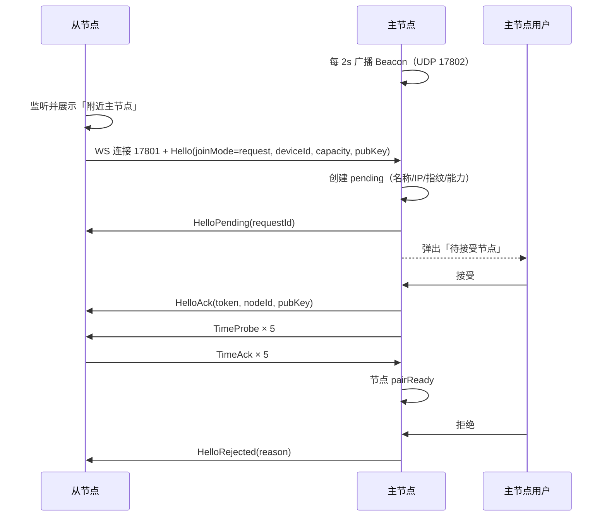

# AstroMan v1.1.2 技术方案

> 主题：分布式压测「跑满、看得见、可解释、可被 AI 使用」+ 参数/Token 池与拟人化执行
>
> 基线：v1.1.1（分支 `develop-master-v1.1.2`，DB v16，集群协议 v1）
>
> 当前进度：v1.1.2 实现已收口（DB v20，集群协议 v2）；第 16 节为已落地修复，第 18 节为 2026-11-20 的实施状态审计，12.5 无池 5,000 QPS 回归基线已落地并跑通门禁，8.10.5 集群 Token 刷新已改为主节点统一单飞（协议增量消息，版本仍为 v2）。追加的 v20 为数据池自定义列（`columns_json` / `data_json`）与 Excel 模板导入，方案见 [features.md](features.md)，本文其余章节保留原始设计。

---

## 0. 摘要

v1.1.2 不建议再单独加一个「分布式压测 2.0」模块，而是围绕现有主从引擎做六件事：

| 工作流 | 解决的问题 | 优先级 |
|---|---|---|
| W1 并发预算与节点利用 | 500 上限、跨任务上限、主机/从机跑不满、采集不可见 | P0 |
| W2 环境变量下发与变量体系 | 从机误报系统变量缺失、主节点独有变量读不到、secret 跨机不可用 | P0 |
| W3 局域网自动发现与审批配对 | 手输 IP + 6 位码、多从机串行、无设备列表 | P1 |
| W4 报告集群化与峰值指标 | 集群信息埋在页面底部、峰值不突出、没有节点级曲线 | P1 |
| W5 AI 可读集群/压测/池 | 航仔没有 `cluster_*` 工具、读不到实时任务和池 | P1 |
| W6 参数池 / Token 池 / 拟人化 | 不能批量导入 token、不能按 VU 固定身份、不能逐请求变化 | P2 |

交付顺序建议：**P0 先修根因 → P1 做可见性与发现 → P2 做池**。W6 工作量最大，允许在 v1.1.2 内先交付 MVP（Token/参数池 + 每 VU 粘性 + 思考时间分布 + 401 刷新），完整多步场景编排放 v1.1.3。

### 0.1 问题登记表（按你反馈逐条对应）

| 编号 | 你的反馈 | 定位结论 | 处理方案 | 验收口径 | 详见 |
|---|---|---|---|---|---|
| Q1 | 接近 500 并发上不去，取消 500 限制，发挥机器本来的功效 | 不是单点：AI 阶梯写死 500、跨任务默认 1000/硬上限 2000、单任务 5000、前端各自硬编码 | 改为按 CPU/内存/fd/能力检测自动预算；删除所有 500/2000 硬编码；手动可调高，只给资源告警 | 两机各 3000 并发可跑；AI 生成的 3000 并发计划不被截断 | 3.1 / 3.2 / 3.8 |
| Q2 | 子机不能采集 | 只有每秒增量，没有累计计数兜底；没有首样时间、丢样、gap、引擎状态；节点曲线不落报告 | 心跳携带累计 `EngineStats`；主节点维护采集健康度；首样超时/中断可见；节点序列抽稀落库 | 首样 5s/10s 分级告警；杀从机 7s 内 lost；报告能看到 gap 与最后采样时间 | 3.4 / 3.5 |
| Q3 | 主机不能发挥 | 默认每节点权重 1，主节点只拿 1/N；每节点又被本机预算卡住 | 能力感知分配（默认按 capacity）、每节点 min/max、节点预算列、auto/even 两种模式 | 8 核 vs 4 核 auto 约 2:1；even 1:1；分配不超过各节点预算 | 3.3 |
| Q4 | 压测报告没有突出集群展示 | 集群卡片在配置区之后，首屏看不到；没有贡献占比和节点状态 | 报告首屏加集群总览：节点数、合并 QPS、峰值、贡献条、完整性告警 | 打开集群报告首屏即可看到节点数与合并/峰值 QPS | 6.1 |
| Q5 | 峰值指标需要单独展示 | 峰值只是普通指标卡之一，没有出现时刻、持续时间和节点贡献 | 新增「峰值指标」专题：峰值 QPS/并发/带宽/P95/P99/错误率 + 出现时刻 + 平台期 + 每节点峰值 | 能回答“峰值多少、几点出现、持续多久、哪台机器贡献最大” | 6.2 |
| Q6 | AI 还不能读取集群的服务和压测的服务 | `aiTools.ts` 没有任何 `cluster_*`，`report_get` 不含集群/峰值，没有实时压测任务工具 | 新增只读 `cluster_*`、`stress_jobs`、`pool_*`；扩展 `report_get`；上下文注入集群摘要；写操作必须确认 | 问“集群什么状态/最近峰值/从机为什么没数据”能得到正确结果 | 7 |
| Q7 | 配置压测需要同一局域网自动发现，从机点开加入配对，各机接受 | 只能手输 IP + 6 位码；码单次使用；无设备列表/审批/拒绝 | UDP 17802 广播附近主节点；从机点击加入；主节点待接受列表，接受/拒绝；手动码兜底 | 3s 内发现；1s 内出现待接受；接受后 2s 内 pairReady | 5 |
| Q8 | 下发压测计划时环境变量配置有问题，很多系统变量读取不了 | `required_vars` 未过滤内置占位符，从机逐名比对，把 `{{$timestamp}}` 等误判缺失；主节点独有变量/secret 不可用；不支持 OS 变量 | 占位符分类；主节点 EnvBundle 加密下发；OS 变量白名单；变量体检；`secret:` 归一化 | 内置变量不再误报；主节点独有变量从机可跑；日志/报告无明文 secret | 4 |
| Q9 | 构建计划时提前导入执行参数和 Token 池，模拟人操作 | 引擎 prepare 阶段一次性渲染，运行期不再碰模板，无法按 VU/按请求变化 | 池表 + CSV/JSON 导入；per-VU 粘性；思考时间分布；401 HTTP 刷新；模板预编译保留无池快路径；执行前预览；集群切片/分片下发 | 100 token/50 VU 固定分配；逐请求 timestamp/uuid 不同；401 可刷新重试；执行前可预览池数据（默认脱敏）；集群切片不跨机重复 | 8 |
| Q10 | 17801 一个机子只能开 3 个；任务结束/关闭后应放开；不应限制 | `MAX_MASTER_SESSIONS=3` 把已完成未关闭的任务也算进去；`MAX_STRESS_JOBS=3` 再卡一层；终态不释放 listener，只有 close 才释放；端口固定 17801 | 删除固定计数；终态 `release_transport()` 自动停 accept/beacon 并释放端口；端口自动 17801→17811..→临时；已完成快照 20 个/30 分钟且不占名额 | 连续 4 个任务不关闭都能建；结束不关闭同端口可立即重建；3 个并发自动端口不冲突 | 3.6 |
| Q11 | 航仔里切换输入法、用回车确认英文字母时，没输完就整段发送执行 | 发送只判断 `event.isComposing`；部分浏览器/输入法确认候选词时该值已为 false；`Ctrl+Enter` 绑定绕过了保护 | composition 状态 + `compositionend` 80ms 时间窗 + `keyCode 229` + `key === 'Process'` 四重守卫；`Enter`/`Ctrl+Enter` 共用 | 中英文输入法确认候选词不发送；正常 Enter 仍发送；Shift+Enter 仍换行 | 16 |

### 0.2 处理优先级

| 阶段 | 内容 | 原因 |
|---|---|---|
| P0 | Q1 并发预算、Q2 采集健康度、Q3 能力分配、Q8 内置变量误报、Q10 会话/端口生命周期 | 直接决定“能不能跑满、能不能看见、能不能稳定建任务” |
| P1 | Q4 报告集群首屏、Q5 峰值专题、Q7 局域网发现、Q6 只读 AI 工具 | 决定“结果能不能解释、能不能被 AI 使用、配网是否顺畅” |
| P2 | Q6 写操作确认、Q9 参数/Token 池 MVP | 工作量最大，先保证主链路，再补拟人化执行 |

### 0.3 文档导航

| 章节 | 内容 |
|---|---|
| 1 | 每个问题的代码级根因与证据 |
| 2 | 总体设计原则、分层改动、版本兼容 |
| 3 | Q1/Q2/Q3/Q10：预算、分配、采集健康、会话与端口 |
| 4 | Q8：变量体系、EnvBundle、OS 变量、变量体检 |
| 5 | Q7：局域网发现、审批配对、安全边界 |
| 6 | Q4/Q5：报告集群化、峰值指标、节点序列、导出 |
| 7 | Q6：AI 工具、上下文注入、权限与提示词 |
| 8 | Q9：池模型、导入、执行前预览、集群切片下发、接口/算法/错误码 |
| 9-13 | 数据库、协议、命令、测试、风险 |
| 14-15 | 交付拆分、待确认项 |
| 16-17 | 已实现修复、端到端流程 |

### 0.4 本次补充点

相对初稿，本轮把「参数/Token 池」从概念补到了可实施粒度：

1. **8.2** 增加 `sensitive` 字段与池项目索引，明确哪些池默认脱敏。
2. **8.9** 新增「执行前预览」：绑定汇总、数据样例、VU 分配预览、身份预览、校验区。
3. **8.10** 明确集群下发：主节点切片、全局 VU 编号、`per_vu` 模切片、`round_robin/random/weighted` 条目分片、主节点统一刷新。
4. **8.11** 补齐命令签名、返回结构、脱敏规则、预检 JSON 示例。
5. **8.12** 补齐切片、分片、刷新单飞、覆盖校验的伪代码。
6. **8.13** 统一池相关错误码与文案。
7. **12/13/14/15** 同步补充测试、风险、交付顺序与默认值。
8. **16** 输入法回车误发送修复已落地（航仔、记录页、工作台、快速记录）。
9. **17** 新增端到端流程：单机任务、集群任务、关键边界一张图说清。

---

## 1. 问题与根因

### 1.1 500 并发上限到底在哪

代码里不是只有一个 500，而是三层限制叠加：

| 位置 | 现状 | 影响 |
|---|---|---|
| `src/utils/aiTools.ts:1440-1450` | AI 生成阶梯计划时每阶段 `Math.min(500, ...)` | 航仔建 1000/3000 并发计划会被静默压到 500 |
| `src-tauri/src/state.rs:621`、`:678-682` | 跨任务并发总和默认 1000，硬上限 2000；`stress_limits()` 再 clamp 到 2000 | 单机所有任务之和被限制；若用户把设置填成 500，则所有节点最高 500 |
| `src-tauri/src/commands/stress.rs:23-24` | 单任务 `MAX_CONCURRENT = 5000` | 引擎本身的单任务上限 |
| `src/views/Cluster.vue:43`、`src/views/StressTest.vue:376` | 前端各自硬编码 5000 | 与后端漂移，改一处不生效 |
| `src/views/Settings.vue:1528-1541` | UI `max=2000`，文案写死「硬上限 2000」 | 用户无法按机器能力调高 |

结论：**不能只把 500 改成 5000**。需要把「固定上限」改成「按机器能力计算的预算 + 可见告警」，否则放开后会在连接数、文件句柄、内存或目标端先崩，且用户不知道为什么。

### 1.2 子机采集不到 / 主机发挥不足

已确认的结构性原因：

1. **权重默认平均**：`resolve_weights`（`server.rs:1851-1875`）对未指定节点一律权重 1，`Cluster.vue:244-252` 默认也按 1 展示。结果总并发 500、3 台机器时主节点只拿约 167，强机被弱机拖平。
2. **每节点独立预算**：从节点 `prepare_local` 用本机 `stress_limits()` 做 `try_reserve`（`client.rs:810-822`），主节点本地同样（`server.rs:1228-1232`）。如果某台机器设置里是 500/1000，主节点分配超过它就直接失败；错误只会出现在 PrepareAck，前端没有「节点预算」这一列。
3. **采集没有健康度**：`on_sample` 只接受 `running/done`（`server.rs:873-892`），丢样、首样超时、worker 未启动、引擎提前退出都没有字段可看。
4. **采样只存增量**：每秒包只有本秒 QPS/计数（`protocol.rs:189-206`），没有累计计数兜底；一旦某一秒丢失或聚合异常，无法还原。
5. **节点曲线不落报告**：`node.samples` 只在内存里，`merge.rs` 只输出合并序列；报告无法回答「哪台机器在几点掉速」。
6. **内存无上限**：24h × 16 节点 × 1/s 的 `node.samples` 会非常可观，长稳压测存在内存压力。

「子机不能采集」不一定是单点 bug，当前代码缺少把「没采到」和「采到了但没显示」区分开的观测。v1.1.2 先补采集健康度和累计兜底，再按诊断结果修具体链路。

### 1.3 报告没有突出集群、峰值不突出

- 集群卡片位于配置区之后（`src/views/ReportDetail.vue:1495-1586`），首屏看不到。
- 峰值 QPS 只是普通指标卡之一（`:958-961`），没有出现时刻、持续时间、每节点贡献。
- 节点表只有平均 QPS、CPU、内存，没有「峰值 QPS / 峰值并发 / 贡献占比 / 采集健康」。
- 没有节点级时间序列，无法定位拖后腿的机器。

### 1.4 AI 读不到集群和压测服务

- `src/utils/aiTools.ts` 的工具清单里没有任何 `cluster_*`；`report_get` 不返回 `config.cluster` 和峰值。
- 没有实时压测任务查询工具（只有 `stress_start` / `stress_stop`）。
- `src-tauri/src/prompts/hangzai_system_prompt.md` 没有集群概念、节点预算、采集健康度这些术语。

### 1.5 配对只能手输

- 当前流程：主节点出 6 位码 → 从节点手输 `IP:端口` + 码 → 反向 WebSocket。
- 码单次使用（`server.rs` 配对成功后轮换），多从机必须串行加入；没有「附近设备」、没有待审批列表、没有拒绝理由。

### 1.6 环境变量为什么读不到

这是本次最明确的一个 bug 链：

1. 主节点 `collect_required_vars`（`server.rs:1796-1849`）用 `find_placeholders` 收集**所有** `{{...}}`，没有过滤内置变量。
2. 从节点 `prepare_local`（`client.rs:749-782`）拿 `payload.required_vars` 逐名和本机环境变量比对，缺一个就拒绝。
3. 于是 `{{$timestamp}}`、`{{uuid}}`、`{{randomInt(1,100)}}`、`{{faker:name}}` 这些**本来由各节点本地生成**的系统变量，被当成「用户变量缺失」，从机直接报错。
4. `util.rs:374-395` 其实已经有 `is_builtin_placeholder`，但只被 `check_unresolved` 使用，下发路径没用。
5. 此外：从机按环境名查本机库（`client.rs:733-748`），主节点独有变量不存在；secret 用本机密钥加密，跨机无法解密；`config.vars` 在下发前被清空（`server.rs:1789-1793`）；不支持 OS 环境变量。
6. `secret:TOKEN` 被 `is_builtin_placeholder` 直接判为内置，导致 `TOKEN` 本身既不进入 required，也不会被正确校验。

### 1.7 参数/Token 池缺失的架构原因

引擎在 `prepare_stress` 阶段一次性完成 URL、Headers、Auth 渲染（`stress.rs:1392`、`build_url`），运行期不再碰模板。这意味着：

- `{{$timestamp}}` / `{{$uuid}}` 在整个压测生命周期只生成一次；
- 无法按 VU 固定一个 token；
- 无法每请求换参数；
- 无法在 401 时换 token 重试。

要支持池，必须把「一次渲染」改成「预编译模板 + 运行期按 VU/按请求取变量」，同时保留无池场景的零开销快路径。

### 1.8 任务结束不释放端口 + 固定 3 个会话

- `MAX_MASTER_SESSIONS = 3`（`server.rs:54`、`:288`）按 `sessions.len()` 计数，**已结束但未点「关闭」的任务仍占名额**。
- `MAX_STRESS_JOBS = 3`（`state.rs:620`）再卡一层活跃本地引擎数量。
- `accept_loop` 只在 `shutdown=true` 时退出（`server.rs:1563-1589`），而 `shutdown` 只有 `close()` 会设置（`:455`）；`finished / failed / abort` 都不会释放 `0.0.0.0:17801` 的监听。
- 端口固定 `17801`，第二个并发任务必须手动改端口，否则 bind 失败。

结论：**结束即释放、关闭即彻底移除，不应再用固定 3 个限制。** 详细设计见 3.6。

---

## 2. 总体设计

### 2.1 设计原则

1. **上限改为预算**：默认按本机 CPU / 内存 / 文件句柄 / 最近一次能力检测自动计算；超预算时明确报错，不静默截断。
2. **所有截断可见**：每个任务、每个节点都能解释「为什么只跑到 X」。
3. **一次采集、多处复用**：报告、AI、导出共用同一份集群/峰值结构。
4. **变量只在下发时解密，不落盘**：从机内存中使用，结束后清零。
5. **无池路径不退化**：没有参数池、没有动态占位符时，仍走现有预渲染快路径。
6. **协议先升版本再改字段**：主从版本不一致直接给出升级提示。

### 2.2 改动分层

```
前端
  ├─ Cluster.vue            发现列表 / 审批 / 预算与权重 / 采集健康
  ├─ ReportDetail.vue       集群首屏 / 峰值专题 / 节点曲线
  ├─ Reports.vue            集群徽标 / 峰值列 / 筛选
  ├─ Settings.vue           预算模式 / 发现开关 / OS 变量白名单
  ├─ StressTest/Plan       池绑定 / 思考时间分布
  ├─ aiTools.ts             新增 cluster_* / stress_* / pool_* 工具
  └─ reportExport.ts        集群与峰值导出

Rust
  ├─ state.rs               并发预算、任务注册表结构化错误
  ├─ commands/stress.rs     峰值统计、动态模板、池注入
  ├─ services/cluster/      协议 v2、能力分配、采集健康、EnvBundle
  ├─ services/cluster/discovery.rs（新增）UDP 发现
  ├─ services/pool.rs（新增）池读取、游标、刷新状态机
  ├─ commands/pool.rs（新增）池 CRUD / 导入
  ├─ commands/report.rs     节点采样读写
  ├─ report_builder.rs      集群/峰值导出
  └─ db/schema.sql + db/mod.rs  DB v19（v17 池表 + v18 池健康度 + v19 刷新配置与节点采样表）
```

### 2.3 版本

- `DB_VERSION: 16 → 19`
- `PROTOCOL_VERSION: 1 → 2`
- 报告 `config_json` 只增字段，旧报告按缺省值降级展示，不做数据回填。

---

## 3. W1：并发预算与节点利用

### 3.1 统一预算模型

在 `AppState` 增加：

```rust
pub enum BudgetMode { Auto, Manual }

pub struct ConcurrencyBudget {
    pub mode: BudgetMode,
    /// 本机所有压测任务并发之和的上限
    pub machine_limit: u32,
    /// 单任务上限（正常等于 machine_limit）
    pub per_job_limit: u32,
    pub sources: BudgetSources,
}

pub struct BudgetSources {
    pub cores: u32,
    pub mem_gb: f64,
    pub fd_limit: u64,
    pub probe_saturation: Option<u32>,
    pub computed_at: i64,
}
```

自动公式（保守、可解释）：

```text
cores      = std::thread::available_parallelism()
mem_gb     = 总内存 / 1GiB
fd_limit   = Unix RLIMIT_NOFILE / Windows 8192 兜底
by_cpu     = cores * 512
by_fd      = fd_limit * 0.8
by_mem     = mem_gb * 256
by_probe   = 最近一次能力检测的 saturation_concurrent * 2（没有则忽略）

machine_limit = clamp(
    max(by_cpu, by_probe.unwrap_or(0)),
    1000,
    min(by_fd, by_mem, 100_000)
)
per_job_limit = machine_limit
```

说明：

- macOS 默认 `RLIMIT_NOFILE` 常见 2560，自动预算会被文件句柄压住；设置页要直接展示「当前受 fd 限制，建议 `ulimit -n 65535`」。
- Windows 没有 fd，按 8192 兜底，并在超过 3000 时提示检查动态端口范围。
- 能力检测结果（`machine_capacity`）存在时优先参考，但不作为硬上限。
- 手动模式允许 `1..=100_000`，低于自动值不提示，高于自动值给黄色警告；**不再有 2000 硬上限**。

新增命令：

- `stress_budget_get() -> ConcurrencyBudget`
- `stress_budget_set(mode, manual_limit) -> ConcurrencyBudget`

`app_info` / `stress_budget_get` 把 `per_job_limit` 暴露给前端，前端不再各自写 `5000`。

### 3.2 任务注册表与错误

`StressJobRegistry::try_reserve`（`state.rs:167-186`）改为返回结构化错误：

```rust
pub struct ReserveError {
    pub kind: ReserveErrorKind, // JobsFull | BudgetExceeded | SameTarget
    pub requested: u32,
    pub current_total: u32,
    pub budget: u32,
    pub active_jobs: Vec<JobBrief>,
    pub message: String,
}
```

前端在压测页/集群页原样展示「当前总并发 800 + 本次 1500 > 本机预算 2000，请调低或关闭其他任务」，而不是只有一句「超过上限」。

集群任务不做特权绕过，仍受同一台机器的预算约束；但主节点在 `Hello` 阶段拿到每个从机的预算，分配时先做可行性校验。

### 3.3 能力感知分配

协议 v2 的 `HelloPayload` 增加：

```rust
pub struct NodeCapacity {
    pub cores: u32,
    pub mem_mb: u64,
    pub saturation_concurrent: Option<u32>,
    pub budget: u32,          // 本机 machine_limit
    pub engine_version: String,
}
```

主节点分配算法：

```text
输入：total（计划总并发）、nodes[{id, weight, capacity, min, max}]
1. 校验 sum(min) <= total <= sum(max)，否则报错并给出可接受区间
2. 每节点先分 min
3. remaining = total - sum(min)
4. 循环直到 remaining == 0：
     eligible = 未达到 max 的节点
     score_i = weight_i * capacity_i（capacity 取 saturation_concurrent，缺省 cores*256）
     share_i = remaining * score_i / sum(score)
     floor 分配，余数按最大余数法补齐
     受 max_i 限制；全部分满仍有剩余 -> 报错「集群可接受上限 X」
5. 每节点分配不得超过其 budget，超了同样报错
```

默认权重：

- 新增 `allocationMode: auto | even`。
- `auto`（默认）：权重按 `saturation_concurrent` 或 `cores * 256` 计算，强机多拿。
- `even`：保持现有每节点 1，方便做对照实验。

UI 增加每节点 `min/max` 与「节点预算」列，实时显示预计分配与总并发校验结果。

### 3.4 采集健康度

协议 v2 心跳带累计统计：

```rust
pub struct EngineStats {
    pub samples_sent: u64,
    pub total: u64,
    pub success: u64,
    pub errors: u64,
    pub bytes: u64,
    pub sum_rt_ms: u64,
    pub sum_ttfb_ms: u64,
    pub first_sample_at: Option<i64>,
    pub last_sample_at: Option<i64>,
}
```

- `PingPayload` / `PongPayload` 都携带 `stats`；主节点用累计差值兜底 QPS、成功/失败、字节数与平均耗时。
- 延迟百分位仍以每秒桶为准；缺失秒标记 gap，不伪造分位。
- 主节点为每个节点维护：`expected_sec`、`received_sec`、`gap_sec`、`last_sample_age`、`first_sample_at`、`engine_state`。
- 首样超过 5s：节点标记 `collecting`（黄色）；超过 10s 且心跳正常：标记 `stalled`（红色，但不等于 lost）。
- 心跳 6s 无消息才标记 `lost`，保持现有语义。
- 快照与报告都带 `sampleHealth`，前端显示「正常 / 延迟 / 采集中断 / 失联」。

内存与长稳：

- `node.samples` 改为带上限的环形/抽稀结构：前 1 小时 1/s，之后 1/5s，单节点最多 5000 点。
- 合并报告时按同一抽稀粒度写入，避免报告膨胀。

### 3.5 引擎侧峰值统计

在 `run_engine` 每秒采样处（`stress.rs:1861-1908`）同步计算：

- `peak_qps`、`peak_qps_at_sec`
- `peak_qps_10s`（10 秒滚动平均最大值）
- `peak_concurrent`
- `peak_bytes`
- `peak_p95` / `peak_p99`（仅统计当秒请求数 ≥ 10）
- `peak_error_rate`（当秒请求数 ≥ 10）
- `plateau_sec`（QPS ≥ 90% 峰值的秒数）
- `time_to_peak_sec`

这些字段进入 `EngineOutcome`，单机报告与集群报告共用；集群在 `merge.rs` 基于合并后的每秒序列再算一遍，节点级峰值来自节点序列。

### 3.6 会话与端口生命周期（取消「一台机器 3 个」限制）

#### 现状根因

用户看到「一台机器只能开 3 个」不是端口本身的限制，而是两层固定计数叠加：

| 位置 | 现状 | 实际行为 |
|---|---|---|
| `server.rs:54`、`:288` | `MAX_MASTER_SESSIONS = 3`，判断 `sessions.lock().len()` | 已结束但未点「关闭」的任务仍留在 map 里，继续占名额 |
| `state.rs:620` | `MAX_STRESS_JOBS = 3` 写死 | 每个集群任务会占用一个本地引擎任务槽；虽然终态会释放，但活跃任务数仍被卡 3 |
| `server.rs:313` | `TcpListener::bind(("0.0.0.0", port))` | 同一端口只能绑一次；多任务并发时必须手动改端口 |
| `server.rs:1563-1589` | `accept_loop` 只在 `shutdown=true` 时退出 | 任务 finished / failed 后监听不释放 |
| `server.rs:455` | 只有 `close()` 设置 `shutdown=true` | 所以「结束 ≠ 释放」，必须点「关闭任务」才放开端口 |

结论：用户的直觉是对的。**任务进入终态就该释放端口和监听；同时不应该用固定 3 个来限制。**

#### 设计

1. **删除固定计数**
   - 删除 `MAX_MASTER_SESSIONS` 及其校验。
   - `stress_limits()` 的 `max_jobs` 改为设置项 `stress_max_jobs`，默认 `0 = 不限`；`try_reserve` 在 `max_jobs == 0` 时跳过数量校验，只保留并发预算与同目标检查。
   - 活跃任务超过 32 个时给一次非阻塞警告（不是拒绝），提示检查端口、文件句柄与内存。
   - 设置页删除「最多 3 个」相关文案，改为「0 = 不限制」。

2. **终态自动释放传输层**
   - `MasterSession` 增加：

```rust
struct TransportHandle {
    accept: tauri::async_runtime::JoinHandle<()>,
    beacon: Option<tauri::async_runtime::JoinHandle<()>>,
    port: u16,
}

transport: Mutex<Option<TransportHandle>>,
transport_released: AtomicBool,
```

   - `create` 绑定端口后，把 accept 任务与发现广播任务的句柄存入 `transport`。
   - 新增 `release_transport()`：幂等执行
     - 设置 `transport_stop = true`；
     - `accept.abort()`；
     - `beacon.abort()`；
     - `*transport = None`（listener 随 accept 任务结束被 drop）；
     - `transport_released = true`。
   - 调用点：
     - `maybe_finalize` 成功落库后（当前 `server.rs:1347` 置 finished）；
     - `abort` 完成合并后（`:1445`）；
     - `fail`（`:1490`）；
     - `close`（`server.rs:449-464`，保留幂等）。
   - 释放后快照字段 `transportReleased: true`，前端显示「已结束 · 端口已释放」。

3. **已完成任务的保留策略**
   - `sessions` map 仍保留终态任务供 UI 查看报告，但「活跃名额」只统计 `pairing/preparing/ready/running`。
   - 终态任务保留上限 20 个或 30 分钟，`create` 前先清理过期项；`close` 立即移除。
   - `snapshots()` 排序：活跃任务在前，已完成在后。

4. **端口自动分配**
   - 端口字段改为可选，默认「自动」：
     1. 优先 `17801`；
     2. 被占用则尝试 `17811..17860`；
     3. 仍失败则绑定 `0`（系统分配临时端口），并把实际端口写回快照与发现广播。
   - 用户显式指定端口且被占用时，错误信息要区分：
     - 被本应用任务占用：`端口 17801 已被任务 #12（订单压测）占用`；
     - 被其他进程占用：带 OS 错误并建议改用自动。
   - Unix 开后 `SO_REUSEADDR`，避免刚结束后的 `TIME_WAIT` 导致短暂无法重绑；Windows 保持默认独占行为并提示换端口。

5. **发现广播与多任务**
   - 每个主节点会话独立广播自己的 `jobId`、`port`、`nodeCount`，从节点列表会看到多个可加入任务，不再假设一台机器只有一个端口。
   - 终态后停止该会话的 beacon，避免从节点加入已结束任务。

#### 验收标准

1. 连续创建 4 个任务且都不点「关闭」，第 4 个能成功创建（前提是并发预算允许）。
2. 任务跑完/中止/失败后，不点「关闭」也能立刻用同一端口重新创建任务。
3. 同时开 3 个任务且端口选「自动」，实际端口互不冲突，从节点能分别发现和加入。
4. 显式指定一个已被占用的端口，错误信息能指出占用任务号或提示改用自动。
5. 活跃任务数与已完成任务数分离；已完成任务不占「3 个」名额。
6. 关闭任务后快照消失，端口、beacon、accept 任务全部释放；重复关闭不报错。

### 3.7 改动清单

- `src-tauri/src/state.rs`：预算模型、`stress_max_jobs`（0=不限）、设置字段、`ReserveError`
- `src-tauri/src/commands/stress.rs`：从预算取上限、峰值统计、采样健康钩子
- `src-tauri/src/services/cluster/protocol.rs`：`NodeCapacity`、`EngineStats`、`sampleHealth`
- `src-tauri/src/services/cluster/server.rs`：删除 `MAX_MASTER_SESSIONS`、`TransportHandle`、终态释放、端口自动分配、分配算法、采集健康
- `src-tauri/src/services/cluster/client.rs`：上报 capacity/stats、预算不足的明确错误
- `src-tauri/src/services/cluster/merge.rs`：峰值与节点序列
- `src-tauri/src/services/cluster/discovery.rs`：每会话 beacon 与终态停止
- `src/views/Cluster.vue`：端口自动、活跃/已结束分组、端口已释放状态
- `src/views/Settings.vue`：任务数上限 0=不限、预算模式
- `src/views/StressTest.vue`：预算展示
- `src/utils/aiTools.ts:1440-1450`：删除 500，改用后端预算

### 3.8 验收标准

1. 两台机器各 3000 并发，总计 6000，启动成功，不再出现 500/2000 错误。
2. 航仔生成「3000 并发阶梯计划」时，保存结果就是 3000，不再变 500。
3. `auto` 模式下，8 核机器分配明显多于 4 核机器；`even` 模式下按 1:1。
4. 手动把本机预算设成 500 时，错误信息给出 `requested/current_total/budget/active_jobs` 四项。
5. 杀掉从节点进程：7 秒内 `lost`；报告 `incomplete`；采集健康度显示最后采样时间与 gap。
6. 从节点引擎启动但未产生采样：10 秒内显示 `stalled`，而不是静默 0 QPS。
7. 连续创建 4 个任务不关闭也能成功；终态任务不再占用端口与名额（见 3.6）。

---

## 4. W2：环境变量下发与变量体系

### 4.1 变量来源与优先级

统一定义：

| 优先级 | 来源 | 说明 |
|---|---|---|
| 1 | 运行期变量 `vars.set` | 脚本写入，最高 |
| 2 | 计划变量 `config.vars` | 计划内联，随计划下发 |
| 3 | 主节点环境快照 `EnvBundle` | 本次 v1.1.2 新增，默认覆盖从机同名变量 |
| 4 | 从机本地同名环境 | 节点特有变量（如本机出口 IP）继续可用 |
| 5 | OS 环境变量 `{{os:NAME}}` | 需显式开启白名单 |
| 6 | 内置变量 / faker | 各节点本地生成 |

新增计划级开关 `varPolicy: master_wins | local_wins`，默认 `master_wins`；`local_wins` 用于「每台机器用本机环境覆盖主节点」的场景。

### 4.2 占位符分类（修 bug 的核心）

把 `find_placeholders` 从「返回字符串」升级为「返回带类型」：

```rust
pub enum PlaceholderKind {
    User,       // {{host}}            需要用户提供
    Secret,     // {{secret:TOKEN}}   需要 TOKEN，输出时登记脱敏
    Os,         // {{os:USER}}        从 OS 环境读取
    Pool,       // {{pool:token}}     由池运行期注入
    Faker,      // {{faker:name}}     本地生成
    Function,   // {{randomInt(1,9)}} 本地生成
    Builtin,    // {{$timestamp}}     本地生成
}

pub fn classify_placeholder(expr: &str) -> (PlaceholderKind, String);
pub fn required_user_vars(config: &StressConfig) -> Vec<String>;
```

规则：

- `{{$timestamp}}`、`{{uuid}}`、`{{randomInt(...)}}`、`{{faker:...}}` **不进入** `required_vars`。
- `{{secret:TOKEN}}` 归一化为 `TOKEN`，进入 required，并标记为 secret。
- `{{os:USER}}` 归一化为 `USER`，进入「OS 变量」清单，不走 EnvBundle。
- `{{pool:token}}` 归一化为 `token`，由池绑定检查，不走环境变量。
- 主节点 `check_unresolved` 与从节点 `prepare_local` 必须共用同一套分类，禁止两套逻辑。

### 4.3 EnvBundle 协议

`PreparePayload` 增加：

```rust
pub struct EnvBundle {
    pub version: u8,
    pub env_name: Option<String>,
    pub digest: String,          // 规范化变量集合的 SHA-256
    pub vars: Vec<BundleVar>,    // 环境变量
    pub plan_vars: Vec<BundleVar>, // config.vars
    pub policy: String,          // master_wins | local_wins
}

pub struct BundleVar {
    pub key: String,
    pub value_enc: String,       // AES-256-GCM 密文
    pub secret: bool,
}
```

加密方案：

1. 配对阶段 `HelloAck` 携带主节点临时 X25519 公钥；`Hello` 携带从节点公钥。
2. 双方用 X25519 得到共享密钥，`HKDF-SHA256(salt = job_id || nonce, info = "astroman-env")` 派生 AES-256-GCM 密钥。
3. 每个变量独立 nonce，AAD = `job_id || key`。
4. 从节点解密后只放内存，注册到 `logging::register_secret`，任务结束清零。
5. 握手失败：**不降级明文**，直接拒绝并提示升级/关闭 secret 下发。

> 说明：一期 WebSocket 仍是明文，EnvBundle 只保护「变量值」不被旁观者直接读到；完整传输加密（wss + 证书指纹）建议放 v1.1.3，作为独立安全项。

`PrepareAck` 增加：

```rust
pub struct PrepareAckPayload {
    pub ok: bool,
    pub error: Option<String>,
    pub missing_vars: Vec<String>,
    pub received_vars: u32,
    pub secret_count: u32,
    pub bundle_digest: Option<String>,
    pub accepted_concurrent: u32,
    pub budget: u32,
}
```

主节点校验 `bundle_digest`；不一致直接失败，避免「部分变量没解出来但继续跑」。

### 4.4 OS 环境变量

- 语法：`{{os:NAME}}` 或 `{{$os:NAME}}`。
- 设置项 `stress_os_env_allow`（逗号分隔，默认空）。未在白名单内的 `os:` 占位符直接判为缺失。
- 各节点在渲染时本地读取，不进入 EnvBundle；主节点预检只能校验「语法」，实际可用性由 PrepareAck 返回。
- 值包含 `TOKEN/SECRET/PASSWORD/KEY` 时自动登记脱敏。

### 4.5 变量体检 UI

在「准备节点」之前增加一个只读检查：

- 表格列：变量名、类型（普通/secret/os/pool）、主节点是否有值、各从机状态（有/无/待确认）。
- 主节点能提前发现「从机 A 缺 3 个变量」，而不是等 PrepareAck 失败。
- 启动后报告配置快照记录 `envName`、`bundleDigest`、`varCount`、`secretCount`、`policy`，不记录值。

### 4.6 改动清单

- `src-tauri/src/util.rs`：占位符分类
- `src-tauri/src/commands/stress.rs`：`check_unresolved` 改用分类
- `src-tauri/src/services/cluster/server.rs`：`required_user_vars`、EnvBundle 构建/加密
- `src-tauri/src/services/cluster/client.rs`：解密、覆盖、Ack
- `src-tauri/src/services/cluster/protocol.rs`：EnvBundle 字段
- `src-tauri/Cargo.toml`：`x25519-dalek`、`hkdf`（`sha2`/`aes-gcm` 已有）
- `src/views/Cluster.vue`：变量体检面板

### 4.7 验收标准

1. 配置里同时含 `{{host}}`、`{{$timestamp}}`、`{{uuid}}`、`{{randomInt(1,100)}}`、`{{faker:name}}`、`{{secret:TOKEN}}`，主从都不再误报内置变量缺失。
2. 只在主节点环境里定义的 `host`，从节点无需本地配置也能跑。
3. `secret:TOKEN` 正确解密，日志/报告/AI 上下文中不出现明文。
4. `{{os:USER}}` 未开白名单时给出明确错误；开启后各节点读取本机值。
5. 从机缺少普通变量时，一次列出全部缺失项，并带环境名。
6. 篡改 EnvBundle 或 digest 不一致时，准备阶段失败。

---

## 5. W3：局域网自动发现与审批配对

### 5.1 发现协议

新增 `src-tauri/src/services/cluster/discovery.rs`。

- 传输：UDP，默认端口 **17802**。
- 发送：主节点在 `pairing` 阶段每 2 秒发一次 beacon；同时发 multicast `239.255.77.88:17802` 与各网卡广播地址。
- 有效期：6 秒；从节点超过 6 秒未收到即从列表移除。
- Beacon（不含任何密钥/配对码）：

```json
{
  "v": 1,
  "type": "master",
  "app": "AstroMan",
  "instanceId": "uuid",
  "name": "设计部-MacBook",
  "host": "192.168.1.10",
  "port": 17801,
  "jobId": 123,
  "status": "pairing",
  "joinMode": "approval",
  "nodeCount": 2,
  "maxNodes": 16,
  "capacity": { "cores": 8, "memMb": 16384, "budget": 4096 },
  "sentAt": 1760000000000
}
```

- 从节点监听所有网卡，按 `instanceId` 去重，展示名称、IP、延迟、节点数、状态。
- 只接受私网 IPv4（10/8、172.16/12、192.168/16）与 IPv6 link-local；公网地址丢弃。

### 5.2 加入与审批



要点：

- `Hello` 增加 `join_mode: "code" | "request"`、`device_id`、`capacity`、`public_key`。
- 审批等待期把从节点 hello 超时从 10 秒放宽到 120 秒；期间显示「等待主机接受」。
- 同意后仍走现有 5 次时钟对齐，不新增第二条配对路径。
- 自动接受：默认关闭；可开「本次任务自动接受」或设备指纹白名单（持久化，需显式开启）。
- 限流：每 IP 5 秒 1 次、最多 3 个 pending、总节点数不超过 `MAX_NODES=16`。
- 手动码路径保留，作为跨网段/VLAN 的兜底。

### 5.3 安全边界

- Beacon 不携带配对码、token、环境变量。
- 审批必须在主节点 UI 上由人完成；AI 的 `cluster_approve_join` 也必须走确认卡。
- 发现可全局关闭（企业策略），关闭后仍可手动输入。
- 文档补充防火墙：TCP 17801、UDP 17802（多播 + 广播）。

### 5.4 UI

从节点页签：

- 「附近的主节点」卡片列表：名称、IP、节点数、状态、最后发现时间、加入按钮。
- 加入后显示「等待主机接受」、被拒绝原因、重新申请。

主节点页签：

- 「待接受节点」卡片：设备名、IP、版本、能力、指纹；接受/拒绝。
- 「本次自动接受」开关（仅当前任务）。
- 设备白名单入口（设置页）。

### 5.5 改动清单

- 新增 `services/cluster/discovery.rs`
- `commands/cluster.rs`：`cluster_discovery_start/stop/list`、`cluster_pending_list/approve/reject`、`cluster_join_discovered`
- `protocol.rs`：`HelloPending`、`HelloRejected`、Hello/HelloAck 新字段
- `server.rs`：pending 管理、超时、限流
- `client.rs`：发现列表、申请加入、等待状态
- `Cluster.vue`：附近设备与审批卡片

### 5.6 验收标准

1. 同一局域网两台机器，从节点 3 秒内看到主节点。
2. 点击加入后，主节点 1 秒内出现待接受项。
3. 接受后 2 秒内完成时钟对齐，节点状态 `pairReady`。
4. 拒绝后从节点显示原因，可重新申请；不产生半配对状态。
5. 关闭发现后不再广播；手动码路径仍可用。
6. 非私网地址/跨 VLAN 不显示，提示改用手动输入。

---

## 6. W4：报告集群化与峰值指标

### 6.1 报告信息架构

调整 `ReportDetail.vue` 顺序：

1. 页头：报告名、时间、状态、集群徽标（`集群 N 节点` / `结果不完整`）。
2. **集群总览（仅集群报告，首屏）**：
   - 合并吞吐、总请求、成功率、平均/峰值 QPS、总并发；
   - 节点贡献条（每节点 QPS 占比）；
   - 不完整/失联/丢样告警。
3. **峰值指标专题（所有报告）**：
   - 峰值 QPS + 出现时刻 + 10s 持续峰值 + 平台期时长；
   - 峰值并发、峰值带宽、峰值 P95/P99、峰值错误率；
   - 每节点峰值（集群）或施压端峰值 CPU/内存（单机）。
4. 核心指标区（现有）。
5. 集群节点表：
   - 峰值 QPS、平均 QPS、贡献占比、峰值并发、CPU/内存峰值、采样数、丢样、首样时间、采集健康、状态、时钟偏移与不确定度。
6. 图表：
   - 总 QPS + 各节点 QPS 堆叠/多线；
   - 总 P95 + 各节点 P95（可切换）；
   - 采集 gap 标记（不伪造数据）。
7. 现有慢请求、错误、请求明细等。

### 6.2 峰值定义（页面、导出、AI 同一口径）

| 指标 | 定义 |
|---|---|
| `peakQps` | 合并后每秒 QPS 的最大值；记录 `elapsedSec` 与绝对时间 |
| `peakQps10s` | 10 秒滚动平均的最大值 |
| `plateauSec` | QPS ≥ 90% `peakQps` 的秒数 |
| `peakConcurrent` | 每秒各节点 `concurrent` 之和的最大值 |
| `peakBandwidth` | 每秒响应字节数的最大值 |
| `peakP95` / `peakP99` | 当秒请求数 ≥ 10 时，每秒 P95/P99 的最大值 |
| `peakErrorRate` | 当秒请求数 ≥ 10 时，每秒错误率的最大值 |
| `timeToPeakSec` | 从统一起跑到峰值出现的秒数 |
| `nodePeakQps` | 单节点每秒 QPS 最大值 |
| `nodeShare` | 节点总请求数 / 集群总请求数 |

单机报告在引擎里直接算；集群报告在 `merge.rs` 合并后的每秒序列上算，节点级在节点序列上算。**不允许前端自行用采样点重算一套口径。**

### 6.3 数据落库

峰值：

- 写入 `config_json.metricsPeaks`（单机）与 `config_json.cluster.peaks`（集群）。
- 不新增 `test_reports` 列，避免迁移与旧库兼容成本。

节点序列（新增表）：

```sql
CREATE TABLE IF NOT EXISTS cluster_report_samples (
    id          INTEGER PRIMARY KEY AUTOINCREMENT,
    report_id   INTEGER NOT NULL REFERENCES test_reports(id) ON DELETE CASCADE,
    node        TEXT    NOT NULL,
    role        TEXT    NOT NULL DEFAULT 'slave',
    elapsed_sec INTEGER NOT NULL,
    concurrent  INTEGER DEFAULT 0,
    qps         REAL    DEFAULT 0,
    p95_rt      REAL    DEFAULT 0,
    error_count INTEGER DEFAULT 0
);
CREATE INDEX IF NOT EXISTS idx_cluster_samples_report
    ON cluster_report_samples(report_id, node, elapsed_sec);
CREATE INDEX IF NOT EXISTS idx_cluster_samples_node
    ON cluster_report_samples(node, elapsed_sec);
```

抽稀规则：

- ≤ 1 小时：1 秒 1 点；
- > 1 小时：5 秒 1 点；
- 单节点最多 3600 点，整报告最多 50,000 行；
- 超出后按时间桶取平均，峰值秒单独保留标记（`is_peak` 可选）。

单机报告不写该表；`report_get` 对集群报告返回节点摘要，节点曲线通过 `report_node_series(report_id, node_id?)` 按需读取。

### 6.4 导出

- HTML：首屏集群总览 + 峰值卡 + 节点表 + 节点曲线；不完整告警置顶。
- Excel：新增 sheet `峰值`、`节点`、`节点采样`；列名与页面一致。
- JSON：`cluster`、`peaks`、`nodeSeries` 保留。
- 报告列表：集群徽标、峰值 QPS 列、按「仅集群」筛选。

### 6.5 改动清单

- `src-tauri/src/services/cluster/merge.rs`：峰值、节点序列、贡献占比
- `src-tauri/src/commands/stress.rs`：单机峰值
- `src-tauri/src/commands/report.rs`：节点采样写入/读取、摘要
- `src-tauri/src/report_builder.rs`：HTML/Excel 集群与峰值
- `src/views/ReportDetail.vue`、`Reports.vue`
- `src/utils/reportExport.ts`、`reportAnalytics.ts`
- `src/types/models.ts`、`src/types/cluster.ts`

### 6.6 验收标准

1. 集群报告首屏能看到节点数、合并 QPS、峰值 QPS、是否完整。
2. 峰值专题能回答「峰值多少、几点出现、持续多久、哪台机器贡献最大」。
3. 节点表有峰值 QPS、贡献占比、采集健康。
4. 节点曲线能看出某台机器中途掉速；gap 不画成 0。
5. HTML/Excel 导出包含以上信息。
6. 旧报告打开不报错，缺字段显示 `—`。

---

## 7. W5：AI 可读集群 / 压测 / 池

### 7.1 新增工具

只读（默认允许）：

| 工具 | 作用 |
|---|---|
| `cluster_status` | 当前主节点会话、状态、配对码剩余时间、节点列表 |
| `cluster_session_get` | 单个任务快照：节点、分配并发、QPS、采集健康、错误 |
| `cluster_nodes` | 节点明细与预算 |
| `cluster_samples` | 指定节点最近 N 个采样点（默认 30，最大 300） |
| `cluster_diagnostics` | 首样时间、gap、reserve 错误、引擎状态 |
| `cluster_discovered_masters` | 附近主节点（从节点视角） |
| `cluster_pending_joins` | 待接受节点 |
| `stress_jobs` | 当前运行中的压测任务与预算 |
| `stress_job_get` | 单任务进度、峰值、采集健康 |
| `stress_budget_get` | 本机预算与来源 |
| `pool_list` / `pool_get` / `pool_preview` | 池列表、详情、脱敏预览 |

写操作（必须确认卡）：

| 工具 | 备注 |
|---|---|
| `cluster_start` | 复用 `stress_start` 的长稳确认与权限策略，禁止 AI 自动执行 |
| `cluster_stop` / `cluster_close` | 确认后执行 |
| `cluster_approve_join` / `cluster_reject_join` | 必须人工确认 |
| `cluster_join_master` | 从节点加入，确认后执行 |
| `pool_create` / `pool_import` / `pool_delete` / `pool_bind_plan` | 写操作，secret 值不进入 AI 上下文 |

扩展现有工具：

- `report_get`：返回 `cluster`、`peaks`、节点摘要；
- `plan_save`：接受 `poolBindings`；
- `stress_start`：接受 `poolBindings` 与 `allocationMode`。

### 7.2 上下文注入

在 `src/utils/aiScenarios.ts` 的工作区上下文中加入：

- 当前集群会话摘要（不超过 20 行）：任务名、状态、节点数、总并发、合并 QPS、峰值、是否完整、采集异常节点。
- 待接受节点数量与名称（不含 IP 全量，按需查）。
- 最近 3 份集群报告：峰值 QPS、节点数、是否完整。
- 当前压测任务：名称、并发、QPS、剩余时间、预算占用。
- 数据池：数量、类型、item 数、健康状态；**不注入值**。

采样点默认不注入，AI 调 `cluster_samples` 按需取，避免上下文膨胀。

### 7.3 权限与提示词

- 读工具归入只读权限；写工具归入 `confirm_write` / `trusted`，与现有压测策略一致。
- **`pool_item_reveal` 不对 AI 暴露**；AI 只能拿到 `masked`、`hash` 和统计，不能请求明文。
- `hangzai_system_prompt.md` 增加：
  - 集群术语：主节点、从节点、配对、预算、采集健康、失联、不完整；
  - 「AI 不得自动启动分布式压测或批准节点，必须由用户确认」；
  - 「不得输出 token/secret 明文，只能引用标签与统计」；
  - 常见诊断路径：0 QPS 先看 `cluster_diagnostics`，再看节点状态与首样时间。

### 7.4 验收标准

1. 问「现在集群什么状态」，返回节点数、状态、各节点 QPS、采集健康。
2. 问「最近一次集群压测峰值多少，哪台机器贡献最大」，数值与报告一致。
3. 问「从机为什么没数据」，能返回首样时间、gap、reserve 错误或引擎状态。
4. 让 AI「把 192.168.1.8 加入集群」，只创建待审批项，不自动接受。
5. AI 上下文中不出现任何 token/secret 明文。
6. AI 请求「看看 token 池里第 3 条是什么」时，只返回掩码与 label，不返回明文。

---

## 8. W6：参数池 / Token 池 / 拟人化执行

### 8.1 范围

v1.1.2 MVP：

- Token / 参数 / 账号 / JSON 四类池；
- CSV / JSON / TXT 导入、去重、预览、脱敏；
- 每 VU 粘性、轮询、随机、按权重；
- 计划绑定池 → 变量；
- 思考时间分布（均匀/正态/对数正态）与 VU 相位抖动；
- 401/403 的 HTTP 刷新与一次重试；
- 池健康度进报告；
- 执行前预览：绑定汇总、数据样例、VU 分配、身份预览、启动校验；
- 集群下发：`per_vu` 切片、`round_robin/random/weighted` 条目分片、主节点统一刷新。

与变量体系的关系：

- 池绑定后会以同名变量参与模板渲染，模板写法不变；
- 取值优先级：池绑定 > 计划变量 > 项目变量 > OS 变量（同名时池覆盖）；
- 池变量不参与「缺失变量」判定，未绑定时才回落到普通变量；
- `kind=token/account` 的池值始终按 secret 处理，不因为回落而变成明文。

暂不做（v1.1.3）：

- 多步骤业务场景编排（登录→浏览→下单）；
- 每 VU 完整 Cookie Jar 回放；
- 脚本型 token 刷新（Python/JS）；
- 池的跨项目共享与权限。

### 8.2 数据模型（DB v17；v18 增补池健康度字段）

```sql
CREATE TABLE IF NOT EXISTS data_pools (
    id           INTEGER PRIMARY KEY AUTOINCREMENT,
    project_id   INTEGER REFERENCES projects(id) ON DELETE CASCADE,
    name         TEXT NOT NULL,
    kind         TEXT NOT NULL,              -- token | param | account | json
    strategy     TEXT NOT NULL DEFAULT 'per_vu',
                                             -- per_vu | round_robin | random | weighted
    on_exhaust   TEXT NOT NULL DEFAULT 'fail',
                                             -- fail | wrap | wait
    refresh_mode TEXT NOT NULL DEFAULT 'none',
                                             -- none | http
    refresh_json TEXT NOT NULL DEFAULT '{}',
    sensitive    INTEGER NOT NULL DEFAULT 1, -- 1=默认脱敏，0=参数类可直接展示
    enabled      INTEGER NOT NULL DEFAULT 1,
    created_at   INTEGER NOT NULL,
    updated_at   INTEGER NOT NULL
);

CREATE TABLE IF NOT EXISTS data_pool_items (
    id           INTEGER PRIMARY KEY AUTOINCREMENT,
    pool_id      INTEGER NOT NULL REFERENCES data_pools(id) ON DELETE CASCADE,
    label        TEXT NOT NULL DEFAULT '',
    item_enc     TEXT NOT NULL,              -- AES-GCM 密文，JSON 原文
    item_hash    TEXT NOT NULL,              -- 去重/统计用，不可逆
    weight       REAL NOT NULL DEFAULT 1,
    expires_at   INTEGER,
    status       TEXT NOT NULL DEFAULT 'active',
                                             -- active | cooling | invalid
    fail_count   INTEGER NOT NULL DEFAULT 0,
    last_used_at INTEGER,
    enabled      INTEGER NOT NULL DEFAULT 1
);

CREATE UNIQUE INDEX IF NOT EXISTS idx_pool_items_hash
    ON data_pool_items(pool_id, item_hash);
CREATE INDEX IF NOT EXISTS idx_pool_items_status
    ON data_pool_items(pool_id, status, enabled);
CREATE INDEX IF NOT EXISTS idx_pool_project
    ON data_pools(project_id, kind, enabled);
```

> 当前实现（v18）：`data_pools` 字段为 `name / kind / sensitive / description / created_at / updated_at`；`data_pool_items` 为 `value / account / weight / enabled / created_at` + `expires_at / cooldown_until / fail_count / last_used_at`。`status` 不落库，由「enabled + 空值 + expires_at + cooldown_until + fail_count」在查询时派生，保证管理页筛选与健康度口径一致。`project_id / strategy / on_exhaust / refresh_mode` 等字段留待第三批刷新状态机落地。

计划绑定不建表，放 `test_plans.config_json`：

```json
{
  "poolBindings": [
    {
      "poolId": 7,
      "variable": "token",
      "mode": "per_vu",
      "onMissing": "fail"
    }
  ]
}
```

理由：计划本身已经是自由 JSON，导出/导入/克隆天然带上绑定；池删除时计划侧在加载阶段校验并提示，不做外键级联。

加密约定：

- 复用现有 secret 的主密钥与本机密钥链，不新引入第二套密钥管理；
- `item_enc` 的 AAD 为 `pool_id || item_hash`，防止密文在池/条目间被替换；
- 解密只发生在主进程内存，落盘、导出、报告、日志均为密文或掩码；
- 池导出（可选功能）默认导出密文包，需要目标机器同一主密钥才能恢复；跨机迁移走「导入原始文件」而不是导出密文。

### 8.3 导入格式

- CSV：首行可选表头 `label,token,expiresAt,weight`；无表头按列顺序。
- JSON：数组对象，直接映射为变量。
- TXT：一行一个 token，`label` 自动生成 `item-1`。
- 预览：前 50 行、字段映射、重复数、过期数、非法数。
- 限制：单池 100,000 条、文件 20 MB；事务批量插入。
- 去重：`sha256(pool_id + canonical_json)`；重复跳过并计数。
- 加密：写入 `item_enc`；`label` 可含用户名但不含 token。
- 导入完成后不直接可跑，必须经过 8.9.2 的执行前预检（`canStart=true` 才允许启动）。

### 8.4 执行语义

| 模式 | 行为 |
|---|---|
| `per_vu`（默认） | VU i 固定使用第 `i % n` 条，整个任务不变，模拟一个用户 |
| `round_robin` | 每次迭代换下一条 |
| `random` | 每次迭代随机 |
| `weighted` | 按 `weight` 加权随机 |

- `on_exhaust=fail`：池耗尽时停止任务，报告 `poolExhausted`。
- `on_exhaust=wrap`：循环复用。
- `on_exhaust=wait`：等待可用项（仅 `cooling` 场景，避免死锁需超时）。
- 绑定变量示例：`Authorization: Bearer {{token}}`。
- VU 数 > 池条数时，默认允许多个 VU 共用一条，但在启动前提示「500 VU / 100 tokens = 5 VU/token」。
- 集群模式下 `per_vu` 使用全局 VU 编号；`round_robin` / `random` / `weighted` 改为条目分片，详见 8.10.2。

### 8.5 引擎改造：预编译模板 + 运行期变量

现状：`prepare_stress` 一次性渲染所有字段。改造为三层：

```rust
pub struct CompiledTemplate {
    parts: Vec<TemplatePart>, // Static(String) | Dynamic(Placeholder)
}

pub struct PreparedRequest {
    method: Method,
    url: String,
    headers: HeaderMap,
    body: Option<Vec<u8>>,
    // 仅当含动态占位符时保留模板
    dynamic: Option<CompiledTemplate>,
}

pub struct WorkerContext {
    pub vu_id: usize,
    pub iteration: u64,
    pub item_index: usize,
    pub vars: Arc<HashMap<String, String>>,
}
```

执行路径：

1. **无池且无动态占位符**：沿用现有单个 `PreparedRequest`，零额外开销。
2. **有池**：prepare 阶段按池项预渲染 N 个 `PreparedRequest`（N ≤ 2000），worker 按 `per_vu` 索引取；N > 2000 时退化为运行期渲染并缓存最近使用项。集群模式下只预渲染本节点切片。
3. **有动态占位符**：只对含 `{{$timestamp}}`、`{{$uuid}}`、`{{random*}}`、`{{faker:*}}`、`{{pool:*}}` 的片段做运行期渲染，静态片段不重复拼接。
4. **字符集/签名**：签名类请求若依赖完整 body，动态渲染后重新计算；在文档里明确「签名脚本需使用运行期变量」。

性能约束：

- 5,000 QPS、10,000 tokens 场景下，准备阶段预渲染耗时与内存要有基准测试；
- 无池路径回归不得超过 5%；
- 预渲染内存超过 128 MB 时自动降级为运行期渲染并提示。

### 8.6 Token 刷新与失效

`refresh_mode = http`：

```json
{
  "method": "POST",
  "url": "{{base_url}}/auth/refresh",
  "headers": [{ "key": "Content-Type", "value": "application/json" }],
  "body": "{\"refreshToken\":\"{{refreshToken}}\"}",
  "tokenPath": "$.data.accessToken",
  "expiresPath": "$.data.expiresIn"
}
```

状态机：

1. 请求返回 401/403，或 `expires_at` 距现在 < 30s。
2. 对该 item 加锁（每 item 一个 `Mutex`），避免 100 个 VU 同时刷新。
3. 调刷新请求；成功则更新内存中的 token/expires，重试原请求一次。
4. 失败则 `fail_count += 1`，标记 `cooling`（指数退避），当前 VU 换下一条；连续失败 3 次标记 `invalid`。
5. 报告记录 `refreshed / invalid / cooling / 401` 计数，不记录 token。
6. 集群模式下刷新必须走主节点单飞（见 8.10.5），节点不自行并发刷新。

### 8.7 拟人化参数

- 思考时间：
  - `uniform(min,max)`；
  - `normal(mean,std)`，截断到 `[0, max]`；
  - `lognormal(mu,sigma)`；
  - 每 VU 起始相位 `random(0, ramp_up)`，避免同时起跑。
- 预热：`ramp_up_mode = linear | step | spike`。
- 会话粘性：`per_vu` 池 + 固定 headers/账号；完整 Cookie Jar 放 v1.1.3。
- 压测节奏：保留 `target_rps` 限速；思考时间与限速同时开启时，以限速为准并提示。

### 8.8 报告与隐私

报告 `config_json.pools`：

```json
{
  "id": 7,
  "name": "生产只读账号",
  "kind": "token",
  "items": 100,
  "used": 87,
  "refreshed": 12,
  "invalid": 2,
  "exhausted": false,
  "perItem": [
    { "label": "user-01", "hash": "a1b2c3", "requests": 1200, "errors": 3 }
  ]
}
```

- 不写 token 明文、不写 refreshToken。
- 日志/错误消息/HTML/Excel/AI 上下文统一脱敏。
- 导出提供「包含池统计（不含凭据）」开关，默认开。

### 8.9 UI 与执行前预览

#### 8.9.1 数据池管理页

- 项目级「数据池」入口：列表显示名称、类型、条目数、可用/过期/冷却/失效、最近使用、被多少计划绑定。
- 详情页分页展示条目（50 条/页）：`label`、掩码值、状态、权重、过期时间、使用次数、最近使用时间。
- 默认全部脱敏：token 显示 `eyJhbG...c9f2`，账号密码只显示 `label`；参数/JSON 池可配置 `sensitive=false` 直接显示。
- 单条「显示明文」需二次确认，30 秒后自动恢复掩码；不提供批量导出明文；列表接口永不下发明文。
- 支持搜索、按状态筛选、启用/停用、清空、删除、刷新健康度。
- 导入沿用 8.3 的预览（前 50 行、重复/过期/非法计数），导入完成直接进入详情页。

#### 8.9.2 执行前预览（本次新增）

入口：

- 压测页点「开始压测」后、真正下发 `Prepare` 之前的确认弹窗；
- 计划详情的「执行前检查」；
- 集群任务「下发计划」前的确认页。

面板分四个 Tab：

| Tab | 内容 |
|---|---|
| 绑定汇总 | 池名/类型/总条目/可用/过期/冷却/失效/VU 数/覆盖率；直接显示「500 VU ÷ 100 token = 5 VU/token」这类提示 |
| 数据样例 | 分页查看本次会参与执行的数据（默认脱敏），按状态筛选、按 label 搜索；token/账号需单条点开查看 |
| VU 分配预览 | `VU 编号 → 条目 label / hash 掩码 / 状态`；可按 VU 编号跳转；`per_vu` 下能确认每个 VU 固定用哪条。集群任务额外展示节点维度：节点、VU 区间、切片条目数、digest，不展示其他节点明文 |
| 身份预览 | 选一个 VU，展示它这次执行携带的完整身份：token（掩码）、固定 headers、账号 label、参数值、思考时间分布，用来确认「模拟人」配置是否符合预期 |

校验区（不通过禁止开始）：

- 池为空或可用条目为 0；
- 绑定的变量没有被任何模板引用（警告，可继续）；
- 同一变量绑定了多个池；
- 条目全部过期或 `invalid`；
- `refresh_mode=http` 但缺 URL / tokenPath；
- 集群切片并集不完整、digest 不一致；
- VU 数 > 可用条目数（提示，不阻断）。

安全约束：

- 预览只在主节点内存中解密，只有用户点「显示明文」的单条会返回前端；
- 不写日志、不写报告、不进 AI 上下文，也不随集群 `Prepare` 下发全量明文；
- 关闭弹窗即清空前端已显示的明文缓存。

#### 8.9.3 计划编辑器绑定

- 「参数与 Token」区域：选择池 → 绑定变量名 → 策略；
- 显示「将注入 `{{token}}`」，并提供「预览数据」按钮直接打开 8.9.2；
- 启动前校验与 8.9.2 共用同一套后端检查，禁止前端再写一套。

集群任务同样支持池；池在主节点加载，按 VU 分配到各节点时需保证**全局 VU 编号唯一**，否则不同节点会重复使用同一条。v1.1.2 采用「主节点预分配：节点 N 的第 k 个 VU 使用全局 VU 编号」，并在 Prepare 中下发 `vuOffset`。

### 8.10 集群模式下的池下发与调度

这一节回答两个问题：池里的数据怎么到其他机器，以及「模拟人」的调度怎么在多机上保持一致。

#### 8.10.1 三种下发方案与取舍

| 方案 | 做法 | 问题 | 结论 |
|---|---|---|---|
| 全量复制 | 每个节点都拿到完整池 | 凭据泄露面 ×N；各节点刷新状态分叉；大池内存浪费 | 仅小规模、无凭据的参数池可选 |
| 主节点切片（默认） | 主节点持有池，按全局 VU 区间切片、加密下发 | 需要全局 VU 编号、切片覆盖校验 | **v1.1.2 默认方案** |
| 池服务化 | 节点每次请求前向主节点换取 token | 每请求一次 RTT，高 QPS 不可行 | 仅适合一次性注册码类场景，v1.1.3 |

默认方案的核心：**池只在主节点解密一次，节点只拿到自己 VU 区间真正会用到的条目**，既控制泄露面，又避免刷新状态各说各话。

#### 8.10.2 全局 VU 编号与切片规则

任务创建时，主节点按 3.3 的能力分配结果生成：

```text
节点 k：VU 区间 [vuOffset_k, vuOffset_k + vuCount_k)，全局连续且不重叠
```

池条目与 VU 的映射分两种下发形态。

**A. 按 VU 区间切片（`per_vu`）**

| 策略 | 映射规则 | 说明 |
|---|---|---|
| `per_vu` | 全局 VU `g` 使用 `active_items[g % n]` | 一个 VU 全程一个身份，最接近真人 |

主节点计算节点 k 的 VU 区间 `[s, s + c)` 覆盖的条目：

- `c >= n`：该节点需要整个池；
- 否则 `slice_start = s % n`、`slice_len = c`，按模 `n` 回绕。

节点仍以**全局条目下标**索引，因此 `per_vu` 的粘性在跨机时依然成立。

**B. 按条目分片（`round_robin` / `random` / `weighted`）**

这三种策略下，一个 VU 随时间可能用到任意条目。如果仍按 VU 区间切片，要么每个节点都得拿整个池（泄露面 ×N），要么随机范围被截断。v1.1.2 改为**条目分片**：

- 主节点按节点分配权重把 `n` 条切成连续分片：节点 k 拿 `[item_start_k, item_end_k)`；
- 节点内的 VU 只在自己的分片里取值：
  - `round_robin`：`item[shard_start + (local_vu + iter) % shard_len]`
  - `random`：`seed = hash(job_id, global_vu)` 在分片内随机；
  - `weighted`：分片内按权重随机。
- 全局看所有条目都被覆盖且不跨机重复使用；单节点只持有自己的分片。

代价是 `random`/`weighted` 的随机范围从「全池」变成「本节点分片」，启动前预览会显示每个节点的分片条目数，避免用户误解。

#### 8.10.3 Prepare 下发内容

复用 4.3 的 X25519 + HKDF + AES-256-GCM 信封，`PreparePayload` 增加：

```rust
pub struct PreparePayload {
    // 现有字段：config、env_bundle...
    pub vu_offset: u32,          // 本节点第一个全局 VU 编号
    pub vu_count: u32,           // 本节点 VU 数
    pub pool_seed: u64,          // random/weighted 的可复现种子
    pub pools: Vec<PoolBundle>,  // 本节点切片
    pub think_time: Option<ThinkTimeConfig>,
}

pub struct PoolBundle {
    pub pool_id: i64,
    pub name: String,
    pub kind: String,            // token | param | account | json
    pub strategy: String,        // per_vu | round_robin | random | weighted
    pub slice_mode: String,      // vu_slice | item_shard
    pub on_exhaust: String,      // fail | wrap | wait
    pub total_items: u32,        // 全局条目数 n
    pub slice_start: u32,        // 切片/分片在全局数组中的起始下标
    pub slice_len: u32,          // 切片/分片长度
    pub items: Vec<PoolItemBundle>,
    pub digest: String,          // 切片规范化后的 SHA-256
    pub refresh: Option<RefreshConfig>,
}

pub struct PoolItemBundle {
    pub index: u32,              // 全局条目下标，粘性映射依赖它
    pub value_enc: String,       // AES-GCM 密文，明文是 JSON
    pub weight: f64,
    pub expires_at: Option<i64>,
    pub hash: String,            // 报告/去重用，不可逆
}
```

说明：

- 条目值单独加密，AAD 带 `job_id || pool_id || index`，防止跨池/跨位置重放；
- `refresh` 配置里只放 URL、方法、JSONPath，refreshToken 作为条目字段加密；
- 不传「VU → 条目」映射表，节点用全局 VU 编号自行计算，减少下发体积。

节点准备阶段：

1. 解密切片到内存，构建 `index → item` 稀疏表；
2. 校验切片是否覆盖本节点 `[vuOffset, vuOffset + vuCount)` 所需条目，缺一条直接拒绝；
3. 按 8.5 预编译模板，`per_vu` 且条目数 ≤ 2000 时预渲染；
4. `PrepareAck` 返回 `pool_ready`、`pool_items`、`pool_digest`、`accepted_vu`、`budget`。

主节点校验所有 Ack：`digest` 一致、切片并集覆盖完整、`accepted_vu` 之和等于计划 VU 数，任一不满足则任务不启动并列出原因。

#### 8.10.4 运行期调度

- `Start` 携带统一的 `start_at`（沿用 `TimeProbe/TimeAck` 校时），各节点同一时刻起跑。
- 每个 VU 的思考时间相位由 `hash(job_id, global_vu_id)` 生成，避免所有 VU 同时打第一条请求。
- 节点内 `WorkerContext { vu_id, iteration, item_index, vars }`，`vu_id` 使用全局编号，报告可直接按节点+VU 聚合。
- 采样沿用每分钟秒级 `Sample`；`Ping/Done` 增加池统计：`used / refreshed / invalid / cooling / exhausted`。
- 主节点合并为报告 `config_json.pools`（见 8.8），条目维度只保留 `hash` 与计数。

#### 8.10.5 刷新冲突：集群模式由主节点统一刷新

refreshToken 轮换场景下，多节点并发刷新会让彼此的 refreshToken 失效，因此：

1. 节点收到 401/403 或条目即将过期，向主节点发 `PoolRefreshRequest { request_id, pool_id, item_index }`；
2. 主节点按 `(pool_id, item_index)` 加锁，只发起一次 HTTP 刷新；
3. 成功后用同一信封加密，`PoolRefreshResult` 回传新值和新过期时间；
4. 节点更新内存条目并重试原请求一次；超时 5s 视为失败；
5. 失败 `fail_count += 1`，进入 `cooling`（指数退避）或连续 3 次标记 `invalid`，后续 VU 跳过。

单机任务没有主节点，仍按 8.6 本地刷新。这样「同一 token 只刷新一次」在集群下是可保证的。

#### 8.10.6 失败与回收

| 场景 | 行为 |
|---|---|
| 解密失败 / digest 不一致 | Prepare 失败，任务不启动，提示具体节点与池 |
| 切片缺失 | Prepare 失败，列出缺失的全局条目下标 |
| 运行中节点掉线 | 沿用采集健康度标记 lost；该节点未完成的 VU 计入报告不完整，不自动重分配（v1.1.3） |
| 任务结束 / 失败 / 中止 | 各节点清零池内存；主节点只保留统计摘要 |
| 池耗尽 | 按 `on_exhaust` 执行；`fail` 时全集群停止并标记 `poolExhausted` |

#### 8.10.7 「模拟人」实际下发的东西

| 数据 | 来源 | 下发方式 | 运行期行为 |
|---|---|---|---|
| Token | Token 池 | 加密切片 | 每 VU 固定（`per_vu`），401 由主节点统一刷新 |
| 账号/密码 | 账号池 | 加密切片 | 与 token 同 VU 绑定，登录取值 |
| 业务参数 | 参数池 / JSON 池 | 加密切片 | 按策略逐请求或逐 VU 取 |
| 身份头 | 计划变量/池绑定 | EnvBundle + 模板 | 每 VU 固定 UA / 设备号 / 租户 |
| 思考时间 | 计划配置 | 明文配置 | 分布采样 + 相位抖动 |
| Cookie / 会话 | v1.1.3 | — | 当前只保证 token 粘性 |

一句话概括：**主节点做「身份目录 + 分发 + 统一刷新」，从节点做「按全局 VU 编号取身份 + 本地并发执行」，报告只回流统计不回流凭据。**

### 8.11 接口契约

#### 8.11.1 命令签名

```rust
// 池管理
pool_list(project_id: i64) -> Vec<PoolSummary>
pool_get(pool_id: i64) -> PoolDetail
pool_create(input: PoolCreateInput) -> PoolDetail
pool_update(pool_id: i64, input: PoolUpdateInput) -> PoolDetail
pool_delete(pool_id: i64) -> ()

// 导入
pool_import_preview(pool_id: i64, path: String, format: ImportFormat, has_header: bool) -> ImportPreview
pool_import_commit(pool_id: i64, path: String, mapping: ImportMapping, dedup: bool) -> ImportResult

// 条目
pool_items_page(pool_id: i64, page: u32, page_size: u32,
                keyword: Option<String>, status: Option<String>) -> PoolItemsPage
pool_item_reveal(pool_id: i64, item_id: i64) -> RevealedItem
pool_item_disable(pool_id: i64, item_id: i64, disabled: bool) -> ()

// 执行前预检（计划或临时压测都可用）
pool_plan_preview(input: PlanPoolPreviewInput) -> PlanPoolPreview

// input: { planId: Option<i64>, config: StressConfig, vuTotal: u32, sessionId: Option<String> }
```

约定：

- `pool_items_page` 返回的 `masked` 由后端计算，**列表接口永不返回明文**；
- `pool_item_reveal` 是唯一明文入口，独立 DTO，不参与缓存；
- `session_id` 为空表示单机预检；非空表示集群任务，需要返回节点切片信息；
- 所有命令失败统一返回 `{ code, message }`，前端按 8.13 展示。

#### 8.11.2 关键返回结构

```rust
pub struct PoolSummary {
    pub id: i64,
    pub name: String,
    pub kind: String,          // token | param | account | json
    pub sensitive: bool,
    pub total: u32,
    pub available: u32,
    pub expired: u32,
    pub cooling: u32,
    pub invalid: u32,
    pub bound_plans: u32,
    pub updated_at: i64,
}

pub struct PoolItemView {
    pub id: i64,
    pub index: u32,
    pub label: String,
    pub masked: String,        // 后端算好，前端拿不到明文
    pub status: String,        // active | cooling | invalid | expired
    pub weight: f64,
    pub expires_at: Option<i64>,
    pub fail_count: u32,
    pub last_used_at: Option<i64>,
}

pub struct PoolItemsPage {
    pub items: Vec<PoolItemView>,
    pub total: u32,
    pub page: u32,
    pub page_size: u32,
}

pub struct RevealedItem {
    pub id: i64,
    pub value: String,         // 单条明文，仅本次响应
    pub expires_at: Option<i64>,
}

pub struct PlanPoolPreview {
    pub can_start: bool,
    pub pools: Vec<PoolPreviewSummary>,
    pub bindings: Vec<PoolBindingPreview>,
    pub vu_assignments: Vec<VuAssignmentPreview>,
    pub nodes: Vec<NodeSlicePreview>,
    pub checks: Vec<PreviewCheck>,
}

pub struct PreviewCheck {
    pub level: String,         // error | warn | info
    pub code: String,          // 见 8.13
    pub message: String,
    pub pool_id: Option<i64>,
    pub node_id: Option<String>,
}
```

#### 8.11.3 脱敏规则

| 类型 | 规则 | 示例 |
|---|---|---|
| token / JWT（长度 > 16） | 保留前 6 + 后 4 | `eyJhbG...c9f2` |
| 短 token | 保留前 2，其余 `***` | `sk***` |
| 账号 | 只显示 `label`，密码固定 `******` | `user-01` |
| 参数（`sensitive=false`） | 原样显示 | `deviceId=A1` |
| 参数（`sensitive=true`） | 同 token 规则 | `abc...xyz` |

- 掩码在 Rust 端统一计算，前端不接触原始值；
- `pool_item_reveal` 只返回单条，响应不写日志、不入事件总线；
- 前端明文只放组件局部变量，不进 Pinia、不进 localStorage、不打印 console；
- 关闭弹窗、切页、30 秒超时三者任一触发立即清空。

#### 8.11.4 预检返回示例

```json
{
  "canStart": false,
  "pools": [
    {
      "poolId": 7, "name": "生产只读账号", "kind": "token",
      "total": 100, "available": 87, "expired": 5, "cooling": 6, "invalid": 2,
      "vuTotal": 500, "coverage": "5 VU/条"
    }
  ],
  "bindings": [
    { "poolId": 7, "variable": "token", "mode": "per_vu", "referenced": true }
  ],
  "vuAssignments": [
    { "vu": 0, "node": "master", "itemIndex": 0, "label": "user-01", "hash": "a1b2c3", "status": "active" },
    { "vu": 1, "node": "master", "itemIndex": 1, "label": "user-02", "hash": "d4e5f6", "status": "active" }
  ],
  "nodes": [
    { "node": "master", "vuStart": 0, "vuEnd": 300, "sliceMode": "vu_slice", "sliceStart": 0, "sliceCount": 100, "digest": "..." },
    { "node": "slave-1", "vuStart": 300, "vuEnd": 500, "sliceMode": "vu_slice", "sliceStart": 0, "sliceCount": 100, "digest": "..." }
  ],
  "checks": [
    { "level": "warn", "code": "POOL_VU_OVER_SUBSCRIBE", "message": "500 VU 共用 100 条 token，每条约 5 个 VU", "poolId": 7 },
    { "level": "error", "code": "POOL_REFRESH_CONFIG_INVALID", "message": "刷新模式为 http，但缺少 tokenPath", "poolId": 7 }
  ]
}
```

前端只展示 `label`、`hash`、`masked`，不展示明文。

### 8.12 关键算法

#### 8.12.1 `per_vu` 切片

```text
输入：active = [item0..item(n-1)]（Prepare 时快照）
      node 区间 [s, s + c)

if c >= n:
    slice_start = 0; slice_len = n
else:
    slice_start = s % n
    slice_len = c

节点取条目：
    g = global_vu_id
    idx = g % n
    local = (idx - slice_start + n) % n
    若 local >= slice_len -> 切片缺失，Prepare 失败
```

#### 8.12.2 条目分片

```text
输入：n 条，N 个节点，节点权重 w[k]

按最大余数法分配条目数：
    quota[k] = floor(n * w[k] / sum(w))
    余数从大到小补 1，保证 sum(quota) == n

shard_start[k] = 前 k-1 个 quota 之和
shard_len[k]   = quota[k]

若 shard_len = 0（节点数 > 条目数）：
    该节点不下发池数据，预检给出 warn
    运行期按 on_exhaust 处理，或使用计划级默认值
```

节点内取值：

```text
round_robin: idx = shard_start + (local_vu + iter) % shard_len
random:      rng = SmallRng::seed_from_u64(hash64(job_id) ^ global_vu_id)
             idx = shard_start + rng.next_range(shard_len)
weighted:    同上，在分片内按 weight 做加权抽样
```

#### 8.12.3 集群刷新单飞

```text
节点：
  if status == 401/403 or expires_in < 30s:
      send PoolRefreshRequest(pool_id, item_index)
      wait result with 5s timeout

主节点：
  lock per (pool_id, item_index)
  if cache has valid new value (updated within 30s):
      return cached
  http_refresh()
  on success: encrypt + cache + return
  on failure: fail_count += 1; cooling/invalid; return error
```

#### 8.12.4 启动前覆盖校验

```text
1. 对每个池：所有节点切片并集 == 所需条目集合
2. slice_start/slice_len 连续、无空洞、无重叠（per_vu 允许条目复用）
3. 各节点 digest 一致
4. sum(accepted_vu) == plan.vu_total
任一失败 -> can_start=false，返回具体节点/条目下标
```

#### 8.12.5 条目状态快照

- Prepare 时对 `active` 条目做一次快照，索引在任务期内保持不变；
- 运行期某条变 `invalid`：该 VU 按 `on_exhaust` 处理（`fail` 停止 / `wrap` 顺延下一条 / `wait` 等待恢复）；
- 报告记录 `fallback` 次数，便于判断池质量。

### 8.13 错误码

| code | 级别 | 触发条件 | 文案示例 |
|---|---|---|---|
| `POOL_EMPTY` | error | 池没有任何条目 | 池「生产只读账号」为空，请先导入 |
| `POOL_NO_AVAILABLE` | error | 全部过期/冷却/失效 | 池「…」没有可用条目（过期 5、冷却 6、失效 2） |
| `POOL_VAR_UNREFERENCED` | warn | 绑定变量未被模板引用 | 变量 `token` 未被任何请求使用 |
| `POOL_VAR_CONFLICT` | error | 同一变量绑定多个池 | 变量 `token` 同时绑定了池 A 和池 B |
| `POOL_REFRESH_CONFIG_INVALID` | error | 刷新配置缺字段 | 刷新模式为 http，但缺少 URL / tokenPath |
| `POOL_VU_OVER_SUBSCRIBE` | warn | VU 数 > 可用条目数 | 500 VU 共用 100 条，每条约 5 个 VU |
| `POOL_SHARD_EMPTY` | warn | 节点数 > 条目数，某节点分到 0 条 | 节点 slave-2 未分到池条目，将按耗尽策略处理 |
| `POOL_SLICE_GAP` | error | 节点切片未覆盖所需条目 | 节点 slave-1 缺少全局条目 37、38 |
| `POOL_SLICE_TOO_LARGE` | error | 单节点切片序列化后超过 64 MB | 节点 slave-1 的池切片 71.2 MB 超过 64 MB 上限，请缩小池条目或增加节点 |
| `POOL_DIGEST_MISMATCH` | error | 节点切片 digest 不一致 | 节点 slave-1 数据校验失败，请重新准备 |
| `POOL_DECRYPT_FAILED` | error | 解密失败 | 节点 slave-1 无法解密池数据 |
| `POOL_REVEAL_DENIED` | error | 无权/状态异常时查看 | 当前池已停用，无法查看明文 |
| `POOL_NOT_BOUND` | warn | 计划没有绑定任何池 | 当前计划未使用参数/Token 池 |

### 8.14 改动清单

- 新增 `src-tauri/src/services/pool.rs`：池读取、加解密、切片/分片、游标、刷新状态机
- 新增 `src-tauri/src/commands/pool.rs`：CRUD、导入、分页掩码、单条 reveal、执行前预检
- `src-tauri/src/util.rs`：掩码计算与 secret 登记
- `src-tauri/src/db/schema.sql`、`db/mod.rs`
- `src-tauri/src/commands/stress.rs`：模板编译、WorkerContext、池注入、刷新
- `src-tauri/src/models.rs`：`PoolBinding`、`PoolRuntimeStats`
- `src-tauri/src/services/cluster/protocol.rs`：`vuOffset`、`vuCount`、`poolSeed`、`PoolBundle`、`PoolRefreshRequest/Result`
- `src-tauri/src/services/cluster/server.rs`：切片计算、信封加密、统一刷新、Ack 校验
- `src-tauri/src/services/cluster/client.rs`：切片解密、覆盖校验、刷新转发
- `src/utils/aiTools.ts`：`pool_*`
- `src/views/StressTest.vue`、`Plans.vue`：执行前预览弹窗、身份预览
- 新增池管理页与池详情页（分页、掩码、单条显示）
- `src/types/models.ts`

### 8.15 验收标准

1. 导入 100 条 token，50 VU `per_vu`：每个 VU 固定一条，报告显示使用 50 条。
2. 500 VU / 100 token：启动前提示 5 VU/token，不静默。
3. 401 触发 HTTP 刷新并重试成功；报告 `refreshed` 增加，token 明文不出现。
4. 连续失败 3 次标记 invalid，后续 VU 自动跳过。
5. `{{$timestamp}}`/`{{$uuid}}` 在逐请求模式下每次不同；无池路径性能回归 < 5%。
6. 池耗尽按 `on_exhaust` 执行，报告标记 `poolExhausted`。
7. 集群 2 节点、总 100 VU：全局 VU 编号不重复，token 不被两台机器重复占用。
8. 集群模式下同一 token 在多个节点被使用并触发 401：只有主节点发起一次刷新，两个节点都拿到新值并重试成功。
9. 人为删掉某个节点切片中的一条：该节点 Prepare 失败并明确指出缺失的全局下标，任务不启动。
10. 节点切片解密失败或 digest 不一致：任务不启动，其他节点不进入运行态。
11. 执行前预览默认脱敏；单条「显示明文」30 秒后自动恢复；列表接口响应中不出现明文。
12. 10 万条目池打开预览为分页加载，首屏 1 秒内可见，不一次性解密全池。
13. 集群预览能显示每个节点的 VU 区间与切片条目数，且不显示其他节点的条目明文。

---

## 9. 数据库迁移（v16 → v20）

`db/mod.rs`：

- `DB_VERSION = 20`
- `schema.sql` 增加：`cluster_report_samples`、`data_pools`（含 `refresh_mode / refresh_json / columns_json`）、`data_pool_items`（含 `data_json`）
- 索引：`idx_cluster_samples_report`、`idx_cluster_samples_node`、`idx_pool_items_hash`、`idx_pool_items_status`、`idx_pool_project`
- 迁移只做加法，不重建表；旧库启动直接 `CREATE TABLE IF NOT EXISTS` 并对 `data_pools` / `data_pool_items` 补列。
- 版本注释补充：`17 = v1.1.2（集群报告节点采样、参数/Token 池）`、`18 = 池健康度（expires_at / cooldown_until / fail_count / last_used_at）`、`19 = Token 刷新配置与集群节点级采样表`、`20 = 池自定义列（columns_json / data_json）`
- v20 旧数据兼容：`columns_json` 为空按 `["value","account"]` 解释，`data_json` 为空时由 `value/account` 合成，不丢历史展示。

回滚策略：

- 新表不影响旧版本读取；旧版本忽略即可。
- 报告新增字段为 JSON 增量，旧版本按缺省值展示。
- 若需回退，保留 `DB_VERSION=20` 不降级，避免新表/新字段被误删。

---

## 10. 集群协议 v2 变更清单

`PROTOCOL_VERSION: 1 → 2`。

| 消息 | 变更 |
|---|---|
| `Hello` | 增加 `joinMode`、`deviceId`、`capacity`、`publicKey`、`pool_columns`（自定义列能力位，v20） |
| `HelloAck` | 增加 `joinStatus`、`sessionPublicKey`、`requiresApproval`、`pool_columns` |
| `HelloPending`（新增） | `requestId`、`message` |
| `HelloRejected`（新增） | `reason` |
| `TimeProbe/TimeAck` | 不变 |
| `Prepare` | 增加 `envBundle`、`varPolicy`、`requiredVars`、`vuStart`、`vuCount`、`poolSlices`（每个切片含 `columns` / `items.data` / `refresh`）、`thinkTime`、`poolSummary` |
| `PrepareAck` | 增加 `receivedVars`、`secretCount`、`bundleDigest`、`budget`、`poolReady`、`poolItems`、`poolDigest` |
| `PoolRefreshRequest`（新增） | `requestId`、`poolId`、`itemIndex`、`reason` |
| `PoolRefreshResult`（新增） | `requestId`、`ok`、`nonce`、`payload`、`digest`、`column`（本次写入的列名）、`error` |
| `Preflight` | 不变 |
| `Start` | 不变 |
| `Sample` | 增加 `seq`、`sampleStep` |
| `Done` | 不变 |
| `Ping/Pong` | 增加 `stats: EngineStats` |
| `Abort/Error` | 不变 |

兼容策略：

- 协议版本仍为 v2，v20 只做增量字段：新增字段都带 `#[serde(default)]`，旧节点缺省按「不支持自定义列 / 仅读本机环境」处理。
- 计划含 `column` 非空（含 `*`）的绑定、而某个活动从节点未上报 `pool_columns` 时，主节点在 prepare 前明确失败并列出节点名，不静默降级。
- v1 协议仍不兼容：从节点在 `HelloAck` 阶段拒绝并提示升级。

---

## 11. 命令与前端 API 清单

后端新增命令（`lib.rs` 注册）：

- `stress_budget_get` / `stress_budget_set`
- `cluster_discovery_start` / `cluster_discovery_stop` / `cluster_discovery_list`
- `cluster_pending_list` / `cluster_approve_join` / `cluster_reject_join`
- `cluster_join_discovered`
- `cluster_diagnostics`
- `cluster_node_samples`
- `pool_list` / `pool_get` / `pool_create` / `pool_update` / `pool_delete`
- `pool_import_preview` / `pool_import_commit`
- `pool_items_page`（只返回掩码）/ `pool_item_reveal`（单条明文，需二次确认）/ `pool_item_disable`
- `pool_plan_preview`（绑定汇总、VU 分配、集群切片、校验结果）
- `report_node_series`

现有命令语义调整：

- `cluster_master_create`：`port` 改为可选，返回实际端口；不再检查 `MAX_MASTER_SESSIONS`。
- `cluster_master_sessions`：活跃任务在前、已完成在后；新增 `port`、`transportReleased`、`activeCount`。
- `cluster_master_close`：幂等；释放 transport 并移除快照，不再需要「先结束再关闭」。
- `stress_budget_get`：额外返回 `activeJobs` 与 `maxJobs`（0 表示不限）。

前端 `src/api/index.ts` 对应封装；事件：

- `cluster:discovery`（附近主节点）
- `cluster:pending`（待接受节点）
- `cluster:health`（采集健康变更）
- 现有 `cluster:master` / `cluster:sample` / `cluster:slave` 保持

---

## 12. 测试计划

### 12.1 Rust 单测

- 预算公式：CPU/内存/fd/能力检测组合；手动超自动预算；Windows 兜底。
- 分配算法：min/max、权重、最大余数、总和精确、预算不足错误。
- 会话生命周期：终态 `release_transport()` 幂等、活跃/已完成计数分离、快照清理。
- 端口分配：17801 占用 → 17811 起顺延 → 临时端口；显式冲突错误含占用任务号。
- 占位符分类：`{{$timestamp}}`、`{{uuid}}`、`{{randomInt}}`、`{{faker:}}`、`{{secret:TOKEN}}`、`{{os:USER}}`、`{{pool:token}}`。
- EnvBundle：X25519 往返、AES-GCM、digest、篡改失败。
- 池游标：per_vu / round_robin / random / weighted、耗尽策略。
- 池切片：per_vu 模 n 切片回绕、条目分片最大余数法、切片覆盖无空洞。
- 池预检：空池、全失效、变量冲突、VU 超订、刷新配置缺字段、digest 不一致。
- 池脱敏：长 token / 短 token / 账号 / sensitive=false 参数的掩码规则。
- 刷新状态机：401、刷新成功/失败、冷却、invalid。
- 集群刷新单飞：同一 `(pool_id, item_index)` 并发 10 个请求只发一次 HTTP。
- 峰值计算：单机与合并、10s 滚动、平台期、gap 不参与分位。

### 12.2 集群验收（扩展现有 acceptance.rs）

- `two_node_3000_concurrency_runs`：两台各 3000，总并发 6000，报告 6000。
- `capacity_aware_allocation`：8 核 vs 4 核，auto 模式分配比约 2:1；even 模式 1:1。
- `slave_budget_rejected_with_details`：从机预算 500，分配 800，Ack 带 budget 与建议。
- `finished_session_releases_port`：任务结束不关闭，同端口可立即重新创建。
- `four_sequential_tasks_without_close`：连续 4 个任务不关闭都能创建。
- `concurrent_sessions_auto_port`：3 个并发任务自动端口互不冲突。
- `no_fixed_job_count_limit`：预算允许时 10 个活跃任务不再被固定 3 拦截。
- `lost_slave_marks_incomplete_but_keeps_others`：现有用例扩展采集健康断言。
- `builtin_vars_not_required`：含全部内置变量，从机不误报。
- `master_only_env_bundle_works`：从机本地无同名环境仍可跑。
- `secret_env_redacted`：日志/报告不含明文。
- `discovery_join_approve`：UDP 发现 → 申请 → 接受 → pairReady。
- `discovery_join_reject`：拒绝后状态与原因正确。
- `pool_per_vu_sticky`：2 节点 100 VU，全局 VU 不重复。
- `pool_vu_slice_no_gap`：per_vu 下各节点切片并集覆盖所需条目，无空洞。
- `pool_item_shard_covers_all`：round_robin/random/weighted 分片并集等于全池，跨节点不重复。
- `pool_cluster_single_flight_refresh`：两节点同时 401，只发生一次刷新，均重试成功。
- `pool_preview_masks_and_reveal`：列表无明文，单条 reveal 正常，过期后恢复掩码。
- `pool_preview_100k_pagination`：10 万条池预检分页返回，首屏不超时。

### 12.3 前端单测

- `aiTools` 阶梯并发不再截断 500。
- 峰值/报告 analytics 与后端字段一致。
- 池导入预览、去重、脱敏。
- 执行前预览四个 Tab：汇总、样例、VU 分配、身份预览。
- 单条显示明文 30 秒后自动恢复；关闭弹窗立即清空。
- `canStart=false` 时开始按钮禁用，错误项可定位到池/节点。
- 集群报告首屏渲染、旧报告降级。

### 12.4 E2E

- 集群：发现 → 审批 → 准备 → 启动 → 停止 → 报告首屏。
- AI：问集群状态、问峰值、请求加入节点（确认卡）。
- 池：导入 → 执行前预检（VU 分配/身份预览）→ 启动 → 报告池健康。
- 池集群：两节点预检显示各自 VU 区间与分片条目数，启动后 token 不跨机重复。

### 12.5 性能

- 无池路径 5,000 QPS 回归 < 5%。
- 10,000 token 预渲染内存 < 128 MB。
- 预检响应（10 万条池、1,000 VU）< 300 ms；单条 reveal < 50 ms。
- 单节点池切片下发 ≤ 64 MB，超出直接拒绝并提示缩小池或增加节点。
- 24h、16 节点报告节点序列 ≤ 50k 行，写入 < 2s。

**本轮实测（2026-11-20，macOS arm64 / debug）**

可量化的指标已固化为手动性能用例，执行命令：

```bash
cargo test --lib perf_ -- --ignored --nocapture
```

| 验收项 | 目标 | 实测 | 状态 |
|---|---|---|---|
| 10 万条池预检读取（`load_items`，预检主体成本） | < 300 ms | 69 ms | 达标 |
| 单条 reveal（单行读取） | < 50 ms | 0.08 ms | 达标 |
| 10,000 token 载入内存 | < 128 MB | RSS 增量 < 1 MB（ps 分辨率下限） | 达标 |
| 16 节点 × 24h 抽稀后节点序列 | ≤ 50k 行 | 28,800 行（每节点 1,800 点） | 达标 |
| 节点序列写入 `cluster_report_samples` | < 2s | 93 ms | 达标 |
| 无池路径 5,000 QPS 回归 | < 5% | 基线 12,238 QPS；复跑 12,188 / 12,227 / 12,655 QPS，最低 12,188（−0.4%） | 达标 |
| 单节点池切片 ≤ 64 MB | 显式拒绝 | 已实现：`ensure_pool_slice_size` 序列化后校验，超出返回 `POOL_SLICE_TOO_LARGE` 并提示缩小池或增加节点；从节点接收上限提升到 72 MB 以容纳切片 | 达标 |

性能用例分别位于 `services/pool.rs`、`services/cluster/merge.rs`、`services/cluster/server.rs`、`commands/stress.rs` 的 `perf_tests` 模块，默认 `#[ignore]`，不进入常规回归。

**无池 5,000 QPS 回归的固定基线（12.5 收口）**

- 压测目标固定为本机回环 keep-alive 服务（2 字节响应，不经过真实网络与服务端），只衡量「无池请求准备 + 发送」的引擎开销。
- 固定工作负载：GET `http://{loopback}/api/v1/{{tenant}}/items`，2 个查询参数、8 个请求头（含 `{{tenant}}` / `{{trace}}`），`bodyType = none`，`Capture::Off`，64 个并发任务连续调用 `send_once`。
- 预热 1s 后统计 3 个 1s 窗口，取中位数 QPS；同时要求 `median_qps >= 5000` 且不低于同指纹基线的 95%。
- 基线文件：[`src-tauri/perf/no_pool_5000_baseline.json`](file:///Applications/my-system/ProjectFile/AstroMan/src-tauri/perf/no_pool_5000_baseline.json)，字段 `version / fingerprint / medianQps / recordedAtUnix / workload`；指纹格式为 `{OS}-{ARCH}-{可用并行度}-{debug|release}`，不同指纹只校验 5,000 下限、不跑 5% 门禁。
- 本机记录：`macos-aarch64-10-debug`，基线 12,238 QPS（窗口 12,073 / 12,238 / 12,310）；随后非 update 复跑中位数 12,188 / 12,227 / 12,655 QPS，最低值相对基线 −0.4%，门禁要求 ≥ 12,238 × 0.95 = 11,626，均通过。

```bash
# 校验（默认，读取基线并执行 5% 门禁）
cargo test --lib perf_no_pool_5000_qps -- --ignored --nocapture
# 重新记录基线（更换机器或负载口径时执行）
ASTROMAN_PERF_BASELINE=update cargo test --lib perf_no_pool_5000_qps -- --ignored --nocapture
```

**已知边界**：基线只覆盖无池请求准备与回环发送，不含真实目标网络 RTT、TLS 握手与服务端处理耗时；不同机器/构建类型（debug 与 release）不可直接比较，需按指纹各自录制。


---

## 13. 风险与应对

| 风险 | 影响 | 应对 |
|---|---|---|
| 协议 v2 不兼容 | 主从混版本无法配对 | 明确同版本要求；错误提示升级；发布说明置顶 |
| EnvBundle 加密引入新依赖 | 构建体积/兼容 | 仅新增 x25519/hkdf；可选编译特性；握手失败不降级明文 |
| UDP 被防火墙/AP 隔离 | 发现不可用 | 手动码兜底；文档给端口；设置可关 |
| 运行期渲染拖慢高 QPS | 压测结果失真 | 预渲染池项 + 动态片段编译；无池快路径；基准门禁 |
| 报告节点序列膨胀 | 数据库变大 | 抽稀 + 行数上限 + 过期清理（可选） |
| 池 token 泄露 | 安全 | 加密存储、日志脱敏、AI 不注入、导出开关 |
| 执行前预览导致明文扩散 | 安全 | 列表只回掩码；单条 reveal + 30s 自动隐藏；不缓存、不写日志/报告 |
| 集群刷新单飞成为瓶颈 | 刷新变慢 | 锁粒度到 `(pool_id, item_index)`；刷新结果缓存 30s；超时 5s 后本 VU 换条目 |
| 条目分片让 random/weighted 范围变小 | 用户误解 | 预检显示每节点分片数；设置允许切换「全量复制」但需显式确认风险 |
| 大池切片超过节点内存 | 节点 OOM | 单节点切片上限 64 MB / 50k 条；超出拒绝并提示加节点或减小池 |
| 10 万条池预检变慢 | 启动等待 | 分页查询 + 只统计不批量解密；预检 < 300ms 门禁 |
| 50k 并发耗尽 fd/端口 | 启动失败 | 预算按 fd 计算；黄色警告；错误给 `ulimit` 建议 |
| 取消任务数限制后会话过多 | 内存/端口/fd 增长 | 终态立即释放 transport；已完成快照 20 个/30 分钟；>32 活跃给非阻塞警告 |
| 多任务端口冲突 | 第 2 个任务 bind 失败 | 默认自动端口 17801→17811..17860→临时端口；显式冲突给占用任务号 |
| 从机重复使用 token | 数据污染 | 全局 VU 编号 + vuOffset；验收覆盖 |

---

## 14. 交付拆分与依赖

### P0（必须先合）

1. W1.1 预算模型 + `try_reserve` 结构化错误 + 移除前端 500/2000 硬编码。
2. W1.6 删除 `MAX_MASTER_SESSIONS` / 固定 `MAX_STRESS_JOBS`；终态 `release_transport()`；端口自动分配。
3. W2.1 占位符分类 + `required_vars` 过滤（这是从机「系统变量读不了」的直接修复）。
4. W1.4 采集健康度最小版：首样时间、last sample、gap、诊断字段。
5. W4.1 峰值统计（单机 + 合并），先落 `config_json`，不改报告表。

### P1

6. W1.3 能力感知分配 + 节点预算列 + min/max。
7. W2.2-4.4 EnvBundle + OS 变量 + 变量体检。
8. W3 发现 + 审批。
9. W4.2-4.5 节点序列表 + 报告首屏 + 导出。

### P2

10. W5 只读 AI 工具 + 上下文注入 + 提示词。
11. W5 写工具确认卡。
12. W6.1 池表 + CRUD + CSV/JSON/TXT 导入 + 去重 + 脱敏列表。
13. W6.2 执行前预览：绑定汇总、数据样例、VU 分配、身份预览、校验与错误码。
14. W6.3 单机运行期注入：预编译模板 + `per_vu` + 思考时间分布 + 本地 401 刷新。
15. W6.4 集群切片：`vuOffset`/`vuCount`、per_vu 切片、条目分片、统一刷新、Ack 校验。
16. W6.5 报告池健康 + AI `pool_*` 只读工具。

依赖关系：

```
W1 预算 ─┬─> W1 分配 ─> W3 审批后节点容量展示
         └─> W4 峰值/节点序列
W2 变量 ─> W6.3 单机池注入
W6.1 池表/导入 ─> W6.2 执行前预览
W6.2 预览 ─> W6.3 单机注入 ─> W6.4 集群切片 ─> W6.5 报告/AI
W4 报告 ─> W5 AI 报告读取
W6.5 池统计 ─> W5 AI 池工具
```

---

## 15. 待确认项（建议默认值）

1. **传输加密**：v1.1.2 只做 EnvBundle 的 X25519 + AES-GCM，WebSocket 仍明文；wss 放 v1.1.3。建议默认按此执行。
2. **自动接受节点**：默认关闭，仅在主节点 UI 手动接受；「本次任务自动接受」为可选开关。
3. **绝对并发上限**：自动预算上限 100,000，单任务默认不超过 20,000，超过给红色警告但允许手动确认。建议先按 20,000 发布，收集反馈再调。
4. **池刷新**：v1.1.2 只支持 HTTP 刷新，不支持脚本刷新；脚本刷新放 v1.1.3。
5. **每 VU Cookie Jar**：v1.1.2 先做池 + 固定 headers，完整 Cookie 回放放 v1.1.3。
6. **节点级序列保留时长**：默认跟随报告，不自动清理；设置页提供「清理 90 天前节点采样」入口（可选）。
7. **明文显示时长**：单条「显示明文」默认 30 秒后自动恢复掩码，关闭弹窗/切页立即清空。
8. **单节点切片上限**：默认 64 MB / 50,000 条；超出拒绝并提示增加节点或缩小池。
9. **random/weighted 集群策略**：默认条目分片；如需全池随机，必须显式选择「全量复制」并确认泄露面。
10. **预检分页**：默认 50 条/页；VU 分配预览默认展示前 100 个 VU，支持按编号跳转。
11. **池刷新缓存**：主节点刷新成功后缓存 30 秒，避免同一 token 在短时间内重复刷新。

---

## 16. 输入法回车误发送修复（已实现）

### 16.1 现象

在航仔输入框里切换中英文输入法，用回车确认英文字母/候选词时，消息会被当成“发送”提交，但内容其实还没输完。

### 16.2 根因

原逻辑只判断 `event.isComposing`：

```ts
// 修复前
function onEnter(event: KeyboardEvent) {
  if (event.shiftKey || event.ctrlKey || event.metaKey || event.isComposing) return
  event.preventDefault()
  void send()
}
```

不同浏览器/输入法的 Enter 事件顺序不一致：

- Chrome/Firefox：`keydown(Enter, isComposing=true)` → `compositionend`，原判断能挡住；
- Safari/部分输入法：`compositionend` → `keydown(Enter, isComposing=false)`，原判断挡不住；
- 部分 Windows 输入法用 `keyCode=229` / `key='Process'` 表示组字，原判断也挡不住；
- 额外的 `@keydown.ctrl.enter.prevent="send"` 完全绕过 `onEnter`，组字时按 Ctrl+Enter 也会误发。

### 16.3 修复

在 `AiAssistant.vue` 与 `AiAssistDrawer.vue` 增加统一的输入法守卫；同一套守卫已同步到记录页、工作台和快速记录窗口的「Enter 保存」输入框：

```ts
let imeComposing = false
let imeEndedAt = 0

function onCompositionStart() {
  imeComposing = true
  imeEndedAt = 0
}

function onCompositionEnd() {
  imeComposing = false
  imeEndedAt = Date.now()
}

function isImeKey(event: KeyboardEvent) {
  return imeComposing
    || event.isComposing
    || event.keyCode === 229
    || event.key === 'Process'
    || Date.now() - imeEndedAt < 80
}

function onEnter(event: KeyboardEvent) {
  if (event.shiftKey || event.ctrlKey || event.metaKey || isImeKey(event)) return
  event.preventDefault()
  void send()
}

function onCtrlEnter(event: KeyboardEvent) {
  if (isImeKey(event)) return
  event.preventDefault()
  void send()
}
```

模板绑定：

```html
@keydown.enter="onEnter"
@keydown.ctrl.enter="onCtrlEnter"
@compositionstart="onCompositionStart"
@compositionend="onCompositionEnd"
```

要点：

- `compositionstart/end` 记录组字状态；
- `compositionend` 后 80ms 内的 Enter 一律视为“确认候选词”，不发送；
- `keyCode === 229` / `key === 'Process'` 覆盖未触发 composition 事件的输入法；
- `Ctrl+Enter` 改走 `onCtrlEnter`，不再用 `.prevent` 直接绑 `send`，确保同样经过守卫；
- 不拦截时仍保留原有行为：Enter 发送、Shift+Enter 换行。

### 16.4 验证

- `vue-tsc --noEmit` 通过。
- 手工验证矩阵：
  - 中文拼音输入中按 Enter 选词：不发送，候选正常上屏；
  - 英文输入法输入中按 Enter 确认：不发送；
  - 组字结束后立即再按 Enter：正常发送；
  - Shift+Enter：换行；
  - Ctrl+Enter：发送；
  - 空输入按 Enter：保持原有空内容保护，不发送。
- 涉及文件：`src/views/AiAssistant.vue`、`src/components/AiAssistDrawer.vue`、`src/views/Notes.vue`、`src/views/Dashboard.vue`、`src/views/QuickCapture.vue`。
- 每处都补齐了 `compositionstart` / `compositionend` 绑定；`vue-tsc --noEmit` 全量通过。

---

## 17. 端到端流程（含池与执行前预览）

### 17.1 单机任务

```text
1. 建计划
   选择目标 / 方法 / 并发 / 时长
   → 绑定池：poolId → 变量名（如 token）→ 策略（per_vu）
   → 模板写 {{token}}、{{$timestamp}}、{{uuid}}

2. 执行前预览
   汇总：100 条 token、可用 87、500 VU → 5 VU/条
   样例：分页查看（脱敏）
   VU 分配：VU 0 → user-01、VU 1 → user-02 …
   身份预览：选中 VU，看 token/headers/参数/思考时间
   校验：空池、全失效、变量冲突、刷新配置 → canStart

3. 启动
   预算检查（按 CPU/fd/内存）
   → 快照 active 条目
   → 预编译模板（无池/无动态占位符走快路径）
   → VU 按 per_vu 取固定条目
   → 思考时间相位抖动

4. 运行
   采样每秒上报；401/403 → 本地刷新 → 重试一次
   条目失败计数、cooling、invalid

5. 结束
   汇总峰值、池健康（used/refreshed/invalid/exhausted）
   → 写报告；池明文随任务结束清零
```

### 17.2 集群任务

```text
1. 建计划与预览
   主节点选择从机 → 能力分配得到全局 VU 区间
   → 预检额外展示：节点、VU 区间、切片模式、切片条目数、digest
   → canStart=false 时禁止下发

2. 任务创建
   预算校验 → 节点 VU 区间 [vuOffset, vuOffset+vuCount)
   → per_vu：按模 n 计算各节点切片
   → round_robin/random/weighted：按条目分片

3. Prepare 下发
   EnvBundle（变量）+ PoolBundle（池切片）+ vuOffset/vuCount/poolSeed/thinkTime
   全部 X25519 + HKDF + AES-GCM
   节点：解密 → 覆盖校验 → 预编译 → PrepareAck(poolDigest, acceptedVu, budget)
   主节点：校验 digest 一致、切片无空洞、acceptedVu 总和正确

4. 统一启动
   Start 携带统一 start_at；VU 相位 = hash(job_id, global_vu_id)

5. 运行与采样
   各节点只用自己的分片/切片
   401 → PoolRefreshRequest → 主节点按条目加锁刷新 → 加密回传 → 重试
   Sample/Ping 回流 QPS、健康度、池统计

6. 结束与回收
   合并峰值与节点曲线；池只回流统计
   各节点清零池内存
   任务终态 release_transport()，端口立即释放
```

### 17.3 关键边界

| 边界 | 处理 |
|---|---|
| 预检发现错误 | 禁止启动，错误定位到池/节点/条目 |
| 节点缺少切片 | Prepare 失败，任务不启动 |
| 节点运行中掉线 | 标记 lost，报告不完整，不自动重分配（v1.1.3） |
| 同一 token 多节点 401 | 主节点单飞刷新，只发一次 HTTP |
| 任务结束未点关闭 | 端口/监听已释放，不再占用名额 |
| 用户查看明文 | 单条、二次确认、30 秒自动隐藏、不落日志 |

## 18. 实施状态与差距（2026-11-20 审计）

> 本章按代码实际落地情况回填，作为后续排期依据。证据以仓库当前代码为准；「已完成」表示主链路可用并有测试，「部分完成」表示核心可用但缺方案中的细节，「未完成」表示尚未落地。

### 18.1 总览

| 工作包 | 状态 | 说明 |
|---|---|---|
| W1 并发预算与节点利用 | ✅ 已完成 | 预算、任务表、健康度、端口生命周期、`even`/`min-max` 分配、单机峰值落库均已落地 |
| W2 环境变量与变量体系 | ✅ 已完成 | EnvBundle、OS 白名单、占位符分类、`varPolicy`、变量体检表格均已落地 |
| W3 局域网发现与审批配对 | ✅ 已完成 | UDP 发现、审批、自动接受、5 轮时钟、限流均有实现与测试 |
| W4 报告集群化与峰值 | ✅ 已完成 | 集群/单机峰值统一口径、节点曲线、节点采样落库、列表筛选与导出均已落地 |
| W5 AI 可读集群/压测/池 | ✅ 已完成 | 工具、上下文注入、写操作确认、提示词均已更新 |
| W6 参数池/Token 池/拟人化 | ✅ 已完成 | 池 CRUD/导入/预览、执行语义、401 换条、刷新状态机、拟人化、统计、从节点池统计与管理页均已落地 |

**结论**：P0（W1、W2、W3）、P1（W4、W5）、P2（W6）全部完成；4.5 变量体检、8.8 集群池统计、8.11 `pool_get` 契约、12.5 无池 5,000 QPS 回归基线、8.10.5 集群 Token 刷新单飞与既有前端单测均已收口。

### 18.2 已完成

- **W1**
  - 统一预算：`BudgetMode` / `BudgetSources` / `ConcurrencyBudget` / `try_reserve`，手动上限 1..=100000，设置页可切换自动/手动（`state.rs`、`Settings.vue`）。
  - 任务注册表与同时运行任务上限（0 表示不限，`stress_max_jobs`）。
  - 采集健康度：`EngineStats`、`SampleHealth`，集群节点表展示健康状态。
  - 会话与端口生命周期：17801 → 17811..17860 → 系统临时端口；终态释放监听；完成快照保留 20 个 / 30 分钟。
  - 分配模式：`auto`（按本机预算）/ `even`（平均且余数依次补齐）/ `custom`（权重 + 每节点 min/max），上限不足或下限冲突时返回明确错误（`server.rs`、`Cluster.vue`）。
  - 单机峰值：复用集群 `build_peaks` 口径写入 `config_json.metricsPeaks`，报告页、Excel/HTML 导出、AI `reportDigest` 统一读取（`reportAnalytics.reportPeaks`）。
  - 清理 `MAX_MASTER_SESSIONS`，会话数量不再有任何固定上限。
- **W2**
  - EnvBundle：X25519 + HKDF-SHA256 + AES-256-GCM，nonce 由共享密钥与 digest 派生（`services/cluster/env_bundle.rs`）。
  - 占位符分类与内置变量修复（内置变量不再误报缺失）、`{{os:NAME}}` 白名单。
  - `varPolicy`：`master_wins`（默认）主节点覆盖本机、`local_wins` 本机已有值优先且仍补齐缺失项；集群页可选择，AI `cluster_start` 可传。
- **W3**
  - UDP 17802 多播 239.255.77.88 + /24 广播、TTL 6 秒、私网校验、Beacon 不含令牌。
  - `join_mode=request` 审批、HelloPending / HelloRejected、每 IP 5 秒限流、待审批上限 3、自动接受、5 轮时钟探测。
- **W4**
  - 集群报告总览、峰值专题（QPS/并发/P95/P99/带宽/错误率）、节点贡献占比、采集健康度。
  - 报告页节点 QPS 曲线；Excel 拆分为「集群峰值 / 集群节点 / 节点采样」；报告列表支持「仅集群」筛选与峰值 QPS 列。
  - 节点序列落库：`cluster_report_samples` 表 + `report_node_series` 命令，合并报告保存后按节点写入（第三批）。
- **W5**
  - 集群/压测/预算/池相关读写工具齐全；写工具需用户确认；AI 现场上下文注入（只带计数与状态，不含凭据）。
- **W6**
  - DB v17 池表、池 CRUD / 导入 / 脱敏查询 / 执行前预览；DB v18 增加过期/冷却/失效字段；DB v19 增加刷新配置。
  - 执行语义：`per_vu` 固定、`per_request` 轮换、`random`；401 换下一条重试一次。
  - Token 刷新状态机：`none | http`、到期前 30 秒预刷新、401/403 单飞刷新、连续失败 3 次失效、指数退避冷却（第三批）。
  - 拟人化执行：`thinkTimeMode = fixed / uniform / normal / lognormal`、`rampUpMode = linear / step / spike`、`vuStartJitterMs`（第三批）。
  - 集群池切片：按全局 VU 偏移切片，`pool_slices` 不下发明文；VU 区间连续性与单节点 64 MB 体积校验（`POOL_SLICE_TOO_LARGE`）。
  - 集群刷新单飞：主节点按 `(pool, item_id)` 加锁统一刷新，从节点经 `PoolRefreshRequest` / `PoolRefreshResult` 加密回传；主节点本地引擎走同一核心（`services/cluster/pool_refresh.rs`）。
  - 压测页绑定、预览与池管理弹窗；项目级「数据池」管理页（分页 / 搜索 / 状态筛选 / 启停 / 清空 / 健康度刷新 / 单条明文二次确认且 30 秒自动隐藏）。
  - 开跑前强制执行池预览：单机开始压测、集群下发配置、计划详情运行/新窗口三个入口，预览失败或用户取消均阻止启动。
  - 报告写入 `config_json.pools`（`used / requests / refreshed / invalid / perItem`，不含明文）；导出增加「包含池统计」开关，Excel 新增「池统计」sheet。

### 18.3 部分完成（与方案的差距）

无。原「8.10.5 集群 Token 刷新单飞」已按方案落地（见 18.6 第六批）。

### 18.4 待办收口

| 编号 | 事项 | 优先级 | 验收口径 | 状态 |
|---|---|---|---|---|
| 4.5 | 变量体检表格 UI | P2 | 展示每个变量的来源、状态与缺失原因 | ✅ 已完成：`cluster_var_audit` + 集群页「变量体检」表格（普通/密钥/系统/数据池，主节点与各从节点状态）；PrepareAck 缺失清单落库；报告配置快照写入 `envInfo`（名称 / 摘要 / 数量 / 策略） |
| 8.8 | 集群从节点池统计 | P2 | 报告可按节点汇总 used / requests / refreshed | ✅ 已完成：`DonePayload.pools` 回传各节点池计数，合并为 `nodeScope = cluster` 并输出 `byNode`；报告页新增池统计卡片，Excel 增加节点用量明细 |
| 8.11 | `pool_get` 后端命令或契约对齐 | P3 | 契约表与实现一致 | ✅ 已完成：新增 `pool_get`（池摘要 + 首页脱敏条目），AI 工具改为直接调用 |
| 12.5 | 无池路径 5,000 QPS 回归 | P2 | 回归 < 5%，需固定基线环境 | ✅ 已完成：本机回环 keep-alive 基线用例（64 并发 × 3×1s 窗口中位数）+ 机器指纹基线文件；基线 12,238 QPS，复跑 12,188 / 12,227 / 12,655 QPS（最低 −0.4%），门禁 11,626 通过 |
| 8.10.5 | 集群 Token 刷新单飞 | P1 | 同一 token 只刷新一次 | ✅ 已完成：`PoolRefreshRequest/Result` + `PoolRefreshCore` 主节点单飞，主节点本地引擎复用同一核心；旧主节点缺省能力位时从节点退回本地刷新 |
| 基线 | 16 项既有前端单测失败（reportExport / toolbox / aiEval / aiTools） | P2 | `npx vitest run` 全量通过 | ✅ 已修复：补 WebCrypto 测试环境、恢复「配置快照」sheet、假网关关闭 keep-alive、更新工具目录上限；318/318 通过 |

### 18.5 与方案的已知偏差

| 方案 | 实现 | 影响 |
|---|---|---|
| 集群池统计由主节点汇总 | 已按 `DonePayload.pools` 汇总全部节点并输出 `byNode`；旧版本节点未回传时退回主节点快照并标记 `nodeScope = master` | 新旧节点混跑时只能看到主节点统计，升级从节点后恢复 |

### 18.6 后续计划

**第一批（收口 P0 缺口）— 已完成（2026-11-20）**

1. ✅ 单机峰值统计与 `config_json.metricsPeaks` 落库，报告页/导出/AI 统一读取 `reportPeaks`。
2. ✅ 清理 `MAX_MASTER_SESSIONS`，会话数量无固定上限。
3. ✅ `even` 分配模式、每节点 `min/max` 校验、上限不足/下限冲突提示，并新增 `cluster_prepare` AI 工具。
4. ✅ `varPolicy`（默认 `master_wins`）：后端下发、客户端合并、集群页选择、AI 参数与单元测试。

验证：`cargo test --lib` 410 passed；`npx vue-tsc --noEmit` 通过。

**第二批（池与报告体验）— 已完成（2026-11-20）**

5. ✅ 项目级数据池管理页（`/pools`）：分页、搜索、状态筛选、启停、清空、健康度刷新、单条明文二次确认且 30 秒自动隐藏；DB v18 增加 `expires_at / cooldown_until / fail_count / last_used_at`，列表接口对敏感池永不下发明文。
6. ✅ 开跑前强制预览：单机开始压测、集群下发配置、计划详情运行/新窗口三个入口统一走 `ensurePoolPreview`，预览失败或取消均阻止启动，无池绑定保留快路径。
7. ✅ 报告池统计写入 `config_json.pools`（used / requests / refreshed / invalid / perItem，不含明文）；报告页导出新增「包含池统计」开关，Excel 增加「池统计」sheet。
8. ✅ 报告列表增加「仅集群」筛选与峰值 QPS 列（后端 `peak_qps` 读取集群 peaks / 单机 metricsPeaks）；Excel 拆分为「集群峰值 / 集群节点 / 节点采样」。

验证：`cargo test --lib` 412 passed；`npx vue-tsc --noEmit` 通过。

**第三批（协议与算法增强）— 已完成（2026-11-20）**

9. ✅ Token 刷新状态机：`data_pools.refresh_mode / refresh_json`（DB v19）、管理页「Token 刷新」弹窗与 `pool_refresh_get / pool_refresh_set`；运行期按条目过期/冷却/失效筛选，到期前 30 秒预刷新，401/403 单飞刷新后重试一次，连续失败 3 次标记失效，失败按指数退避冷却；集群切片携带同一份刷新配置，由各从节点本地刷新。
10. ✅ 拟人化执行：`thinkTimeMode = fixed / uniform / normal / lognormal`、`rampUpMode = linear / step / spike`、`vuStartJitterMs`；后端每 worker 独立 PRNG，前端快速配置与计划编辑器均已提供控件。
11. ✅ `POOL_*` 错误码：`POOL_EMPTY`、`POOL_BINDING_INVALID`、`POOL_SHARD_EMPTY`、`POOL_SLICE_GAP`、`POOL_SLICE_TOO_LARGE`、`POOL_REFRESH_FAILED`；下发前校验节点 VU 区间连续、无重叠、完整覆盖 `[0, totalVUs)`，并校验单节点切片序列化体积 ≤ 64 MB。
12. ✅ `cluster_report_samples` 表（report_id / node / role / elapsed_sec / qps / concurrent / p95 / errors）与 `report_node_series` 命令，支持按报告集合与节点名跨报告查询曲线；合并报告保存后自动落库。

验证：`cargo test --lib` 415 passed；`npx vue-tsc --noEmit` 通过。

**第四批（测试与验收）— 已完成（2026-11-20）**

13. ✅ 前端单测（新增 17 项）：
    - `src/utils/clusterAllocation.spec.ts`（9 项）：auto/even/custom 三种分配、节点预算与 min/max 收敛、下限超总并发/上限不足提示，覆盖「预算切换」。
    - `src/utils/poolGate.spec.ts`（6 项）：无绑定快速放行、绑定不完整拦截、预览失败/空池/无返回拦截、VU 取整、确认与取消。
    - `src/utils/reportAnalytics.spec.ts`（新增 2 项）：峰值专题集群优先、单机回退与旧报告返回 null。
    - 为便于单测，把集群分配算法从 `Cluster.vue` 抽到纯函数模块 `src/utils/clusterAllocation.ts`，页面行为不变。
14. ✅ E2E（新增 4 项，`e2e/cluster.spec.ts` / `e2e/report.spec.ts`）：
    - 集群审批：待接受列表 → 接受 → 待接受清零、节点进入节点表、命令参数正确。
    - 预算切换：能力分配（13/7）切换为平均分配（10/10）后并发预览同步。
    - 报告峰值：集群报告首屏展示集群总 QPS、峰值时刻/平台期与节点贡献。
    - 旧报告降级：无配置快照时提示降级且不渲染集群卡片。
15. ✅ 回归：`cargo test --lib` 416 passed；`npx vue-tsc --noEmit` 通过；`npm run build` 打包成功；Playwright `smoke + enterprise + cluster + report` 12 passed。
16. ✅ 12.5 性能验收（可本地量化部分）：新增 5 个 `#[ignore]` 性能用例（`services/pool.rs`、`merge.rs`、`server.rs`），实测 10 万条预检 69ms、单条 reveal 0.08ms、10k token 内存增量 <1MB、16 节点×24h 序列 28,800 行/6.6ms、落库 28,800 行 93ms，均达标；详见 12.5。✅ 单节点切片 64 MB 校验已补齐：`ensure_pool_slice_size` 按序列化体积拒绝并返回 `POOL_SLICE_TOO_LARGE`，从节点接收上限同步提升到 72 MB。

**第五批（收口 P2/P3 与测试基线）— 已完成（2026-11-20）**

17. ✅ 4.5 变量体检：新增只读命令 `cluster_var_audit` 与 `VarAuditReport`，按普通 / 密钥 / 系统 / 数据池分类列出主节点取值来源与各从节点状态（通过 / 缺失 / 待确认 / 未知）；`PrepareAck.missing_vars` 落库到节点快照，集群页新增「变量体检」弹窗表格；合并报告配置快照追加 `envInfo`（环境名、`bundleDigest`、变量数、secret 数、冲突策略），不记录变量值。`Environment.vue` 的原 AI 体检入口保留。
18. ✅ 8.8 集群从节点池统计：`DonePayload` 增加 `pools`，从节点在完成时回传本节点池计数；主节点合并为 `nodeScope = cluster`，输出 `used / requests / refreshed / unauthorized / invalid / cooling / exhausted / byNode`，`items` 取各节点最大值避免 `per_vu` 重复计数；旧节点未回传时退回主节点快照并标记 `master`。报告页新增「参数 / Token 池」卡片与节点明细行，Excel「池统计」增加节点用量明细。
19. ✅ 8.11 `pool_get` 契约：新增后端命令（池摘要 + 第一页脱敏条目）并注册到 Tauri；AI 工具 `pool_get` 改为直接调用，返回条目数、启用数、健康度与脱敏样例。
20. ✅ 16 项既有前端单测：新增 `vitest.setup.ts` 注入 WebCrypto（Node 18 环境）；恢复 `buildReportSheets` 漏推的「配置快照」sheet；AI 评测假网关返回 `Connection: close` 避免 5s keep-alive 超时；工具目录上限随 `cluster_* / pool_*` 清单放宽到 5,200 并保留 `ratio ≤ 0.7` 约束。
21. ✅ 12.5 无池 5,000 QPS 回归基线：`commands/stress.rs` 新增 `perf_tests::perf_no_pool_5000_qps`（`#[ignore]`），固定本机回环 keep-alive 目标、GET + 2 参数 + 8 头的请求形态、`Capture::Off` 与 64 并发；预热 1s 后取 3 个 1s 窗口中位数，并按 `{OS}-{ARCH}-{并行度}-{debug|release}` 指纹写入 `src-tauri/perf/no_pool_5000_baseline.json`。基线 12,238 QPS，复跑 12,188 / 12,227 / 12,655 QPS（最低 −0.4%），满足「同时 ≥ 5,000 且 ≥ 基线 × 0.95」双门禁；换机器或改口径用 `ASTROMAN_PERF_BASELINE=update` 重录。

验证：`cargo test --lib` 417 passed / 0 failed / 6 ignored；`npx vitest run` 318 passed；`npx vue-tsc --noEmit` 与 `npm run build` 通过；`cargo test --lib perf_ -- --ignored --nocapture` 6 passed（含无池回归门禁）。

**第六批（8.10.5 集群 Token 刷新单飞）— 已完成（2026-11-20）**

22. ✅ 协议增量：`ClusterMessage` 增加 `PoolRefreshRequest { requestId, pool, itemId, itemIndex }` 与 `PoolRefreshResult { requestId, ok, error, nonce, payload, digest }`；`HelloAck.poolRefreshRelay` 能力位缺省 `false`，旧主从混跑时从节点自动退回本地刷新，协议版本仍为 v2。
23. ✅ 主节点单飞：新增 `services/cluster/pool_refresh.rs`，`PoolRefreshCore` 按 `(pool, itemId)` 异步锁 + 内存条目缓存，锁内二次检查未过期直接返回，只发一次 HTTP；失败沿用指数退避与连续 3 次失效。主节点本地引擎通过 `LocalPoolRefreshRelay` 进程内复用同一核心，避免主从并发刷新同一条目。
24. ✅ 从节点中继：`PoolRuntime` 增加 `PoolRefreshRelay`，`refresh_item` 在 5 秒超时内等待主节点结果，成功写回内存并累计 `refreshed`，失败走原有冷却/失效；结果用会话密钥（X25519 + AES-256-GCM）加密，失败只回错误文案不含 token。
25. ✅ 单测：消息 serde 往返、同条目双请求只打一次刷新 HTTP、缓存命中跳过第二次、连续 3 次失败标记失效。

验证：`cargo test --lib` 420 passed / 0 failed / 6 ignored；`cargo test --lib perf_ -- --ignored --nocapture` 6 passed（无池门禁 12,423 ≥ 11,626）。

### 18.7 当前验证基线

- `cargo test --lib`：426 passed / 0 failed / 6 ignored（含 `services::cluster` 与 `services::pool` 用例）。
- 性能用例：`cargo test --lib perf_ -- --ignored --nocapture` 6 passed（结果见 12.5）；其中 `perf_no_pool_5000_qps` 为 12.5 无池回归门禁（基线 12,238 QPS，复跑 12,188 / 12,227 / 12,655 QPS）。
- `npx vue-tsc --noEmit`：通过。
- `npm run build`：通过（仅 antd chunk 体积告警）。
- `cargo check`：通过（0 警告）。
- 前端单测：`npx vitest run` 35 文件 / 322 passed / 0 failed。
- E2E：`npx playwright test --project=smoke --project=enterprise --project=cluster --project=report` 12 passed（2026-11-20 第四批结果，本轮未改动 E2E 相关流程）；需 Node.js ≥ 20（本机默认 18，本轮用临时 Node 20 运行）。
- DB 版本：`DB_VERSION = 20`。

