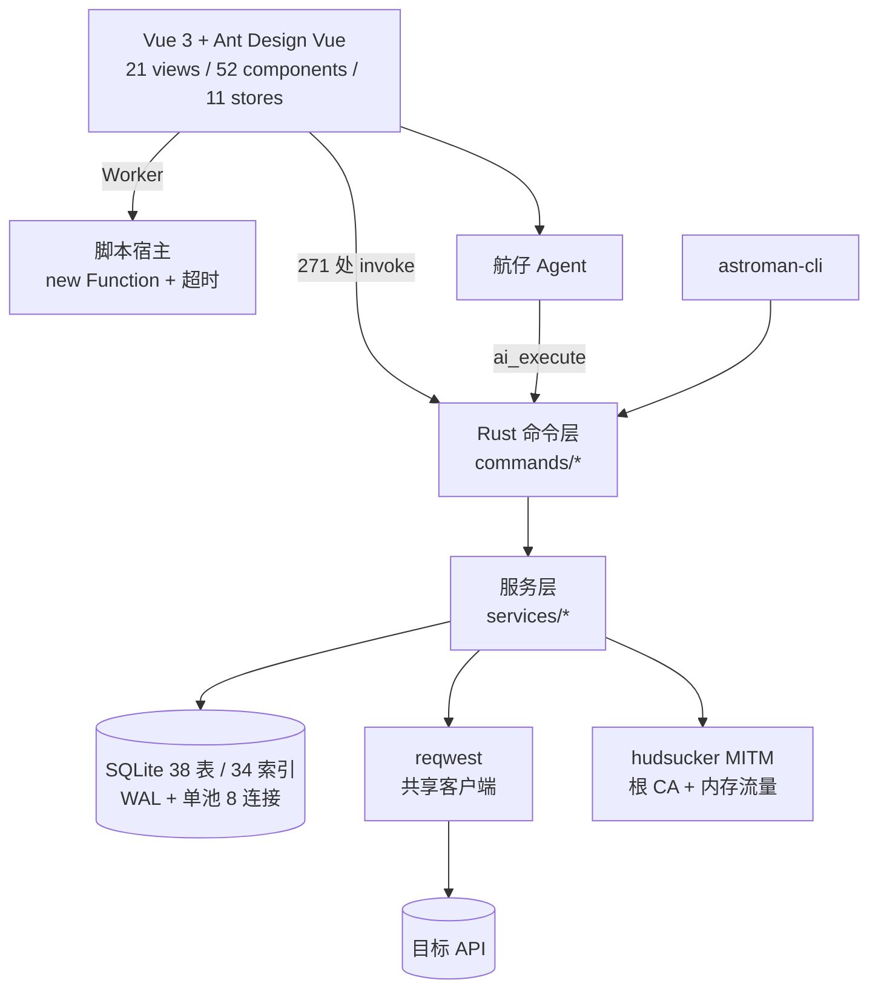
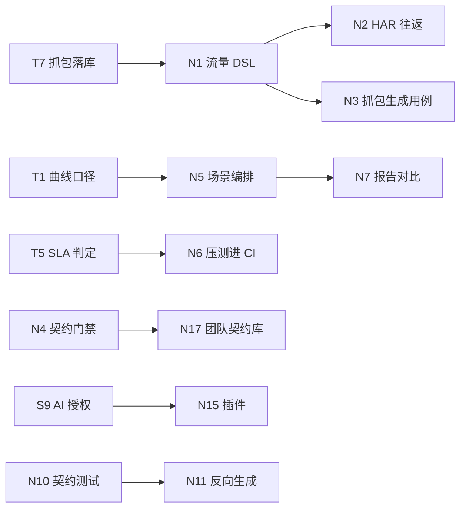

# AstroMan 产品与技术评估报告

> 评估角色：产品负责人 + 项目架构师
> 评估基准：工作区当前代码 · 2026-11-17 · 应用版本 **1.1.0** · 数据库结构 **v15**
> 评估方式：全量静态阅读 + 四域并行深审 + 关键行号抽样复核 + 单测实测（30 文件 / 288 条全绿）
> 本文回答三个问题：**这东西现在值多少分、最大的风险在哪、下一步该做什么不该做什么。**

---

## 一、执行摘要

### 1.1 一句话结论

**AstroMan 已经是一个「功能完整度接近商业产品、工程质量高于同体量开源项目」的本地 API 工具；它当前的最大风险不是缺功能，而是「功能看起来能用、结论却可能是错的」。**

这个判断基于三类事实：

1. **功能密度高**：调试、抓包、Mock、压测、测试套件、工具箱、AI 助手、文档导出、CI/CLI 九个域齐全，21 个视图、38 张表、23 套主题。
2. **工程门禁完整**：CI 已有依赖审计、版本一致性、单测、构建、release 安全断言、SBOM、产物体积门禁、E2E 冒烟、`cargo fmt --check`、`clippy -D warnings`、`cargo audit`、覆盖率门禁、CLI 独立编译。
3. **存在「静默错误」**：多个配置项被接收、返回成功，但不生效；多个统计口径算错，但界面显示正常。

第 3 点是本次评估最重要的发现。**用户不会因为这些缺陷报错，只会基于错误数据做出错误的技术决策。** 对一个「研发工具」而言，这比崩溃更伤品牌。

### 1.2 三个核心矛盾

| 矛盾 | 表现 | 本质 |
|---|---|---|
| **能力增长快于结构治理** | 单文件最大 5,708 行（前端）、3,576 行（Rust）；126 个 Rust 文件、855 处 `unwrap/expect` | 每个新功能都在放大维护成本 |
| **配置面大于实现面** | 抓包上游代理/SSL 白名单、套件 `max_workers`/`parallel_rows`、压测 SLA 等「有 UI、有字段、无效果」 | 产品承诺与运行时行为脱节 |
| **数据产生快于数据沉淀** | 抓包零持久化（`capture/store.rs:3`）；压测结束才落库；AI 提问只存前 1000 字 | 用完即弃，无法复盘、无法沉淀资产 |

### 1.3 五条最高优先级动作（如果只做五件事）

| 顺序 | 动作 | 为什么是它 | 复杂度 |
|---|---|---|---|
| 1 | **修「开关无效」**：重定向、上游代理、套件并行、低内存档 | 直接摧毁用户信任，且改动面小 | S~M |
| 2 | **修「数字不对」**：压测延迟曲线、AI token 计费、压测 SLA | 错误数据会导出错误报告，影响外部决策 | S |
| 3 | **堵「数据泄露」**：历史明文密钥、导出明文凭据、Mock CORS 反射 | 一次泄露即可定性为不安全产品 | S~M |
| 4 | **建「可回溯」**：抓包落库 + 会话化 | 从「看完就没了」变成「可复盘资产」 | L |
| 5 | **拆「巨型文件」**：RequestEditor / AiAssistant / ai.rs / test_runner.rs | 不做，后面每加一个功能都更贵 | L |

### 1.4 产品定位建议

**不要做「又一个 Postman」。** 那个赛道已经被 Postman（生态）、Apifox（一体化）、Bruno（Git 友好）占满。

AstroMan 真正稀缺的位置是：**本地优先、数据不出机、从抓包到压测再到 CI 的「API 质量闭环」。**

- Postman 强在协作与生态，弱在本地隐私与抓包深度；
- JMeter 强在压测，弱在调试与易用；
- AstroMan 的机会是「一个人/一个小团队，把接口从发现问题到守住质量的全过程做完，且数据全在本机」。

这条定位决定了功能取舍：**凡是削弱「本地、闭环、可回溯」的，优先级往后放；凡是强化它的，优先做。**

---

## 二、产品评估

### 2.1 用户与场景

| 用户 | 核心场景 | 当前满足度 | 缺口 |
|---|---|---|---|
| 后端开发 | 调接口、看响应、存用例 | 高 | 字符集、Cookie、Auth 体系偏弱 |
| 测试工程师 | 抓包、造用例、回归、压测 | 中高 | 抓包不可回溯、套件并行无效 |
| 技术负责人 | 看报告、做容量判断 | 中 | 压测曲线口径错、无报告对比 |
| 独立开发者 | 本地工具、不要账号 | 高 | 缺可移植模式、壳包偏大 |
| 团队 | 共享契约、协作 | 低 | 无共享库、无 Git 同步、无协作 |

**判断**：前四类用户已经能「用起来」，第五类还不能「一起用」。这是产品从「个人工具」走向「团队工具」的门槛。

### 2.2 能力盘点

| 域 | 已具备 | 成熟度 | 关键短板 |
|---|---|---|---|
| 请求调试 | 方法/头/体/认证/脚本/历史/重定向/计时 | ★★★★☆ | 重定向语义分裂、字符集、Cookie、Auth 刷新 |
| 抓包 | MITM、证书、断点、映射、弱网、HAR 导出 | ★★★☆☆ | 零持久化、上游代理无效、无检索 DSL |
| Mock | 路由、模板、CORS、回放 | ★★★☆☆ | 规则排序、中文路径 panic、与用例脱节 |
| 实时协议 | SSE / WebSocket 会话 | ★★★☆☆ | 重连计数、无空闲超时、不入流量列表 |
| 压测 | 并发/限速/阶梯/错误分类/报告 | ★★★☆☆ | 曲线口径错、无限速平滑、无 warm-up、无场景 |
| 测试套件 | 用例/断言/数据集/依赖/报告 | ★★★☆☆ | 并行配置无效、断言类型少、无变量提取 |
| AI 助手 | 流式对话、工具调用、会话、预算、用量 | ★★★★☆ | 中断不可续、计费失真、写库无后端闸门 |
| 文档导出 | Markdown / HTML | ★★☆☆☆ | 无 PDF、大文档全内存、OpenAPI 失真 |
| 平台化 | CLI、CI 门禁、备份、导入器 | ★★★☆☆ | 无 stress 子命令、备份恢复不可靠 |

### 2.3 竞争位对照

| 能力 | Postman | Apifox | Bruno | JMeter | AstroMan |
|---|---|---|---|---|---|
| 本地优先 / 数据不出机 | 部分（云同步） | ✗ | ✓ | ✓ | **✓** |
| 抓包 MITM | 有限 | 有限 | ✗ | ✗ | **✓** |
| 断点改包 / 弱网 | 弱 | 弱 | ✗ | ✗ | **✓** |
| 压测 | 云 | 云 | ✗ | **强** | 中 |
| 测试套件 + 断言 | ✓ | ✓ | 有限 | 有限 | 中 |
| 团队协作 / 共享 | **强** | **强** | Git | ✗ | ✗ |
| AI 辅助 | 有 | 有 | ✗ | ✗ | **✓（本地）** |
| CI 集成 | ✓ | ✓ | ✓ | ✓ | 部分（仅测试） |

**读法**：AstroMan 在「抓包 + 本地 + AI」这一格是空位，在「压测 + 协作」是短板。**策略应是「守住空位、补齐短板」，而不是全面对标。**

### 2.4 用户旅程断点（最有价值的 PM 视角）

| 用户意图 | 实际会发生什么 | 断点性质 |
|---|---|---|
| 「我关掉跟随重定向，看看 302 响应」 | 默认路径仍自动跟随，跳链记录为空 | **承诺失效** |
| 「我用公司代理上网，抓包应该也能走代理」 | 参数被接收但代理未接上游，流量出不去 | **承诺失效** |
| 「我配了 20 个并发跑用例」 | 实际串行执行，配置无任何效果 | **承诺失效** |
| 「我设了低内存模式，抓包应该更省内存」 | 抓包写死 8MB/2MB，档位不生效 | **承诺失效** |
| 「我看压测曲线，第 30 秒有个延迟尖刺」 | 曲线是累计值，尖刺被平均掉 | **结论错误** |
| 「这个月 AI 花了多少钱」 | 工具调用 completion 恒为 0，成本偏低 | **结论错误** |
| 「这个压测没达到 SLA 吧？」 | 手工压测不判定 SLA，显示成功 | **结论错误** |
| 「把项目导出发给同事」 | 凭据是明文 | **安全事故** |
| 「抓包记录了刚才那个 bug」 | 重启或再点录制即清空 | **资产丢失** |
| 「拿上次的抓包对比一下」 | 根本没有持久化，无法对比 | **能力缺失** |

这张表建议直接作为下一版的需求评审输入。

### 2.5 建议的北极星指标

产品当前没有可度量的健康指标。建议先立三个低成本可采集的：

| 指标 | 定义 | 为什么是它 | 采集点 |
|---|---|---|---|
| **周活跃闭环用户数** | 一周内同时做过「发送请求 + 跑用例/压测」的用户数 | 衡量「闭环」定位是否成立 | 本地匿名计数（可选上报） |
| **报告生成数 / 抓包会话数** | 每周产生的可复盘资产量 | 衡量「资产沉淀」 | `test_reports`、未来 `capture_sessions` |
| **首请求成功率** | 新用户首次发送请求成功比例 | 衡量上手门槛 | 前端埋点 |

> 注：本地优先产品做指标要克制，默认关闭上报，只提供「导出诊断包」由用户主动发送。

---

## 三、技术评估

### 3.1 架构现状

### 3.2 架构上值得肯定的部分（不要改坏）

| 优点 | 证据 | 价值 |
|---|---|---|
| 命令层与服务层分离 | `commands/*` → `services/*` | 边界清晰，便于 CLI 复用 |
| 数据库 WAL + busy_timeout | `db/mod.rs:32-36` | 多线程读写不互相卡死 |
| 迁移有版本号与列迁移表 | `db/mod.rs:23,159` | 升级有路径，不是一次性建表 |
| 前端有全局错误兜底 | `main.ts:38-67` | 异常可上报、可弹窗，不死白屏 |
| 主题有开发期完整性校验 | `main.ts:19-21` | 23 套主题不靠人肉保证 |
| AI 工具 SPECS 已趋向单源 | `aiTools.ts:192` | 后续可派生 MCP/插件 |
| CI 门禁真实存在且会失败 | `.github/workflows/ci.yml` | 不是摆设 |

**架构师的判断**：这套骨架是对的，问题在「骨架里塞了太多东西」，不是骨架本身错了。**所以策略是「拆」而不是「重写」。**

### 3.3 五个结构性负债

| 负债 | 量化 | 后果 | 处理策略 |
|---|---|---|---|
| **巨型文件** | 前端 5,708 / 5,538 / 3,458 行；Rust 3,576 / 3,464 / 2,470 / 2,296 / 2,183 行 | 定位难、冲突多、无法写页面级测试 | 按 composable / 子模块拆，**先补测试再拆** |
| **双份真相** | `schema.sql` 与 `COLUMN_MIGRATIONS` 双写；AI 工具 SPECS 与 `TOOL_LABELS`/`WRITE_TOOLS`/`KNOWN_TOOLS` 平行 | 漂移，且漂移不报错 | 单一来源 + 一致性测试 |
| **零持久化** | 抓包只在内存 `VecDeque`，`capture/store.rs:3` 自述 | 证据不可回溯，无法做会话/对比/检索 | 新增 session/flow/body + FTS5 |
| **无界背压** | 压测 `unbounded_channel`（`stress.rs:1492-1493`）；实时日志 5000 条无虚拟化 | 高并发内存峰值不可控、UI 掉帧 | 有界队列 + 批量落库 + 虚拟滚动 |
| **权限边界不清** | AI 写库只靠前端 Modal（`AiAssistant.vue:2239-2246`），策略只覆盖「发送」（`ai_policy.rs:1-7`） | 渲染层被注入即等于全库写权限 | 后端闸门 + 工具授权分级 |

### 3.4 正确性缺陷 Top 15（按「用户被误导的严重程度」排序）

| # | 缺陷 | 证据 | 用户看到的 | 实际发生的 |
|---|---|---|---|---|
| 1 | 重定向双套语义 | `state.rs:980-984`、`commands/http.rs:293-304` | 「已关闭跟随」 | 仍自动跟随；跳链为空 |
| 2 | 抓包上游代理无效 | `capture/mod.rs:368`、`capture/proxy.rs:24-32` | 「已配置上游代理」 | 参数未参与代理构建 |
| 3 | 套件并行是死字段 | `test_runner.rs:44-47,943-1053` | 「20 并发」 | 串行执行 |
| 4 | 压测延迟曲线为累计值 | `stress.rs:1737-1751` | 「第 30 秒尖刺」 | 曲线看不到单秒变化 |
| 5 | 手工压测不判 SLA | `stress.rs:1532` | 「压测成功」 | 未做任何阈值判定 |
| 6 | AI completion token 恒为 0 | `ai.rs:1919,1935-1944` | 「本月花费 X」 | 成本系统性偏低 |
| 7 | 抓包不读低内存档 | `capture/handler.rs:41-43` vs `services/profile.rs:19,21` | 「已开低内存」 | 仍按 8MB/2MB |
| 8 | 停止不中止请求 | `http.rs:864-885` | 「已停止」 | POST 仍到达服务端 |
| 9 | GET/HEAD 丢 Body | `http.rs:630-632` | 「我填了 Body」 | 请求体消失 |
| 10 | 字符集不识别 | `http.rs:963-1005,1256` | 「响应乱码/变成下载」 | 未解析 charset |
| 11 | 跨域重放鉴权头 | `http.rs:738-740` | 「只是跟随跳转」 | Token 发给第三方域 |
| 12 | Mock 中文路径 panic | `mock/router.rs:114` | 「Mock 无响应」 | 切片 panic，连接断开 |
| 13 | SSE 重连计数不复位 | `realtime.rs:398-402,503-507` | 「开了自动重连」 | 第 5 次后永久关闭 |
| 14 | 脚本变量全局泄漏 | `scriptRunner.ts:87` | 「只在本接口用」 | 其他接口静默复用 |
| 15 | cURL 导出不可复现 | `curl.ts:34,53-124` | 「复制就能跑」 | 缺 Auth、变量被编码 |

### 3.5 安全与隐私（按可利用性分级）

| 等级 | 问题 | 证据 | 建议 |
|---|---|---|---|
| **高** | 历史/运行记录明文写入 secret 变量真实值 | `http.rs:146-183,220-244` | 入库前打码 |
| **高** | 项目导出为明文凭据；OpenAPI 导出零脱敏 | `transfer.rs:212-220,867-870` | 默认掩码 + 显式开关 |
| **高** | Mock CORS 反射任意 Origin 且允许凭据 | `mock/server.rs:628-635` | Origin 白名单 |
| **高** | AI 写库无后端确认；生产判定可绕过 | `aiTools.ts:1703-1714`、`ai.rs:2202-2215` | 后端闸门 + 授权分级 |
| **高** | 兜底主密钥 base64 明文落盘 | `secret.rs:1298-1309` | Windows 也收紧 ACL / 走系统凭据库 |
| **中** | 备份恢复后密钥失效无提示 | `backup.rs:248-270` | 恢复前试解密 |
| **中** | 导入器可被用作 SSRF | `importer.rs:2047-2068` | 阻断内网 / 限制响应体 |
| **中** | 提问预览明文入库 | `ai.rs:1538-1556` | 脱敏或只存摘要 |
| **低** | CSP 允许外链图片 | `tauri.conf.json:25` | 收敛 `img-src` |
| **低** | 旧 v1 固定派生密钥 | `secret.rs:1055-1078` | 迁移后清除旧密文 |

### 3.6 性能热点（只列有明确路径的）

| 热点 | 位置 | 量级 | 建议 |
|---|---|---|---|
| 压测聚合每秒搬 5 万条 | `stress.rs:1492-1493,1692-1703` | 单 tick 可阻塞进度回调 | 有界队列 + 增量落库 |
| 每请求 `COUNT(*)` 全表 | `http.rs:1417-1426` | 10 万行后每次发送变慢 | 维护计数或缓存 |
| 抓包 1.5s 全量快照 | `Capture.vue:722,1235-1237` | 每轮锁内 clone 1000 条 | 事件增量推送 |
| 报告导出拉 5 万条 | `ReportDetail.vue:700-706` | 数百 MB 峰值 | 后端生成 / TopN |
| antd 全量注册 | `main.ts:3,71` | antd chunk 1.47MB | 按需引入 |
| 表单每次按键全量序列化 | `RequestEditor.vue:333-343,873` | 2MB Body 每键一次 | 按字段 watch |
| 大文档全内存 | `docs/builder.rs:12-13` | 5000 × 64KB 峰值数百 MB | 流式写盘 |

### 3.7 工程质量

| 项 | 现状 | 评价 |
|---|---|---|
| 前端单测 | 30 文件 / 288 条，全在 `utils`/`tools` | 有基础，但**零组件测试** |
| E2E | 3 spec，CI 只跑 6 条冒烟 | 覆盖主路径不够 |
| Rust 覆盖率 | `fail-under = 25` | 门槛偏低，且文档目标是 60% |
| 前端 lint | **无** ESLint / Prettier | 与 Rust 侧不对称 |
| 依赖安全 | `npm audit --omit=dev`、`cargo audit` | 做得对 |
| 产物门禁 | dist 总量 ≤ 8MB | 过粗，管不住 antd 1.47MB |
| 可访问性 | 32 处标注 / 10 文件 | 弱 |
| 配置有效性测试 | 无 | 本轮多个「死字段」本可被一条测试拦住 |

**架构师判断**：门禁的「有无」已经很好，短板是「粒度」——缺 lint、缺组件测试、缺单 chunk 体积、缺配置契约测试。

---

## 四、优化路线（合并去重后 24 项）

> 原则：先止血、再可信、再结构、最后体验。每批有明确「退出条件」，不按工期排。

### 批次一：止血（承诺兑现 + 安全）

**目标**：不再出现「开关无效」「导出即泄露」。

| ID | 动作 | 位置 | 复杂度 | 退出条件 |
|---|---|---|---|---|
| S1 | 共享客户端统一 `Policy::none()`，全链路手工重定向 | `state.rs:980-984`、`http.rs:293-304` | S | 关闭开关生效、跳链完整、302 登录流可用 |
| S2 | 实现抓包上游代理与 SSL 直通白名单 | `capture/proxy.rs:24-32`、`capture/mod.rs:368` | M | 公司代理环境可抓包；固定证书站点可直通 |
| S3 | 套件并行配置：实现或移除 | `test_runner.rs:44-47,943-1053` | M | UI 不再展示无效开关 |
| S4 | 抓包读取低内存档位 | `capture/handler.rs:41-43` | S | 低内存档上限实际降低 |
| S5 | 历史/运行记录对 secret 变量打码 | `http.rs:146-183,220-244` | S | 库内检索不到真实 token |
| S6 | 导出统一脱敏（项目/OpenAPI/HAR/request.txt） | `transfer.rs:212-220,867-870`、`har.rs:96-149` | M | 默认掩码，显式开关才保留 |
| S7 | Mock CORS 改白名单 | `mock/server.rs:628-635` | S | 非白名单 Origin 不返回 ACAO |
| S8 | Mock 模板索引改字节安全 | `mock/router.rs:109-122` | S | 中文路径不 panic，有单测 |
| S9 | AI 写操作后端闸门 + 工具授权分级 | `aiTools.ts:4157`、`ai_policy.rs` | M | 绕过前端直接 invoke 也需确认 |
| S10 | 备份写入 key_id，恢复前试解密 | `backup.rs:248-270` | M | 异机恢复不再「假成功」 |

### 批次二：可信（数字与数据）

**目标**：所有对外呈现的指标口径正确、可回溯。

| ID | 动作 | 位置 | 复杂度 | 退出条件 |
|---|---|---|---|---|
| T1 | 压测延迟改每秒增量直方图 | `stress.rs:1737-1751` | S | 人为制造 1 秒抖动，曲线可见尖刺 |
| T2 | 阶段汇总按边界差值 | `stress.rs:2098-2113` | S | 阶梯每阶段 P95 为该阶段实测 |
| T3 | 读响应体出错计入失败 | `stress.rs:550,558,733` | S | 错误率不再被低估 |
| T4 | 限速改平滑令牌桶 | `stress.rs:401,1668-1723` | M | 首秒不再 2× 突发，无脉冲 |
| T5 | 手工压测 SLA 判定 | `stress.rs:1532` | S | 不达标显示失败 |
| T6 | AI token 统计修正 + 取消记失败 | `ai.rs:1825-1834,1919-1944,2013-2016` | M | 用量与实际账单同量级 |
| T7 | 抓包落库 + 会话化 | 新增 `capture_sessions/flows/bodies` | L | 重启后可检索、可对比 |
| T8 | 压测批处理落库 + `spawn_blocking` | `stress.rs:1966,2455-2487` | M | 长压测中途断电不丢已采样数据 |

### 批次三：结构（可维护性）

**目标**：新功能不再让维护成本指数上升。

| ID | 动作 | 位置 | 复杂度 | 退出条件 |
|---|---|---|---|---|
| A1 | RequestEditor 拆 composable + 子组件 | 5,708 行 | L | 主文件 ≤ 1,500 行 |
| A2 | AiAssistant 拆流/工具/会话 | 5,538 行 | L | 主文件 ≤ 1,500 行 |
| A3 | `commands/ai.rs` 拆 chat/tools/usage/session | 3,576 行 | L | 单文件 ≤ 800 行 |
| A4 | `test_runner.rs` 拆 http/python/stress/assert/report | 3,464 行 | L | 单文件 ≤ 800 行 |
| A5 | AI 工具权限并入 SPECS 单源 | `aiTools.ts:4046,4157`、`aiProtocol.ts:58` | M | 新增写工具不会漏白名单 |
| A6 | 引入 ESLint + Prettier + CI lint | 根目录 | S | `npm run lint` 阻断新增问题 |
| A7 | antd 按需引入 + 单 chunk 门禁 | `main.ts:3,71`、`ci.yml:47-68` | S | antd ≤ 900KB |
| A8 | 组件测试 + E2E 扩到 15 条 | `vitest.config.ts` | M | 4 条主路径有组件测试 |
| A9 | 覆盖率 25% → 35% → 45% | `tarpaulin.toml` | M | CI 按阶段生效 |

### 批次四：体验（细节打磨）

| ID | 动作 | 位置 | 复杂度 |
|---|---|---|---|
| X1 | 响应编码切换（UTF-8/GBK/UTF-16） | `http.rs:963-1005` | M |
| X2 | 请求级超时/连接超时/代理覆盖 UI | `RequestEditor.vue:1781` | S |
| X3 | 多值响应头保留 | `http.rs:767-778` | S |
| X4 | 下载硬上限 + 可中断 | `http.rs:1133-1254` | S |
| X5 | 实时日志与报告明细虚拟滚动 | `RequestEditor.vue:3405`、`ReportDetail` | M |

> 完整的 P0/P1/P2 明细（52 条，含验收）可作为执行清单，不在本文展开，避免再次变成「清单文档」。

---

## 五、功能规划

> 取舍原则：**强化「本地 + 闭环 + 可回溯」的优先做；削弱或偏离这个定位的往后放。**

### 5.1 闭环类（最高战略价值）

| 编号 | 功能 | 用户价值 | 实现切入点 | 依赖 | 复杂度 | 优先级 |
|---|---|---|---|---|---|---|
| N1 | **流量检索 DSL + 会话持久化** | 从「看最近 1000 条」变成「可检索的资产库」 | 新增 `capture_sessions/flows/bodies` + FTS5；语法 `host: status:>= dur:> mime: body~` | T7 | L | P0 |
| N2 | **HAR 往返：导入 → 回放 → 对比** | 同事发来的 HAR 能直接变成可执行用例 | 复用 `capture/har.rs` 导出结构反序列化 | N1 | M | P1 |
| N3 | **抓包 → 测试套件/压测计划** | 一次录制自动生成回归集 | 从 flow 生成 case + 断言模板 | N1 | M | P1 |
| N4 | **契约门禁** | API 改动在 CI 被拦下 | `contract_snapshots` 表已存在；做 OpenAPI diff + CLI 非零退出 | — | M | P1 |
| N5 | **压测场景编排（事务链路）** | 从「单接口打点」到「真实业务链路」 | 请求组 + 权重 + 步骤断言 + 虚拟用户；`scenario_text` 字段已留 | T1/T4 | L | P1 |
| N6 | **压测进 CI** | 性能回归不靠人盯 | `astroman-cli stress run --sla --out junit` | T5 | M | P1 |
| N7 | **报告对比与趋势** | 回答「这次比上次慢了多少」 | `run_group_id` 已入库；多选报告差异表 + 近 5 次中位数基线 | T1 | M | P2 |

### 5.2 质量门禁类

| 编号 | 功能 | 用户价值 | 实现切入点 | 复杂度 | 优先级 |
|---|---|---|---|---|---|
| N8 | **断言可视化 + 变量提取 + JSON Schema** | 非程序员也能写用例 | 表格式断言编辑器；`jsonPath` 提取到变量 | M | P1 |
| N9 | **用例依赖 DAG 与数据回传** | 登录 → 下单 → 查询 自动串起来 | 拓扑排序 + 就绪队列；上游输出注入下游 | L | P2 |
| N10 | **导入导出 round-trip 契约测试** | 防止 OpenAPI 导出失真 | Postman→OpenAPI→Postman 断言，纳入 CI | M | P1 |
| N11 | **OpenAPI 反向生成请求** | 有 spec 就能直接调 | 复用 `schema_from_raw` / `entity_from_schema` | M | P2 |

### 5.3 AI 纵深类

| 编号 | 功能 | 用户价值 | 实现切入点 | 复杂度 | 优先级 |
|---|---|---|---|---|---|
| N12 | **AI 工具授权分级与记忆** | 「允许这次」「允许本域名」 | 后端签发会话令牌；SPECS 增加权限标签 | M | P0 |
| N13 | **流式断点续传** | 网络抖动不用重问、不重复计费 | SSE 带 offset，前端按 offset 续写 | M | P1 |
| N14 | **AI 会话资产化** | 聊天记录变成可检索知识 | 原文对象表 + 消息引用；支持导出 | M | P2 |
| N15 | **插件/自定义工具** | 团队私有工具接入 | 声明式工具定义（JSON Schema + 权限 + handler），同时供 MCP 使用 | L | P2 |

### 5.4 平台与生态类

| 编号 | 功能 | 用户价值 | 实现切入点 | 复杂度 | 优先级 |
|---|---|---|---|---|---|
| N16 | **MCP Server** | 让 Cursor/Claude 直接调 AstroMan 能力 | 复用 AI 工具 SPECS 单源 | L | P2 |
| N17 | **团队契约库（Git 同步）** | 团队共享接口定义，但不落明文 | 项目契约 + 变量引用 + Git；与 N4 联动 | L | P2 |
| N18 | **可移植模式** | U 盘/免安装/绿色版 | 数据目录可由启动参数决定 | M | P2 |

### 5.5 明确「不做什么」（同样重要）

| 不做 | 理由 |
|---|---|
| 分布式压测 | 与「本地优先」冲突，且需要中央调度，投入产出比低 |
| 云端协作/账号体系 | 直接进入 Postman/Apifox 的主场，且违背本地优先定位 |
| gRPC / MQTT 全协议支持 | 需求密度低，先把 HTTP/WS 做扎实 |
| 自研 UI 组件库 | 已有 Ant Design，重造成本高收益低 |
| 内置 AI 模型 | 让用户自带 Key 更轻、更可控、更合规 |

### 5.6 依赖关系

---

## 六、版本节奏建议

> 只给批次与里程碑，不给工期。

| 里程碑 | 主题 | 包含 | 判断标准（做完了吗） |
|---|---|---|---|
| **v1.1.x** | 止血补丁 | S1–S10 | 十项「承诺失效/泄露」全部关闭，且各有一条回归测试 |
| **v1.2** | 可信与数据 | T1–T8 + A6/A7 | 压测曲线可信、抓包可回溯、lint 与体积门禁生效 |
| **v1.3** | 闭环 | N1–N6、N8、N10 | 「抓包 → 用例 → 压测 → 报告 → CI」端到端可演示 |
| **v1.4** | 结构 | A1–A5、A8/A9 | 四个巨型文件降到目标行数，覆盖率 ≥ 45% |
| **v2.0** | 平台 | N7、N9、N11–N18 | 有团队协作路径、有插件机制、有 MCP |

**节奏判断**：v1.1.x 和 v1.2 是「还债」，v1.3 才是「增长」。如果资源有限，**宁可不做 v1.3 的新功能，也要先把 v1.1.x 做完**——因为前两批修的是「用户已经相信你、结果被骗」的问题，这类问题拖得越久，修复成本越高（用户流失是不可逆的）。

---

## 七、风险登记册

| 风险 | 概率 | 影响 | 缓解 |
|---|---|---|---|
| 静默错误被用户发现并公开吐槽 | 高 | 高 | 批次一全做，并公开修复说明 |
| 明文凭据随导出物外流 | 中 | 高 | 批次一 S5–S7 |
| 拆巨型文件时引入回归 | 中 | 中 | 先补测试再拆，按页面分步 |
| 抓包落库带来写放大与卡顿 | 中 | 中 | 独立连接 + 批量事务 + 保留上限 |
| 压测统计口径变更引起历史报告不可比 | 高 | 低 | 报告标注算法版本，新旧不混比 |
| AI 能力被注入后越权 | 中 | 高 | 后端闸门 + CSP 收紧 |
| 功能面继续扩张导致结构进一步恶化 | 高 | 高 | 在 CI 加「文件行数上限」与「新增依赖评审」 |

---

## 八、验收标准（Definition of Done）

### 8.1 功能正确性

- [ ] 关闭「跟随重定向」后停在 302，跳链为空；302 登录流可带 Cookie 走通。
- [ ] 配置上游代理后，抓包流量确实经由上游代理。
- [ ] 套件并发数改变时，实际执行并发随之改变（或 UI 不再提供该配置）。
- [ ] 低内存档位下抓包单响应上限实际降低。
- [ ] 压测曲线能反映单秒延迟突变；手工压测不达 SLA 显示失败。
- [ ] 中文路径 Mock 不 panic；非白名单 Origin 拿不到 CORS 头。
- [ ] AI token 用量与供应商账单同量级；用户取消不记为成功。

### 8.2 安全

- [ ] 历史、运行记录、HAR、request.txt、OpenAPI 导出中检索不到 secret 真实值。
- [ ] 异机恢复备份若密钥不可用，明确报错并引导导入 keypack。
- [ ] 绕过前端直接 invoke AI 写操作，仍会被后端拦截。

### 8.3 工程质量

- [ ] `npm run lint` 进 CI；antd chunk ≤ 900KB 有独立门禁。
- [ ] 覆盖率 ≥ 35% 并锁定；至少 3 个核心组件有组件测试；E2E ≥ 15 条。
- [ ] 「配置字段被读取」契约测试覆盖 `max_workers`、`upstream_proxy`、`ssl_hosts`。
- [ ] 四个巨型文件达到目标行数，且 288 条既有单测全绿。

### 8.4 产品可信度

- [ ] README / roadmap / features 不再出现「WebSocket 未实现」与旧版本号。
- [ ] 主题数量、数据库版本注释与实际一致。
- [ ] 至少一个版本的 CHANGELOG 明确列出「修复了哪些静默错误」。

---

## 附录 A：关键证据索引

| 主题 | 位置 |
|---|---|
| 重定向策略 | `src-tauri/src/state.rs:980-984`、`commands/http.rs:293-304,733-793` |
| 请求头 / 响应头 | `commands/http.rs:738-740,767-778` |
| 请求体 / 下载 | `commands/http.rs:630-632,1133-1254` |
| 历史与密钥 | `commands/http.rs:146-183,220-244,1400-1426` |
| 脚本变量 | `src/utils/scriptRunner.ts:87` |
| cURL 导出 | `src/utils/curl.ts:34,53-124` |
| 抓包生命周期 | `capture/mod.rs:360-390,502-509`、`capture/store.rs:3` |
| 抓包上游 / 证书 | `capture/proxy.rs:24-32`、`capture/ca.rs:90-98` |
| 抓包缓冲 / 解码 | `capture/handler.rs:41-43,359-379,986-1008` |
| Mock | `services/mock/router.rs:100-122`、`services/mock/server.rs:628-635` |
| 实时协议 | `services/realtime.rs:398-427,503-507` |
| 压测指标 / 限速 | `commands/stress.rs:401,1492-1493,1737-1751,2098-2113` |
| 压测落库 | `commands/stress.rs:1966,2455-2487` |
| 测试套件 | `src-tauri/src/test_runner.rs:44-68,943-1053` |
| AI 计费 / 取消 | `commands/ai.rs:1825-1834,1919-1944,2013-2016` |
| AI 安全 | `commands/ai.rs:1538-1556,2202-2215`、`src/utils/aiTools.ts:1703-1714,4046,4157` |
| 导入器 | `commands/importer.rs:127-133,1634,1747-1762,1998-2028,2047-2068` |
| 文档导出 | `src-tauri/src/docs/builder.rs:12-13`、`services/docs.rs:15-21,119-138` |
| 传输与脱敏 | `commands/transfer.rs:212-220,867-870` |
| 密钥 | `src-tauri/src/secret.rs:1055-1078,1298-1309` |
| 备份 | `commands/backup.rs:248-270` |
| 数据库 | `db/schema.sql`（654 行 / 38 表 / 34 索引）、`db/mod.rs:23,159,325,372-421` |
| 前端入口 / 构建 | `src/main.ts:3,71`、`vite.config.ts` |
| CI | `.github/workflows/ci.yml`、`src-tauri/tarpaulin.toml` |
| Tauri 配置 | `src-tauri/tauri.conf.json:24-35`、`src-tauri/capabilities/default.json` |

## 附录 B：现状基线（用于后续对比）

| 指标 | 当前值 | 目标值（v1.4） |
|---|---|---|
| 前端最大单文件 | 5,708 行 | ≤ 1,500 行 |
| Rust 最大单文件 | 3,576 行 | ≤ 800 行 |
| antd chunk | 1.47 MB | ≤ 900 KB |
| 前端单测 | 288 条（全在 utils） | ≥ 400 条，含组件测试 |
| E2E | 3 spec / 6 条冒烟 | ≥ 15 条 |
| Rust 覆盖率门槛 | 25% | 45% |
| `unwrap/expect` | 855 处 | ≤ 600 处（新增代码禁止） |
| 数据库表 / 索引 | 38 / 34 | 41 / 40（+抓包三表） |
| 可访问性标注 | 32 处 | 关键控件全覆盖 |

---

> 本文所有行号基于 2026-11-17 工作区代码。若后续改动导致行号漂移，以文件路径与函数名检索为准。
> 建议把第 2.4 节「用户旅程断点」直接作为下一次需求评审的输入，把第 8 节「验收标准」直接作为发布检查单。

---

## 附录 C：批次一执行任务清单

> 范围：第 4 节批次一（S1–S10）。
> 粒度：每个任务拆到「可直接开工」的子步骤；每步都可独立验证。
> 排序原则：**先修「用户能立刻感知」的，再修「需要配置才触发」的**；同文件改动合并到同一 PR，避免反复冲突。
> 工作量用 S/M/L 表示相对量级，不代表工期。

### C.0 执行总览

| 任务 | 主题 | 主要文件 | 依赖 | 量级 | 建议 PR |
|---|---|---|---|---|---|
| S1 | 重定向策略统一 + 跨域头剔除 | `state.rs`、`commands/http.rs` | 无 | S | PR-1 |
| S8 | Mock 模板中文路径 panic | `services/mock/router.rs` | 无 | S | PR-2 |
| S4 | 抓包读取低内存档位 | `capture/handler.rs`、`capture/store.rs` | 无 | S | PR-3 |
| S7 | Mock CORS 白名单 | `services/mock/server.rs` | 无 | S | PR-4 |
| S5 | 历史/运行记录脱敏 | `commands/http.rs`、`util.rs` | S1 | S | PR-5 |
| S6 | 导出统一脱敏 | `commands/transfer.rs`、`refs` | S5 | M | PR-6 |
| S10 | 备份密钥闭环 | `commands/backup.rs`、`secret.rs` | 无 | M | PR-7 |
| S3 | 套件并行配置收敛 | `test_runner.rs`、`Automation.vue` | 无 | S/M | PR-8 |
| S2 | 上游代理 + SSL 直通 | `capture/proxy.rs`、`capture/mod.rs` | 无 | M | PR-9 |
| S9 | AI 写操作后端闸门 | `commands/ai.rs`、`utils/aiTools.ts` | 无 | M | PR-10 |

**三条并行泳道**（互不冲突，可同时开）：

- 泳道 A（请求链路）：S1 → S5 → S6
- 泳道 B（抓包与 Mock）：S8 → S4 → S7 → S2
- 泳道 C（AI / 备份 / 套件）：S10 → S3 → S9

**第一个 PR 建议做 S1。** 理由：单文件、语义明确、用户可立刻感知，且能顺带修掉跨域重放鉴权头这个安全问题，是「信任修复」的最佳样板。

---

### C.1 S1：重定向策略统一（含跨域头剔除）

**目标**：让「跟随重定向」开关真正生效，且 302 登录流可用、跨域不泄露鉴权头。

**前置事实**：共享客户端 `Policy::limited(10)`（`state.rs:980-984`）；一次性客户端硬传 `follow=false`（`commands/http.rs:293-304`）；手工链逐跳原样重放全部头（`http.rs:738-740`）。

**子任务**

- [ ] 在 `state.rs` 的共享与一次性两条客户端构造路径上，统一 `redirect(reqwest::redirect::Policy::none())`
- [ ] 删除 `http.rs:300` 的 `follow=false` 硬编码，改为「由手工链决定」
- [ ] 手工链入口读取 `follow_redirects`：为 `false` 时首跳即返回，`redirects` 为空
- [ ] 跨 host 跳转时剔除 `authorization`、`cookie`、`proxy-authorization` 三个头
- [ ] 重定向总耗时改为单一 deadline，超限返回明确错误码（替代当前不可达分支）
- [ ] 多值响应头改为 `Vec<(String, String)>`（同一 PR 做，避免二次改签名）
- [ ] 补 Rust 单测：302 两跳、超 10 跳、跨 host 头剔除、关闭跟随

**验收**

- [ ] 关闭开关后停在 302，跳链列表为空
- [ ] `302 + Set-Cookie → Location` 能带 Cookie 走通
- [ ] A 域跳 B 域时，B 域收不到 `Authorization`
- [ ] 既有 288 条前端单测与 Rust 测试不回归

**风险与回滚**：手工链是唯一发送路径，改动面集中。若出现回归，回滚点单一（客户端策略 + 手工链），可单独 revert。

---

### C.2 S8：Mock 模板中文路径 panic

**目标**：含中文的模板路径不再 panic。

**前置事实**：`mock/router.rs:114` 用字符下标切字节。

**子任务**

- [ ] 统一索引口径：要么全按字节（`template.as_bytes()`），要么先 `chars().collect::<Vec<_>>()` 再按字符切片
- [ ] 排查同一函数内其他 `[..]` 切片点
- [ ] 补单测：`/中文/{id}`、`/路径/{a}/尾`、纯中文无占位符
- [ ] 补一条「404 而非断开连接」的行为测试

**验收**

- [ ] 三种中文路径均返回预期 Mock 响应
- [ ] 未命中路由返回 404，不再触发 panic

---

### C.3 S4：抓包读取低内存档位

**目标**：设置里的「低内存」对抓包真实生效。

**前置事实**：`state.rs:668` 已调用 `capture.set_limits(profile.limits)`；`CaptureStore` 已持有 `limits`；但 `capture/handler.rs:41-45` 仍用三个常量。

**子任务**

- [ ] 给 `CaptureStore` 暴露只读 `limits()`（若尚无）
- [ ] `CaptureHandler` 构造时取 store limits，替换 `MAX_STORED_BODY`、`MAX_COLLECT_BODY`、`MAX_IMAGE_BODY`
- [ ] 超出上限时沿用现有截断策略，不改变请求/响应转发行为
- [ ] 补测试：low 档上限为 2MB、standard 为 5MB、high 为更高值

**验收**

- [ ] 切换档位后，抓包保存的最大 body 实际变化
- [ ] 大响应仍能完整转发，只是不入库/不预览

---

### C.4 S7：Mock CORS 白名单

**目标**：任意网页不能读取本地 Mock 数据。

**前置事实**：`mock/server.rs:628-635` 反射任意 Origin 且允许凭据。

**子任务**

- [ ] 配置增加 `cors_origins: Vec<String>`，默认空（即不返回 ACAO）
- [ ] 命中白名单才回显 `Access-Control-Allow-Origin`，并回 `Vary: Origin`
- [ ] 默认移除 `Access-Control-Allow-Credentials`；仅白名单 + 显式开关才返回
- [ ] 设置页增加白名单输入（逗号分隔，支持 `http://localhost:*` 之类简单通配）
- [ ] 补测试：`evil.com` 无 ACAO；白名单 Origin 有 ACAO

**验收**

- [ ] 浏览器从任意第三方页面 `fetch` 本地 Mock 被 CORS 拦截
- [ ] 配置白名单后，指定来源可正常调用

---

### C.5 S5：历史与运行记录脱敏

**目标**：secret 变量真实值不进入历史、运行快照与错误信息。

**前置事实**：`load_vars_with_secrets` 已存在（`http.rs:1336`）并返回密钥名；`util::mask_values` 已存在且 `test_runner` 在用。

**子任务**

- [ ] `execute` 内改用 `load_vars_with_secrets`，拿到 `secret_names` 与 `secret_values`
- [ ] `url_for_history` 生成后、写库前统一 `mask_values`
- [ ] `request_runs.headers` / `request_runs` 其余字段写入前同样掩码
- [ ] 错误信息（含渲染后的 URL）在返回前端前掩码
- [ ] 补测试：含 `{{secret:token}}` 的请求，入库后全表检索不到真实值

**验收**

- [ ] 直接查库与前端历史列表均看不到真实 token
- [ ] 复制导出历史不含明文

---

### C.6 S6：导出统一脱敏

**目标**：项目导出、OpenAPI、HAR、request.txt 默认不泄露凭据。

**前置事实**：`transfer.rs:212-220` 注释自认明文；`openapi.rs:72` 原样落 `example`；`har.rs`/`archive.rs` 也照写。

**子任务**

- [ ] 抽出统一脱敏入口（复用 `util::mask_values`），四处导出共用
- [ ] 导出命令增加 `includeSecrets` 参数，默认 `false`
- [ ] UI 增加「包含明文凭据」勾选 + 二次确认弹窗
- [ ] OpenAPI 中命中的 secret 变量落 `example: "***"`，`securitySchemes` 不落真实值
- [ ] 补测试：默认导出物全量检索不到 token

**验收**

- [ ] 默认导出可安全发给同事
- [ ] 显式勾选后才保留原文，且审计留痕

---

### C.7 S10：备份可恢复性闭环

**目标**：异机恢复不再「显示成功但变量全空」。

**前置事实**：`backup.rs:248-270` 只做 `quick_check` 与版本校验。

**子任务**

- [ ] 备份 manifest 增加 `key_id` 与 `encrypted` 标记
- [ ] 恢复前抽样解密 1 条 secret 与 1 条凭据
- [ ] 解密失败返回明确错误码并引导导入 keypack
- [ ] 恢复结果区分「完整恢复 / 结构恢复但密钥缺失」
- [ ] 补测试：用不同 master key 恢复时给出可读提示

**验收**

- [ ] 密钥不匹配时不会显示「恢复成功」
- [ ] 用户能按提示完成 keypack 导入后重试

---

### C.8 S3：套件并行配置收敛

**目标**：UI 不再承诺未实现的能力。

**前置事实**：`test_runner.rs:44-47,65-68` 声明字段但全仓无读取；执行循环串行（`943-1053`）。

**决策点（需先定）**

| 方案 | 做法 | 成本 | 适用 |
|---|---|---|---|
| A. 先隐藏 | UI 移除并发/并行行输入，字段保留并注释「v1.3 实现」 | S | 推荐先做，立刻止损 |
| B. 直接实现 | 按 `depends_on` 拓扑 + 就绪队列 + 信号量限流 | L | 需求明确且近期要用 |

**子任务（方案 A）**

- [ ] `Automation.vue` 移除 `max_workers` / `parallel_rows` 输入与提示
- [ ] `test_runner.rs` 字段加注释说明「未实现，禁止在 UI 暴露」
- [ ] 增加一条「配置字段必须被读取」的契约测试（本轮新增的通用防线）
- [ ] 若后续要做方案 B，单独开任务，不在本批混入

**验收**

- [ ] 界面上不再出现无效开关
- [ ] 契约测试能拦住「声明但未读取」的新字段

---

### C.9 S2：抓包上游代理与 SSL 直通

**目标**：公司代理环境可抓包；证书固定类站点可直通不被解密。

**前置事实**：`capture/proxy.rs:24-32` 未接上游；`sslHosts` 全代码无读取；`capture/mod.rs:368` 只写状态。

**子任务**

- [ ] 让 `CaptureConfig` 的上游代理字段进入 `proxy::run`
- [ ] 在 `Proxy::builder()` 上接入上游代理（hudsucker 0.25 若无直接 API，则用自定义 connector 串联，先做 spike 确认可行性）
- [ ] `ssl_hosts` 白名单命中时，CONNECT 直接隧道透传，不做 MITM
- [ ] 上游 TLS 握手失败返回可读错误码，不再统一压成 502
- [ ] 补集成测试：起一个假上游代理，验证流量确实经过

**验收**

- [ ] 配置上游代理后，抓包流量可出网
- [ ] 白名单域名在流量列表中标记为「未解密直通」

**风险**：涉及网络栈，建议先做 1 小时 spike 验证 hudsucker API，再决定实现路径。

---

### C.10 S9：AI 写操作后端闸门

**目标**：绕过前端直接 invoke 写命令，也会被后端拦截。

**前置事实**：发送已有后端闸门（`ai.rs:2296-2330` 的 `ai_execute`）；但写库工具只靠前端 `isWriteTool`（`aiTools.ts:4210`）弹窗确认。

**子任务**

- [ ] **Spike**：定位 AI 工具的真实执行入口，列出所有写命令（项目/集合/请求/环境/用例的增删改）
- [ ] 在 `ai.rs` 增加授权命令：`ai_tool_authorize(tool, target, mode) -> token`，token 绑定本次会话与 trace
- [ ] 写命令入口校验 token；无 token 或 mode 为 `readonly` 时拒绝
- [ ] `WRITE_TOOLS` 改为从 SPECS 的 `write: true` 派生，消除三处手写
- [ ] 审计复用 `ai_confirm_audit`，记录 allow/deny
- [ ] 补测试：不带 token 直接 invoke 写命令返回 `E_AI_CONFIRM`

**验收**

- [ ] 前端确认逻辑保留为体验层，后端为唯一可信闸门
- [ ] 审计日志可回答「谁在什么模式下允许了什么写操作」

---

### C.11 每个任务的统一完成定义（DoD）

任何一个 S 任务，只有同时满足以下四条才算完成：

- [ ] 有对应的自动化测试（Rust 单测或前端组件测试），且能在 CI 跑
- [ ] 有明确的错误码 / 用户提示，不出现「静默成功」
- [ ] 文档或注释同步更新（至少写明「为什么这样改」）
- [ ] 本地 `npm run test` 与 `cargo test` 全绿，无新增 `clippy` 警告

### C.12 本批结束后的复盘问题

1. 这 10 项里，哪几项用户其实感知不到？下一批是否该降低它们的优先级？
2. 「配置字段被读取」的契约测试是否覆盖了全部设置项？还漏了哪些？
3. 修完后，第 2.4 节「用户旅程断点」表里还剩几行？剩余的是否都属于「能力缺失」而非「承诺失效」？
4. 是否已经具备条件，把「抓包落库」从批次二提前？如果用户对「可回溯」的呼声最高，应该提前。
