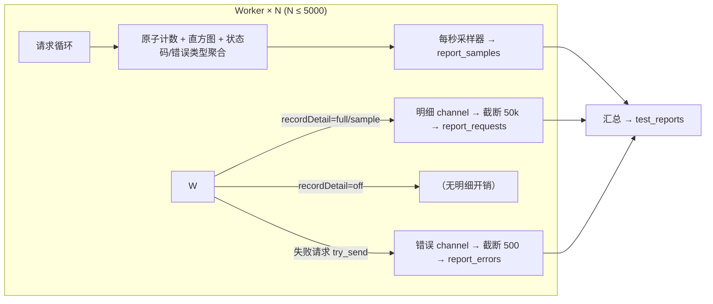

# AstroMan 压测能力提升与报告优化技术方案

| 项目 | 内容 |
| --- | --- |
| 文档版本 | v1.1.1 |
| 编写日期 | 2026-10-30 |
| 修订说明 | v1.1 新增「对标 JMeter 报表增强」（批次一）与「差异化分析能力」（批次二/三），见 4.2.2~4.2.4、附录 B；v1.1.1 修订代码级事实（B-3 位置为 state.rs、B-4 已确认 try_send 仅补丢弃计数），任务归属与验收标准相应对齐 |
| 适用版本 | AstroMan v1.0.8（压测引擎增强） |
| 关联文档 | [AstroMan的自动化测试方案.md](./AstroMan的自动化测试方案.md) |
| 参考样本 | 系统性能测试报告-20260129214508.html（第三方分布式压测平台报告） |

---

## 1. 背景与目标

### 1.1 背景

当前压测引擎（Rust + tokio + reqwest，见 `src-tauri/src/commands/stress.rs`）在普通场景下工作良好，但存在三类待改进问题：

1. **能力天花板偏低**：并发数硬编码钳制在 500，无法承诺「保底 10,000 QPS」；
2. **报告内容对标不足**：与第三方专业压测报告相比，缺少场景描述、报告总结、施压端信息、总流量、90% 分布 QPS 等要素；
3. **HTML 报告体积失控**：HTML 导出内嵌「请求明细（最多 5000 行 × 14 列，含请求体/响应体）」「采样明细（每秒 1 行）」「错误明细（最多 500 行）」，长时间高压测下文件可达数十 MB，浏览器打开卡顿。

### 1.2 目标

| 编号 | 目标 | 衡量标准 |
| --- | --- | --- |
| G-1 | 保底 10,000 QPS | 对 RT ≤ 100ms 的目标服务，单机稳定输出 ≥ 10,000 QPS，指标数据完整可信 |
| G-2 | 报告内容对齐专业压测报告 | 覆盖参考样本中的关键板块（不适用的除外，见附录 A 对照表） |
| G-3 | HTML 报告轻量化 | HTML 导出不含任何逐条明细表，文件体积与压测时长脱钩（始终 < 1MB 量级） |
| G-4 | 明细数据不丢失 | 明细仍完整入库，需要时可通过 JSON/CSV/Excel 单独导出 |
| G-5 | 报表专业度对标 JMeter | 统计表、错误统计、趋势/分布图表达到 JMeter HTML Dashboard 同等覆盖度（对照见附录 B） |
| G-6 | 差异化分析能力 | 提供 JMeter 原生不具备的自动分析：拐点检测、四维体检打分（批次二）；报告对比回归、AI 解读（批次三） |

### 1.3 非目标

- 不做分布式压测（多施压机协同），仍属 v1.0.9 backlog；
- 不改动断言引擎、套件引擎等自动化测试方案中规划的内容；
- 不改变 Excel 导出保留明细的现有行为；
- 批次三（报告对比、AI 解读）默认规划在 v1.0.9，本文档给出方案并预留接口，可延后实施。

---

## 2. 现状评估（代码级事实）

### 2.1 引擎侧瓶颈清单

| # | 位置（stress.rs） | 现状 | 对 10k QPS 的影响 |
| --- | --- | --- | --- |
| B-1 | `config.concurrent.clamp(1, 500)`，阶梯阶段同样钳制 | 并发硬上限 500 | **直接封顶**：RT 100ms 时理论上限仅 5,000 QPS |
| B-2 | 每请求生成 `ReportRequestRecord`（clone URL/Header、裁剪 body 1000 字符、响应体 2000 字符），经 unbounded channel 发送 | 每请求固定分配开销 | 万级 QPS 时 CPU 与内存带宽占用可观，channel 瞬时积压 |
| B-3 | `pool_max_idle_per_host(32)`（位于 state.rs:404） | 空闲连接保活 32 个/主机 | 思考时间 > 0 或负载波动时连接频繁重建，TLS/握手开销放大 |
| B-4 | 错误明细走容量 1024 的有界 channel（stress.rs:906） | 发送侧已确认为 `try_send`（stress.rs:761），不阻塞 worker；但丢弃时无计数，静默丢失 | 错误风暴下错误明细被静默截断，用户无法感知丢失规模 |
| B-5 | `MAX_REQUEST_RECORDS = 50_000`、`MAX_ERRORS = 500` | 明细入库截断 | 内存安全有保障，但高 QPS 下明细几秒即截断，保留价值低 |
| B-6 | 逐请求 `attempt.bytes` 统计 | 已有 | 可用于聚合总流量，无需新增采集 |

### 2.2 报告侧现状（reportExport.ts `renderHtml`）

现有 HTML 报告共 12 个板块：

| # | 板块 | 数据来源 | 体积特征 |
| --- | --- | --- | --- |
| 1 | 头部与自动结论（verdict） | 汇总 | 小 |
| 2 | KPI 卡片 | 汇总 | 小 |
| 3 | SLA 达标判定表 | 配置 + 汇总 | 小 |
| 4 | 压测配置汇总表 | 配置快照 | 小 |
| 5 | 吞吐量趋势图（RPS） | 采样 | 小（SVG） |
| 6 | 响应时间趋势图（avg/P95/P99） | 采样 | 小（SVG） |
| 7 | 阶段表（阶梯模式） | 汇总 | 小 |
| 8 | 状态码分布表 | 聚合 | 小 |
| 9 | 错误类型聚合表 | 聚合 | 小 |
| 10 | 响应时间分布直方图表 | 聚合 | 小 |
| 11 | **采样明细表**（11 列 × 时长秒数行） | 采样 | **随时长线性增长**（1 小时 ≈ 3600 行） |
| 12 | **请求明细表**（14 列 × 最多 5000 行，含请求体/响应体）与**错误明细表**（最多 500 行） | 明细 | **体积爆炸主因** |

---

## 3. 可行性分析（G-1）

### 3.1 数学模型

压测工具产出 QPS 遵循 Little 定律：

```
QPS = 并发数 ÷ (平均响应时间(秒) + 思考时间(秒))
```

达成 10,000 QPS（思考时间为 0）所需并发：

| 目标服务平均 RT | 所需并发 | 当前 500 上限 | 放开上限后 |
| --- | --- | --- | --- |
| ≤ 20ms（本机/同机房） | ≤ 200 | 够用 | 稳定达标 |
| 50ms | 500 | 顶格零余量 | 稳定达标 |
| 100ms | 1,000 | 不足 | 稳定达标 |
| 200ms | 2,000 | 不足 | 可达标（需 8 核以上） |
| ≥ 500ms | ≥ 5,000 | 不足 | 技术上可行，不建议承诺保底，应转分布式 |

**结论：目标 RT ≤ 100ms 时保底 10,000 QPS 现实可行**，并发上限放开至 5,000 即可覆盖并留有余量。

### 3.2 瓶颈消除核算

| 瓶颈 | 消除措施 | 消除后开销评估 |
| --- | --- | --- |
| B-1 并发钳制 | 上限放开到 5,000 | tokio task 极轻，5,000 task 内存占用 < 100MB，无调度问题 |
| B-2 逐请求明细 | 新增「高吞吐模式」，关闭或采样明细 | 关闭后每请求仅剩原子计数 + 直方图写入，约几微秒；10k QPS ≈ 占用 0.1 核 |
| B-3 连接池 | `pool_max_idle_per_host` 对齐峰值并发 | 稳态下连接常驻复用，无握手放大 |
| B-4 错误通道 | 发送侧已为 `try_send`，仅需补充丢弃计数 `errors_dropped` | 错误风暴下错误明细丢弃规模在报告与日志中可见 |
| HTTP 栈本身 | 不变 | hyper/reqwest 单机万级 QPS 为成熟能力，8 核机器约占用 2~3 核 |

**结论：G-1  achievable，改动集中在 stress.rs 与 StressTest.vue，无架构变更。**

---

## 4. 技术方案

### 4.1 引擎增强（对应 G-1）

#### 4.1.1 并发上限放开

- `StressConfig.concurrent` 钳制由 `clamp(1, 500)` 改为 `clamp(1, 5000)`，阶梯阶段 `stage.concurrent` 同步放开；
- 前端 `StressTest.vue`：
  - 输入框上限同步为 5000；
  - 并发 > 1000 时显示提示：「高并发将占用较多 CPU/内存，建议 8 核以上机器，并确认本机端口与文件句柄限制」；
- 文档与压测确认弹窗（AiConfirmCard）中同步新上限。

#### 4.1.2 高吞吐模式（明细记录策略）

`StressConfig` 新增字段：

```json
{
  "recordDetail": "auto"   // "full" | "sample" | "off" | "auto"，默认 "auto"
}
```

| 模式 | 行为 | 适用 |
| --- | --- | --- |
| `full` | 每请求生成明细记录（现状行为），入库截断 50,000 条 | 问题排查、小流量验证 |
| `sample` | 按 1% 概率采样生成明细（每请求哈希判定），上限不变 | 大流量下保留代表性样本 |
| `off` | 不生成任何逐请求明细 | 冲量跑分 |
| `auto` | 引擎按 `预估QPS = 峰值并发 ÷ max(预估RT, 10ms)` 判定：预估 QPS > 2,000 时自动降为 `sample`；> 5,000 时自动降为 `off`；运行中实际 QPS 连续 3 个采样点超阈值同样降档，并在进度事件中通知前端 | 默认，免心智负担 |

- 无论何种模式，**聚合指标全部保留**：原子计数、直方图、状态码分布、错误类型聚合、每秒采样、错误明细（500 条截断）；
- 请求记录入库时 `record_mode` 一并写入 `test_reports.config_json`，报告页展示当前模式标签，避免「明细缺失」被误读为 Bug。

#### 4.1.3 连接池对齐

- `pool_max_idle_per_host(32)` 改为 `pool_max_idle_per_host(min(峰值并发, 4096))`；
- 峰值并发 = 固定模式 concurrent / 阶梯模式 max(stage.concurrent)。

#### 4.1.4 错误通道丢弃计数

- 发送侧已确认为非阻塞 `try_send`（worker 不会被反压阻塞），无需改动发送逻辑；
- 仅需在 `try_send` 失败时递增 `errors_dropped` 计数，并在报告与日志中体现（「错误明细已截断/丢弃 N 条」）。

#### 4.1.5 数据流示意



### 4.2 报告内容增强（对应 G-2 / G-5 / G-6）

#### 4.2.1 基础增强（对标参考样本，逐项对照见附录 A）

**原则：所有内容从现有聚合数据派生，不增加引擎采集负担。**

| # | 板块 | 内容 | 数据来源 |
| --- | --- | --- | --- |
| R-1 | 测试场景描述（可编辑） | 报告生成前可填写场景/目的说明，HTML 顶部展示；AI 生成报告时可自动起草 | 新增 `test_reports.scenario_text`（TEXT，可空） |
| R-2 | 报告总结（可编辑） | 文末总结段落；默认由 verdict 自动结论预填，可手工修改 | 新增 `test_reports.summary_text`（TEXT，可空） |
| R-3 | KPI 补充：总流量 | 外网总流量（入 + 出，MB），由 `attempt.bytes` 聚合 | 现有采样 bytes 求和，仅改汇总与展示 |
| R-4 | KPI 补充：90% 分布 QPS | 每秒采样 QPS 的 P10（即 90% 时间高于该值），对齐参考样本口径 | 现有 `report_samples` 派生 |
| R-5 | 图表补充：并发趋势图 | 复用 `samples.concurrent`，新增第三张 SVG 趋势图 | 现有数据 |
| R-6 | 图表补充：错误趋势图 | 每秒错误数/错误率曲线 | 现有数据 |
| R-7 | 施压端信息卡 | 单机场景展示：工具版本、OS、CPU 核数、内存、引擎模式（recordDetail）；为将来分布式预留表格结构 | 启动时采集（sysinfo 或 std），存入 `config_json` |
| R-8 | Top 慢请求 | 最慢 10 条请求（时间、URL、耗时、状态），从明细中取；`recordDetail=off` 时显示「高吞吐模式未记录」；full/sample 模式下标注「基于已记录明细（截断上限 50,000 条）」，避免与全量最慢混淆 | 现有明细派生 |
| R-9 | 页脚 | 生成时间、工具版本、免责声明一行 | 静态文案 |

> 说明：参考样本中的「测试机（客户端）详情表」「测试地址详情表」分别对应分布式多机与多 URL 场景，当前单机单 URL 架构不适用，处理方式见附录 A。

#### 4.2.2 对标 JMeter 补齐（批次一，建议并入 v1.0.8）

JMeter HTML Dashboard 的核心资产是「一张统计表 + 三组趋势/分布图表」。差距项全部可用**库内已有数据**补齐，纯展示层工作：

| # | 板块 | 内容 | 数据来源 |
| --- | --- | --- | --- |
| R-10 | 完整统计表 | KPI 卡片之外新增统计表：样本数、错误率、平均/最小/最大/中位数/P90/P95/P99、**标准差**、吞吐量、接收/发送带宽（KB/s） | 直方图 + 采样派生（发送字节引擎未采集，由 T-02 顺带补一个发送字节计数器，随 recordDetail 各模式均采集） |
| R-11 | 错误统计增强 | 错误类型表增加「占错误 % / 占全部样本 %」双口径；新增 Top 5 错误采样表（对齐 JMeter Top 5 Errors by Sampler，单 URL 场景按错误类型聚合） | `report_errors` 聚合 |
| R-12 | 字节吞吐趋势图 | 每秒接收字节速率曲线（对齐 Bytes Throughput Over Time） | `samples.bytes` |
| R-13 | 每秒状态码堆叠图 | 成功/失败按秒堆叠柱状（对齐 Response Codes Per Second） | `samples.successCount / errorCount` |
| R-14 | TTFB 趋势图 | 首字节时间均值趋势（近似 JMeter Connect Time） | `samples.ttfbAvg` |
| R-15 | RT 趋势补线 | 响应时间趋势图增加 P50 线 | `samples.p50Rt` |
| R-16 | 负载-延迟散点图 | 以每秒采样为散点（X = RPS，Y = 平均 RT），人工观察饱和拐点的经典图 | `samples` |

#### 4.2.3 差异化自动分析（批次二，JMeter 原生不具备）

| # | 板块 | 内容 | 数据来源 |
| --- | --- | --- | --- |
| R-17 | **拐点自动检测** | 阶梯模式下对「并发 → QPS / P95」做分段线性拟合，检出吞吐饱和拐点，报告直接输出结论「该系统最大有效容量 ≈ N 并发 / M QPS」；固定并发模式输出当前并发下的余量评估 | `samples` + 阶段表，纯前端算法 |
| R-18 | **四维体检打分** | 容量（QPS 达标度）、稳定性（RT 变异系数 CV）、错误（错误率）、尾部延迟（P99/avg 比值）四个维度 0~100 打分 + SVG 雷达图 + 总评等级，打分规则随报告附注、可解释 | 汇总派生 |

#### 4.2.4 对比与 AI（批次三，规划 v1.0.9，预留接口）

| # | 板块 | 内容 | 数据来源 |
| --- | --- | --- | --- |
| R-19 | 报告对比 / 回归判定 | 任选两份报告叠加趋势图 + 指标差异表，自动判定劣化项（如「P95 较基线 +23%」并标红）；支持将某次报告设为基线 | 库内历史报告 |
| R-20 | AI 报告解读 | 将汇总/采样/错误聚合（**不含明细**）送入内置 AI 助手，生成中文诊断与调优建议（如「第 3 阶段起 P99 恶化而 QPS 未涨，疑似服务端连接池耗尽」）；入口为报告页「AI 解读」按钮，结果可编辑并写入 `summary_text` | 现有 AI 链路 |

### 4.3 HTML 导出精简（对应 G-3、G-4）

#### 4.3.1 导出结构调整

| 板块 | 调整后 HTML | Excel | JSON |
| --- | --- | --- | --- |
| 头部/KPI/SLA/配置/图表/聚合表/阶段表 | 保留 | 保留 | 保留 |
| 采样明细表 | **删除** | 保留（采样明细 sheet） | 保留 |
| 请求明细表 | **删除** | 保留（请求明细 sheet） | 保留 |
| 错误明细表 | **删除**（保留错误类型聚合表） | 保留（错误明细 sheet） | 保留 |

- HTML 中三个明细表位置替换为提示行：「明细数据已入库，可通过导出 Excel / JSON / CSV 查看」；
- 删除后 HTML 体积与压测时长脱钩：1 分钟与 8 小时的报告同为 < 1MB 量级（SVG 图表点数按秒采样，1 小时 3600 点，SVG 体积可控，必要时按 300 点降采样）。

#### 4.3.2 明细独立导出

- 报告页「导出」下拉新增：
  - `导出明细 CSV`：逐请求明细（report_requests 全量）流式写出，避免一次性加载；
  - `导出错误 CSV`：错误明细全量；
- CSV 列与现有 Excel 明细 sheet 对齐；写入走 `report_write_file` 既有目录选择流程；
- 大结果集导出时前端显示进度条（按批读取，每批 5000 条）。

### 4.4 前端交互变更汇总

| 位置 | 变更 |
| --- | --- |
| StressTest.vue | 并发上限 5000；>1000 提示；新增「明细记录」下拉（自动/完整/采样/关闭），默认自动 |
| 压测进度页 | 当前 recordDetail 生效模式标签；自动降档时 toast 提示 |
| 报告页 | 新增 R-1~R-9 板块；三个明细表移除；导出下拉新增两项 CSV |
| AiConfirmCard（压测确认） | 展示明细模式与并发上限提示 |

---

## 5. 数据与接口变更

### 5.1 配置与存储

| 项 | 变更 | 兼容 |
| --- | --- | --- |
| `StressConfig.recordDetail` | 新增枚举字段，默认 `auto` | 旧配置缺失该字段时按 `auto` 处理 |
| `test_reports.config_json` | 快照中新增 `recordDetail` 实际生效值、施压端信息 | JSON 内嵌，无表结构变更 |
| `test_reports.scenario_text` / `summary_text` | 新增两列（TEXT NULL） | 迁移：`ALTER TABLE ... ADD COLUMN`，旧报告为空时隐藏对应板块 |
| `report_requests` / `report_errors` / `report_samples` | 不变 | — |

### 5.2 Tauri 命令

| 命令 | 变更 |
| --- | --- |
| `stress_start` | 入参透传 `recordDetail`；返回值/事件增加实际生效模式 |
| `report_detail` | 不变 |
| `report_export_detail_csv` | **新增**：按类型（requests / errors）分页流式导出 CSV |
| `report_update_texts` | 新增：保存场景描述与报告总结 |
| `report_compare` | 新增（批次三预留）：读取两份报告的汇总 + 采样序列供前端对比渲染 |
| AI 解读 | 复用现有 AI 助手链路 + `report_detail` 数据，不新增后端命令 |

---

## 6. 任务清单

| 编号 | 任务 | 涉及文件 | 工作量 | 验收 |
| --- | --- | --- | --- | --- |
| T-01 | 并发上限放开（引擎 + 前端 + 提示） | stress.rs、StressTest.vue | S | 固定模式与阶梯模式的最大阶段并发配置 5000 均可启动且不被钳制（注意 stress.rs 630/634/852/858 共四处钳制点需全部放开） |
| T-02 | recordDetail 四模式与自动降档 | stress.rs、StressTest.vue | M | 三种手动模式行为正确；auto 按阈值降档并通知前端（含高预估 QPS 启动与运行中实际 QPS 超阈值两条降档路径）；顺带新增发送字节计数器（供 R-10 统计表使用） |
| T-03 | 连接池对齐峰值并发 | state.rs（pool_max_idle_per_host）、stress.rs | S | 压测中无异常连接重建风暴 |
| T-04 | 错误通道丢弃计数（发送侧已是 try_send，无需改动） | stress.rs | XS | 错误风暴下 worker 不阻塞（现状已保证），报告含「已丢弃 N 条」计数 |
| T-05 | KPI 新增总流量、90% 分布 QPS | reportExport.ts、报告页 | S | 数值与采样数据勾稽一致 |
| T-06 | 并发趋势图、错误趋势图 | reportExport.ts | S | 两张 SVG 图渲染正确 |
| T-07 | 场景描述 / 报告总结（可编辑 + 入库 + AI 预填） | stress.rs、报告页、迁移 | M | 编辑保存后重开报告内容保留 |
| T-08 | 施压端信息卡 + Top 慢请求 + 页脚 | stress.rs、reportExport.ts | M | 信息准确；off 模式下慢请求区显示说明 |
| T-09 | HTML 移除三个明细表 + 提示行 | reportExport.ts | S | 8 小时压测报告 < 1MB，浏览器秒开 |
| T-10 | 明细/错误 CSV 独立导出（流式 + 进度） | stress.rs、reportExport.ts、报告页 | M | 50 万条明细导出完成且无内存溢出 |
| T-11 | AiConfirmCard 与文档同步 | AiConfirmCard.vue、使用文档 | S | 文案与新上限一致 |
| T-12 | 批次一：完整统计表 + 错误双口径 + Top 5 错误（R-10/R-11） | reportExport.ts、报告页 | M | 统计表数值与采样/直方图勾稽一致 |
| T-13 | 批次一：字节吞吐/状态码堆叠/TTFB/散点四图 + P50 补线（R-12~R-16） | reportExport.ts | M | SVG 渲染正确；长报告采样点按 300 点降采样 |
| T-14 | 批次二：拐点自动检测算法（R-17） | 前端分析模块 | M | 用已知拐点的合成采样数据验证检出正确 |
| T-15 | 批次二：四维打分 + 雷达图（R-18） | reportExport.ts、报告页 | M | 打分规则文档化附注，雷达图渲染正确 |
| T-16 | 批次三：报告对比与回归判定（R-19，v1.0.9） | reportExport.ts、报告页、stress.rs | L | 两份报告趋势叠加与差异表正确，基线可设置 |
| T-17 | 批次三：AI 报告解读（R-20，v1.0.9） | 报告页、AI 链路 | M | 解读结果生成成功并可编辑入库 |

> 批次划分：T-01~T-11 为地基；T-12/T-13（批次一）建议并入 v1.0.8；T-14/T-15（批次二）紧随其后；T-16/T-17（批次三）规划 v1.0.9，可先评审接口契约。
> 工作量：S < 0.5 人日，M ≈ 1 人日，L ≈ 2~3 人日。v1.0.8 范围（T-01~T-15）约 10~11 人日，含批次三总计约 13~15 人日。

## 7. 验收标准（G-1 实测）

1. **环境**：本机或局域网 mock 服务（RT ≤ 5ms，如本地 nginx 静态页），8 核机器；
2. **配置**：并发 2,000、recordDetail=off、无思考时间、不限速、时长 5 分钟；
3. **通过条件**：
   - 全程每秒采样 QPS 的 P10 ≥ 10,000；
   - 工具进程 CPU ≤ 4 核、内存增长稳定（无泄漏）；
   - 聚合指标完整（直方图/状态码/错误类型/趋势图齐全），报告正常生成与导出；
4. **auto 降档路径验证**：同一场景改用 recordDetail=auto 启动，引擎应自动降档至 off 并通过进度事件通知前端（预估 QPS 10,000 > 5,000 阈值）；
5. **回归**：recordDetail=full、并发 100、短时长压测，行为与现状一致（明细完整入库）；
6. **报表增强**：统计表与新增图表数值和采样数据勾稽一致；拐点检测在合成数据上验证通过；四维打分各维度可解释；
7. **批次三预留**：`report_compare` 接口契约评审通过（可先于实现）。

## 8. 风险与回退

| 风险 | 缓解 |
| --- | --- |
| 高并发下对端先崩，误判为工具问题 | 报告施压端信息卡 + 错误趋势图可辅助定位；文档注明「工具能力 ≠ 目标容量」 |
| 用户在高并发下误选 full 模式导致卡顿 | auto 默认降档；full 模式在预估 QPS > 2,000 时启动前弹确认 |
| Windows 端口耗尽（仅连接大量重建场景） | 文档给出 `netsh int ipv4 set dynamicport` 与 `TcpTimedWaitDelay` 调优指引；keep-alive 正常时无需处理 |
| 并发 5000 内存超预期 | 每 task 栈与缓冲区实测验证；不达标则上限回调至 3000 |
| 新增图表导致 HTML 体积回升 | 全部图表 SVG 化 + 采样点 300 点降采样；实测 8 小时报告仍 < 1MB 量级，远小于原明细表 |
| 回退 | 全部改动独立于断言/套件规划；`recordDetail` 默认 auto，上限改动不影响低并发行为，可整体回滚 stress.rs 与 reportExport.ts |

---

## 附录 A：参考报告板块对照表

基于参考样本《系统性能测试报告-20260129214508.html》（31 台施压机、1550~4650 并发、最大 QPS 11,161、总请求 507 万）。

| 参考样本板块 | 我方现状 | 处理 |
| --- | --- | --- |
| 测试场景（可编辑文本） | 无 | **新增（R-1）** |
| 工作模式表（任务编号/起止/时长/并发/思考时间/目标主机） | 配置汇总表已覆盖大部分 | 保留，字段对齐补齐 |
| 结果汇总大数字（总请求/成功率/总流量/最大 QPS/90% QPS） | KPI 卡片缺总流量、90% QPS | **新增（R-3、R-4）** |
| 成功 QPS 时间曲线 | 吞吐量趋势图（等价） | 保留 |
| 错误率时间曲线 | 无 | **新增（R-6）** |
| 并发数时间曲线 | 无 | **新增（R-5）** |
| URL 耗时时间曲线 | 无（单 URL 场景） | 不适用；多 URL 随套件压测再议 |
| 响应时间分布图 | 直方图表（等价） | 保留 |
| 状态分布饼图 | 状态码分布表（等价） | 保留 |
| 测试机（客户端）详情表 | 无（单机） | **以施压端信息卡替代（R-7）**，分布式时再扩展为表格 |
| 测试地址详情表（按 URL 聚合） | 无（单 URL） | 不适用 |
| 错误地址聚合表 | 错误类型聚合表（近似） | 保留，补 Top 慢请求（R-8） |
| 报告总结（可编辑文本） | 仅自动结论 | **新增（R-2）** |
| 免责声明 | 无 | **新增（R-9 页脚内）** |
| 逐请求/逐秒大表 | 采样明细、请求明细、错误明细三表内嵌 HTML | **HTML 移除，Excel/JSON/CSV 保留（4.3）** |

## 附录 B：JMeter 板块对照表

以 JMeter HTML Dashboard（官方 Report Dashboard）为对标基准。

| JMeter 板块 | 本方案对应 | 批次 | 说明 |
| --- | --- | --- | --- |
| Statistics 统计表（min/中位数/标准差/收发带宽） | R-10 | 一 | 直方图 + 采样派生 |
| APDEX | 现有 `apdexGrade` | — | 已具备 |
| Errors 表（占错误 % / 占全部 %） | R-11 | 一 | 增加双口径占比 |
| Top 5 Errors by Sampler | R-11 | 一 | 单 URL 场景按错误类型聚合 |
| Response Times Over Time | 现有 RT 趋势图 + R-15 补 P50 | 一 | — |
| Bytes Throughput Over Time | R-12 | 一 | 采样已带 bytes |
| Response Codes Per Second | R-13 | 一 | 成功/失败堆叠 |
| Latency vs Requests / Time vs Threads | R-16 + R-5 | 一 | 散点 + 并发趋势 |
| Connect Time Over Time | R-14（TTFB 近似） | 一 | — |
| —（JMeter 无）拐点自动检测 | R-17 | 二 | **差异化** |
| —（JMeter 无）四维体检打分 + 雷达图 | R-18 | 二 | **差异化** |
| —（需插件手工做）报告对比 / 回归判定 | R-19 | 三 | **差异化** |
| —（JMeter 无）AI 报告解读 | R-20 | 三 | **差异化** |

## 附录 C：Windows 高并发调优指引（文档摘录）

仅在连接大量重建（高并发 + 思考时间波动 + 短连接服务端）时需要：

```powershell
# 扩大动态端口范围（管理员）
netsh int ipv4 set dynamicport tcp start=1025 num=64510

# 缩短 TIME_WAIT（注册表，重启生效）
# HKLM\SYSTEM\CurrentControlSet\Services\Tcpip\Parameters
# TcpTimedWaitDelay (DWORD) = 30
```

keep-alive 正常工作（本方案 4.1.3 对齐连接池后）时无需任何系统调优。
