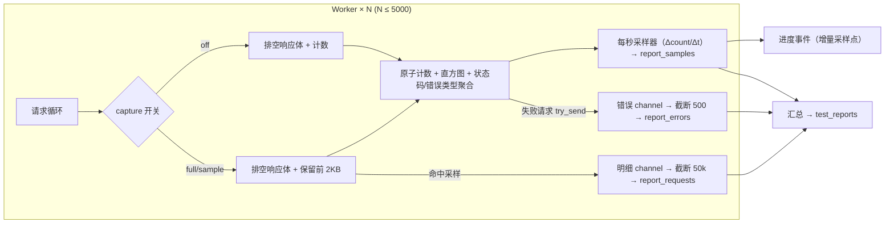

# AstroMan 压测能力提升与报告优化技术方案

| 项目 | 内容 |
| --- | --- |
| 文档版本 | v1.3 |
| 编写日期 | 2026-10-30 |
| 修订说明 | v1.1 新增「对标 JMeter 报表增强」（批次一）与「差异化分析能力」（批次二/三）；v1.1.1 修订代码级事实（B-3 位置、B-4 try_send）；v1.2 增补 3 项代码级瓶颈（B-7 采集未下推、B-8 采样未按实测 Δt 归一、B-9 进度事件 O(n²)），新增第 4.0 节指标口径定义、4.1.3 采集下推与响应体排空、4.3.2 后端流式 CSV、4.5 数据保留，修正 R-3/R-4/R-10 口径矛盾与 T-01 钳制点清单，新增 T-18~T-21，详见附录 D；**v1.3 版本批次归一：批次三由旧编号 v1.0.9 改归 v1.0.8，正文批次编号统一为 v1.0.8** |
| 适用版本 | AstroMan v1.0.8（压测引擎增强） |
| 关联文档 | [AstroMan的自动化测试方案.md](./AstroMan的自动化测试方案.md) |
| 参考样本 | 系统性能测试报告-20260129214508.html（第三方分布式压测平台报告） |

---

## 1. 背景与目标

### 1.1 背景

当前压测引擎（Rust + tokio + reqwest，见 `src-tauri/src/commands/stress.rs`）在普通场景下工作良好，但存在三类待改进问题：

1. **能力天花板偏低**：并发数硬编码钳制在 500，无法承诺「保底 10,000 QPS」；
2. **报告内容对标不足**：与第三方专业压测报告相比，缺少场景描述、报告总结、施压端信息、总流量、90% 分布 QPS 等要素；
3. **HTML 报告体积失控**：HTML 导出内嵌「请求明细（最多 5000 行 × 14 列，含请求体/响应体）」「采样明细（每秒 1 行）」「错误明细（最多 500 行）」，长时间高压测下文件可达数十 MB，浏览器打开卡顿。

### 1.2 目标

| 编号 | 目标 | 衡量标准 |
| --- | --- | --- |
| G-1 | 保底 10,000 QPS | 对 RT ≤ 100ms 的目标服务，单机稳定输出 ≥ 10,000 QPS，指标数据完整可信 |
| G-2 | 报告内容对齐专业压测报告 | 覆盖参考样本中的关键板块（不适用的除外，见附录 A 对照表） |
| G-3 | HTML 报告轻量化 | HTML 导出不含任何逐条明细表，文件体积与压测时长脱钩（始终 < 1MB 量级） |
| G-4 | 明细数据不丢失 | 明细仍完整入库，需要时可通过 JSON/CSV/Excel 单独导出 |
| G-5 | 报表专业度对标 JMeter | 统计表、错误统计、趋势/分布图表达到 JMeter HTML Dashboard 同等覆盖度（对照见附录 B） |
| G-6 | 差异化分析能力 | 提供 JMeter 原生不具备的自动分析：拐点检测、四维体检打分（批次二）；报告对比回归、AI 解读（批次三） |
| G-7 | **指标口径可自洽** | 报告内「总请求 = 成功 + 失败」「Σ 每秒采样 ≈ 总请求」「Σ 每秒字节 ≈ 总流量」三项校验全部通过，口径定义唯一（见 4.0） |

### 1.3 非目标

- 不做分布式压测（多施压机协同），仍留待后续 backlog；
- 不改动断言引擎、套件引擎等自动化测试方案中规划的内容；
- 不改变 Excel 导出保留明细的现有行为；
- 批次三（报告对比、AI 解读）归入 v1.0.8 批次三，本文档给出方案并预留接口；本版先交付接口契约，功能可延后实施。

---

## 2. 现状评估（代码级事实）

### 2.1 引擎侧瓶颈清单

| # | 位置（stress.rs 除非注明） | 现状 | 对 10k QPS 的影响 |
| --- | --- | --- | --- |
| B-1 | `stage_at` 630/634 行、`prepare_stress` 846/852 行：`clamp(1, 500)` | 并发硬上限 500（**共 4 处**） | **直接封顶**：RT 100ms 时理论上限仅 5,000 QPS |
| B-2 | 每请求构造 `ReportRequestRecord`（713 行，clone URL/params/headers、裁剪 body 1000 / 响应体 2000 字符） | 每请求固定分配开销 | 万级 QPS 时分配开销可观，unbounded channel 瞬时积压 |
| B-3 | `pool_max_idle_per_host(32)`（state.rs:440，位于共用构建器 `build_client_custom`） | 空闲连接保活 32 个/主机 | 峰值并发 > 32 时连接无法常驻；且该常量被普通请求共用，不能直接按压测峰值改 |
| B-4 | 错误明细走容量 1024 的有界 channel（895 行），发送侧为 `try_send`（761 行） | 不阻塞 worker，但丢弃时无计数，静默丢失 | 错误风暴下错误明细被静默截断，用户无法感知丢失规模 |
| B-5 | `MAX_REQUEST_RECORDS = 50_000`（27 行）、`MAX_ERRORS = 500`（25 行）；drain 循环达到上限后仍持续 `try_recv` 丢弃（1019、1122 行） | 明细入库截断且**丢弃无计数** | 内存安全有保障，但用户无法判断「明细少」是截断还是 Bug |
| B-6 | 逐请求 `attempt.bytes` 统计（414-419 行 `read_snippet`） | 已有，但语义有偏差 | 可用；**发送方向未采集**，且见 B-7 |
| **B-7** | **`send_once`（422 行）内的采集不受 `recordDetail` 控制：`read_snippet(response, 2000)` 548 行、`response_headers` 571-577 行、逐请求 render 全部 header 450-474 行** | **关闭明细只跳过 channel 发送，采集开销一份没省**；且 `read_snippet` 读满 2000 字节即 `break`（407-410 行），响应体未读完 | **两重影响**：① off 模式省不掉开销；② 响应体 > 2KB 时 response 被提前 drop，hyper 无法复用连接，**每次请求新建 TCP**，高 QPS 下端口耗尽/TIME_WAIT 风暴，`pool_max_idle_per_host` 调到 4096 也无效 |
| **B-8** | **每秒采样 `qps = total - prev_total`（1043 行），未按 ticker 实际间隔归一；ticker 为 `MissedTickBehavior::Delay`（1001 行）** | 负载高时 tick 间隔 > 1s | **QPS 被高估**，而 G-1 恰好用「采样 QPS 的 P10 ≥ 10,000」判定，验收基准本身会漂 |
| **B-9** | **进度事件每秒 `samples.clone()` 全量下发（1079 行）** | O(n²) 拷贝 + 每秒序列化全量 JSON 过 IPC | 8 小时长稳 = 28,800 个采样点，累计约 4 亿次结构体拷贝，长稳压测会自己压垮自己 |

### 2.2 报告侧现状（reportExport.ts `renderHtml`）

现有 HTML 报告共 12 个板块：

| # | 板块 | 数据来源 | 体积特征 |
| --- | --- | --- | --- |
| 1 | 头部与自动结论（verdict） | 汇总 | 小 |
| 2 | KPI 卡片 | 汇总 | 小 |
| 3 | SLA 达标判定表 | 配置 + 汇总 | 小 |
| 4 | 压测配置汇总表 | 配置快照 | 小 |
| 5 | 吞吐量趋势图（RPS） | 采样 | 小（SVG） |
| 6 | 响应时间趋势图（avg/P95/P99） | 采样 | 小（SVG） |
| 7 | 阶段表（阶梯模式） | 汇总 | 小 |
| 8 | 状态码分布表 | 聚合 | 小 |
| 9 | 错误类型聚合表 | 聚合 | 小 |
| 10 | 响应时间分布直方图表 | 聚合 | 小 |
| 11 | **采样明细表**（11 列 × 时长秒数行） | 采样 | **随时长线性增长**（1 小时 ≈ 3600 行） |
| 12 | **请求明细表**（14 列 × 最多 5000 行，含请求体/响应体）与**错误明细表**（最多 500 行） | 明细 | **体积爆炸主因** |

### 2.3 已确认的代码事实（易误判项，勿再重复排查）

| 事实 | 结论 |
| --- | --- |
| 错误通道发送侧 | 已是 `try_send`（761 行），worker 不会被反压阻塞；只需补丢弃计数 |
| 明细通道 | `unbounded_channel`（896 行），drain 每 1s 执行一次，上限 50,000，内存有界 |
| 已有采集能力 | 总请求/成功/失败、逐毫秒延迟直方图、TTFB 直方图、状态码、错误类型、每秒采样（含 bytes/p50/ttfb）、min/max/stddev/apdex —— **R-10~R-16 几乎全部可派生** |
| 未采集能力 | 发送字节、施压端资源占用；两者见 4.1.5 / R-7 |
| 明细导出通道 | `report_write_file(path, data: Vec<u8>)`（report.rs:290）由前端把整个文件字节经 IPC 传入，**不适合大文件流式导出**，见 4.3.2 |

---

## 3. 可行性分析（G-1）

### 3.1 数学模型

压测工具产出 QPS 遵循 Little 定律：

```
QPS = 并发数 ÷ (平均响应时间(秒) + 思考时间(秒))
```

达成 10,000 QPS（思考时间为 0）所需并发：

| 目标服务平均 RT | 所需并发 | 当前 500 上限 | 放开上限后 |
| --- | --- | --- | --- |
| ≤ 20ms（本机/同机房） | ≤ 200 | 够用 | 稳定达标 |
| 50ms | 500 | 顶格零余量 | 稳定达标 |
| 100ms | 1,000 | 不足 | 稳定达标 |
| 200ms | 2,000 | 不足 | 可达标（需 8 核以上） |
| ≥ 500ms | ≥ 5,000 | 不足 | 技术上可行，不建议承诺保底，应转分布式 |

**结论：目标 RT ≤ 100ms 时保底 10,000 QPS 现实可行**，并发上限放开至 5,000 即可覆盖并留有余量。

### 3.2 瓶颈消除核算

| 瓶颈 | 消除措施 | 消除后开销评估 |
| --- | --- | --- |
| B-1 并发钳制 | 上限放开到 5,000（单一常量） | tokio task 极轻，5,000 task 内存占用 < 100MB，无调度问题 |
| B-2 逐请求明细 | 新增「高吞吐模式」，采集下推（4.1.3），关闭后不构造明细结构 | 关闭后每请求仅剩原子计数 + 直方图写入，约几微秒；10k QPS ≈ 占用 0.1 核 |
| B-3 连接池 | 构建器增加参数，仅压测客户端按峰值并发设置 | 稳态下连接常驻复用，无握手放大 |
| B-4/B-5 丢弃 | 发送侧补 `errors_dropped` / `records_dropped` 计数 | 错误风暴下丢弃规模在报告与日志中可见 |
| **B-7 采集未下推** | capture 开关下推到 `send_once`；响应体始终排空、按需保留 | off 模式省掉 2000 字节拷贝与 header 序列化；**连接可复用，字节统计准确** |
| **B-8 采样未归一** | QPS 改用 `Δcount / Δt`（`Instant` 实测） | 采样值与真实间隔一致，P10 判定可靠 |
| **B-9 进度 O(n²)** | 进度事件只下发增量采样点，前端累积 | 每秒拷贝从 O(n) 降到 O(1)，8 小时长稳无压力 |
| HTTP 栈本身 | 不变 | hyper/reqwest 单机万级 QPS 为成熟能力，8 核机器约占用 2~3 核 |

**结论：G-1 可实现，改动集中在 stress.rs / state.rs / StressTest.vue，无架构变更。**

### 3.3 单机 10k 的现实边界（写进报告免责声明）

- 施压端自身 CPU 会先于目标服务饱和，报告须同时给出**施压端资源曲线**，否则无法区分「目标服务到顶」与「施压机到顶」；
- 单机端口数（默认约 16k 动态端口 + TIME_WAIT 复用窗口）是硬约束，仅在连接大量重建时触发；
- 结论表述统一为「本次压测在施压端 X 核 / 峰值 CPU Y% 条件下测得」，不使用「系统极限」这类绝对表述。

---

## 4. 技术方案

### 4.0 指标口径定义（唯一真源）

所有板块的数值必须来自本表口径，避免 R-3 / R-4 / R-10 各说各话。

| 指标 | 定义 | 数据来源 | 备注 |
| --- | --- | --- | --- |
| QPS / RPS | 每秒完成请求数；采样值 = **Δ完成数 ÷ Δt（实测秒）** | `report_samples.qps` | 不再是「相邻 tick 计数差」 |
| 平均 QPS | 总请求数 ÷ 实际持续秒数 | `total_requests / duration` | 与采样均值区分 |
| 90% 分布 QPS | 每秒采样 QPS 序列的 **P10**（90% 的时间不低于该值） | 采样派生 | **剔除 ramp-up 段与末尾不完整秒** |
| 峰值 QPS | 采样 QPS 的最大值 | 采样派生 | 单点噪声敏感，仅作参考 |
| 总流量（出） | 响应体字节总量；优先取 `Content-Length`，缺失时取**实际读取字节数** | `bytes_total` | 关闭采集后仍准确（4.1.3） |
| 总流量（入） | 请求行 + 请求头 + 请求体字节总量 = 单请求静态字节 × 请求数 | 新增 `bytes_sent` | 压测期间请求内容静态，启动时算一次 |
| 总流量（合计） | 入 + 出 | 派生 | KPI 展示口径 |
| 接收/发送带宽 | 出/入字节 ÷ 持续秒数（KB/s） | 派生 | 对标 JMeter 统计表 |
| P50/P90/P95/P99/P99.9 | 逐毫秒直方图分位值（1ms 精度） | 直方图 | 分位值取桶下界，整数毫秒 |
| 标准差 | 直方图按桶中值计算的样本标准差（n−1） | 直方图 | — |
| TTFB | 请求发出 → 收到响应头的时间 | 采样 / 汇总 | **不叫 Connect Time**，见 R-14 |
| APDEX | T = 500ms，三档加权 | 直方图 | 沿用现状 |

### 4.1 引擎增强（对应 G-1）

#### 4.1.1 并发上限放开

- 新增常量 `MAX_CONCURRENT: u32 = 5000`，替换 `stage_at`（630/634）与 `prepare_stress`（846/852）**共 4 处**硬编码 500；
- 前端 `StressTest.vue` 中硬编码 500 的 **7 处**全部改为引用同一常量 `MAX_CONCURRENT`（311、469、478、634、668、1038、1083），其中 311 是 `addStage` 的 `Math.min(500, ...)`，容易被漏掉；
- 并发 > 1000 时显示提示：「高并发将占用较多 CPU/内存，建议 8 核以上机器，并确认本机端口与文件句柄限制」；
- 文档与压测确认弹窗（AiConfirmCard）中同步新上限。

> 反模式提醒：不要只在 `<a-input-number :max>` 上改数字，校验函数里的 `> 500` 判断会让输入直接报错。

#### 4.1.2 高吞吐模式（明细记录策略）

`StressConfig` 新增字段：

```json
{
  "recordDetail": "auto"   // "full" | "sample" | "off" | "auto"，默认 "auto"
}
```

| 模式 | 行为 | 适用 |
| --- | --- | --- |
| `full` | 每请求生成明细记录（现状行为），入库截断 50,000 条 | 问题排查、小流量验证 |
| `sample` | 按 1% 概率采样生成明细（请求序号哈希判定，确定性可复现），上限不变 | 大流量下保留代表性样本 |
| `off` | 不生成任何逐请求明细，且**不读取响应体内容、不序列化 header** | 冲量跑分 |
| `auto` | 启动按预估 QPS 定档，运行中只降不升（见下） | 默认，免心智负担 |

**auto 定档规则（确定性，便于文档与实现对齐）：**

```
预估 QPS = target_rps > 0 ? target_rps : 峰值并发 × 10   // 按 100ms 参考 RT
预估 QPS ≥ 5000 → off      2000 ≤ 预估 QPS < 5000 → sample      其他 → full
运行中：连续 3 个采样点实测 QPS ≥ 5000 → 降为 off；
        连续 3 个采样点实测 QPS ≥ 2000 且当前为 full → 降为 sample。
        只降不升，避免抖动；每次降档通过进度事件 notice 通知前端。
```

- 无论何种模式，**聚合指标全部保留**：原子计数、直方图、状态码分布、错误类型聚合、每秒采样、错误明细（500 条截断）；
- 实际生效模式写入 `test_reports.config_json.recordDetail`，报告页展示「明细记录：采样 1% / 已关闭」标签，避免「明细缺失」被误读为 Bug。

#### 4.1.3 采集下推与响应体排空（B-7，本次新增关键项）

**问题**：`send_once` 里的采集与 `recordDetail` 无关，且响应体读满 2000 字节即中断，导致连接不可复用、字节统计失真。

**改法：**

1. `RunCtx` 增加采集开关 `capture: Arc<AtomicU8>`（0=off / 1=sample / 2=full），由 auto 降档逻辑动态修改；
2. `send_once` 进入时读一次开关：
   - `off`：**不**序列化 headers、**不**保留请求体/查询串、**不**读响应头 JSON；
   - `sample` / `full`：按现有逻辑采集（采样判定在 worker 侧按请求序号做，命中才构造明细结构）；
3. `read_snippet` 改为 `read_body(response, keep: Option<usize>)`：

```
始终把响应体读到底（排空），逐 chunk 累加真实字节数；
keep = Some(n) 时只保留前 n 个字节（供明细/错误快照用），其余丢弃；
keep = None 时不保留任何内容，只计数。
```

   → 一次解决三件事：**连接可复用**（不再因半读关闭 TCP）、**字节准确**（chunked 响应不再按 2000 封顶）、**off 模式真正省掉拷贝**；
4. 字节口径：`bytes = declared_content_length > 0 ? declared : drained_bytes`。gzip 响应在 reqwest 自动解压后 `Content-Length` 会被移除，此时按解压后字节计，**须在报告口径说明中注明**；
5. 内存上限不变：明细仍按 `MAX_REQUEST_RECORDS` 截断，并新增 `records_dropped` 计数。

> 注意：排空 body 会略微增加每请求读取字节数（原来 2000 字节就停），但换来连接复用，万级 QPS 下净收益远大于成本（省掉 TCP 三次握手 + TLS 握手）。

#### 4.1.4 连接池对齐（B-3）

- `build_client_custom` / `client_with_options` 增加 `pool_max_idle: Option<usize>` 参数，`None` 时保持 32；
- 仅 `prepare_stress` 传入 `Some(min(峰值并发, 4096))`，**普通请求客户端保持 32**；
- 峰值并发 = 固定模式 concurrent / 阶梯模式 max(stage.concurrent)。

> 该参数量化后必须显式传递，禁止在共用构建器里直接改成压测口径，否则所有手动请求的空闲连接上限一起抬高。

#### 4.1.5 丢弃与发送字节计数（B-4 / B-5 / B-6）

| 计数器 | 位置 | 用途 |
| --- | --- | --- |
| `errors_dropped` | `try_send` 失败递增 | 报告「错误明细已丢弃 N 条」 |
| `records_dropped` | drain 时 `requests.len() >= MAX` 递增 | 报告「请求明细已截断，丢弃 N 条」 |
| `bytes_sent` | 启动时计算单请求静态字节 × 请求数 | R-3 总流量（入）、R-10 发送带宽 |

单请求静态字节 = `method + url + Σ(header key: value) + body`，压测期间请求内容不变，启动时算一次即可，**逐请求仅一次加法**。

#### 4.1.6 采样时钟归一（B-8）

`drive_stress` 循环内：

```rust
let now = Instant::now();
let dt = now.duration_since(last_tick).as_secs_f64().max(0.001);
let qps = (total - prev_total) as f64 / dt;   // 代替 total - prev_total
last_tick = now;
```

- 同时把 `dt` 记录到采样（可选字段，用于报告标注采样抖动）；
- 限速模式下（`target_rps`）同样受益：读数与真实时间对齐。

#### 4.1.7 进度事件增量下发（B-9）

- `StressProgress.samples` 语义改为**本次新增的采样点（增量）**，另附 `record_mode`、`notice`；
- 前端在监听回调里 `append` 到本地数组，压测开始时清空；
- 兼容策略：字段名不变（仍为 `samples`），仅语义从「全量」变「增量」，前后端同版本发布；
- 结果：8 小时长稳的进度拷贝从 O(n²) 降为 O(n)。

#### 4.1.8 数据流示意



### 4.2 报告内容增强（对应 G-2 / G-5 / G-6）

#### 4.2.1 基础增强（对标参考样本，逐项对照见附录 A）

**原则：所有内容从现有聚合数据派生，不增加引擎采集负担。**

| # | 板块 | 内容 | 数据来源 |
| --- | --- | --- | --- |
| R-1 | 测试场景描述（可编辑） | 报告生成前可填写场景/目的说明，HTML 顶部展示；AI 生成报告时可自动起草 | 新增 `test_reports.scenario_text`（TEXT，可空） |
| R-2 | 报告总结（可编辑） | 文末总结段落；默认由 verdict 自动结论预填，可手工修改 | 新增 `test_reports.summary_text`（TEXT，可空） |
| R-3 | KPI 补充：总流量 | **入 + 出**（MB）：出 = `bytes_total`，入 = `bytes_sent`（4.1.5）；同时给出单请求平均流量 | 汇总 + 新计数器 |
| R-4 | KPI 补充：90% 分布 QPS | 每秒采样 QPS 的 P10，**剔除 ramp-up 阶段与末尾不完整秒**（4.0） | 现有 `report_samples` 派生 |
| R-5 | 图表补充：并发趋势图 | 复用 `samples.concurrent`（**在途请求数**，非配置并发，图注需说明） | 现有数据 |
| R-6 | 图表补充：错误趋势图 | 每秒错误数 / 错误率曲线 | 现有数据 |
| R-7 | 施压端信息卡 | 工具版本、OS、CPU 核数、内存、引擎模式（recordDetail）、**压测期间进程 CPU/内存峰值**；为将来分布式预留表格结构 | 启动时 sysinfo 采集 + 运行期采样 |
| R-8 | Top 慢请求 | 最慢 10 条请求（时间、URL、耗时、状态），从明细中取；`off` 时显示「高吞吐模式未记录」；full/sample 标注「基于已记录明细（截断上限 50,000 条）」 | 现有明细派生 |
| R-9 | 页脚 | 生成时间、工具版本、免责声明一行 | 静态文案 |

> 说明：参考样本中的「测试机（客户端）详情表」「测试地址详情表」分别对应分布式多机与多 URL 场景，当前单机单 URL 架构不适用，处理方式见附录 A。

#### 4.2.2 对标 JMeter 补齐（批次一，建议并入 v1.0.8）

JMeter HTML Dashboard 的核心资产是「一张统计表 + 三组趋势/分布图表」。差距项全部可用**库内已有数据**补齐：

| # | 板块 | 内容 | 数据来源 |
| --- | --- | --- | --- |
| R-10 | 完整统计表 | 样本数、错误率、平均/最小/最大/中位数/P90/P95/P99、标准差、吞吐量、**接收/发送带宽（KB/s）** | 直方图 + 采样 + `bytes_sent`（T-02 顺带补） |
| R-11 | 错误统计增强 | 错误类型表增加「占错误 % / 占全部样本 %」双口径；新增 Top 5 错误采样表（单 URL 场景按错误类型聚合） | `report_errors` 聚合 |
| R-12 | 字节吞吐趋势图 | 每秒接收字节速率曲线 | `samples.bytes` |
| R-13 | 每秒状态码堆叠图 | 成功/失败按秒堆叠柱状 | `samples.successCount / errorCount` |
| R-14 | 首字节（TTFB）趋势图 | TTFB 均值趋势。**命名不采用 JMeter 的 Connect Time**：TTFB 含服务端处理时间，与 TCP 建连耗时不是同一量级，混用会误导排查方向 | `samples.ttfbAvg` |
| R-15 | RT 趋势补线 | 响应时间趋势图增加 P50 线 | `samples.p50Rt` |
| R-16 | 负载-延迟散点图 | 以每秒采样为散点（X = RPS，Y = 平均 RT），人工观察饱和拐点的经典图 | `samples` |

#### 4.2.3 差异化自动分析（批次二，JMeter 原生不具备）

| # | 板块 | 内容 | 数据来源 |
| --- | --- | --- | --- |
| R-17 | **拐点自动检测** | 优先按**阶段稳态窗口**（每阶段剔除前 20% 与后 10% 的采样，取中位数 QPS/P95）判定：QPS 增幅 < 5% 且 P95 增幅 > 20% 判定饱和，输出「最大有效容量 ≈ N 并发 / M QPS」；无阶段数据时退化为分段线性拟合。固定并发模式输出当前并发下的余量评估 | `samples` + 阶段表，纯前端算法 |
| R-18 | **四维体检打分** | 容量（QPS 达标度，无目标时不评分并注明）、稳定性（RT 变异系数 CV）、错误（错误率）、尾部延迟（P99/avg 比值）四维 0~100 分 + SVG 雷达图 + 总评等级；阈值随报告附注、可解释 | 汇总派生 |

#### 4.2.4 对比与 AI（批次三，v1.0.8，预留接口）

| # | 板块 | 内容 | 数据来源 |
| --- | --- | --- | --- |
| R-19 | 报告对比 / 回归判定 | 任选两份报告叠加趋势图 + 指标差异表，自动判定劣化项（如「P95 较基线 +23%」并标红）；支持将某次报告设为基线 | 库内历史报告 |
| R-20 | AI 报告解读 | 将汇总/采样/错误聚合（**不含明细**）送入内置 AI 助手，生成中文诊断与调优建议；入口为报告页「AI 解读」按钮，结果可编辑并写入 `summary_text` | 现有 AI 链路 |

#### 4.2.5 数据自洽校验（R-21，对应 G-7）

报告生成时执行三项校验，任一项偏差 > 1% 则在报告底部输出黄色提示（不影响导出）：

| 校验项 | 公式 | 失败含义 |
| --- | --- | --- |
| 计数自洽 | `总请求 == 成功 + 失败` | 原子计数写入竞态 |
| 采样自洽 | `Σ 采样成功数 ≈ 成功总数`，`Σ 采样 QPS ≈ 总请求`（容差 1 秒） | 采样丢点（ticker 抖动） |
| 流量自洽 | `Σ 采样 bytes ≈ bytes_total` | 字节统计口径不一致 |

---

### 4.3 HTML 导出精简（对应 G-3、G-4）

#### 4.3.1 导出结构调整

| 板块 | 调整后 HTML | Excel | JSON |
| --- | --- | --- | --- |
| 头部/KPI/SLA/配置/图表/聚合表/阶段表 | 保留 | 保留 | 保留 |
| 采样明细表 | **删除** | 保留（采样明细 sheet） | 保留 |
| 请求明细表 | **删除** | 保留（请求明细 sheet） | 保留 |
| 错误明细表 | **删除**（保留错误类型聚合表） | 保留（错误明细 sheet） | 保留 |

- HTML 中三个明细表位置替换为提示行：「明细数据已入库，可通过导出 Excel / JSON / CSV 查看」；
- 删除后 HTML 体积与压测时长脱钩：1 分钟与 8 小时的报告同为 < 1MB 量级；
- 图表统一降采样到 **300 点**（超过时按等距抽稀，保留首尾与极值点），10 张图合计 SVG 体积 < 300KB。

#### 4.3.2 明细独立导出（后端流式，B-10）

**问题**：现有 `report_write_file(path, data: Vec<u8>)` 要求前端把整个文件字节塞进 IPC。50 万行明细 ≈ 数百 MB 的 JSON 数字数组，必然超时或 OOM。

**改法**：新增后端命令 `report_export_detail_csv(id, kind, path) -> Result<u64, String>`：

- `kind = "requests" | "errors"`；
- 内部用 `rusqlite` 逐行迭代 + `BufWriter` + 8KB 缓冲块直写磁盘，**全程不在内存中累积整表**；
- 返回写入行数；前端只负责选路径 + 显示 loading，导出完成 toast 提示行数；
- CSV 列与现有 Excel 明细 sheet 对齐，UTF-8 **带 BOM**（Excel 直接打开中文不乱码）；
- 大文件进度：后端每 5 万行 `app.emit("report:export-progress", {done, total})`，前端按需展示。

**同时保留**：`report_write_file` 继续服务 HTML/XLSX 之类的小文件（HTML < 1MB，XLSX 亦在数 MB 内）。

#### 4.3.3 数据保留策略（新增）

| 对象 | 现状 | 调整 |
| --- | --- | --- |
| `report_requests` | 每报告最多 50,000 行，永久保留 | 保留不变；报告列表提供「清理明细（保留汇总）」操作，释放历史明细 |
| `report_samples` | 每报告每秒 1 行 | 时长 > 2 小时时采样间隔降为 2s，> 6 小时降为 5s（报告注明实际间隔） |
| `report_errors` | 每报告 500 行 | 不变 |

---

### 4.4 前端交互变更汇总

| 位置 | 变更 |
| --- | --- |
| StressTest.vue | 并发上限 5000（单一常量）；>1000 提示；新增「明细记录」下拉（自动/完整/采样/关闭），默认自动 |
| 压测进度页 | 当前 recordDetail 生效模式标签；自动降档时 toast 提示；采样点改为增量累积 |
| 报告页 | 新增 R-1~R-21 板块；明细表分页保留（页面内），HTML 导出移除；导出下拉新增「明细 CSV / 错误 CSV」 |
| AiConfirmCard（压测确认） | 展示明细模式与并发上限提示 |

---

## 5. 数据与接口变更

### 5.1 配置与存储

| 项 | 变更 | 兼容 |
| --- | --- | --- |
| `StressConfig.recordDetail` | 新增枚举字段，默认 `auto` | 旧配置缺失该字段时按 `auto` 处理 |
| `test_reports.config_json` | 快照新增 `recordDetail`（生效值）、`agent`（施压端信息）、`metrics`（bytesSent / errorsDropped / recordsDropped / cpuPeak / memPeak） | JSON 内嵌，无表结构变更 |
| `test_reports.scenario_text` / `summary_text` | 新增两列（TEXT NULL） | 迁移：`ALTER TABLE ... ADD COLUMN`，旧报告为空时隐藏对应板块 |
| `report_requests` / `report_errors` / `report_samples` | 结构不变 | — |

> 为什么不给 `bytes_sent` 单独加列：`test_reports` 已有 34 列，且 `REPORT_COLUMNS` 被多处以位置索引读取（`map_report`），新增列会波及索引与用例；改为写入 `config_json.metrics`，读取集中在 `ReportDetail.config`，零迁移成本。

### 5.2 Tauri 命令

| 命令 | 变更 |
| --- | --- |
| `stress_start` | 入参透传 `recordDetail`；进度事件增加 `recordMode` / `notice` |
| `report_detail` | 不变（新增字段随 `ReportDetail` 返回） |
| `report_export_detail_csv` | **新增**：按类型（requests / errors）后端流式导出 CSV，返回行数 |
| `report_update_texts` | **新增**：保存场景描述与报告总结 |
| `report_clear_details` | **新增**：清理指定报告的逐请求明细（保留汇总） |
| `report_compare` | 新增（批次三预留）：读取两份报告的汇总 + 采样序列供前端对比渲染 |
| AI 解读 | 复用现有 AI 助手链路 + `report_detail` 数据，不新增后端命令 |

---

## 6. 任务清单

| 编号 | 任务 | 涉及文件 | 工作量 | 验收 |
| --- | --- | --- | --- | --- |
| T-01 | 并发上限放开（引擎 + 前端 + 提示） | stress.rs、StressTest.vue | S | 固定与阶梯模式最大并发 5000 均可启动且不被钳制（引擎 630/634/846/852 四处、前端 7 处全部收敛到常量） |
| T-02 | recordDetail 四模式与自动降档 | models.rs、stress.rs、StressTest.vue | M | 三种手动模式行为正确；auto 按 4.1.2 规则定档并通知前端；顺带新增 `bytes_sent` |
| T-03 | **采集下推 + 响应体排空 + 连接池参数化** | stress.rs、state.rs | M | off 模式下不读响应体内容、不序列化 header；响应体 > 2KB 的目标压测中连接可复用（`netstat` 无连接数随 QPS 线性增长）；chunked 响应流量统计不再封顶 2000 |
| T-04 | 丢弃计数（errors_dropped / records_dropped） | stress.rs | XS | 错误风暴与明细截断时报告含「已丢弃 N 条」 |
| T-05 | 采样时钟归一 + 进度增量下发 | stress.rs、StressTest.vue | S | 8 小时压测进度事件单次体积恒定；采样 QPS 与 `总请求/时长` 偏差 < 2% |
| T-06 | KPI 新增总流量（入+出）、90% 分布 QPS | reportExport.ts、reportAnalytics.ts | S | 数值与 4.0 口径一致；90% QPS 已剔除预热段 |
| T-07 | 并发/错误/字节/状态码堆叠/TTFB 五图 + P50 补线 + 散点 | reportExport.ts | M | SVG 渲染正确；长报告按 300 点降采样 |
| T-08 | 场景描述 / 报告总结（可编辑 + 入库 + AI 预填） | stress.rs、report.rs、ReportDetail.vue、迁移 | M | 编辑保存后重开报告内容保留 |
| T-09 | 施压端信息卡 + Top 慢请求 + 页脚 | stress.rs、reportExport.ts | M | 信息准确；off 模式下慢请求区显示说明；CPU/内存峰值有值 |
| T-10 | HTML 移除三个明细表 + 提示行 | reportExport.ts | S | 8 小时压测报告 < 1MB，浏览器秒开 |
| T-11 | 明细/错误 CSV 后端流式导出 | report.rs、ReportDetail.vue | M | 50 万条明细导出完成、内存峰值 < 200MB、Excel 打开不乱码 |
| T-12 | 完整统计表 + 错误双口径 + Top 5 错误（R-10/R-11） | reportExport.ts、reportAnalytics.ts | M | 统计表数值与采样/直方图勾稽一致 |
| T-13 | 拐点自动检测（R-17） | reportAnalytics.ts | M | 用已知拐点的合成采样数据单测通过 |
| T-14 | 四维打分 + 雷达图（R-18） | reportAnalytics.ts、reportExport.ts | M | 打分规则文档化附注，雷达图渲染正确 |
| T-15 | 数据自洽校验（R-21） | reportAnalytics.ts、reportExport.ts | S | 三项校验在正常报告上全绿，人为构造偏差能触发提示 |
| T-16 | 报告页承载新板块（统计表/分析卡/文本编辑/导出菜单） | ReportDetail.vue | L | 页面与 HTML 报告数值一致 |
| T-17 | AiConfirmCard 与使用文档同步 | AiConfirmCard.vue、docs/load-testing.md | S | 文案与新上限、新模式一致 |
| T-18 | 明细保留策略（采样降频 + 清理明细） | stress.rs、report.rs、报告页 | M | > 2h 自动 2s 采样；清理后汇总数据完整 |
| T-19 | 报告对比与回归判定（R-19，v1.0.8 批次三） | reportExport.ts、报告页、stress.rs | L | 两份报告趋势叠加与差异表正确，基线可设置 |
| T-20 | AI 报告解读（R-20，v1.0.8 批次三） | 报告页、AI 链路 | M | 解读结果生成成功并可编辑入库 |
| T-21 | 明文敏感头脱敏（明细导出） | stress.rs | S | `Authorization` / `Cookie` / `Set-Cookie` 在明细中为 `***`，聚合指标不受影响 |

> 批次划分：T-01~T-17 为地基与批次一/二能力；T-18 为数据治理；T-19/T-20 归入 v1.0.8 批次三（本版交付接口契约，功能可延后）。
> 工作量：S < 0.5 人日，M ≈ 1 人日，L ≈ 2~3 人日。v1.0.8 批次一/二（T-01~T-18）约 **14~16 人日**（含 B-7/B-8/B-9 三项引擎修复，比 v1.1 估的 10~11 人日增加约 4 人日），含批次三（T-19/T-20）总计约 17~19 人日。

## 7. 验收标准（G-1 实测）

1. **环境**：本机或局域网 mock 服务（RT ≤ 5ms，如本地 nginx 静态页），8 核机器；
2. **配置**：并发 2,000、recordDetail=off、无思考时间、不限速、时长 5 分钟；
3. **通过条件**：
   - 全程每秒采样 QPS 的 P10 ≥ 10,000（采样值须为 B-8 归一后的口径）；
   - 工具进程 CPU ≤ 4 核、内存增长稳定（无泄漏），**报告施压端信息卡中的 CPU/内存峰值与外部观测一致**；
   - 聚合指标完整（直方图/状态码/错误类型/趋势图齐全），报告正常生成与导出；
4. **连接复用验证**：对**响应体 8KB** 的目标以 10,000 QPS 压 2 分钟，`netstat -an | findstr ESTABLISHED` 的连接数应稳定在并发量级（不随累计请求增长）；关闭本修复前该值应线性增长——作为回归对比项；
5. **auto 降档路径验证**：同一场景改用 recordDetail=auto 启动，引擎应自动降档至 off 并通过进度事件通知前端；
6. **回归**：recordDetail=full、并发 100、短时长压测，行为与现状一致（明细完整入库、报告 Excel 与 JSON 导出内容不变）；
7. **报表增强**：统计表与新增图表数值和采样数据勾稽一致（R-21 三项校验全绿）；拐点检测在合成数据上验证通过；四维打分各维度可解释；
8. **长稳**：8 小时压测进度事件单次 payload < 20KB，前端无卡顿，HTML 报告 < 1MB；
9. **批次三预留**：`report_compare` 接口契约评审通过（可先于实现）。

## 8. 风险与回退

| 风险 | 缓解 |
| --- | --- |
| 高并发下对端先崩，误判为工具问题 | 报告施压端信息卡（含 CPU/内存峰值）+ 错误趋势图可辅助定位；文档注明「工具能力 ≠ 目标容量」 |
| 用户在高并发下误选 full 模式导致卡顿 | auto 默认降档；full 模式在预估 QPS > 2,000 时启动前弹确认 |
| **响应体排空引入额外读取开销** | 仅当响应体 > 2KB 时多读剩余字节；以连接复用收益为主，实测对比 3.2 核算 |
| **gzip 响应字节口径偏差** | 报告口径注明「压缩响应按解压后字节计」；需要精确线上流量时关闭自动解压（后续可选） |
| Windows 端口耗尽（仅连接大量重建场景） | 文档给出 `netsh int ipv4 set dynamicport` 与 `TcpTimedWaitDelay` 调优指引；keep-alive 正常时无需处理 |
| 并发 5000 内存超预期 | 每 task 栈与缓冲区实测验证；不达标则上限回调至 3000 |
| 新增图表导致 HTML 体积回升 | 全部图表 SVG 化 + 300 点降采样；实测 8 小时报告仍 < 1MB 量级 |
| 明细 CSV 导出中断产生半文件 | 先写临时文件，成功后原子重命名；失败删除临时文件 |
| 回退 | 全部改动独立于断言/套件规划；`recordDetail` 默认 auto，上限改动不影响低并发行为，可整体回滚 stress.rs / state.rs / reportExport.ts |

---

## 附录 A：参考报告板块对照表

基于参考样本《系统性能测试报告-20260129214508.html》（31 台施压机、1550~4650 并发、最大 QPS 11,161、总请求 507 万）。

| 参考样本板块 | 我方现状 | 处理 |
| --- | --- | --- |
| 测试场景（可编辑文本） | 无 | **新增（R-1）** |
| 工作模式表（任务编号/起止/时长/并发/思考时间/目标主机） | 配置汇总表已覆盖大部分 | 保留，字段对齐补齐 |
| 结果汇总大数字（总请求/成功率/总流量/最大 QPS/90% QPS） | KPI 卡片缺总流量、90% QPS | **新增（R-3、R-4）** |
| 成功 QPS 时间曲线 | 吞吐量趋势图（等价） | 保留 |
| 错误率时间曲线 | 无 | **新增（R-6）** |
| 并发数时间曲线 | 无 | **新增（R-5）** |
| URL 耗时时间曲线 | 无（单 URL 场景） | 不适用；多 URL 随套件压测再议 |
| 响应时间分布图 | 直方图表（等价） | 保留 |
| 状态分布饼图 | 状态码分布表（等价） | 保留 |
| 测试机（客户端）详情表 | 无（单机） | **以施压端信息卡替代（R-7）**，分布式时再扩展为表格 |
| 测试地址详情表（按 URL 聚合） | 无（单 URL） | 不适用 |
| 错误地址聚合表 | 错误类型聚合表（近似） | 保留，补 Top 慢请求（R-8） |
| 报告总结（可编辑文本） | 仅自动结论 | **新增（R-2）** |
| 免责声明 | 无 | **新增（R-9 页脚内）** |
| 逐请求/逐秒大表 | 采样明细、请求明细、错误明细三表内嵌 HTML | **HTML 移除，Excel/JSON/CSV 保留（4.3）** |

## 附录 B：JMeter 板块对照表

以 JMeter HTML Dashboard（官方 Report Dashboard）为对标基准。

| JMeter 板块 | 本方案对应 | 批次 | 说明 |
| --- | --- | --- | --- |
| Statistics 统计表（min/中位数/标准差/收发带宽） | R-10 | 一 | 直方图 + 采样 + `bytes_sent` |
| APDEX | 现有 `apdexGrade` | — | 已具备 |
| Errors 表（占错误 % / 占全部 %） | R-11 | 一 | 增加双口径占比 |
| Top 5 Errors by Sampler | R-11 | 一 | 单 URL 场景按错误类型聚合 |
| Response Times Over Time | 现有 RT 趋势图 + R-15 补 P50 | 一 | — |
| Bytes Throughput Over Time | R-12 | 一 | 采样已带 bytes |
| Response Codes Per Second | R-13 | 一 | 成功/失败堆叠 |
| Latency vs Requests / Time vs Threads | R-16 + R-5 | 一 | 散点 + 并发趋势（在途请求数） |
| Connect Time Over Time | R-14（TTFB，**不沿用 Connect Time 命名**） | 一 | 口径不同，避免误导 |
| —（JMeter 无）拐点自动检测 | R-17 | 二 | **差异化** |
| —（JMeter 无）四维体检打分 + 雷达图 | R-18 | 二 | **差异化** |
| —（JMeter 无）数据自洽校验 | R-21 | 二 | **差异化**（可信度背书） |
| —（需插件手工做）报告对比 / 回归判定 | R-19 | 三 | **差异化** |
| —（JMeter 无）AI 报告解读 | R-20 | 三 | **差异化** |

## 附录 C：Windows 高并发调优指引（文档摘录）

仅在连接大量重建（高并发 + 思考时间波动 + 短连接服务端）时需要：

```powershell
# 扩大动态端口范围（管理员）
netsh int ipv4 set dynamicport tcp start=1025 num=64510

# 缩短 TIME_WAIT（注册表，重启生效）
# HKLM\SYSTEM\CurrentControlSet\Services\Tcpip\Parameters
# TcpTimedWaitDelay (DWORD) = 30
```

完成 4.1.3（响应体排空）与 4.1.4（连接池对齐）后，keep-alive 正常情况下无需任何系统调优。

## 附录 D：v1.2 / v1.3 修订记录（相对 v1.1.1）

| 类型 | 修订内容 | 影响章节 |
| --- | --- | --- |
| 新增瓶颈 | B-7 采集未下推 `send_once` + 响应体截断导致连接不可复用 / 字节失真 | 2.1、3.2、4.1.3、T-03 |
| 新增瓶颈 | B-8 采样 QPS 未按实测 Δt 归一，验收基准会漂 | 2.1、4.1.6、T-05 |
| 新增瓶颈 | B-9 进度事件每秒全量 clone 采样（O(n²)） | 2.1、4.1.7、T-05 |
| 新增瓶颈 | B-10 CSV 导出复用 `report_write_file`（整文件过 IPC）不可行 | 4.3.2、T-11 |
| 口径修正 | R-3 总流量改为「入 + 出」，入侧由 `bytes_sent` 提供（原写「由 attempt.bytes 聚合」与 R-10 矛盾） | 4.0、4.2.1、R-10 |
| 口径修正 | R-4 的 P10 需剔除 ramp-up 段与末尾不完整秒 | 4.0、4.2.1 |
| 口径修正 | R-14 由「TTFB 近似 Connect Time」改为「首字节趋势」，不再借用 Connect Time 命名 | 4.2.2、附录 B |
| 事实修正 | T-01 钳制点由「630/634/852/858」修正为 **630/634/846/852**；前端另有 7 处硬编码 500 | 4.1.1、T-01 |
| 事实修正 | B-5 补 `records_dropped`（与 B-4 同源问题） | 2.1、4.1.5、T-04 |
| 新增能力 | R-21 数据自洽校验；R-7 增加压测期 CPU/内存峰值；R-17 改用阶段稳态判定 | 4.2.1、4.2.3、4.2.5 |
| 新增章节 | 4.0 指标口径定义、4.3.3 数据保留策略 | — |
| 工作量 | v1.0.8 由 10~11 人日修正为 14~16 人日（含 4 项隐性修复） | 6 |
| 版本批次（v1.3） | 批次三（R-19/R-20、T-19/T-20）由旧编号 v1.0.9 改归 **v1.0.8 批次三**，与发布版本号一致；本版先交付接口契约，功能可延后实施 | 1.3、4.2.4、6 |
