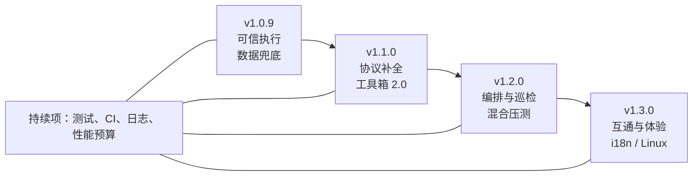
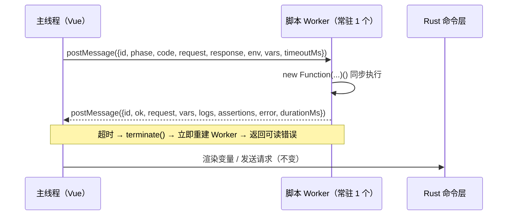

# AstroMan 本地能力补强技术方案（v1.0.9 – v1.3）

> 文档性质：v1.0.8「自动化测试」之后的本地能力演进方案，覆盖请求内核、数据安全、协议支持、工具箱与工程质量
> 代码基线：AstroMan v1.0.7（2026-10-29 发布），工作区已落 v1.0.8 的 T-01 建表改动（未提交）
> 目标版本：v1.0.9 / v1.1.0 / v1.2.0 / v1.3.0
> 边界：**不做云**——不做账号、不做团队同步、不做云端报告托管、不做分布式压测调度
> 关键决策：脚本沙箱走 Web Worker 而非下沉 Rust；Mock 用 axum 内嵌进程内服务；备份用 `VACUUM INTO`；主密钥交系统钥匙串；耗时分解只承诺可测口径，不伪造 DNS/TLS 分段
> 编写日期：2026-10-30
> 维护要求：任务状态变化时更新第 9 节；发布前核对第 10 节

---

## 0. 一页结论

### 0.1 现在有什么

| 层 | 已具备 | 代码位置 |
|---|---|---|
| 请求内核 | 7 种方法、Params/Headers/Cookie/Auth/Form-Data/Binary/GraphQL、5MB 截断、mTLS、SOCKS5 代理、30s 超时、连接池 32 | [http.rs](../src-tauri/src/commands/http.rs)、[state.rs](../src-tauri/src/state.rs) |
| 变量与脚本 | 环境变量 + 运行时变量两级；`{{secret:NAME}}` 渲染与脱敏清单；JS 前后置脚本、环境脚本；`vars/env/cipher/rsa/test/assert` | [util.rs](../src-tauri/src/util.rs#L83)、[scriptRunner.ts](../src/utils/scriptRunner.ts#L259) |
| 存储 | SQLite 27 张表（含 v1.0.8 新增 8 张）、WAL、连接池 8、数据目录可迁移、历史 10 万条 | [schema.sql](../src-tauri/src/db/schema.sql)、[db/mod.rs](../src-tauri/src/db/mod.rs) |
| 测试与压测 | 批量运行、压测引擎（并发/阶梯/RPS/SLA）、报告 JSON/HTML/Excel、报告横向对比 | [stress.rs](../src-tauri/src/commands/stress.rs)、[reportExport.ts](../src/utils/reportExport.ts) |
| AI | 三协议、61 个业务工具 + `tool_search`、确认卡、上下文预算、用量统计 | [ai.rs](../src-tauri/src/commands/ai.rs)、[aiTools.ts](../src/utils/aiTools.ts) |
| 工具箱 | 9 分类 75 个离线工具，Rust 侧哈希/HMAC/IP 查询 | [registry.ts](../src/tools/registry.ts) |
| 交互 | 8 套主题、命令面板、多标签、自动保存、托盘、自动更新 | [App.vue](../src/App.vue)、[Settings.vue](../src/views/Settings.vue) |

### 0.2 还差什么（一句话版）

**能力已经够多，但"跑得安全、数据敢放、协议够用、专业够深"四件事没做完。**

| 编号 | 缺口 | 一句话影响 | 优先级 | 版本 |
|---|---|---|---|---|
| G-01 | JS 脚本无隔离、无超时 | 一个 `while(true)` 卡死整个界面，批量/压测同样中招 | P0 | v1.0.9 |
| G-02 | 密钥只做"静态混淆"，环境变量明文 | 数据库被拷走即等于全部 token 泄露 | P0 | v1.0.9 |
| G-03 | 无备份、无恢复、无自检 | 本地唯一一份数据，损坏即全损 | P0 | v1.0.9 |
| G-04 | 二进制与大响应不可用 | 图片/PDF/zip 既无法正确预览，也无法原样保存；超 5MB 没有完整出口 | P0 | v1.0.9 |
| G-05 | 耗时不可分解、无重定向链 | 只知道"很慢"，不知道为什么慢 | P0 | v1.0.9 |
| G-06 | 协议能力不足 | HTTP/2 未启用、br/deflate 不解压、请求不可取消、无重试 | P1 | v1.0.9 |
| G-07 | 无 WebSocket / SSE | 长连接接口必须换工具 | P1 | v1.1.0 |
| G-08 | 无本地 Mock Server | 后端未就绪时无法自测，也无法给自动化测试造被测服务 | P1 | v1.1.0 |
| G-09 | 变量作用域与鉴权不可继承 | 集合级 token 要逐个接口粘贴 | P1 | v1.1.0 |
| G-10 | 无定时巡检与通知 | 只能人肉点，SRE 场景缺失 | P1 | v1.2.0 |
| G-11 | 压测只支持单接口 | 无混合链路，容量摸底失真 | P1 | v1.2.0 |
| G-12 | 无 Flow 编排 | 差异化卖点缺席，跨接口传参靠手工 | P2 | v1.2.0 |
| G-13 | 工具箱偏"通用"，缺专业刚需 | 国密、证书、造数、编码转换全无 | P1 | v1.1.0 / v1.2.0 |
| G-14 | 无示例库与接口沉淀 | 响应示例、字段说明、接口变更无处存放 | P2 | v1.1.0 |
| G-15 | 工程质量欠账 | 测试仅 4 个 spec / 23 条；无 CI、无落盘日志、无 LICENSE | P0 | 持续 |
| G-16 | 国际化 / Linux / 无障碍 | 英文用户与 Linux 用户直接劝退 | P2 | v1.3.0 |
| G-17 | 大集合性能未知 | 万级接口时树、搜索、渲染可能先崩 | P2 | v1.3.0 |
| G-18 | 本地协作能力弱 | 项目模板、环境对比、文件交换缺失 | P2 | v1.1.0 / v1.3.0 |

### 0.3 版本主题



| 版本 | 主题 | 一句话 | 预估 |
|---|---|---|---|
| v1.0.9 | 可信执行 + 数据兜底 | 让脚本跑不死、密钥偷不走、数据丢不了、响应存得下 | 37–42 人日 |
| v1.1.0 | 协议补全 + 工具箱 2.0 | WebSocket/SSE、Mock、变量作用域、15 个专业工具 | 50–57 人日 |
| v1.2.0 | 编排与巡检 | 定时调度、混合压测、Flow 编排、10 个工具 | 35–40 人日 |
| v1.3.0 | 互通与体验 | i18n、Linux、HAR/Postman 导出、性能与无障碍 | 32–37 人日 |

> 人日口径：1 名熟悉代码库的全职开发，含自测与文档，不含商店审核/签名等待。四个版本合计约 155 人日，含缓冲约 176 人日。

### 0.4 五个关键决策

1. **JS 沙箱走 Worker，不下沉 Rust**。脚本 API 全是同步的，Worker 能保持 `vars.set()` 同步语义；下沉 Rust 需要重写 crypto-js 兼容层，收益低、风险高。
2. **Mock Server 与主程序同进程**。用 axum 绑 `127.0.0.1` 随机端口，避免再发一个二进制、避免用户装两个东西。
3. **备份用 `VACUUM INTO` 而不是复制文件**。WAL 模式下直接拷 `.db` 会得到不一致快照，`VACUUM INTO` 是 SQLite 官方推荐的一致性备份方式（bundled 版本已支持）。
4. **密钥交系统钥匙串**。Windows Credential Manager / macOS Keychain 存 32 字节主密钥，数据库里只留密文；钥匙串不可用时降级为 0600 权限的本地密钥文件并明确告警。
5. **耗时分解只承诺能测的**。reqwest 不暴露 DNS/TCP/TLS 分段，v1.0.9 交付「连接、首字节、下载、总计 + 重定向链」，DNS 用独立预解析近似并标注口径，不编造数据。

---

## 1. 代码级现状盘点

### 1.1 请求内核

| 项 | 现状 | 证据 |
|---|---|---|
| HTTP 版本 | **仅 HTTP/1.1**。`reqwest` 关闭了默认特性，未启用 `http2` | [Cargo.toml](../src-tauri/Cargo.toml) features 仅 `json/stream/native-tls/gzip/multipart/socks` |
| 压缩 | 只解 gzip；服务端返回 `br` / `deflate` 时按原始字节处理 | 同上，无 `brotli` / `deflate` |
| 超时 | 连接 10s、总 30s 写死；无按请求覆盖 | [state.rs](../src-tauri/src/state.rs#L343) |
| 取消 | 普通请求无取消；只有压测与 AI 有取消位 | [state.rs](../src-tauri/src/state.rs#L59-L62) |
| 重试 | 无 | — |
| 响应 | 全量读入内存，5MB 截断，只返回文本 `body` | [http.rs](../src-tauri/src/commands/http.rs#L12) |
| 落盘 | 只有 `file_write_text`，无二进制写 | [files.rs](../src-tauri/src/commands/files.rs#L26) |
| 计时 | 只有 `started.elapsed()` 总耗时 | [http.rs](../src-tauri/src/commands/http.rs#L249) |
| 记录 | `RecordOptions` 已带 `origin`，套件运行默认不写历史 | [http.rs](../src-tauri/src/commands/http.rs#L15-L45) |

### 1.2 存储与数据

- 27 张表，`PRAGMA user_version = 1`；`migrate()` 以「逐条 ALTER + 吞掉错误」实现补列（[db/mod.rs](../src-tauri/src/db/mod.rs#L20-L89)）。
- **隐患**：吞错会把磁盘满、库锁死等真实故障一起吞掉，只剩"表结构没升级"的隐性故障；建议改为 `PRAGMA table_info` 判存后再 ALTER。
- 无 `integrity_check`、无备份、无「旧版本打开新库」保护。
- `collections` 只有 `id/parent_id/name/sort_order`，没有变量与鉴权字段（[schema.sql](../src-tauri/src/db/schema.sql#L16-L24)）。
- `env_variables` 只有 `is_secret` 标记，值明文存储；读取时原样返回前端，仅界面用 password 框遮挡（[environment.rs](../src-tauri/src/commands/environment.rs#L8-L18)）。

### 1.3 安全边界

| 项 | 现状 | 评价 |
|---|---|---|
| AI Key | AES-256-GCM，密钥由**固定种子**派生 | 代码注释自述为"本机静态混淆"（[ai.rs](../src-tauri/src/commands/ai.rs#L23)），拿程序即可解 |
| 环境变量 | 明文入库 | 与 `is_secret` 的语义不符 |
| `{{secret:NAME}}` | 渲染时收集敏感值，供日志/报告脱敏 | **已实现**，比文档描述更完整（[util.rs](../src-tauri/src/util.rs#L83-L117)） |
| CSP | `script-src 'self' 'unsafe-eval'`；无 `worker-src` | 引入 Worker 必须补 `worker-src 'self' blob:` |
| 文件写入 | `file_write_text` 任意路径、自动建目录 | 仅本应用可调用，风险低；建议导出路径限制在对话框选择结果内 |
| 脚本能力 | `new Function` 全量执行，无白名单 | 沙箱化后仍不承诺"安全执行不可信代码"，只解决卡死与超时 |

### 1.4 测试与压测

- v1.0.8 规划已覆盖套件、用例、数据集、Python、报告、CLI，本文不重复。
- 本文只补 v1.0.8 未覆盖的三处：**JS 引擎隔离**（原 D-07 推到 1.0.9）、**混合场景压测**（原 D-09）、**SLA 门禁与基线**（原 D-08 已在 1.0.8，本文只做验收联动）。

### 1.5 工具箱

- 75 个工具、9 分类；`simple`（声明式输入输出）与 `component`（自定义交互）双形态，注册表集中在 [registry.ts](../src/tools/registry.ts)（1746 行）。
- 结构性问题：
  1. **偏通用、缺专业**：国密、证书、TOTP、文件编码转换、测试造数全无；
  2. **工具之间不通**：JSON 生成实体类的结果无法一键送进「代码格式化」；
  3. **无个人化**：没有收藏、最近使用、输入快照；
  4. **单文件膨胀**：`TextToolbox.vue`、`JsonWorkbench.vue` 已接近维护上限；
  5. **搜索只做子串匹配**，无别名与拼音首字母。
- 详见 4.13 与附录 A。

### 1.6 交互

已有命令面板、多标签、自动保存、8 套主题、托盘、自动更新。缺口：
- 编辑器与集合树无撤销/重做；删除只有二次确认，没有回收站；
- 无变量检查器（不知道某个 `{{var}}` 最终来自哪一层、是否未定义）；
- 无接口级"示例/文档"沉淀；
- 空状态引导有，但错误态缺少"下一步该做什么"的直达入口。

### 1.7 工程

| 项 | 现状 | 目标 |
|---|---|---|
| 前端单测 | 4 个 spec、23 条，只覆盖 AI 工具/协议/预算/注入 | ≥ 200 条，覆盖脚本引擎、转换器、加密、脱敏 |
| Rust 单测 | 仅 `db` 模块有迁移测试 | 命令层关键路径 + 密钥 + 备份 + 计时口径 |
| E2E | 无 | 20 条核心链路（tauri-driver，Windows 优先） |
| CI | 无可见工作流（仅 release） | PR 跑 `vue-tsc` + `vitest` + `cargo test` + `cargo clippy` |
| 日志 | `env_logger` 输出到 stdout，无落盘 | 滚动文件 + 诊断包导出 |
| 版本号 | `package.json` / `Cargo.toml` / `tauri.conf.json` 三处手工同步 | 发布脚本校验一致 |
| LICENSE | 缺失（README 自述待补） | MIT |

---

## 2. 缺口总表（含验收口径）

| 编号 | 缺口 | 现状证据 | 用户可感知后果 | 验收口径 | 优先级 |
|---|---|---|---|---|---|
| G-01 | 脚本无隔离 | `new Function` 主线程执行 | 死循环卡死界面，只能杀进程 | `while(true)` 5s 内被终止并提示，界面可继续操作 | P0 |
| G-02 | 密钥保护不足 | 固定种子 + 明文变量 | 拷库即泄露 | 库内无明文密钥；换机后需重新输入或显式导出 | P0 |
| G-03 | 无备份恢复 | 只有目录迁移与历史清理 | 误删/损坏即全损 | 每日自动快照 + 一键恢复 + 启动 `quick_check` | P0 |
| G-04 | 二进制不可用 | 只有文本写、5MB 截断 | 下载类接口无法交付产物 | 二进制响应可预览/另存；超限可保存完整文件 | P0 |
| G-05 | 耗时不可分解 | 单一总耗时 | 无法定位慢在连接还是服务端 | 展示连接/首字节/下载/总计与重定向链 | P0 |
| G-06 | 协议能力弱 | 无 http2、无 br、不可取消 | 部分站点行为与浏览器不一致 | HTTP/2 可开关；br/deflate 自动解压；请求可取消 | P1 |
| G-07 | 无长连接调试 | 全仓库无 WS 实现 | 实时接口无法调试 | WS 连接/收发/帧列表/保存为接口；SSE 可看事件流 | P1 |
| G-08 | 无 Mock | 无相关代码 | 后端未就绪无法自测 | 本地起服务、规则命中、延迟/错误注入、日志可查 | P1 |
| G-09 | 变量层级不足 | 仅环境 + 运行时 | 集合级配置重复劳动 | 全局/集合/请求三层 + 继承 + 变量检查器 | P1 |
| G-10 | 无调度 | 仅工具箱里的 cron 解析 | 无法做定时拨测 | 按 cron 执行并本地通知，错过的运行有明确策略 | P1 |
| G-11 | 单接口压测 | `stress.rs` 单请求 | 链路容量摸底失真 | 多接口按权重混合，分接口指标 + 汇总 | P1 |
| G-12 | 无编排 | 无 Flow | 跨接口依赖只能手点 | DAG 编辑器 + 条件分支 + 断点续跑 | P2 |
| G-13 | 工具箱不够专业 | 见附录 A | 国密/证书场景直接放弃 | 新增 25 个工具，全部本地计算 | P1 |
| G-14 | 无示例库 | 请求表无示例字段 | 接口文档无处沉淀 | 保存响应示例、字段说明、导出 Markdown | P2 |
| G-15 | 工程欠账 | 见 1.7 | 改动回归靠手点，问题难定位 | CI 全绿 + 覆盖率门槛 + 日志落盘 | P0 |
| G-16 | 无 i18n / Linux | 文案硬编码中文 | 开源受众受限 | 中英双语可切换；Linux 可构建运行 | P2 |
| G-17 | 大集合性能未知 | 无虚拟滚动证据 | 万级接口卡顿 | 10k 接口树首屏 < 300ms，滚动 60fps | P2 |
| G-18 | 协作能力弱 | 仅项目 JSON 导入导出 | 换机/交接靠手工 | 项目模板、环境对比、HAR/Postman 导出 | P2 |

---

## 3. 版本规划

### 3.1 v1.0.9 —「可信执行 + 数据兜底」

**目标**：让用户敢把生产 token 放进来、敢让脚本自动跑、敢把数据只存这一份。

Must（必须做）：

1. JS 脚本 Worker 沙箱（超时、终止、日志回传、错误行号不退化）
2. 主密钥进系统钥匙串 + 环境变量/AI Key 统一加密 + 读取掩码
3. 自动备份 + 恢复 + 启动自检 + 诊断包
4. 二进制响应落盘与预览 + 完整响应另存
5. 耗时分解（连接/首字节/下载/总计）+ 重定向链

Should（有余力就做）：

6. HTTP/2 开关、br/deflate 解压
7. 请求取消与幂等重试
8. 日志落盘与滚动

**不做**：WebSocket、Mock、变量层级、Flow、i18n。

**完成定义**：老库（v1.0.7 真实数据）升级零报错；脚本死循环不再卡界面；断网状态下备份与恢复全流程可用。

### 3.2 v1.1.0 —「协议补全 + 工具箱 2.0」

1. WebSocket 调试（连接、帧、心跳、保存为接口）
2. SSE / EventStream 查看器（自动重连、Last-Event-ID）
3. 本地 Mock Server（规则、延迟、错误注入、请求日志）
4. 变量作用域（全局/集合/请求）+ 鉴权继承 + 变量检查器
5. 响应示例库 + 接口说明 + Markdown 导出
6. HAR 导入、Postman 导出
7. 工具箱 2.0：15 个专业工具 + 收藏/最近/跨工具传参
8. CSP 与能力配置同步更新（`worker-src`、asset 协议、notification）

**完成定义**：一个纯前端项目可以在 AstroMan 内完成"调试 → Mock → 联调 → 文档"闭环。

### 3.3 v1.2.0 —「编排与巡检」

1. 定时巡检（cron、错过策略、本地通知、Webhook）
2. 混合场景压测（权重、分接口指标、SLA 汇总）
3. Flow 编排（DAG、条件、变量传递、断点续跑、失败重试）
4. Flow 与套件/压测/报告打通
5. 工具箱第二批 10 个工具（含造数、编码转换、DNS/TLS 查询）

**完成定义**：一条"登录 → 下单 → 查询 → 断言"的链路可无人值守跑通并出报告。

### 3.4 v1.3.0 —「互通与体验」

1. i18n（zh-CN / en-US，按页面灰度迁移）
2. Linux 桌面端（WebKitGTK 4.1，AppImage/deb）
3. HAR / Postman / OpenAPI 三向互通补齐
4. 大集合性能（虚拟滚动、搜索索引）
5. 无障碍与快捷键体系（可自定义、焦点可见）
6. 项目模板与回收站

### 3.5 明确不做

| 方向 | 原因 |
|---|---|
| 账号 / 云同步 / 团队协作 | 破坏"无账号、无后端、数据不出本机"的核心卖点 |
| 分布式压测 | 需要多机协同与控制面，本质是云能力 |
| 云端报告托管 | 同上；本地 HTML 报告已够交付 |
| 插件市场 | 安全与审核成本高，先做"脚本片段库"这种轻形态 |
| gRPC 全量支持 | 生态与反射服务差异大，投入产出不划算，v1.3 后评估 |
| AI 云端记忆 | 与本地优先冲突 |

---

## 4. 专项技术方案

### 4.1 JS 脚本沙箱（G-01）

**现状**

- [scriptRunner.ts](../src/utils/scriptRunner.ts#L259) 用 `new Function('request','vars','env','console','rsa','cipher', code)` 在主线程同步执行。
- 前置、后置、环境脚本三条路径共用同一套注入对象；`vars.set()` 是同步写入闭包 Map。
- 没有超时、没有中断、没有资源上限；`while(true)` 会让 WebView 主线程永久占用，只能结束进程。
- 批量 Runner 每个接口执行一次，压测中脚本在每次请求前执行，卡死概率被放大。

**设计**



- 新增 `src/utils/scriptWorker.ts`：接收消息、构造与现在完全一致的注入对象、执行、回传序列化结果。
- 新增 `src/utils/scriptHost.ts`：Worker 生命周期管理（懒启动、超时 `terminate`、重建、并发串行队列、`AbortSignal`）。
- 保留 `scriptRunner.ts` 的纯函数形态（`runPreScript/runPostScript`）作为**浏览器降级路径**：`npm run dev` 无 Worker 时仍可用，签名不变。
- 超时默认 5s（设置项可调 1–30s）；超时错误文案带阶段与耗时，禁止静默失败。
- 日志上限 4000 字符/条、200 条/次，超出丢弃并标注"日志已截断"。
- 断言结果结构不变（`ScriptAssertion[]`），保证「测试」页无需改动。

**兼容性风险与对策**

| 风险 | 对策 |
|---|---|
| Worker 内无 DOM | 脚本 API 本就不暴露 DOM；若有用户脚本访问 `window`，捕获 `ReferenceError` 并提示"脚本运行在隔离环境" |
| 大量数据 structured clone 变慢 | 后置脚本只传 `body` + 必要字段；500KB 以上响应按"截断 + 标记"传入，与现有 5MB 截断口径一致 |
| `new Function` 在 Worker 里受 CSP 限制 | CSP 增加 `worker-src 'self' blob:`；Worker 内 `unsafe-eval` 继承 `script-src`，无需额外放开 |
| 时序：Worker 启动有 20–50ms 延迟 | 应用启动后空闲预热的 1 个 Worker；首帧请求不预热 |
| 错误行号定位退化 | Worker 内 `error.stack` 行号偏移需校正（包装函数增加行数），单测固定 3 个用例校验 |

**验收**

- `while(true){}`：5s 内被终止，界面仍可点击，提示"脚本执行超时（5s），已终止"。
- `for` 循环 1e7 次：不超时，结果与旧实现一致。
- 现有脚本示例（MD5/HMAC/AES/RSA/Token 提取）逐条回归通过。
- 批量运行 100 个接口，任一脚本死循环不阻断后续（可配置"超时即失败并继续"）。

**工作量**：6 人日（Worker + Host + 兼容层 4，单测与回归 2）。

---

### 4.2 密钥加密与主密钥（G-02）

**现状**

- AI Key：`AES-256-GCM`，密钥 = `SHA256("AstroMan::ai::provider::v1")`，注释已承认是"静态混淆"。
- 环境变量：`is_secret` 仅控制前端输入框 `type=password`，值明文入库、明文返回。
- `{{secret:NAME}}` 已能把用到的值收集进脱敏清单，说明"使用侧"链路是通的，缺的是"存储侧"。

**设计**

1. **主密钥**：首次启动生成 32 字节随机数，存入系统钥匙串。
   - Windows：Credential Manager（`keyring` crate，service = `com.astroman.app`，user = `master-key`）
   - macOS：Keychain（同上）
   - 降级：钥匙串不可用时写 `数据目录/keys/master.key`（Unix 0600 / Windows 仅当前用户 ACL），设置页显示黄色告警。
2. **加密格式**：`enc:v1:<base64(nonce12 || ciphertext)>`，AES-256-GCM，AAD 绑定「表名:字段名」防止密文搬到其他字段。
3. **加密范围**：`env_variables.value`（`is_secret = 1`）、`ai_providers.api_key`、`oauth` 客户端密钥、未来 Mock 的鉴权头。
4. **迁移**：启动时 `user_version < 2` 触发一次性迁移：读取旧值 → 加密 → 写回；迁移失败则整体回滚并提示"密钥迁移失败，请先备份"，绝不静默丢值。
5. **读取**：`env_list` 对 `is_secret` 返回 `"••••••"` + `hasValue: true`，只有在"发送请求/渲染变量"的 Rust 内部路径解密；前端永不持有明文。
6. **换机/重装**：提供"导出加密密钥包"（用户设置口令，PBKDF2/Argon2 派生）与"重置密钥"（清空所有密钥值，需二次确认）。

**数据变更**

无新增表。`value` / `api_key` 字段直接存密文；新增 `app_meta` 记录 `key_source`（keyring/file）、`key_created_at`、`crypto_version`。

**风险**

| 风险 | 对策 |
|---|---|
| 钥匙串在 CI / 无桌面会话下不可用 | 降级文件密钥；日志只记一次告警 |
| 用户忘记导出密钥包后重装 | 设置页常驻"导出密钥包"入口；升级提示一次 |
| 迁移中途崩溃 | 单事务 + 备份先行；启动检测 `crypto_version` 与残留明文 |
| 旧版本打开新库 | `user_version` 过高时拒绝启动并提示升级/备份 |

**验收**

- 用 `sqlite3` 直接查库：`env_variables.value`、`ai_providers.api_key` 均无明文。
- 前端 environment 接口返回掩码；发送请求时服务端收到的 header 是正确明文。
- 从 v1.0.7 库升级：值不丢、可正常发送；重复启动不重复加密。
- 换机导入密钥包后，全部密钥可解密。

**工作量**：5 人日（钥匙串 + 加密层 3，迁移 1，密钥包 1）。

---

### 4.3 备份、恢复与自检（G-03）

**现状**

- 有 `storage_set`（迁目录）与 `data_cleanup`（删历史），没有备份。
- WAL 模式下直接复制 `astroman.db` 会漏掉 `-wal` 中的已提交事务，不能作为备份方案。

**设计**

1. **快照**：`VACUUM INTO '备份目录/astroman-YYYYMMDD-HHmm.db'`，单文件、一致、自动压缩空闲页。
2. **触发时机**：
   - 启动后 60s 若距上次成功备份 > 24h，后台执行；
   - 危险操作前强制快照：恢复、清理历史、切换数据目录、DB 迁移；
   - 退出前若当天无备份，尽力执行一次（限 5s，超时放弃）。
3. **保留策略**：日备 7 份 + 周备 4 份 + 手动备份不限；总占用上限 2GB，超限按最旧淘汰。
4. **恢复**：
   - 列表展示时间、大小、schema 版本、记录数；
   - 恢复前把当前库快照为 `pre-restore-*.db`；
   - 关闭连接池 → 替换文件（含 `-wal`/`-shm` 清理）→ 重启应用；
   - 恢复后校验 `quick_check` 与表数量，失败自动回滚到 pre-restore。
5. **自检**：
   - 启动异步 `PRAGMA quick_check`（限 3s），失败弹窗给出"从备份恢复"直达入口；
   - 设置页"深度检查"跑 `integrity_check`，展示结果与耗时；
   - 检测 `-wal` 异常膨胀（> 200MB）提示执行 checkpoint。
6. **诊断包**：版本、系统、schema 版本、表行数、最近 500 行日志、脱敏后的设置；不含请求体与密钥。

**数据变更**

无新表。`app_meta` 记录 `last_backup_at`、`last_backup_path`、`last_check_at`、`last_check_result`。

**验收**

- 100MB 库快照 < 2s（SSD），期间界面不卡（后台线程 + 进度提示）。
- 手动损坏库文件后启动：明确提示损坏，可从备份一键恢复。
- 恢复后项目、集合、请求、环境、报告数量与恢复点一致。
- 连续 8 天启动：日备 7 份、周备按规则保留，无重复堆积。

**工作量**：5 人日（快照与保留 2，恢复流程 2，自检与诊断 1）。

---

### 4.4 二进制响应与大响应（G-04）

**现状**

- `http.rs` 全量读入内存，`MAX_BODY = 5MB`，超出截断并标记 `truncated`。
- `HttpResult.body` 是 `String`，非 UTF-8 内容会损坏。
- `files.rs` 只有 `file_write_text`，"另存为"写的是文本。

**设计**

1. **判定**：`Content-Type` 不属于 `text/*`、`application/json`、`application/xml`、`+json`、`+xml`，或含 `Content-Disposition: attachment` → 视为二进制。
2. **落盘**：二进制或 > 2MB 的响应，流式写入 `数据目录/responses/<yyyymmdd>/<uuid>.<ext>`，同时保留前 64KB 作为预览片段。
3. **返回结构**：`HttpResult` 增加
   ```ts
   bodyKind: 'text' | 'json' | 'binary' | 'stream'
   bodyFile?: string      // 相对数据目录
   bodyBytes: number
   previewBase64?: string // 仅图片/PDF 首页等小片段
   ```
4. **预览**：图片、PDF、音视频用 `convertFileSrc` + `asset:` 协议；需在 `tauri.conf.json` 开启 `assetProtocol` 并把 scope 限定到 `$APPDATA/responses/**`，CSP 已允许 `asset:`。自定义数据目录时该 scope 不生效，降级为 `read_file_base64` 返回 data URL（仅 ≤ 2MB）。
5. **另存为**：新增 `file_write_binary(path, base64)` 或 `file_copy(src, dst)`；优先 `file_copy`，避免大文件过 IPC。
6. **清理**：`responses/` 按 LRU 保留 1GB / 30 天，启动时后台清理；历史记录删除时级联删文件（软失败，不阻断）。
7. **完整响应**：截断场景提供"保存完整响应到文件"，走流式写盘，不进内存。

**验收**

- 下载 20MB zip：不截断、不卡顿、可另存，哈希与源站一致。
- 图片接口：响应区直接显示缩略图，可另存原图。
- 5MB 文本响应：提示"已截断"，点击"保存完整响应"得到完整文件。
- 删除历史后，孤儿文件在 24h 内被清理。

**工作量**：4 人日（含 asset 协议与清理）。

---

### 4.5 耗时分解与重定向链（G-05）

**现实约束**

`reqwest` 不暴露 DNS/TCP/TLS 分段。可选方案对比：

| 方案 | 能拿到 | 代价 | 结论 |
|---|---|---|---|
| A. 自定义 connector 包装 | 连接总耗时、是否复用 | 低（`hyper-util` 连接器包一层） | ✅ 采用 |
| B. 自己解析 DNS + 指定 IP 连接 | DNS、TCP、TLS 可分 | 高（SNI/Host/代理/证书全要自己处理） | ❌ 不做 |
| C. 预解析计时近似 DNS | DNS 近似值 | 低，但代理场景无意义 | ⚠️ 仅直连时展示并标注"近似" |

**设计**

1. `HttpResult.timings`：`dnsMs?`、`connectMs`、`ttfbMs`、`downloadMs`、`totalMs`、`reusedConnection`。
2. 实现：
   - 用 `reqwest` 0.12 的 `connector_layer` 包一层计时连接器（底层 `hyper-util` 的 `HttpConnector`）；
   - 请求前 `Instant::now()`；拿到响应头记 TTFB；读完 body 记下载；
   - 直连且未启用代理时，额外做一次 `ToSocketAddrs` 预解析用于 `dnsMs`（标注近似）。
3. **重定向链**：改为 `redirect::Policy::none()` 手工跟随，最多 10 跳，记录每跳 `status / location / duration / host`；UI 展示瀑布条；提供"不跟随重定向"开关（与压测配置口径统一）。
4. UI：响应区新增"计时"页签，横向瀑布（连接/首字节/下载），慢请求给出"疑似服务端慢/网络慢"的判定提示（阈值可配）。
5. 历史与报告同步存 `timings_json`，便于按时间对比。

**验收**

- 访问 3 跳重定向站点：链上每跳可见，总耗时等于各跳之和（误差 < 5%）。
- 连接复用场景：第二次请求 `connectMs` ≈ 0 且 `reusedConnection = true`。
- 慢接口可区分"连接慢"与"首字节慢"，文案不误导。

**工作量**：5 人日（连接器 2、重定向链 1.5、UI 1、测试 0.5）。

---

### 4.6 HTTP 协议能力（G-06）

**现状**

- `reqwest` 以 `default-features = false` 引入，未启用 `http2`、`brotli`、`deflate`，因此**只能走 HTTP/1.1，且只解 gzip**。
- 连接超时 10s、总超时 30s 写死；请求发出后无法取消；失败不重试。

**设计**

1. **HTTP/2**：`features += ["http2"]`，在请求设置里提供「协议：自动 / HTTP1.1 / HTTP2」，默认自动（ALPN 协商）。响应区展示实际协商结果 `httpVersion`。
2. **解压**：`features += ["brotli", "deflate"]`，自动处理 `Content-Encoding`；保留原始字节大小与解压后大小两个字段。
3. **取消**：`send_http_request` 增加 `requestId`；`AppState` 维护 `cancel_map: Mutex<HashMap<String, CancellationToken>>`；新增命令 `cancel_http_request(requestId)`；前端"发送"按钮在飞行中变为"停止"。
4. **重试**：仅对 `GET/HEAD/OPTIONS` 或显式勾选"允许重试非幂等请求"生效；条件为连接错误、408、429、5xx；策略指数退避（200ms 起，最多 3 次，尊重 `Retry-After`）；重试记录进"计时"页签。
5. **按请求网络覆盖**：`requests.net_json` 存 `{ timeoutMs, connectTimeoutMs, followRedirect, verifyTls, proxyMode }`；未设置时继承全局设置，避免"改一个接口影响全部"。
6. 计时与重定向链复用 4.5 的 `timings`。

**验收**

- 访问仅支持 HTTP/2 的站点：`httpVersion = HTTP/2`，响应正常。
- 返回 `Content-Encoding: br` 的接口：正文可读，`rawBytes != decodedBytes`。
- 慢接口点击"停止"：1s 内中止，界面提示"已取消"。
- 503 接口在开启重试后按退避重试 3 次，计时页可见每次尝试。

**工作量**：4 人日（http2/解压 1.5、取消 1、重试 1、按请求覆盖 0.5）。

---

### 4.7 WebSocket / SSE（G-07）

**范围**

- WebSocket：连接、收发文本/二进制、心跳、帧列表、保存为接口、消息导出。
- SSE：订阅 `text/event-stream`、事件列表、自动重连、暂停/继续。

**数据模型**

- 不建表。连接与帧在内存：`AppState.ws_sessions: Mutex<HashMap<String, WsSession>>`，帧环形缓冲 5000 条 / 单条 10MB。
- "保存为接口"落到 `requests`：新增 `protocol`（`http` | `ws` | `sse`）与 `ws_json`（url、headers、subprotocols、auth）。
- 需要留档时导出 JSON 文件，不进 SQLite，避免帧把库撑大。

**WebSocket 实现**

```rust
// 依赖：tokio-tungstenite（native-tls），tokio features += ["net", "rt-multi-thread", "macros"]
#[tauri::command] async fn ws_connect(app: AppHandle, state: State<'_, AppState>, payload: WsConnectPayload) -> Result<String, String>;
#[tauri::command] async fn ws_send(state: State<'_, AppState>, session_id: String, kind: String, data: String) -> Result<(), String>;
#[tauri::command] async fn ws_close(state: State<'_, AppState>, session_id: String) -> Result<(), String>;
```

- 事件：`ws://frame`（`{sessionId, direction, opcode, data, size, ts}`）、`ws://state`（connecting/open/closing/closed/error）。
- 读写任务分离：读任务循环 `next()`，写任务走 mpsc；心跳 30s（可关），记录 ping/pong 延迟。
- 连接上限 8，单条消息 10MB，超限断开并提示。
- 仅允许 `ws://` / `wss://`；不支持自定义证书时给出提示。

**SSE 实现**

- 复用 reqwest stream；按行解析 `id:` / `event:` / `data:` / `retry:`，空行分派事件。
- 断线自动重连（默认开，1s 起指数退避，最多 5 次），带 `Last-Event-ID`。
- 暂停只停止渲染，不停止接收（可切换"暂停接收"）；缓冲 5000 条。

**UI**

- 请求编辑器增加协议切换（HTTP / WebSocket / SSE）。
- WS 面板：连接状态条、消息列表（方向箭头、时间、大小、opcode）、发送框（文本/JSON/二进制 Base64）、"发送并等待响应"辅助、清空、导出。
- SSE 面板：事件表格（event / id / data / 时间）、自动滚动开关、过滤关键字。

**验收**

- 连接公共 echo 服务：收发 100 条不丢、不乱序，帧时间准确。
- 服务端主动断开：状态变 closed 并给出原因；重连按钮可用。
- 保存为接口后重启应用，配置完整恢复。
- SSE 断流后自动重连并带 `Last-Event-ID`。

**工作量**：10 人日（WS 后端 4、WS UI 3、SSE 2、联调 1）。

---

### 4.8 本地 Mock Server（G-08）

**设计原则**

- 与主程序同进程，`axum` 绑 `127.0.0.1`，**默认关闭、显式启动**、端口冲突自动 +1 探测。
- 规则来自三处：手工新建、从集合响应示例生成、从 OpenAPI 导入。
- 不执行用户 JS（避免把脚本注入面扩大到服务端），只做模板变量与随机/延迟/故障注入。

**数据模型**

```sql
CREATE TABLE mock_servers (
  id INTEGER PRIMARY KEY AUTOINCREMENT,
  project_id INTEGER NOT NULL REFERENCES projects(id) ON DELETE CASCADE,
  name TEXT NOT NULL,
  port INTEGER NOT NULL DEFAULT 0,          -- 0 = 启动时自动选择
  enabled INTEGER NOT NULL DEFAULT 0,
  options_json TEXT,                        -- cors / 默认延迟 / 全局错误率 / 前缀
  created_at INTEGER NOT NULL,
  updated_at INTEGER NOT NULL
);

CREATE TABLE mock_routes (
  id INTEGER PRIMARY KEY AUTOINCREMENT,
  server_id INTEGER NOT NULL REFERENCES mock_servers(id) ON DELETE CASCADE,
  name TEXT NOT NULL,
  method TEXT NOT NULL DEFAULT 'GET',
  path TEXT NOT NULL,                       -- /api/users/:id
  match_json TEXT,                          -- header / query 条件
  status INTEGER NOT NULL DEFAULT 200,
  headers_json TEXT,
  body TEXT,
  delay_ms INTEGER NOT NULL DEFAULT 0,
  fail_rate INTEGER NOT NULL DEFAULT 0,     -- 0-100
  fail_status INTEGER DEFAULT 500,
  enabled INTEGER NOT NULL DEFAULT 1,
  sort_order INTEGER NOT NULL DEFAULT 0
);
```

**匹配与响应**

1. 方法 + 路径（`:param` 与 `*` 通配）→ 命中规则按 `sort_order` 取第一条。
2. 可选条件：header 等值/包含、query 等值、body JSONPath（简单路径）等值。
3. 响应模板支持 `{{randomInt(1,100)}}`、`{{timestamp}}`、`{{uuid}}` 与路径参数 `{{param.id}}`（复用 `util::render` 的表达式解析）。
4. 延迟：固定 + 抖动（±20%）；错误率：按百分比返回 `fail_status`，命中时在日志标记 `injected`。
5. 未命中：返回 404 + JSON 说明，并记录日志（便于发现"路径写错"）。
6. 请求日志：内存环形 200 条（方法、路径、状态、耗时、请求头、前 4KB 请求体），可一键复制为 cURL。

**安全与边界**

- 只绑 `0.0.0.0` 需二次确认并提示防火墙风险（默认不提供）。
- 不解析外网请求体到脚本；日志中 `Authorization` / `Cookie` 默认掩码。
- 服务随应用退出；异常退出时端口由系统回收。

**与自动化测试联动**

- 套件运行环境支持"使用本地 Mock 地址"开关：运行时把 `base_url` 替换为 `http://127.0.0.1:<port>`，实现**离线可跑的回归**。

**验收**

- 启动后 `curl http://127.0.0.1:PORT/api/users/1` 命中规则，返回配置的状态与体。
- 延迟 500ms：实测 500±100ms。
- 错误率 50%：100 次请求中 45–55 次返回注入错误。
- 停止后端口释放，再次启动可用。
- OpenAPI 导入 20 个 path 生成 20 条规则，路径参数正确转 `:param`。

**工作量**：8 人日（引擎 4、UI 2、导入 1、联动与测试 1）。

---

### 4.9 变量作用域与鉴权继承（G-09）

**现状**

- 两级：环境变量 + 脚本运行时变量（[http.rs](../src-tauri/src/commands/http.rs#L442)）。
- `collections` 无 `variables` / `auth` 字段，集合级 token 必须逐接口粘贴。
- 没有"这个 `{{var}}` 到底解析成了什么"的可视化。

**优先级设计**

```
内置变量 < 全局变量 < 集合变量（由远及近，近者覆盖） < 环境变量 < 请求变量 < 运行时变量（脚本 vars.set）
```

> 环境高于集合：环境代表"这套部署"，切换环境应能覆盖集合里的默认 `base_url`。同名时在检查器里显示"被环境覆盖"。

**数据模型**

```sql
CREATE TABLE global_variables (
  id INTEGER PRIMARY KEY AUTOINCREMENT,
  key TEXT NOT NULL UNIQUE,
  value TEXT,
  is_secret INTEGER NOT NULL DEFAULT 0,
  updated_at INTEGER NOT NULL
);
ALTER TABLE collections ADD COLUMN variables TEXT;   -- JSON [{key,value,isSecret}]
ALTER TABLE collections ADD COLUMN auth TEXT;        -- JSON，结构同 requests.auth
ALTER TABLE requests ADD COLUMN variables TEXT;
```

**实现**

1. `resolve_vars(conn, project_id, env_id, collection_id, request_id)` 统一组装，返回 `(HashMap, secret_keys)`，替换现在 `load_vars_with_secrets` 的单层逻辑。
2. 鉴权继承：`requests.auth.mode = "inherit"` 时向上找最近设置鉴权的集合；集合也没有则用项目默认（存 `projects.settings_json`）。
3. 变量检查器：发送前扫描 URL/Headers/Params/Body 中的 `{{...}}`，逐条展示「变量名 / 来源层 / 最终值（secret 掩码） / 是否未定义」；未定义默认警告，可在设置里改为阻止发送。
4. 迁移：老请求的 `auth` 保持不变；`mode` 缺省视为 `none`，不改变行为。
5. 导入导出：`astroman.project` 增加 `schemaVersion: 2`，包含全局/集合/请求变量；旧文件缺字段按空处理。

**验收**

- 集合配 `token`，两个子接口用 `{{token}}`，改一处两边生效。
- 环境变量同名时覆盖集合值，检查器显示覆盖来源。
- 未定义变量在检查器中标红，开启"阻止发送"后不被发出。
- 旧项目导出再导入，变量与鉴权不丢。

**工作量**：6.5 人日（后端 3、检查器 2、鉴权继承 1.5）。

---

### 4.10 定时巡检与本地通知（G-10）

**边界**：调度只在应用运行时生效（含最小化到托盘）。**不做后台守护进程**，文档明确写清，避免"关了也在跑"的误解。

**数据模型**

```sql
CREATE TABLE schedules (
  id INTEGER PRIMARY KEY AUTOINCREMENT,
  project_id INTEGER NOT NULL REFERENCES projects(id) ON DELETE CASCADE,
  name TEXT NOT NULL,
  target_type TEXT NOT NULL,          -- request | suite | stress
  target_id INTEGER NOT NULL,
  cron TEXT NOT NULL,
  timezone TEXT NOT NULL DEFAULT 'local',
  enabled INTEGER NOT NULL DEFAULT 1,
  timeout_secs INTEGER NOT NULL DEFAULT 60,
  missed_policy TEXT NOT NULL DEFAULT 'skip',   -- skip | run_once
  notify_json TEXT,                   -- {desktop:true, webhook:'', onlyOnFail:true}
  next_run_at INTEGER,
  last_run_at INTEGER,
  last_status TEXT,
  created_at INTEGER NOT NULL,
  updated_at INTEGER NOT NULL
);

CREATE TABLE schedule_runs (
  id INTEGER PRIMARY KEY AUTOINCREMENT,
  schedule_id INTEGER NOT NULL REFERENCES schedules(id) ON DELETE CASCADE,
  started_at INTEGER NOT NULL,
  finished_at INTEGER,
  status TEXT NOT NULL,               -- running | passed | failed | timeout | skipped
  summary TEXT,
  detail_json TEXT
);
```

**调度器**

- 依赖 `cron` crate 解析 5/6 段表达式；主循环 30s tick，计算 `next_run_at`（本地时区，跨夏令时按本地时间重算）。
- 单并发：同一时刻只跑一个任务，其余排队并记录 `skipped`。
- 启动时处理错过：`now - next_run_at > 5min` 时按 `missed_policy` 处理（默认跳过并写一条 `skipped`）。
- 任务执行复用 v1.0.8 的套件执行器与 `send_http_request`，`origin = "schedule"`，不写手工历史。
- 结果判定：HTTP 成功 + 断言全通过 = passed；超时/异常 = failed；连续失败 N 次触发通知（避免抖动刷屏）。

**通知**

- 桌面通知：`tauri-plugin-notification`，标题「AstroMan 巡检失败」，正文含任务名与首要错误。
- Webhook：通用 JSON POST，内置飞书 / 钉钉 / 企业微信 / Slack 四种模板；只在"仅失败时"或"每次"发送；超时 5s，失败写日志不重试。

**UI**

- 侧边栏新增「定时巡检」；列表显示下次执行倒计时、最近状态、成功率；详情展示运行历史与结果摘要。
- 请求页与套件页提供"加入定时"入口。

**验收**

- `*/1 * * * *` 任务每分钟执行，误差 < 10s。
- 关闭窗口到托盘后仍执行；从托盘"退出"后停止（文档说明）。
- 失败时系统通知出现；Webhook 收到符合模板的 JSON。
- 应用关闭 2 小时后启动，按策略跳过并留下记录。

**工作量**：7 人日（调度 3、执行与记录 2、通知 1、UI 1）。

---

### 4.11 混合场景压测（G-11）

**现状**：`stress.rs` 一次只压一个请求，`test_plans.config_json` 已是 JSON，具备扩展位。

**模型**

```json
{
  "mode": "mix",
  "durationSec": 300,
  "concurrency": 50,
  "targetRps": 200,
  "mix": [
    { "requestId": 12, "name": "登录", "weight": 10, "thinkTimeMs": 200 },
    { "requestId": 18, "name": "查询", "weight": 70, "thinkTimeMs": 100 },
    { "requestId": 21, "name": "下单", "weight": 20, "thinkTimeMs": 300 }
  ]
}
```

**引擎改造**

1. 每个虚拟用户按权重轮盘选择下一个请求（随机 or 平滑加权，配置项），执行后按 `thinkTimeMs` 等待。
2. 指标双层聚合：全局（现有字段不变）+ 分场景（`report_scenarios` 新表：request_id、name、count、success、p50/p95/p99、avg、rps、error_rate）。
3. 采样：`report_samples` 增加 `scenario` 维度或新增 `scenario_samples`；为避免行数爆炸，分场景每秒采样只保留 top 20 场景，其余归入 `other`。
4. 报告：概览下方新增"场景分布"表与堆叠曲线；SLA 支持"全局 + 单场景"两组阈值。
5. 兼容：`mode = single` 时行为与现在完全一致，老报告正常打开。

**验收**

- 权重 7:3 的两接口，1 万次请求实测比例 68%–72%。
- 报告能看到每个场景的 P95 与错误率，全局指标不劣化。
- 单接口压测结果与 v1.0.7 同配置误差 < 3%。
- 报告 HTML / Excel 导出包含场景表。

**工作量**：8 人日（引擎 4、聚合与存储 2、报告 2）。

---

### 4.12 Flow 编排（G-12）

**取舍**：v1.2 先做**步骤式编排**（线性 + 条件分支），不做自由拖拽画布。理由：画布交互成本高、移动端/小屏不友好，而 80% 场景是"登录 → 取 token → 调业务 → 断言"的线性链路。

**数据模型**

```sql
CREATE TABLE flows (
  id INTEGER PRIMARY KEY AUTOINCREMENT,
  project_id INTEGER NOT NULL REFERENCES projects(id) ON DELETE CASCADE,
  name TEXT NOT NULL,
  env_id INTEGER,
  steps_json TEXT NOT NULL,      -- [{id,type,name,config,next,onFail}]
  created_at INTEGER NOT NULL,
  updated_at INTEGER NOT NULL
);

CREATE TABLE flow_runs (
  id INTEGER PRIMARY KEY AUTOINCREMENT,
  flow_id INTEGER NOT NULL REFERENCES flows(id) ON DELETE CASCADE,
  started_at INTEGER NOT NULL,
  finished_at INTEGER,
  status TEXT NOT NULL,
  vars_json TEXT,
  error TEXT
);

CREATE TABLE flow_run_steps (
  id INTEGER PRIMARY KEY AUTOINCREMENT,
  run_id INTEGER NOT NULL REFERENCES flow_runs(id) ON DELETE CASCADE,
  step_id TEXT NOT NULL,
  name TEXT NOT NULL,
  status TEXT NOT NULL,
  duration_ms INTEGER,
  request_json TEXT,
  response_json TEXT,
  error TEXT
);
```

**步骤类型**

| 类型 | 作用 | 配置 |
|---|---|---|
| request | 发请求 | 复用接口或内联请求，支持变量提取（JSONPath） |
| script | JS 处理数据 | 复用 Worker 沙箱，5s 超时 |
| condition | 分支 | 表达式（`vars.get('code') == 0`），真/假两条 next |
| delay | 等待 | 毫秒 |
| assert | 断言 | 复用 v1.0.8 声明式断言 |

**执行**

- 引擎按 `steps_json` 顺序执行，`next` 为 null 结束；条件节点决定后继。
- 每步输出写入运行上下文；`request` 步骤可声明 `extract: {token: "$.data.token"}`。
- 失败策略：`stop`（默认）/ `continue` / `retry(n, delayMs)`。
- 断点续跑：从 `flow_runs` 最后一次失败步骤继续，之前步骤的状态与变量从快照恢复。

**UI**

- 步骤列表（可拖拽排序）、右侧配置面板、底部运行日志与变量面板。
- 运行详情：时间线 + 每步请求/响应快照 + 失败高亮。
- "另存为套件"与"从套件生成 Flow"双向转换（套件是平铺用例，Flow 是带依赖的链路）。

**验收**

- 三步链路：登录取 token → 带 token 查询 → 断言，全绿。
- 条件分支：`code != 0` 走失败分支并记录原因。
- 失败续跑：修改第三步配置后从断点继续，不重跑前两步。
- 流程图导出 PNG/SVG（v1.3 画布再做）。

**工作量**：12 人日（模型与引擎 5、UI 5、双向转换 2）。

---

### 4.13 工具箱 2.0（G-13）

**现状结构**

`simple` 形态（声明式输入/输出/选项）与 `component` 形态（自定义交互）并存，注册表 1746 行，75 个工具。优点是加工具快，缺点是"通用工具多、专业工具少"。

**缺口矩阵**

| 分类 | 现有 | 明显缺口 |
|---|---|---|
| JSON（18） | 格式化、互转、生成实体、SQL、JSONL | 无 JSONPath/jq、无 Schema、无结构化 diff、无嵌套展开导出 |
| 格式化（1） | 9 种语言美化 | 无 Markdown 预览、无 SQL 方言切换 |
| 加密编码（15） | 哈希、AES、JWT、Base32/64、RC4、Gzip | **无国密、无 RSA 工具箱、无证书、无 TOTP、无 JWT 验签** |
| 文本（13） | 命名、统计、对比、提取、行处理 | 无脱敏、无繁简、无编码转换（GBK）、无 Markdown |
| 计算（10） | 进制、单位、颜色、时间戳、日期 | 无时区会议时间、无位运算面板 |
| 开发辅助（4） | MyBatis、正则、Cron、雪花 | 无 ULID/NanoID、无造数、无 OpenAPI 校验 |
| 网络（5） | IP、子网（仅 IPv4）、URL、端口表 | **无 DNS 查询、无 TLS 证书查看、无 IPv6 子网** |
| 二维码（2） | 生成、识别 | 够用 |
| 手册（7） | ASCII/HTTP/MIME/Header/Git/Docker/正则 | 无 K8s/Redis/Nginx/MySQL/Linux |

**第一批（v1.1.0，15 个，优先国内 API 场景）**

| # | 工具 | 分类 | 价值 | 实现要点 | 复杂度 |
|---|---|---|---|---|---|
| 1 | SM2 加解密/签名验签 | crypto | 国密接口刚需 | Rust `sm2` crate；支持 C1C3C2/C1C2C3、ASN.1 与裸拼接 | M |
| 2 | SM3 哈希/HMAC | crypto | 国密摘要 | Rust `sm3`；输出 hex/base64 | S |
| 3 | SM4 加解密 | crypto | 国密对称 | Rust `sm4`；ECB/CBC/CTR，PKCS7 | M |
| 4 | RSA 密钥对生成 | crypto | 本地联调造密钥 | `rsa` crate；1024/2048/4096，PKCS#1/PKCS#8，PEM/DER | M |
| 5 | RSA 加密/解密/签名/验签 | crypto | 与后端对齐填充 | PKCS#1 v1.5 / OAEP(SHA-256)、PSS | M |
| 6 | X.509 证书解析 | crypto | mTLS 排障 | `x509-parser`；主体、SAN、有效期、指纹、公钥、链 | M |
| 7 | CSR 生成 / 自签证书 | crypto | 本地起 HTTPS | `rcgen`；SAN、有效期、导出 PEM | M |
| 8 | TOTP / HOTP | crypto | 双因子登录测试 | HMAC-SHA1/256，30s 步长，二维码输出 | S |
| 9 | JWT 验签（HS/RS/ES） | crypto | 现在只能解码 | 复用 RSA 能力 + JWKS 解析（粘贴 JSON） | M |
| 10 | Base58 编解码 | crypto | 区块链/短链 | 纯 TS，比特币字母表 | S |
| 11 | Base85 / Ascii85 | crypto | PDF/Adobe 场景 | 纯 TS | S |
| 12 | Punycode / IDN | crypto | 国际化域名 | 纯 TS（`URL` + 自实现） | S |
| 13 | Quoted-Printable / MIME 解码 | crypto | 邮件原文排障 | 纯 TS；软换行、`=XX` | S |
| 14 | MessagePack 编解码 | crypto | 二进制协议 | `msgpack` 轻量实现或 Rust `rmp-serde` | M |
| 15 | JSONPath / jq 查询 | json | 提取字段、写断言 | 纯 TS，支持 `$.a.b[0]`、过滤、通配 | M |

**第二批（v1.2.0，10 个）**

| # | 工具 | 分类 | 价值 | 实现要点 | 复杂度 |
|---|---|---|---|---|---|
| 16 | 文件编码检测与 GBK↔UTF-8 | text | 国内日志/CSV 乱码 | Rust `encoding_rs`；拖入文件或粘贴 | M |
| 17 | 文件哈希与校验和 | crypto | 校验下载产物 | Rust 流式读取，MD5/SHA256/CRC32 | S |
| 18 | 文本脱敏 | text | 贴日志前处理 | 手机/身份证/邮箱/银行卡/姓名规则 + 自定义正则 | S |
| 19 | 繁简转换 | text | 港澳台文案 | 映射表（常用 3000 字，避免大依赖） | M |
| 20 | 测试数据生成器 | dev | 造数 | 姓名/手机/身份证/地址/银行卡/统一社会信用代码（含校验位），导出 CSV/JSON/SQL | M |
| 21 | ULID / NanoID | calc | 现代 ID | 纯 TS；单调递增选项 | S |
| 22 | JSON Schema 生成与校验 | json | 契约校验 | 由样例推断 schema；校验用轻量实现 | M |
| 23 | JSON 结构化 diff | json | 对比两版响应 | 对象级增删改，忽略顺序 | M |
| 24 | DNS 查询（A/AAAA/CNAME/MX/TXT） | network | 解析排障 | Rust `hickory-resolver`，可选 DoH | M |
| 25 | TLS 证书链查看 | network | 线上证书到期 | 连接目标 443 读证书链（复用 reqwest/rustls 信息） | M |

**Backlog（v1.3 后）**：Protobuf 原始字节解码、CBOR、BSON、DataURL/图片 Base64、IPv6 子网与聚合、端口连通性探测、OpenAPI 校验与预览、K8s/Redis/Nginx/MySQL/Linux 速查、Markdown 预览、位运算面板。

**平台能力（与工具同等重要）**

1. **收藏与最近使用**：置顶 8 个常用工具，最近 10 个自动记录（localStorage）。
2. **跨工具传参**：结果区"发送到 →"下拉，把当前输出送进目标工具输入（Pinia `toolHandoff` store + 一次性消费）。
3. **输入快照**：本地保存 20 份命名快照（localStorage，超限淘汰），支持"恢复上次输入"。
4. **结果导出**：统一"导出为文件"，复用 `file_write_text`，大文本走流式（4.4 之后）。
5. **搜索增强**：`aliases` 字段（中英别名、缩写），支持 `sm4` / `国密` / `gm` 都能命中。
6. **深链**：`#/tools/<id>` 直达，命令面板可直接跳具体工具。
7. **工程规范**：单文件 ≤ 400 行；纯函数放 `src/tools/*.ts` 并配单测（每工具 ≥ 3 条）；文案集中到常量，为 i18n 预留。

**验收**

- 国密三件套通过官方测试向量（SM2 签名验签、SM3 空串/abc、SM4 ECB/CBC）。
- 证书解析展示 SAN、有效期、指纹，过期标红。
- 造数生成的身份证/银行卡校验位正确（用现成算法反向校验）。
- 跨工具传参：JSON 工具输出 → 实体类生成，一键完成。

**工作量**：第一批 14 人日 + 平台能力 3 人日；第二批 8 人日。

---

### 4.14 工程质量（G-15）

**测试金字塔**

| 层 | 现状 | 目标 | 重点 |
|---|---|---|---|
| Rust 单测 | 仅 db 迁移 | ≥ 120 条 | `render`/secret 脱敏、密钥加解密、备份恢复、计时口径、migrate 判存 |
| TS 单测 | 4 文件 / 23 条 | ≥ 200 条 | `scriptHost` 超时与重建、转换器、工具纯函数、变量解析 |
| 集成 | 无 | 30 条 | 本地 Mock 起服务 → `send_http_request` → 断言计时/二进制落盘 |
| E2E | 无 | 20 条 | 建项目 → 建接口 → 发送 → 保存示例 → 跑套件（tauri-driver，Windows 优先） |

**CI（GitHub Actions）**

```yaml
# .github/workflows/ci.yml（示意）
jobs:
  check:
    strategy: { matrix: { os: [windows-latest, macos-latest] } }
    steps:
      - npm ci
      - npm run build          # vue-tsc --noEmit + vite build
      - npx vitest run --coverage
      - cargo fmt --check      # 工作目录 src-tauri
      - cargo clippy -- -D warnings
      - cargo test
```

- 覆盖率门槛：全量行覆盖 ≥ 60%，改动文件 ≥ 80%（用 `diff-cover`，不达标只警告，v1.3 转阻断）。
- 缓存：`~/.cargo`、`node_modules`；Windows 跑 cargo 慢，允许矩阵里 mac 先跑、win 后跑。

**日志与诊断**

- `tracing` + `tracing-appender` 按天滚动，保留 7 天，路径 `数据目录/logs/`。
- 级别可配（默认 info）；敏感值统一走 `render_tracked` 收集的清单做替换。
- 诊断包：`数据目录/diagnostics/<时间戳>/`，含 `manifest.json`（版本/系统/schema/表行数）、`app.log`、脱敏设置；不含请求体与密钥。

**版本与发布**

- `scripts/sync-version.mjs`：读 `package.json`，同步 `Cargo.toml` 与 `tauri.conf.json`，不一致直接退出码 1。
- 发布前跑 `scripts/preflight.sh`：版本一致、CHANGELOG 有段落、docs 三处更新、`npm run build` 通过。
- 补 `LICENSE`（MIT）与 `THIRD-PARTY-NOTICES.md`（Rust/npm 依赖许可汇总）。

**代码健康**

- `aiTools.ts` 2602 行拆为 `src/utils/ai/tools/{project,request,env,run,stress,report}.ts` + `index.ts` 注册表。
- `TextToolbox.vue`、`JsonWorkbench.vue` 超 800 行，按面板拆分组件。
- 新增 `docs/adr/`，记录关键决策（本方案 0.4 的五条先落 ADR）。

---

### 4.15 体验与生态（G-14 / G-16 / G-17 / G-18）

**响应示例库（v1.1）**

```sql
CREATE TABLE request_examples (
  id INTEGER PRIMARY KEY AUTOINCREMENT,
  request_id INTEGER NOT NULL REFERENCES requests(id) ON DELETE CASCADE,
  name TEXT NOT NULL,
  status INTEGER,
  headers_json TEXT,
  body TEXT,
  body_kind TEXT DEFAULT 'json',
  note TEXT,
  created_at INTEGER NOT NULL
);
```

- 响应区"保存为示例"；示例可命名、备注、设默认。
- 接口文档视图：方法/路径/参数表/请求体/示例/错误码，导出 Markdown（复用 `markdown.ts`）。
- 字段说明：由示例 JSON 推断类型与是否可空，允许手工补注释。

**i18n（v1.3）**

- `vue-i18n` 9；`src/locales/zh-CN.ts` / `en-US.ts`，key 规范 `view.section.item`。
- 迁移顺序：Settings → Dashboard → RequestEditor → 其余页面；未迁移页面回退中文，不阻塞发布。
- 日期/数字/货币用 `Intl`；`en-US` 下不出现中英混排。
- 语言切换即时生效并持久化；命令面板与快捷键文案同步。

**Linux（v1.3）**

- `webkit2gtk-4.1`、`libappindicator3`；托盘在 GNOME 需扩展，文档说明降级为"仅窗口"。
- 产物：AppImage + deb；CI 用 `ubuntu-22.04` 构建。
- 已知差异：文件对话框、字体渲染、窗口阴影；不做像素级对齐。

**性能（v1.3）**

- 集合树/接口列表虚拟滚动（窗口化渲染，固定行高）；搜索 150ms 防抖 + 预计算小写索引。
- 目标：10k 接口首屏 < 300ms、滚动 60fps、搜索响应 < 100ms。
- `request_search` 加索引；必要时引入 FTS5（`requests_fts` 虚拟表 + 触发器）。
- 启动预算：冷启动 < 1.5s、空闲内存 < 300MB（Windows x64 实测口径）。

**本地协作（v1.3）**

- 项目模板：导出 `.astroman-template.json`（不含历史/报告/密钥）。
- 环境对比：两个环境变量并排 diff，标出仅左侧/仅右侧/值不同。
- HAR 导入、Postman 导出（补齐 roadmap 缺口）。
- 回收站：删除进软删表，保留 30 天，可恢复；`data_cleanup` 一并清理。

---

## 5. 数据模型变更（按版本）

> 统一约定：新增表写进 `schema.sql`（幂等 `CREATE TABLE IF NOT EXISTS`）；改存量表走 `migrate()`，并改为"判存再 ALTER"；每次结构变更 `PRAGMA user_version += 1`。

### v1.0.9（user_version = 2）

```sql
-- 存量表补列
ALTER TABLE request_history ADD COLUMN timings_json TEXT;
ALTER TABLE request_history ADD COLUMN body_kind TEXT;
ALTER TABLE request_history ADD COLUMN body_file TEXT;
ALTER TABLE requests ADD COLUMN net_json TEXT;

-- 元信息
CREATE TABLE IF NOT EXISTS app_meta (
  key TEXT PRIMARY KEY,
  value TEXT
);
-- 约定键：crypto_version、key_source、key_created_at、
--        last_backup_at、last_backup_path、last_check_at、last_check_result
```

密钥本身不需要新列：`env_variables.value` / `ai_providers.api_key` 直接存 `enc:v1:...`。

### v1.1.0（user_version = 3）

```sql
CREATE TABLE IF NOT EXISTS global_variables (
  id INTEGER PRIMARY KEY AUTOINCREMENT,
  key TEXT NOT NULL UNIQUE,
  value TEXT,
  is_secret INTEGER NOT NULL DEFAULT 0,
  updated_at INTEGER NOT NULL
);

ALTER TABLE collections ADD COLUMN variables TEXT;
ALTER TABLE collections ADD COLUMN auth TEXT;
ALTER TABLE requests ADD COLUMN variables TEXT;
ALTER TABLE requests ADD COLUMN protocol TEXT NOT NULL DEFAULT 'http';
ALTER TABLE requests ADD COLUMN ws_json TEXT;
ALTER TABLE projects ADD COLUMN settings_json TEXT;   -- 项目级默认鉴权 / 变量

CREATE TABLE IF NOT EXISTS request_examples (
  id INTEGER PRIMARY KEY AUTOINCREMENT,
  request_id INTEGER NOT NULL REFERENCES requests(id) ON DELETE CASCADE,
  name TEXT NOT NULL,
  status INTEGER,
  headers_json TEXT,
  body TEXT,
  body_kind TEXT DEFAULT 'json',
  note TEXT,
  created_at INTEGER NOT NULL
);

CREATE TABLE IF NOT EXISTS mock_servers (
  id INTEGER PRIMARY KEY AUTOINCREMENT,
  project_id INTEGER NOT NULL REFERENCES projects(id) ON DELETE CASCADE,
  name TEXT NOT NULL,
  port INTEGER NOT NULL DEFAULT 0,
  enabled INTEGER NOT NULL DEFAULT 0,
  options_json TEXT,
  created_at INTEGER NOT NULL,
  updated_at INTEGER NOT NULL
);

CREATE TABLE IF NOT EXISTS mock_routes (
  id INTEGER PRIMARY KEY AUTOINCREMENT,
  server_id INTEGER NOT NULL REFERENCES mock_servers(id) ON DELETE CASCADE,
  name TEXT NOT NULL,
  method TEXT NOT NULL DEFAULT 'GET',
  path TEXT NOT NULL,
  match_json TEXT,
  status INTEGER NOT NULL DEFAULT 200,
  headers_json TEXT,
  body TEXT,
  delay_ms INTEGER NOT NULL DEFAULT 0,
  fail_rate INTEGER NOT NULL DEFAULT 0,
  fail_status INTEGER DEFAULT 500,
  enabled INTEGER NOT NULL DEFAULT 1,
  sort_order INTEGER NOT NULL DEFAULT 0
);
```

### v1.2.0（user_version = 4）

```sql
CREATE TABLE IF NOT EXISTS schedules (...);        -- 见 4.10
CREATE TABLE IF NOT EXISTS schedule_runs (...);
CREATE TABLE IF NOT EXISTS flows (...);            -- 见 4.12
CREATE TABLE IF NOT EXISTS flow_runs (...);
CREATE TABLE IF NOT EXISTS flow_run_steps (...);
CREATE TABLE IF NOT EXISTS report_scenarios (      -- 混合压测分场景
  id INTEGER PRIMARY KEY AUTOINCREMENT,
  report_id INTEGER NOT NULL REFERENCES test_reports(id) ON DELETE CASCADE,
  request_id INTEGER,
  name TEXT NOT NULL,
  count INTEGER, success INTEGER, error INTEGER,
  p50 REAL, p95 REAL, p99 REAL, avg REAL, rps REAL
);
ALTER TABLE report_requests ADD COLUMN scenario TEXT;
```

### v1.3.0（user_version = 5）

```sql
CREATE TABLE IF NOT EXISTS trash (                 -- 回收站
  id INTEGER PRIMARY KEY AUTOINCREMENT,
  kind TEXT NOT NULL,               -- project | collection | request | environment | report
  payload_json TEXT NOT NULL,
  deleted_at INTEGER NOT NULL
);
```

---

## 6. 新增 IPC 命令清单

> 命名保持 `snake_case`，全部返回 `Result<T, String>`，参数 `camelCase`，注册进 `lib.rs::generate_handler!`。

| 版本 | 命令 | 主要参数 | 返回 |
|---|---|---|---|
| v1.0.9 | `http_cancel` | `requestId` | `()` |
| v1.0.9 | `backup_list` / `backup_create` / `backup_restore` / `backup_delete` | `path?` | 备份项 / `()` |
| v1.0.9 | `db_check` | `deep: bool` | `{ ok, detail, durationMs }` |
| v1.0.9 | `diagnostics_export` | `path` | `{ dir }` |
| v1.0.9 | `file_write_binary` / `file_copy` | `path, base64` / `src, dst` | `()` |
| v1.0.9 | `response_file_path` | `relPath` | 绝对路径（供 asset 预览） |
| v1.0.9 | `secrets_status` / `secrets_export` / `secrets_reset` | `password?` | 状态 / 文件路径 |
| v1.1.0 | `ws_connect` / `ws_send` / `ws_close` / `ws_list` | 见 4.7 | `sessionId` / `()` |
| v1.1.0 | `sse_open` / `sse_close` | `url, headers` | `streamId` |
| v1.1.0 | `mock_start` / `mock_stop` / `mock_status` | `serverId` | `{ port, url }` / 状态 |
| v1.1.0 | `mock_route_list` / `mock_route_save` / `mock_route_delete` / `mock_route_reorder` | 规则字段 | 规则列表 |
| v1.1.0 | `mock_import_openapi` | `serverId, doc` | `{ created }` |
| v1.1.0 | `example_list` / `example_save` / `example_delete` | `requestId...` | 示例 |
| v1.1.0 | `vars_resolve` | `projectId, envId, requestId` | `{ items: [{key, value?, source, defined}] }` |
| v1.1.0 | `har_import` / `postman_export` | `path` / `projectId` | `{ created }` / 文件路径 |
| v1.2.0 | `schedule_list` / `schedule_save` / `schedule_delete` / `schedule_run_now` | 见 4.10 | 列表 / `runId` |
| v1.2.0 | `schedule_run_list` | `scheduleId, limit` | 运行记录 |
| v1.2.0 | `flow_list` / `flow_get` / `flow_save` / `flow_delete` / `flow_run` / `flow_resume` | `flowId, fromStep?` | 流程 / `runId` |
| v1.2.0 | `flow_run_get` | `runId` | 运行详情（含步骤） |

**事件（Tauri event）**

| 事件 | 载荷 | 版本 |
|---|---|---|
| `ws://frame` | `{ sessionId, direction, opcode, data, size, ts }` | v1.1.0 |
| `ws://state` | `{ sessionId, state, error? }` | v1.1.0 |
| `sse://event` | `{ streamId, id, event, data, ts }` | v1.1.0 |
| `backup://progress` | `{ phase, percent }` | v1.0.9 |
| `schedule://run` | `{ scheduleId, status }` | v1.2.0 |

---

## 7. 兼容性与迁移

### 7.1 数据库版本矩阵

| 应用 \ 库 | user_version 1（v1.0.7/1.0.8） | 2（v1.0.9） | 3（v1.1） | 4+（v1.2+） |
|---|---|---|---|---|
| v1.0.7 / v1.0.8 | 正常 | 会因缺列报错 → **必须拒绝启动并提示升级** | 拒绝 | 拒绝 |
| v1.0.9 | 自动升级到 2 | 正常 | 拒绝 | 拒绝 |
| v1.1.0 | 自动升级到 3 | 自动升级到 3 | 正常 | 拒绝 |
| v1.2.0 | 自动升级 | 自动升级 | 自动升级 | 正常 |

**新增保护**：打开库后读 `user_version`，若大于本程序 `DB_VERSION`，弹窗"数据库由更高版本创建，请升级应用或从备份恢复"，并禁止写操作（只读打开或直接退出），避免降级写坏数据。

### 7.2 迁移实现要求

1. `add_column_if_missing(table, column, ddl)`：先 `PRAGMA table_info` 判断，再执行；**不再吞掉所有错误**，只忽略"列已存在"。
2. 每个版本迁移包在事务里（`ALTER TABLE` 之外的批量写），失败整体回滚。
3. 迁移前自动快照（复用 4.3），快照失败则中止迁移并提示。
4. `mount` 前校验关键表存在（`projects/requests/environments`），缺失视为损坏，走恢复引导。

### 7.3 安全配置变更

- `CSP` 增加 `worker-src 'self' blob:`；`img-src`/`media-src` 已允许 `asset:`，保持。
- `tauri.conf.json` 开启 `app.security.assetProtocol`，scope 仅 `$APPDATA/responses/**`。
- `capabilities/default.json` 增加 `notification:default`、（如需）`fs` 限定 scope；不放开 shell。
- 明文密钥清零：迁移完成后 `PRAGMA secure_delete = ON` 并 `VACUUM`，降低旧页残留。

### 7.4 导出格式

- `astroman.project` 增加 `schemaVersion`（v1.0.9 = 1，v1.1 = 2）。
- 新字段缺省兼容：导入时缺 `variables`/`protocol` 按默认值处理；未知字段忽略并记录提示。
- 含密钥的导出需显式勾选"包含密钥（明文）"，默认导出密钥为掩码或占位。

---

## 8. 风险登记

| 编号 | 风险 | 概率 | 影响 | 缓解 |
|---|---|---|---|---|
| R-01 | Worker 化改变脚本语义，老脚本报错 | 中 | 高 | 保留主线程降级路径；20 个真实脚本回归；错误文案提示"隔离环境" |
| R-02 | 钥匙串在部分环境不可用 | 中 | 中 | 文件密钥降级 + 明确告警；启动自检显示密钥来源 |
| R-03 | 加密迁移失败导致密钥丢失 | 低 | 极高 | 迁移前强制备份；失败回滚；提供密钥包导出 |
| R-04 | 大库 `VACUUM INTO` 期间磁盘不足 | 中 | 中 | 预检剩余空间 ≥ 库大小 × 1.5；失败清理半成品 |
| R-05 | Mock 端口冲突 / 防火墙弹窗 | 高 | 低 | 自动探测端口；只绑 loopback；文档说明 |
| R-06 | WS 帧风暴导致内存膨胀 | 中 | 中 | 环形缓冲 5000；单条 10MB；连接上限 8 |
| R-07 | 计时口径被用户质疑"不准" | 中 | 中 | 明确标注近似项；UI 提供口径说明；误差 < 5% 验收 |
| R-08 | 新增依赖导致安装包变大 | 高 | 中 | 体积预算 +5MB；`opt-level=z` + LTO 已开；按需 feature |
| R-09 | i18n 改造引入大面积回归 | 中 | 中 | 按页面灰度；未迁移页面回退中文；快照测试 |
| R-10 | Linux 支持成本超预期 | 高 | 中 | 限定 v1.3；只承诺 AppImage/deb；不承诺托盘一致性 |
| R-11 | 混合压测改变现有指标口径 | 中 | 高 | `mode=single` 完全走旧路径；同配置误差 < 3% 作为门禁 |
| R-12 | 调度器被误解为"后台常驻" | 高 | 低 | UI 明示"应用运行期间生效"；退出前提示有启用中的任务 |

---

## 9. 任务表

> 承接 v1.0.8 文档的 T-01 ~ T-27，本方案从 **T-28** 起编号。状态：`待开发` / `进行中` / `已完成`。复杂度：S（≤2 人日）/ M（3–5）/ L（≥6）。

### 9.1 v1.0.9

| ID | 任务 | 缺口 | 优先级 | 复杂度 | 人日 | 验收标准 | 状态 |
|---|---|---|---|---|---|---|---|
| T-28 | 脚本 Worker 与 Host 骨架 | G-01 | P0 | L | 4 | 死循环 5s 终止，界面可用 | 待开发 |
| T-29 | 脚本 API 兼容层与回归 | G-01 | P0 | M | 2 | 6 类示例脚本结果与旧版一致 | 待开发 |
| T-30 | 超时设置与错误文案 | G-01 | P1 | S | 1 | 超时可配 1–30s，文案含阶段与耗时 | 待开发 |
| T-31 | 主密钥与钥匙串 | G-02 | P0 | M | 3 | 库内无明文；钥匙串不可用可降级 | 待开发 |
| T-32 | 密钥加密迁移 | G-02 | P0 | M | 2 | 老库升级值不丢、可正常发送 | 待开发 |
| T-33 | 掩码返回与密钥包 | G-02 | P1 | S | 2 | 前端只见掩码；换机导入可解密 | 待开发 |
| T-34 | 备份快照与保留 | G-03 | P0 | M | 2 | 100MB < 2s；7 日 + 4 周保留 | 待开发 |
| T-35 | 恢复流程与 pre-restore | G-03 | P0 | M | 2 | 损坏库可一键恢复；失败自动回滚 | 待开发 |
| T-36 | 启动自检与诊断包 | G-03 | P1 | S | 2 | quick_check 3s 内完成；诊断包可导出 | 待开发 |
| T-37 | 二进制响应落盘与预览 | G-04 | P0 | L | 3 | 20MB zip 可下载并校验哈希 | 待开发 |
| T-38 | asset 协议与另存为 | G-04 | P0 | S | 1 | 图片可预览；另存不损坏 | 待开发 |
| T-39 | 响应文件清理 | G-04 | P1 | S | 1 | 1GB/30 天 LRU，孤儿 24h 清理 | 待开发 |
| T-40 | 计时连接器与重定向链 | G-05 | P0 | L | 4 | 3 跳链路可见；误差 < 5% | 待开发 |
| T-41 | 计时 UI 与历史字段 | G-05 | P1 | M | 1.5 | 瀑布图 + 历史可回看 | 待开发 |
| T-42 | HTTP/2 与 br/deflate | G-06 | P1 | S | 1.5 | 协议协商可见；br 正文可读 | 待开发 |
| T-43 | 请求取消与重试 | G-06 | P1 | M | 2 | 取消 < 1s；重试按退避 | 待开发 |
| T-44 | 日志落盘与滚动 | G-15 | P0 | S | 1.5 | 7 天滚动，敏感值脱敏 | 待开发 |
| T-45 | migrate 判存改造 | G-15 | P0 | S | 1 | 不吞真实错误；重复执行幂等 | 待开发 |
| T-46 | 版本同步脚本与 LICENSE | G-15 | P0 | S | 0.5 | 三处版本一致；MIT 落地 | 待开发 |

**小计：37 人日**（含 15% 缓冲约 42 人日）

### 9.2 v1.1.0

| ID | 任务 | 缺口 | 优先级 | 复杂度 | 人日 | 验收标准 | 状态 |
|---|---|---|---|---|---|---|---|
| T-47 | WS 连接与帧模型 | G-07 | P1 | L | 5 | 100 条收发不乱序；断线状态正确 | 待开发 |
| T-48 | WS UI 与保存为接口 | G-07 | P1 | M | 3 | 重启后配置恢复 | 待开发 |
| T-49 | SSE 查看器 | G-07 | P1 | M | 2 | 断流重连带 Last-Event-ID | 待开发 |
| T-50 | Mock 引擎与规则 | G-08 | P1 | L | 5 | 命中/延迟/错误率全部生效 | 待开发 |
| T-51 | Mock UI 与请求日志 | G-08 | P1 | M | 2 | 日志可复制 cURL，敏感头掩码 | 待开发 |
| T-52 | Mock 与套件联动 | G-08 | P2 | S | 1 | 离线跑通回归 | 待开发 |
| T-53 | 变量作用域与优先级 | G-09 | P1 | M | 3 | 三层覆盖顺序正确 | 待开发 |
| T-54 | 鉴权继承 | G-09 | P1 | S | 1.5 | inherit 生效，集合改一处全生效 | 待开发 |
| T-55 | 变量检查器与预检 | G-09 | P1 | M | 2 | 未定义标红，可阻止发送 | 待开发 |
| T-56 | 响应示例库 | G-14 | P2 | M | 3 | 保存/命名/默认示例可用 | 待开发 |
| T-57 | 接口文档导出 | G-14 | P2 | S | 1.5 | Markdown 含参数表与示例 | 待开发 |
| T-58 | HAR 导入 / Postman 导出 | G-18 | P2 | M | 3 | 20 条 HAR 正确生成接口 | 待开发 |
| T-59 | 工具箱第一批 15 个 | G-13 | P1 | L | 14 | 国密测试向量通过 | 待开发 |
| T-60 | 工具箱平台能力 | G-13 | P1 | M | 3 | 收藏/最近/传参/深链可用 | 待开发 |

**小计：49.5 人日**（含缓冲约 57 人日）

### 9.3 v1.2.0

| ID | 任务 | 缺口 | 优先级 | 复杂度 | 人日 | 验收标准 | 状态 |
|---|---|---|---|---|---|---|---|
| T-61 | 调度表与调度循环 | G-10 | P1 | M | 3 | 每分钟任务误差 < 10s | 待开发 |
| T-62 | 通知与 Webhook | G-10 | P1 | M | 2 | 桌面通知与四种模板可用 | 待开发 |
| T-63 | 巡检 UI 与错过策略 | G-10 | P1 | M | 2 | skip/run_once 均生效 | 待开发 |
| T-64 | 混合压测引擎 | G-11 | P1 | L | 5 | 7:3 权重实测 68–72% | 待开发 |
| T-65 | 混合报告与 SLA | G-11 | P1 | M | 3 | 分场景 P95 与全局 SLA | 待开发 |
| T-66 | Flow 数据模型 | G-12 | P2 | M | 2 | 步骤图可存取、版本兼容 | 待开发 |
| T-67 | Flow 执行引擎 | G-12 | P2 | L | 5 | 条件分支与断点续跑正确 | 待开发 |
| T-68 | Flow 步骤式 UI | G-12 | P2 | L | 5 | 三步链路全绿可导出 | 待开发 |
| T-69 | 工具箱第二批 10 个 | G-13 | P2 | M | 8 | 造数校验位正确、编码转换无损 | 待开发 |

**小计：35 人日**（含缓冲约 40 人日）

### 9.4 v1.3.0

| ID | 任务 | 缺口 | 优先级 | 复杂度 | 人日 | 验收标准 | 状态 |
|---|---|---|---|---|---|---|---|
| T-70 | i18n 基建与语言包 | G-16 | P2 | M | 3 | 切换即时生效并持久化 | 待开发 |
| T-71 | 页面文案迁移 | G-16 | P2 | L | 8 | 核心 6 页无硬编码中文 | 待开发 |
| T-72 | Linux 构建与适配 | G-16 | P2 | L | 6 | AppImage/deb 可启动、可发请求 | 待开发 |
| T-73 | 虚拟滚动与搜索索引 | G-17 | P2 | M | 3 | 10k 接口首屏 < 300ms | 待开发 |
| T-74 | 无障碍与快捷键 | G-17 | P2 | M | 3 | 键盘可达、焦点可见 | 待开发 |
| T-75 | 项目模板与回收站 | G-18 | P2 | M | 3 | 软删 30 天可恢复 | 待开发 |
| T-76 | E2E 与 CI 完整化 | G-15 | P1 | L | 6 | 20 条 E2E 进 PR 流程 | 待开发 |

**小计：32 人日**（含缓冲约 37 人日）

---

## 10. 发布检查清单

**每个版本通用**

- [ ] 三处版本号一致（`package.json` / `Cargo.toml` / `tauri.conf.json`）
- [ ] `CHANGELOG.md` 有对应版本段落（新增 / 修复 / 迁移分开写）
- [ ] `docs/features.md`、`docs/roadmap.md`、`docs/toolbox.md`、README 对标表同步
- [ ] 用 v1.0.7 真实库副本做升级测试：启动、发送、历史、报告、AI 全通
- [ ] 用上一版本库做降级测试：明确拒绝，不写坏数据
- [ ] `npm run build`（含 `vue-tsc --noEmit`）通过
- [ ] `cargo clippy -- -D warnings`、`cargo test` 通过
- [ ] Windows x64 / x86 / 离线包、macOS universal 全部构建成功
- [ ] 安装包体积增量 ≤ 5MB（对比上一版）
- [ ] 全新安装（无数据目录）与覆盖安装各跑一遍首启流程
- [ ] 卸载不删除用户数据；数据目录说明文档准确
- [ ] 发布说明含"升级前请备份"与迁移说明

**v1.0.9 专项**

- [ ] 脚本死循环、超时、正常三类回归
- [ ] 断网状态下备份、恢复、密钥迁移
- [ ] 库内明文扫描（`strings astroman.db | grep -i bearer` 应为空）
- [ ] 20MB 二进制下载与哈希校验
- [ ] 3 跳重定向站点计时误差 < 5%

---

## 附录 A：工具箱现状与新增映射

### A.1 现状（75 项）

| 分类 | 数量 | 代表工具 | 主要缺口 |
|---|---|---|---|
| JSON 工具 | 18 | 格式化、生成 Java/C#/Go/TS 实体、SQL、JSONL | JSONPath、Schema、结构化 diff、嵌套导出 |
| 格式化转换 | 1 | 9 种语言美化/压缩 | Markdown、SQL 方言 |
| 加密编码 | 15 | 哈希/HMAC、AES、JWT、Base32/64、RC4、Gzip、CRC | 国密、RSA、证书、TOTP、JWT 验签 |
| 文本处理 | 13 | 命名、统计、对比、提取、行处理、一键处理 | 脱敏、繁简、编码转换、Markdown |
| 计算换算 | 10 | 进制、单位、颜色、时间戳、日期、px/rem | 时区会议、位运算 |
| 开发辅助 | 4 | MyBatis、正则、Cron、雪花 | 造数、ULID/NanoID、OpenAPI 校验 |
| 网络工具 | 5 | IP 查询、IPv4 子网、URL、端口表 | DNS、TLS 证书、IPv6 子网 |
| 二维码 | 2 | 生成（7 类内容）、识别 | — |
| 查询手册 | 7 | ASCII、HTTP、MIME、Header、Git、Docker、正则 | K8s、Redis、Nginx、MySQL、Linux |
| **合计** | **75** | | **本轮计划 +25** |

### A.2 新增节奏

| 版本 | 数量 | 主题 |
|---|---|---|
| v1.1.0 | 15 | 国密/证书/编码/JSONPath（国内 API 高频痛点） |
| v1.2.0 | 10 | 编码转换/造数/网络诊断/契约 |
| v1.3+ | 10+ | Protobuf/CBOR/BSON/DataURL/IPv6/手册扩展 |

---

## 附录 B：修订记录

| 日期 | 版本 | 内容 |
|---|---|---|
| 2026-10-30 | v0.1 | 初稿：基于 v1.0.7 代码与 v1.0.8 方案，输出 18 项缺口、4 个版本、49 个任务（T-28 ~ T-76） |

**参考**

- [AstroMan 自动化测试方案（v1.0.8）](./AstroMan的自动化测试方案.md)
- [AstroMan 完整技术实现方案](./AstroMan%20完整技术实现方案.md)
- [AstroMan 的 AI-Agent 开发计划安排](./AstroMan的AI-Agent开发计划安排.md)
- 现有能力清单：[docs/features.md](../docs/features.md)、[docs/toolbox.md](../docs/toolbox.md)、[docs/roadmap.md](../docs/roadmap.md)

