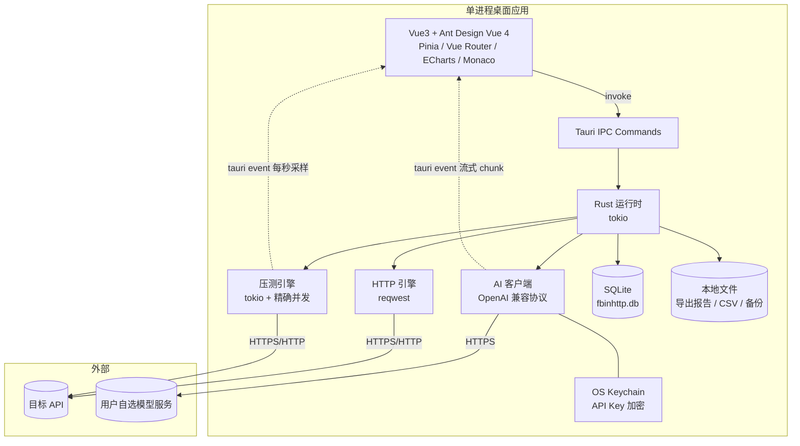

# FbinHttp — 本地版 API 调试与压测工具 技术实现方案

> 版本：v1.0（本地版 · 首个可用版本）
> 更新时间：2026-10-23
> 形态：**单机桌面应用**，下载安装即用，无需注册、无需登录、无需联网
> 技术栈：Tauri 2 + Rust + Vue 3 + Ant Design Vue 4 + SQLite + ECharts
> 原则：先把工具跑起来给人用，砍掉一切账号、权限、云端、付费相关设计

---

## 一、产品定位

### 1.1 一句话描述

一个装在电脑上的 API 调试 + 压测工具：写好请求点发送就能看响应，配好并发点开始就能压测，出报告能导出。

### 1.2 首个版本的边界

| 做 | 不做 |
|---|---|
| 本地发送 HTTP 请求、查看响应 | 注册 / 登录 / 账号体系 |
| 项目、集合、请求的本地管理 | 云端同步、多端一致 |
| 环境变量与变量替换 | 团队、成员、角色、权限 |
| 本地高并发压测 + 实时图表 | 服务端压测、分布式压测 |
| 报告本地保存与导出 | 报告云端存储 |
| 用户自带 Key 的 AI 辅助 | 平台代付、AI 会员、额度计费 |
| 导入 cURL / Postman，导出集合 | 付费、订阅、套餐、功能墙 |
| Windows / macOS 安装包 | 自动更新、崩溃上报（后续再说） |

### 1.3 目标用户与使用方式

- 单个人在自己电脑上用，数据全在自己机器里
- 装完打开就能用，首次启动自动建库，不弹注册
- 唯一需要联网的场景：发送请求到目标 API、使用 AI 助手（取决于目标服务）

---

## 二、整体架构

### 2.1 架构图



### 2.2 为什么这么设计

| 决策 | 原因 |
|---|---|
| **不做后端** | 首个版本的目标是验证"这东西好不好用"，后端只会增加部署与账号成本 |
| **压测放在 Rust 层** | 不经过浏览器沙箱，可精确控制并发；`reqwest` 连接池复用，高并发下性能远好于 JS |
| **数据存 SQLite** | 单文件、免安装、可备份、可直接拷走；查询与分页能力足够 |
| **AI 走用户自己的 Key** | 平台零成本，用户可用自己已有的任意兼容 OpenAI 协议的服务 |
| **前端只做展示与编辑** | 网络、存储、压测全在 Rust 侧，前端不碰系统能力 |

### 2.3 技术栈

| 层 | 技术 | 版本 | 用途 |
|---|---|---|---|
| 桌面壳 | Tauri | 2.x | 窗口、IPC、打包、文件对话框 |
| 核心逻辑 | Rust | 2021 edition | 请求、压测、AI、SQLite、导出 |
| 异步运行时 | tokio | 1.x | 压测并发、AI 流式、HTTP |
| HTTP 客户端 | reqwest | 0.12 | 支持 HTTP/2、连接池、自签证书开关 |
| 本地数据库 | rusqlite（bundled） | 0.32 | 免外部依赖，随应用编译 |
| Key 加密 | keyring + aes-gcm | 3.x / 0.10 | 主密钥进系统钥匙串，密文进 SQLite |
| 前端框架 | Vue | 3.4+ | `<script setup>` |
| 组件库 | Ant Design Vue | 4.x | 表单、表格、树、抽屉 |
| 状态管理 | Pinia | 2.x | 项目 / 环境 / 请求 / 压测状态 |
| 路由 | Vue Router | 4.x | 页面切换 |
| 图表 | ECharts | 5.x | 压测实时曲线、报告图表 |
| 编辑器 | Monaco Editor | 0.50+ | JSON / Script 编辑 + 高亮 |
| 表格导出 | exceljs | 4.x | 前端生成 Excel（MIT） |
| 构建 | Vite | 5.x | 开发与打包 |

---

## 三、本地数据设计

### 3.1 数据存放位置

| 项 | Windows | macOS |
|---|---|---|
| 数据库 | `%APPDATA%\FbinHttp\fbinhttp.db` | `~/Library/Application Support/FbinHttp/fbinhttp.db` |
| 导出文件 | 默认 `文档/FbinHttp/` | `~/Documents/FbinHttp/` |
| 日志 | `%APPDATA%\FbinHttp\logs\` | `~/Library/Logs/FbinHttp/` |
| 备份 | `%APPDATA%\FbinHttp\backup\` | 同应用目录下 `backup/` |

路径统一由 Rust 侧 `app.path().app_data_dir()` 解析，前端不硬编码。

### 3.2 表结构（SQLite）

```sql
PRAGMA journal_mode = WAL;
PRAGMA foreign_keys = ON;

-- 项目
CREATE TABLE projects (
    id          INTEGER PRIMARY KEY AUTOINCREMENT,
    name        TEXT NOT NULL,
    description TEXT,
    color       TEXT,
    sort_order  INTEGER DEFAULT 0,
    created_at  INTEGER NOT NULL,   -- Unix 毫秒
    updated_at  INTEGER NOT NULL
);

-- 集合（文件夹，可无限嵌套）
CREATE TABLE collections (
    id          INTEGER PRIMARY KEY AUTOINCREMENT,
    project_id  INTEGER NOT NULL REFERENCES projects(id) ON DELETE CASCADE,
    parent_id   INTEGER REFERENCES collections(id) ON DELETE CASCADE,
    name        TEXT NOT NULL,
    sort_order  INTEGER DEFAULT 0,
    created_at  INTEGER NOT NULL,
    updated_at  INTEGER NOT NULL
);

-- 请求
CREATE TABLE requests (
    id            INTEGER PRIMARY KEY AUTOINCREMENT,
    collection_id INTEGER NOT NULL REFERENCES collections(id) ON DELETE CASCADE,
    name          TEXT NOT NULL,
    method        TEXT NOT NULL DEFAULT 'GET',
    url           TEXT NOT NULL,
    headers       TEXT,              -- JSON: [{key,value,enabled}]
    params        TEXT,              -- JSON: Query 参数
    body_type     TEXT DEFAULT 'json', -- json/form-data/x-www-form-urlencoded/raw/none
    body          TEXT,
    pre_script    TEXT,              -- Groovy 前置脚本
    post_script   TEXT,              -- Groovy 后置脚本
    assertions    TEXT,              -- JSON: 断言配置
    sort_order    INTEGER DEFAULT 0,
    created_at    INTEGER NOT NULL,
    updated_at    INTEGER NOT NULL
);

-- 环境
CREATE TABLE environments (
    id          INTEGER PRIMARY KEY AUTOINCREMENT,
    project_id  INTEGER NOT NULL REFERENCES projects(id) ON DELETE CASCADE,
    name        TEXT NOT NULL,
    is_active   INTEGER DEFAULT 0,
    created_at  INTEGER NOT NULL
);

-- 环境变量
CREATE TABLE env_variables (
    id         INTEGER PRIMARY KEY AUTOINCREMENT,
    env_id     INTEGER NOT NULL REFERENCES environments(id) ON DELETE CASCADE,
    key        TEXT NOT NULL,
    value      TEXT,
    is_secret  INTEGER DEFAULT 0,   -- 1=界面打码显示
    sort_order INTEGER DEFAULT 0
);

-- 压测计划
CREATE TABLE test_plans (
    id              INTEGER PRIMARY KEY AUTOINCREMENT,
    project_id      INTEGER NOT NULL REFERENCES projects(id) ON DELETE CASCADE,
    request_id      INTEGER NOT NULL REFERENCES requests(id) ON DELETE CASCADE,
    name            TEXT NOT NULL,
    concurrent      INTEGER DEFAULT 10,
    duration_sec    INTEGER DEFAULT 60,
    ramp_up_sec     INTEGER DEFAULT 10,
    think_time_ms   INTEGER DEFAULT 0,
    timeout_ms      INTEGER DEFAULT 30000,
    params_config   TEXT,           -- JSON: 参数化配置
    created_at      INTEGER NOT NULL
);

-- 压测报告
CREATE TABLE test_reports (
    id             INTEGER PRIMARY KEY AUTOINCREMENT,
    plan_id        INTEGER,
    plan_name      TEXT NOT NULL,
    request_id     INTEGER,
    total_requests INTEGER DEFAULT 0,
    success_count  INTEGER DEFAULT 0,
    error_count    INTEGER DEFAULT 0,
    avg_rt         REAL DEFAULT 0,
    min_rt         REAL DEFAULT 0,
    max_rt         REAL DEFAULT 0,
    p50_rt         REAL DEFAULT 0,
    p95_rt         REAL DEFAULT 0,
    p99_rt         REAL DEFAULT 0,
    max_qps        REAL DEFAULT 0,
    avg_qps        REAL DEFAULT 0,
    error_rate     REAL DEFAULT 0,
    concurrency    INTEGER DEFAULT 0,
    status         TEXT DEFAULT 'completed', -- completed/stopped/failed
    start_time     INTEGER,
    end_time       INTEGER,
    created_at     INTEGER NOT NULL
);

-- 报告采样（每秒一条）
CREATE TABLE report_samples (
    id            INTEGER PRIMARY KEY AUTOINCREMENT,
    report_id     INTEGER NOT NULL REFERENCES test_reports(id) ON DELETE CASCADE,
    elapsed_sec   INTEGER NOT NULL,
    concurrent    INTEGER DEFAULT 0,
    qps           REAL DEFAULT 0,
    avg_rt        REAL DEFAULT 0,
    p95_rt        REAL DEFAULT 0,
    p99_rt        REAL DEFAULT 0,
    success_count INTEGER DEFAULT 0,
    error_count   INTEGER DEFAULT 0
);

-- 报告错误明细（最多保留前 500 条，避免撑爆）
CREATE TABLE report_errors (
    id              INTEGER PRIMARY KEY AUTOINCREMENT,
    report_id       INTEGER NOT NULL REFERENCES test_reports(id) ON DELETE CASCADE,
    elapsed_sec     INTEGER,
    error_type      TEXT,           -- TIMEOUT/CONNECT/HTTP_ERROR/SCRIPT
    error_message   TEXT,
    request_url     TEXT,
    response_status INTEGER,
    response_body   TEXT
);

-- 请求历史（本地，最多保留最近 100000 条）
CREATE TABLE request_history (
    id          INTEGER PRIMARY KEY AUTOINCREMENT,
    request_id  INTEGER,
    request_name TEXT,
    method      TEXT,
    url         TEXT,
    status_code INTEGER,
    duration_ms INTEGER,
    created_at  INTEGER NOT NULL
);

-- AI Provider（Key 加密存储）
CREATE TABLE ai_providers (
    id            INTEGER PRIMARY KEY AUTOINCREMENT,
    name          TEXT NOT NULL,
    base_url      TEXT NOT NULL,
    model         TEXT NOT NULL,
    api_key_enc   TEXT,             -- AES-GCM 密文；明文 Key 永不落库
    extra_headers TEXT,             -- JSON
    temperature   REAL DEFAULT 0.3,
    is_default    INTEGER DEFAULT 0,
    enabled       INTEGER DEFAULT 1,
    created_at    INTEGER NOT NULL,
    updated_at    INTEGER NOT NULL
);

-- AI 会话（可选是否记录）
CREATE TABLE ai_conversations (
    id           INTEGER PRIMARY KEY AUTOINCREMENT,
    provider_id  INTEGER,
    scene        TEXT,
    prompt       TEXT,
    response     TEXT,
    token_input  INTEGER DEFAULT 0,
    token_output INTEGER DEFAULT 0,
    created_at   INTEGER NOT NULL
);

-- 索引
CREATE INDEX idx_collections_project   ON collections(project_id, parent_id);
CREATE INDEX idx_requests_collection   ON requests(collection_id);
CREATE INDEX idx_env_variables_env     ON env_variables(env_id);
CREATE INDEX idx_samples_report        ON report_samples(report_id, elapsed_sec);
CREATE INDEX idx_errors_report         ON report_errors(report_id);
CREATE INDEX idx_history_created       ON request_history(created_at DESC);
CREATE INDEX idx_reports_created       ON test_reports(created_at DESC);
```

### 3.3 数据清理（本地规则）

应用启动时检查一次，按下列规则清理，避免长期使用后库变大：

| 表 | 保留策略 |
|---|---|
| `request_history` | 只留最近 100000 条 |
| `report_samples` / `report_errors` | 超过 90 天的报告一并删除采样与错误明细 |
| `ai_conversations` | 默认不记录；开启后只留最近 200 条 |
| 数据库文件 | 每次启动前若 `fbinhttp.db` > 500MB，提示用户到设置页做一次清理 |

### 3.4 备份与恢复

- 设置页提供「导出备份」：把 `fbinhttp.db` 复制到用户选择的位置，文件名带日期
- 提供「从备份恢复」：选择 `.db` 文件 → 关闭当前连接 → 覆盖 → 重启应用
- 暂不做自动定时备份（后续版本再加）

---

## 四、核心功能设计

### 4.1 请求调试

**能力**：
- 支持方法 GET/POST/PUT/PATCH/DELETE/HEAD/OPTIONS
- URL 支持 `{{变量}}` 替换，自动拆分 Query 参数
- Headers：表格编辑，可单条启用/禁用
- Body 六种模式：`json` / `graphql` / `form-data`（multipart，支持文件字段）/ `x-www-form-urlencoded` / `binary`（本地文件二进制上传）/ `raw`
- JSON Body 与 Postman 兼容：允许 `//` 行注释与 `/* */` 块注释，`Ctrl / ⌘ + /` 切换选中行注释，编辑器按注释 / 字段名 / 字符串 / 数字 / `{{变量}}` 着色；发送前由 Rust `util::strip_json_comments` 剥离注释（手动发送、AI 发送与压测同一套规则），字符串里的 `https://` 不会被误删
- 认证：Bearer / Basic / API Key（header 或 query）/ OAuth2 Client Credentials（一键获取令牌），手写 `Authorization` 头优先
- Cookie：按 RFC 6265 解析 Set-Cookie 入库，按域名 / 路径 / Secure 自动携带，可手动维护与清空
- 代理与 mTLS：全局设置支持 HTTP / SOCKS5 代理与客户端证书（`*.pfx` / `*.p12`），保存后重建 HttpClient
- 支持自签证书跳过校验（单请求开关，默认关闭）
- 响应展示：状态码、耗时、大小、Headers、Body（JSON 自动格式化 + 折叠树）、Cookie
- 响应体 > 5MB 时截断展示并提示
- 响应体可另存为本地文件，可按行与历史运行或自定义文本做差异对比
- 历史记录：最近 100000 条，点击可重新载入

**执行路径**：Vue → `invoke('send_http_request')` → Rust `reqwest` → 目标 API → 返回结构化结果 → 写入 `request_history`。

### 4.2 变量与脚本

**变量替换**（在 Rust 侧统一渲染，前端和压测共用同一实现）：

| 语法 | 说明 |
|---|---|
| `{{base_url}}` | 当前激活环境变量 |
| `{{timestamp}}` | 毫秒时间戳 |
| `{{randomInt(1,1000)}}` | 随机整数 |
| `{{randomString(8)}}` | 随机字符串 |
| `{{autoIncrement}}` | 会话内自增 |
| `{{uuid}}` | UUID v4 |
| `{{csv.col}}` | 压测时从 CSV 数据文件按行读取 |

**脚本**：用 **JavaScript**，通过 Rust 侧 `boa_engine` 嵌入执行（纯 Rust 实现的 JS 引擎，不引入 JVM 或 Node）。

- 前置脚本：改请求（`request.headers.set(...)`、`request.body = ...`）
- 后置脚本：读响应、写会话变量（`vars.set("token", response.json().data.token)`）
- 脚本沙箱：不提供文件、网络、进程能力，只有 `request` / `response` / `vars` / `env` 四个对象
- 执行超时 3 秒，超时中断并提示

```javascript
// 后置脚本示例
const body = response.json()
vars.set('token', body.data.token)
vars.set('userId', body.data.userId)
```

### 4.3 压测引擎（Rust）

#### 并发模型

- 用 `tokio::sync::Semaphore` 表示"可用的在途请求额度"
- 每个任务在开始时 `acquire_owned`，请求真正返回后才释放
- 因此 **实际并发 = 设定并发**，不会因为任务快速返回而超发
- 预热（ramp-up）按每秒线性递增目标并发

#### 核心实现骨架

```rust
#[derive(Debug, Clone, serde::Deserialize)]
pub struct LoadConfig {
    pub plan_id: i64,
    pub url: String,
    pub method: String,
    pub headers: Vec<(String, String)>,
    pub body: Option<String>,
    pub concurrent: u32,
    pub duration_sec: u64,
    pub ramp_up_sec: u64,
    pub think_time_ms: u64,
    pub timeout_ms: u64,
    pub csv_file: Option<String>,
    pub insecure: bool,
}

/// 运行期统计（原子操作，读写不用锁）
pub struct LoadState {
    pub running: atomic::AtomicU32,
    pub success: atomic::AtomicU64,
    pub error: atomic::AtomicU64,
    pub total_rt: atomic::AtomicU64,
    pub rts: parking_lot::Mutex<Vec<u32>>,   // 用于 P50/P95/P99
}

#[tauri::command]
pub async fn start_load_test(
    app: tauri::AppHandle,
    state: tauri::State<'_, AppState>,
    config: LoadConfig,
) -> Result<i64, String> {
    let report_id = state.db.create_running_report(&config)?;
    let cancel = CancellationToken::new();
    state.register_cancel(report_id, cancel.clone());

    let app2 = app.clone();
    tauri::async_runtime::spawn(async move {
        let result = run_load(&app2, &config, cancel).await;
        // 落库：report_samples / report_errors / test_reports
        // emit('load.done', { reportId, status })
    });
    Ok(report_id)
}

async fn run_load(
    app: &tauri::AppHandle,
    cfg: &LoadConfig,
    cancel: CancellationToken,
) -> LoadOutcome {
    let client = reqwest::Client::builder()
        .connect_timeout(Duration::from_secs(5))
        .timeout(Duration::from_millis(cfg.timeout_ms))
        .pool_max_idle_per_host(cfg.concurrent as usize * 2)
        .danger_accept_invalid_certs(cfg.insecure)
        .build()
        .unwrap();

    let sem = Arc::new(Semaphore::new(cfg.concurrent as usize));
    let st = Arc::new(LoadState::new());
    let started = Instant::now();

    // 每秒采样任务
    let sampler = spawn_sampler(app.clone(), st.clone(), started, cancel.clone());

    loop {
        if cancel.is_cancelled() || started.elapsed().as_secs() >= cfg.duration_sec {
            break;
        }
        let target = ramp_up_target(cfg.concurrent, cfg.ramp_up_sec, started.elapsed());
        if st.running.load(Ordering::Relaxed) < target {
            let permit = sem.clone().acquire_owned().await.unwrap();
            let client = client.clone();
            let cfg = cfg.clone();
            let st = st.clone();
            tokio::spawn(async move {
                let _p = permit;
                st.running.fetch_add(1, Ordering::Relaxed);
                let r = do_request(&client, &cfg).await;
                st.record(&r);
                st.running.fetch_sub(1, Ordering::Relaxed);
            });
        } else {
            tokio::time::sleep(Duration::from_millis(5)).await;
        }
    }

    // 等待在途请求结束（最多 30s），再做最终汇总
    wait_inflight(&st, Duration::from_secs(30)).await;
    sampler.abort();
    st.summarize()
}
```

#### 采样与推送

- 采样任务每秒读取 `LoadState` 计算：QPS、平均 RT、P95、P99、成功/失败数
- 通过 `app.emit("load.progress", Sample)` 推给前端，ECharts 追加一个点
- 同时插入 `report_samples`，保证应用关闭后报告仍可回放

#### 并发推荐（不给硬限制）

启动前读本机信息，给一个"建议值"，用户可改：

| 机器规格 | 建议并发 |
|---|---|
| ≤ 4 核 / 8GB | 50 |
| 8 核 / 16GB | 200 |
| ≥ 12 核 / 32GB | 500 |

界面同时提示：并发过高时 QPS 可能受本机网卡/端口耗尽影响。

#### 停止

- 前端 `invoke('stop_load_test', { reportId })`
- 通过 `CancellationToken` 立即打断主循环，等待在途请求结束（最多 30s），状态标为 `stopped`

### 4.4 报告与导出

**报告详情页内容**：
- 概览卡片：总请求、成功率、平均/最大 RT、P95/P99、最大 QPS、最大并发
- 曲线：QPS、RT、并发、错误数随时间变化（来自 `report_samples`，可回放）
- 错误明细表：类型、消息、状态码、响应片段
- 请求信息快照：当时用的 URL / Headers / Body（敏感字段打码）

**导出**：
- **HTML**：单文件、内嵌 ECharts 与全部采样数据，双击即可打开，可直接发给人
- **Excel**：概览 sheet + 每秒采样 sheet + 错误明细 sheet
- **CSV**：只导采样数据，方便二次分析

### 4.5 导入与导出

| 能力 | 说明 |
|---|---|
| 导入 cURL | 粘贴 `curl ...` 自动解析成请求 |
| 导入 Postman | 支持 Collection v2.0 / v2.1 JSON |
| 导出 Postman | 把选中集合导出为 Collection v2.1 |
| 导出项目 | 导出为 FbinHttp 自有 JSON（含环境变量），用于换机迁移 |

### 4.6 AI 辅助（用户自带 Key）

#### 原则

- 不内置模型、不代付 Token、不做额度
- 支持三种协议：OpenAI 兼容（`/chat/completions`）、Anthropic（`/v1/messages`）、Gemini（`streamGenerateContent`），一套界面覆盖 DeepSeek、通义千问、Kimi、智谱、Claude、Gemini、Ollama 等
- Key 用 AES-256-GCM 加密（密钥由固定种子 + Key 经 SHA-256 派生）后存本地库，列表只回显掩码，**永不上传任何服务器**
- 采用「工具调用」而不是只把结果填进编辑器：只读工具可自动连续执行（最多 8 轮、单轮 1 个），**所有新建 / 修改 / 删除 / 导入导出 / 发起压测的工具都必须先给方案、经用户确认后执行**
- 未配置服务商时入口仍可见，页面引导去「模型服务」配置，不影响其他功能

#### 实现现状（v1.0.6，含 2026-10-28 更新）

> 本节记录落地结果，与上方早期设计不一致时以本节为准。细节见 skill `fbinhttp-ai`。

| 主题 | 实现 |
|---|---|
| 双模式 | 后端提示词新增「聊天 / 问答」与「操作软件」两种工作模式：闲聊、知识问答、解释代码、写文案直接回答且不调用工具；只要「方案 / 思路 / 模板」也直接输出，不为凑方案去查数据；只有明确指向本机对象或说「帮我查 / 改 / 跑」才进入操作模式 |
| 对话 | Tauri `Channel<AiStreamEvent>` 流式回传 `delta / reasoning / done / error`，三协议共用一套 SSE 解析与 usage 提取；前端累积对象必须 `reactive()`，增量 50ms 合帧刷一次，做到边生成边渲染（对话页与页面内 AI 共用同一套） |
| 系统提示词 | `src-tauri/src/prompts/xiao_hi_system_prompt.md` 由 `include_str!` 编译期嵌入，每次 `ai_chat` 强制插到 `messages[0]`，前端不可覆盖 |
| 工具 | `src/utils/aiTools.ts` 注册 42 个工具；`SCHEMAS` 强校验，`danger` 标记 + `WRITE_TOOLS` 白名单共同决定是否需要确认，结果回灌前脱敏 |
| 写操作确认 | 所有新建 / 修改 / 删除 / 导入导出 / 启动压测的工具都走「模型先给完整计划 → 用户确认 → 调度器再弹 `Modal.confirm` 预览参数 → 执行」；自动执行链路会过滤写入类工具，只能由用户点卡片触发；拒绝结果回灌模型且禁止重试 |
| 压测计划 | 新增 `plan_list` / `plan_get` / `plan_save` / `plan_delete`，生成的 config 与「压测」页 `currentPlanConfig()` 结构完全一致，支持 `stages` 梯度与 SLA 阈值，可保存后在压测页下拉载入 |
| 轮次与去重 | 自动链路上限 8 轮，将用尽时先 `forcedFinal` 要求「禁止调工具、立即给结论」；同一工具 + 同一参数指纹重复命中则复用结果，连续两次强制收尾 |
| 上下文回灌 | 工具结果、纠正指令写入 `messages`（`hidden` 只影响显示）并落库，确保模型下一轮能看到上轮结果，避免无限重查直到轮次耗尽 |
| 原生标记兜底 | `normalizePseudoFence()` 还原 `<fbin-tool>` 伪围栏 → `liftNativeCalls()` 抽取平衡 JSON → 救不回则隐藏并自动纠正（≤2 次）；空工具块直接丢弃 |
| 会话 | `ai_sessions` / `ai_messages` 落库；正文截 8000 字、思考截 2000 字，**用户提问前端另截 1000 字**（`clipStoredPrompt`），附件只存「文件名 + 字符数」摘要 |
| 提问压缩 | 发模型前 `compactPrompt()` 去掉零宽字符、行尾空白、连续空格与多余空行（代码块内保持原样），减少无效 token |
| 审计 | `ai_tool_logs` 每次工具调用一条（参数 / 结果各 2000 字）；`ai_usage_logs` 每次模型调用一条（token、耗时、费用估算、本轮提问），保留 365 天 |
| 费用 | `src/utils/aiPricing.ts` 按模型名正则匹配厂商单价（USD / 1M tokens），界面同时展示美元与人民币估算，匹配不到时标注「默认估算」 |
| 模型目录 | 10 家服务商的 `presetModels` 按官方文档校准（DeepSeek 仅 `deepseek-chat` / `deepseek-reasoner`）；模型下拉改用 `a-auto-complete` 原生展开，未识别服务商时兜底全量列表，仍可手填；编辑服务商回填已保存 Key |
| 报错 | Rust `humanize_api_error` / `humanize_network_error` 把 401/402/403/404/429/5xx、模型不支持、DNS/超时/证书问题统一转中文 |
| 页面内 AI | `stores/aiAssist.ts` + `components/AiAssistDrawer.vue` + `utils/aiScenarios.ts`，覆盖工作台洞察、项目体检、接口分析（解释响应 / 生成断言 / 生成后置脚本 / 优化定义）、环境体检、压测计划、批量运行分析、历史诊断、报告解读 8 个入口，均为只读建议且不调工具 |
| 入口 | 右侧屏幕垂直居中的悬浮机器人；`/ai/usage` 用量统计页；设置页「AI 辅助（小HI）」卡片与首页使用说明第 07 步均提供入口 |

#### 能力清单

| 场景 | 入口 | 输入 | 输出 |
|---|---|---|---|
| 日常聊天 / 答疑 | 小HI 对话页 | "HTTP/2 和 HTTP/1.1 有什么区别" | 直接回答，不调用工具 |
| 出方案 | 小HI 对话页 | "给我一份下单接口的压测方案" | 目标、模式、并发、时长、爬坡、SLA、观察指标与风险 |
| 生成请求 | 新建请求 / 命令面板 | "帮我建一个登录接口，POST JSON，字段 username/password" | 方法、URL、Headers、Body（确认后落库） |
| 生成压测计划 | 小HI / 压测页 AI 生成计划 | "按基准接口做一份压测计划" | 读接口 → 完整计划 → 确认 → `plan_save` |
| 生成脚本 | 请求编辑器脚本 Tab | 当前请求上下文 + 需求 | JavaScript 脚本 |
| 生成参数 | 压测参数化面板 | "生成 100 条手机号" | CSV 内容 / 变量表达式 |
| 生成断言 | 断言 Tab | "断言 status=200 且 body.code=0" | 断言配置项 |
| 错误诊断 | 报告错误明细 / 历史页 AI 分析 | 错误类型、状态码、响应片段 | 可能原因 + 排查建议 |
| 响应解读 | 响应区「AI 解读」/ 接口编辑器 AI 分析 | 截断后的响应 JSON | 字段说明、结构建议 |
| 工作台洞察 | 工作台 AI 洞察 | 项目 / 接口 / 报告 / 历史统计 | 使用情况分析、风险与建议 |
| 环境体检 | 环境页 AI 体检 | 各环境变量（密钥打码） | 命名规范、缺失变量、安全隐患 |

> 并发 / 时长由 AI 先给出建议值并说明依据（默认 10 并发 × 30 秒起步），但必须由用户确认后才保存计划或开跑；不允许模型直接发起压力更大的测试。

#### 调用实现

```rust
// 统一走 OpenAI 兼容协议，非流式与流式共用一套
#[tauri::command]
pub async fn ai_chat(
    app: tauri::AppHandle,
    provider_id: i64,
    scene: String,
    intent: String,
    context: serde_json::Value,
) -> Result<(), String> {
    let provider = AiStore::load(provider_id)?;          // 解密 Key
    let messages = prompts::build(&scene, &context, &intent);

    let mut req = reqwest::Client::new()
        .post(format!("{}/chat/completions", provider.base_url))
        .bearer_auth(provider.api_key)
        .json(&json!({
            "model": provider.model,
            "messages": messages,
            "temperature": provider.temperature,
            "stream": true
        }));

    for (k, v) in provider.extra_headers { req = req.header(k, v); }

    let mut stream = req.send().await.map_err(err)?.bytes_stream();
    while let Some(chunk) = stream.next().await {
        for delta in parse_sse_delta(&chunk?) {
            app.emit("ai.chunk", ChatChunk { delta, done: false }).ok();
        }
    }
    app.emit("ai.chunk", ChatChunk { delta: String::new(), done: true }).ok();
    Ok(())
}

#[tauri::command]
pub async fn ai_test_provider(id: i64) -> Result<ProviderInfo, String> { /* 发一次最小请求探活 */ }

#[tauri::command]
pub async fn ai_save_provider(cfg: ProviderConfig) -> Result<i64, String> { /* AES-GCM 加密后入库 */ }
```

#### Prompt 安全

| 措施 | 做法 |
|---|---|
| 敏感字段不外发 | Headers 里的 `Authorization`、`Cookie`、`X-Api-Key` 替换为 `***` |
| 密钥变量不外发 | `is_secret=1` 的环境变量只发变量名，不发值 |
| 响应截断 | 超过 8KB 时按字段结构截断，并标注"已截断" |
| Prompt 注入 | system 段固定由代码提供，用户内容用明确分隔符包裹，不允许用户覆盖 system |
| 发送前可审阅 | 面板内可展开「将发送的内容」，用户确认后再发 |
| 生成脚本检查 | 保存前静态扫描危险 token（`require`、`fetch`、`eval`、`Function`、`process`、`fs`），命中则二次确认 |

#### 配置项

| 字段 | 说明 |
|---|---|
| 名称 | 如「我的 DeepSeek」 |
| Base URL | 如 `https://api.deepseek.com/v1`、`http://localhost:11434/v1`（Ollama） |
| 模型 | 如 `deepseek-chat`、`qwen2.5:7b` |
| API Key | 密码框输入；保存后只显示 `sk-****abcd` |
| 额外请求头 | JSON，适配自建网关 |
| 温度 | 默认 0.3 |
| 测试连接 | 显示连通性与耗时 |

支持多个 Provider，可设默认。

---

## 五、Tauri IPC 层设计

### 5.1 命令清单

| Command | 入参 | 返回 | 说明 |
|---|---|---|---|
| `project_list` | — | `Vec<Project>` | 项目列表 |
| `project_create` | `{ name, description? }` | `Project` | 新建 |
| `project_update` | `{ id, name?, description?, color? }` | `()` | 更新 |
| `project_delete` | `{ id }` | `()` | 级联删除 |
| `collection_tree` | `{ projectId }` | `Vec<TreeNode>` | 一次返回整棵树 |
| `collection_create/update/delete/sort` | 见参数 | — | 集合维护 |
| `collection_reorder` | `{ projectId, parentId, ids }` | `()` | 同级集合拖拽排序 |
| `request_list` | `{ collectionId }` | `Vec<Request>` | 请求列表 |
| `request_get` | `{ id }` | `Request` | 详情 |
| `request_save` | `{ request }` | `Request` | 新建或更新 |
| `request_delete` | `{ id }` | `()` | 删除 |
| `request_reorder` | `{ collectionId, ids }` | `()` | 请求拖拽排序 |
| `send_http_request` | `{ req, envId, insecure }` | `HttpResponse` | **核心**：本地发送 |
| `oauth2_token` | `{ config, insecure? }` | `access_token` | OAuth2 Client Credentials |
| `cookie_list / cookie_save / cookie_delete / cookie_clear` | 见参数 | — | 本机 Cookie 维护 |
| `settings_get / settings_set` | `AppSettings` | `AppSettings` | 代理与客户端证书 |
| `file_read_text / file_write_text` | `{ path, content? }` | 文本 | Runner 数据与响应另存 |
| `history_list` | `{ page, size }` | `Page<History>` | 历史 |
| `history_stats / data_cleanup` | 见参数 | 统计 / 清理结果 | 历史清理 |
| `env_list` | `{ projectId }` | `Vec<Environment>` | 环境 |
| `env_create/update/delete/activate` | 见参数 | — | 环境维护 |
| `env_var_save` | `{ envId, vars[] }` | — | 批量保存变量 |
| `plan_list / plan_save / plan_delete` | 见参数 | — | 压测计划 |
| `start_load_test` | `LoadConfig` | `reportId` | 启动压测 |
| `stop_load_test` | `{ reportId }` | `()` | 停止 |
| `report_list` | `{ page, size }` | `Page<Report>` | 报告列表 |
| `report_detail` | `{ id }` | `Report + Samples + Errors` | 报告详情 |
| `report_delete` | `{ id }` | `()` | 删除 |
| `report_export_html` | `{ id, path }` | `()` | 导出 HTML |
| `report_export_csv` | `{ id, path }` | `()` | 导出 CSV |
| `import_curl` | `{ text }` | `Request` | 解析 cURL |
| `api_import` | `{ path, projectId? }` | `ImportResult` | 导入 Postman / Apifox 集合 |
| `project_export / project_import` | `{ path }` | `()` / `Project` | 项目 JSON 迁移 |
| `openapi_export / openapi_import` | `{ projectId?, path }` | `()` / `Project` | OpenAPI 3.0 / Swagger 2.0 |
| `ai_provider_list` | — | `Vec<AiProvider>` | 服务商列表（Key 打码） |
| `ai_provider_save` | `AiProviderInput` | `AiProvider` | 新增 / 更新（AES-256-GCM 加密） |
| `ai_provider_delete` | `{ id }` | `()` | 删除 |
| `ai_provider_test` | `{ id }` | `String` | 连通性探活 |
| `ai_chat` | `{ providerId, messages, temperature? }` + `Channel` | 流式 `AiStreamEvent` | 对话（system prompt 由后端注入） |
| `ai_execute` | `{ tool, args }` | `Value` | AI 工具执行代理（敏感工具在前端确认） |
| `ai_session_list / create / rename / delete` | 见参数 | 会话 | 会话维护 |
| `ai_message_list / add / clear` | 见参数 | 消息 | 消息落库与回放（正文/思考截断） |
| `ai_tool_log_add / list / stats / clear` | 见参数 | 流水 | 工具调用审计与准确率 |
| `ai_usage_logs / ai_usage_stats / ai_usage_clear` | `{ days, page, pageSize, ok }` 等 | 分页 / 统计 | 用量、费用与每日趋势 |
| `backup_export` | `{ path }` | `()` | 导出数据库 |
| `backup_restore` | `{ path }` | `()` | 恢复数据库 |

### 5.2 事件清单

| Event | 负载 | 用途 |
|---|---|---|
| `stress:progress` | `StressProgress` | 压测实时指标、阶段与每秒采样 |
| `stress:done` | `StressDone` | 压测结束（含报告 id 与状态） |

AI 对话不走全局事件，改用命令入参里的 `Channel<AiStreamEvent>`，避免多个窗口/会话互相串消息。

### 5.3 IPC 类型契约

- Rust 侧所有出参统一 `Result<T, String>`，错误消息直接可展示
- 前端通过 `src/types/` 下的 TS 接口与 Rust `serde` 结构一一对应
- 关键结构（Request/Response/Report/Sample）在 `src/types/models.ts` 单点定义，Rust 侧字段名用 `#[serde(rename_all = "camelCase")]` 对齐

---

## 六、前端设计

### 6.1 页面与路由

| 路径 | 页面 | 说明 |
|---|---|---|
| `/` | 工作台 | 最近项目、最近请求、快速开始 |
| `/project/:id` | 项目主页 | 左侧集合树 + 右侧请求列表 |
| `/request/:id` | 请求编辑器 | 方法/URL/Headers/Params/Body/脚本/断言 + 响应区 + AI 面板 |
| `/environment/:projectId` | 环境管理 | 环境列表 + 变量表格 |
| `/load/:planId?` | 压测控制台 | 配置 + 实时图表 + 停止按钮 |
| `/report` | 报告中心 | 列表 + 筛选 + 删除 |
| `/report/:id` | 报告详情 | 概览 + 曲线回放 + 错误明细 + 导出 |
| `/settings` | 设置 | AI 配置 / 数据管理 / 关于 |

无登录页、无团队页、无权限相关页面。

### 6.2 布局

```
┌──────────────────────────────────────────────────────┐
│ FbinHttp   全局搜索   环境切换▼          设置 ⚙     │
├──────────┬───────────────────────────────────────────┤
│  侧边栏  │           主内容区（Tab 多标签）            │
│ 项目     │   Workspace ── Load ── Report              │
│ 压测     │                                           │
│ 报告     │                                           │
│ 设置     │                                           │
└──────────┴───────────────────────────────────────────┘
```

### 6.3 状态管理（Pinia）

| Store | 职责 |
|---|---|
| `useProjectStore` | 项目列表、当前项目、集合树 |
| `useRequestStore` | 当前请求草稿、Tab 状态、未保存提示 |
| `useEnvStore` | 环境列表、当前激活环境、变量 |
| `useLoadStore` | 当前压测配置、实时采样缓冲、运行状态 |
| `useAiStore` | Provider 列表、默认 Provider、当前生成任务 |

### 6.4 关键组件

| 组件 | 说明 |
|---|---|
| `CollectionTree.vue` | 拖拽排序、右键菜单、内联重命名 |
| `RequestEditor.vue` | 请求编辑主体，Tab 切换 |
| `ResponsePanel.vue` | 状态/耗时/Headers/Body 树/Cookie/AI 解读 |
| `KeyValueEditor.vue` | Headers / Params / Form 通用表格 |
| `CodeEditor.vue` | Monaco 封装（JSON / JS 高亮） |
| `RealtimeChart.vue` | 压测实时多轴曲线 |
| `ReportChart.vue` | 报告回放曲线 |
| `AiAssistant.vue` | 右侧抽屉，场景切换 + 流式输出 + 采用/放弃 |
| `DangerConfirm.vue` | 删除/覆盖类操作确认 |

---

## 七、打包与发布

### 7.1 构建产物

| 平台 | 产物 | 说明 |
|---|---|---|
| Windows | `.msi` + `.exe`（NSIS） | 双击安装，写开始菜单与桌面快捷方式 |
| macOS | `.dmg` | 拖入 Applications |

### 7.2 打包配置要点

```jsonc
// src-tauri/tauri.conf.json（节选）
{
  "productName": "FbinHttp",
  "version": "1.0.0",
  "identifier": "com.fbinhttp.app", // 旧值为 com.finkmeter.app，启动时自动迁移配置目录
  "app": {
    "windows": [{ "title": "FbinHttp", "width": 1280, "height": 800, "minWidth": 1024, "minHeight": 680 }]
  },
  "bundle": {
    "active": true,
    "targets": ["msi", "nsis", "dmg"],
    "icon": ["icons/32x32.png", "icons/128x128.png", "icons/icon.ico", "icons/icon.icns"],
    "resources": [],
    "windows": { "nsis": { "installMode": "perMachine", "languages": ["SimpChinese"] } }
  },
  "plugins": {
    "dialog": { "open": true, "save": true },
    "fs": { "scope": ["$APPDATA/FbinHttp/**", "$DOCUMENT/FbinHttp/**"] },
    "shell": { "open": true }
  }
}
```

### 7.3 首次启动

1. 解析应用数据目录，不存在则创建
2. 打开/创建 `fbinhttp.db`，执行建表与 `PRAGMA`
3. 若表为空，写入一个示例项目「示例请求」+ 一个「本地环境」（含 `base_url=http://localhost:8080`）
4. 加载设置（AI Provider、主题、默认导出目录）
5. 进入工作台

### 7.4 签名与安装提示

- 首个版本**不做代码签名**（内部试用阶段）
- Windows 首次运行会出现 SmartScreen 提示，需在文档里写明"点『更多信息 → 仍要运行』"
- macOS 未签名需右键打开，或在「系统设置 → 隐私与安全性」中允许

### 7.5 本地构建命令

```powershell
# 安装依赖
npm.cmd install

# 开发（热更新）
npm.cmd run tauri dev

# 打包安装包
npm.cmd run tauri build
```

产物路径：`src-tauri/target/release/bundle/`

---

## 八、开发计划

| 阶段 | 时间 | 交付物 | 验收方式 |
|---|---|---|---|
| **M1 应用骨架 + 请求调试** | 7天 | Tauri+Vue 工程、SQLite 建表、项目/集合/请求 CRUD、本地发送请求、响应展示、历史记录、环境变量 | 装到本机，能建项目发请求看到响应 |
| **M2 压测引擎 + 报告** | 7天 | Rust 压测（精确并发/预热/停止）、实时图表、采样落库、报告详情、HTML/CSV 导出、并发推荐 | 对本地服务压 100 并发，曲线与报告数据一致 |
| **M3 AI 接入** | 4天 | Provider 配置与加密存储、6 个场景、流式面板、Prompt 脱敏、脚本安全扫描 | 用自己的 Key 生成一个可用脚本 |
| **M4 导入导出 + 打包** | 2天 | cURL/Postman 导入、Postman 导出、项目备份恢复、MSI/NSIS/DMG 打包 | 在干净电脑上安装并完成一次完整压测 |

**总工期：约 20 个工作日**

> 范围控制：M1–M4 之外的需求（自动更新、LibreSSL、gRPC、WebSocket 调试、Mock Server、CI 流水线）一律不进首个版本。

---

## 九、验收标准

### 9.1 功能

- [ ] 安装包在干净的 Windows 机器上双击可装、可启动，无报错
- [ ] 启动即用，无注册、无登录、无联网要求
- [ ] 能建项目/集合/请求，拖拽排序，重启后数据仍在
- [ ] 能发送 GET/POST（JSON、form-data、urlencoded），看到状态码、耗时、Headers、格式化 Body
- [ ] 环境变量 `{{var}}` 能正确替换；敏感变量界面打码
- [ ] 能用 JavaScript 前置/后置脚本改请求、取响应、写会话变量
- [ ] 能配压测（并发/时长/预热），实时看到 QPS/RT/并发曲线
- [ ] 能中途停止压测，状态与已采数据正确保存
- [ ] 报告可打开、可回放、可导出 HTML 与 CSV
- [ ] 能导入 cURL 与 Postman 集合
- [ ] 能配置自己的 AI Provider，Key 加密存储、界面打码
- [ ] 能用自然语言生成请求/脚本/参数，结果需手动「采用」
- [ ] 未配置 AI 时入口灰显，不影响其他功能
- [ ] 能导出备份并在另一台机器恢复

### 9.2 性能

| 指标 | 目标 |
|---|---|
| 冷启动到可操作 | < 2.5s |
| 请求列表 1000 条渲染 | < 200ms |
| 压测 500 并发（本机 8 核 16G） | 报告不丢采样、UI 不卡死 |
| 实时曲线刷新 | 每秒 1 帧，延迟 < 200ms |
| 数据库 1 万请求记录 | 打开项目 < 300ms |
| 安装包体积 | < 25MB |

### 9.3 稳定性

- [ ] 压测中关闭窗口，进程能正常退出且不留下脏状态
- [ ] 压测中拔网线，错误类型记为 `CONNECT`，不崩溃
- [ ] 目标 API 超时，单请求按 `timeout_ms` 中断，不堆积
- [ ] 数据库被外部程序占用时，给出可读提示而非白屏

---

## 十、目录结构

```
FbinHttp/
├── package.json
├── vite.config.ts
├── index.html
├── src/                                # Vue 前端
│   ├── main.ts
│   ├── App.vue
│   ├── router/index.ts
│   ├── stores/
│   │   ├── project.ts
│   │   ├── request.ts
│   │   ├── env.ts
│   │   ├── load.ts
│   │   └── ai.ts
│   ├── views/
│   │   ├── Dashboard.vue
│   │   ├── Project.vue
│   │   ├── RequestEditor.vue
│   │   ├── Environment.vue
│   │   ├── LoadConsole.vue
│   │   ├── ReportList.vue
│   │   ├── ReportDetail.vue
│   │   └── Settings.vue
│   ├── components/
│   │   ├── CollectionTree.vue
│   │   ├── RequestForm.vue
│   │   ├── ResponsePanel.vue
│   │   ├── KeyValueEditor.vue
│   │   ├── CodeEditor.vue
│   │   ├── RealtimeChart.vue
│   │   ├── ReportChart.vue
│   │   ├── AiAssistant.vue
│   │   └── DangerConfirm.vue
│   ├── composables/
│   │   ├── useLoadTest.ts        # start/stop + 监听 load.*
│   │   ├── useAi.ts              # ai_chat + 监听 ai.chunk
│   │   └── useDialog.ts
│   ├── api/                       # 全部为 invoke 封装
│   │   ├── project.ts
│   │   ├── request.ts
│   │   ├── environment.ts
│   │   ├── load.ts
│   │   ├── report.ts
│   │   ├── ai.ts
│   │   └── backup.ts
│   ├── types/
│   │   ├── models.ts              # 与 Rust struct 一一对应
│   │   └── events.ts
│   ├── utils/
│   │   ├── format.ts
│   │   └── export.ts              # HTML/Excel 前端生成
│   └── styles/
├── src-tauri/                      # Rust 核心
│   ├── Cargo.toml
│   ├── tauri.conf.json
│   ├── build.rs
│   ├── icons/
│   └── src/
│       ├── main.rs
│       ├── lib.rs
│       ├── state.rs                # AppState：DB 连接池、运行中压测表
│       ├── error.rs
│       ├── commands/
│       │   ├── mod.rs
│       │   ├── project.rs
│       │   ├── collection.rs
│       │   ├── request.rs
│       │   ├── environment.rs
│       │   ├── history.rs
│       │   ├── load.rs
│       │   ├── report.rs
│       │   ├── import_export.rs
│       │   ├── ai.rs
│       │   └── backup.rs
│       ├── http/
│       │   ├── mod.rs              # send_http_request
│       │   ├── template.rs         # {{var}} 渲染
│       │   └── script.rs           # JS 沙箱（boa_engine）
│       ├── load/
│       │   ├── mod.rs
│       │   ├── runner.rs           # 并发调度
│       │   ├── sampler.rs          # 每秒采样 + emit
│       │   ├── stats.rs            # P50/P95/P99
│       │   └── csv.rs              # 参数化数据
│       ├── ai/
│       │   ├── mod.rs
│       │   ├── openai_compat.rs
│       │   ├── prompts.rs
│       │   ├── store.rs            # AES-GCM + keyring
│       │   └── guard.rs            # 危险脚本扫描
│       ├── db/
│       │   ├── mod.rs              # 连接池 + 迁移
│       │   ├── schema.sql
│       │   └── migrate.rs
│       └── util/
│           └── paths.rs
└── README.md
```

---

## 十一、风险与后续演进

### 11.1 首个版本的主要风险

| 风险 | 影响 | 对策 |
|---|---|---|
| 未签名安装包被拦截 | 用户装不上 | 文档写明 SmartScreen / Gatekeeper 绕过步骤 |
| 脚本沙箱能力有限 | 复杂场景写不了 | 首个版本只提供 `request/response/vars/env` 四对象，明确能力边界 |
| 压测受本机端口与网卡限制 | 高并发下 QPS 上不去 | 界面提示建议并发；报告里记录本机信息 |
| SQLite 并发写 | 压测落库与用户操作冲突 | 采样先攒内存，每 5 秒批量事务写入 |
| AI 输出质量参差 | 生成结果不可用 | 只做"填进编辑器"，由用户判断；Prompt 里给足示例 |

### 11.2 明确留出的口子（本版只留位不实现）

| 后续方向 | 预留方式 |
|---|---|
| 云端账号与多端同步 | 数据表已带 `created_at/updated_at`，后续加 `remote_id` 与同步队列即可 |
| 团队协作 | 集合与请求已用 ID 关联，后续加 `owner_id` 不破坏结构 |
| 平台内置模型 | `ai_providers` 已有完整字段，后续插入一条服务端下发的配置即可切换 |
| 多轮 AI 对话 | `ai_conversations` 已按 `scene` 归档，可直接扩展为会话表 |
| 自动更新 | `tauri.conf.json` 已留 `bundle` 配置，接 updater 插件即可 |
| WebSocket / gRPC 调试 | 请求表已按 `method/body_type` 扩展设计，加类型枚举即可 |

---

## 附录 A：Rust 依赖清单

```toml
[package]
name = "fbinhttp"
version = "1.0.0"
edition = "2021"

[lib]
name = "fbinhttp_lib"
crate-type = ["staticlib", "cdylib", "rlib"]

[build-dependencies]
tauri-build = { version = "2", features = [] }

[dependencies]
tauri = { version = "2", features = [] }
tauri-plugin-dialog = "2"
tauri-plugin-fs = "2"
tauri-plugin-shell = "2"
serde = { version = "1", features = ["derive"] }
serde_json = "1"
tokio = { version = "1", features = ["full"] }
reqwest = { version = "0.12", default-features = false, features = [
    "json", "rustls-tls", "stream", "gzip", "cookies"
] }
rusqlite = { version = "0.32", features = ["bundled"] }
r2d2 = "0.8"
r2d2_sqlite = "0.25"
parking_lot = "0.12"
chrono = "0.4"
uuid = { version = "1", features = ["v4"] }
aes-gcm = "0.10"
base64 = "0.22"
keyring = "3"
boa_engine = "0.20"
tokio-util = "0.7"
futures-util = "0.3"
thiserror = "2"
log = "0.4"
tracing = "0.1"
tracing-subscriber = { version = "0.3", features = ["env-filter"] }
```

---

## 附录 B：前端依赖清单

```json
{
  "dependencies": {
    "vue": "^3.4.0",
    "vue-router": "^4.4.0",
    "pinia": "^2.2.0",
    "ant-design-vue": "^4.2.0",
    "@ant-design/icons-vue": "^7.0.0",
    "echarts": "^5.5.0",
    "monaco-editor": "^0.50.0",
    "exceljs": "^4.4.0",
    "@tauri-apps/api": "^2.0.0",
    "@tauri-apps/plugin-dialog": "^2.0.0",
    "@tauri-apps/plugin-fs": "^2.0.0"
  },
  "devDependencies": {
    "vite": "^5.4.0",
    "@vitejs/plugin-vue": "^5.1.0",
    "typescript": "^5.5.0",
    "vue-tsc": "^2.0.0",
    "@tauri-apps/cli": "^2.0.0"
  }
}
```

---

## 附录 C：AI Prompt 模板（节选）

```rust
// src-tauri/src/ai/prompts.rs

pub const SCRIPT_GEN: &str = r#"
你是 FbinHttp 的脚本助手。只输出 JavaScript 代码，不要解释，不要用 Markdown 代码块包裹。

【可用对象】
- request.method / request.url / request.headers / request.body
- response.status / response.headers / response.body
- vars：会话变量，vars.set(key, value) / vars.get(key)
- env：环境变量，只读

【当前请求】
method: {{method}}
url: {{url}}
headers: {{headers}}
body: {{body}}

【用户需求】
{{intent}}

【约束】
1. 不得使用 require / import / fetch / XMLHttpRequest / eval / Function / process / fs
2. 必须 try/catch，异常写入 vars.set('scriptError', e.message)
3. 只做数据处理，不发请求、不读写文件
"#;

pub const REQUEST_GEN: &str = r#"
你是 API 调试助手。根据用户描述生成一个 HTTP 请求，只输出 JSON，结构：
{ "method": "", "url": "", "headers": [{"key":"","value":""}], "bodyType": "json|none|form", "body": "" }

不要输出解释。URL 中的主机部分用 {{base_url}} 占位。

用户描述：{{intent}}
"#;
```

---

## 附录 D：压测统计计算说明

```text
QPS            = 该秒内完成的请求数
平均 RT         = 该秒内所有完成请求耗时的算术平均
P50/P95/P99    = 该秒内完成请求耗时的分位数（升序取对应位置）
成功率          = 成功请求 / 总请求（2xx-3xx 视为成功，可配置 4xx 是否计入）
最大并发        = 运行期间 running 的最大值
```

分位数用最简单可靠的方式实现：采样窗口内把 RT 排序后按 `ceil(p * n) - 1` 取值；单秒样本量不大，性能无压力。全部完成后再对整体数据算一次总 P95/P99 写入报告。
